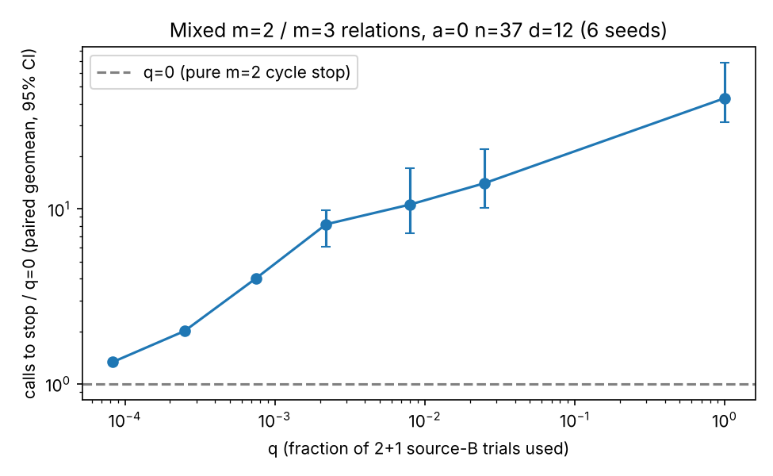

# Structured hybrid at m=3: mixed m=2 / 2+1 relations, cycle stop, a=0 n=37

Exploratory, local run (no AWS identity in this session; not an isolab-eks run). Not a leaderboard row (validation gate not met).

## Question
Can feeding the cycle-stop echelon with a mixture of two-summand relations (source A) and three-summand "2+1" relations (source B, a fraction q of the base-point/sign trials) beat the pure two-summand cycle stop (q=0)? Curve: GF(2^37) Koblitz a=0 (cofactor 596), d=12, K=2011, 8 q values x 6 seeds, 48 runs, all verified (`ic_verified`, `rho_verified` true; bad_t = inconsistent = 0). Instrument checks: q=0 reproduces the merged m=2 trial counts 6/6; 96/96 small-n records verified.

## Prediction (frozen before the sweep, PROTOCOL.md)
Calls to stop rise monotonically with q; no q beats q=0; q=1 is near pure m=3 (~94.7 M calls from #3212). **Outcome: confirmed on all three.**

## Result (analysis.txt, ratios.csv)
| q | mean calls | vs q=0 (geomean, 95% CI) | rels A / B | closed by |
|---|---|---|---|---|
| 0 | 2.44 M | 1 | 142 / 0 | A 6/6 |
| 0.000083 | 3.26 M | 1.33 | 142 / 48 | A 6/6 |
| 0.00025 | 4.90 M | 2.01 | 142 / 148 | A 6/6 |
| 0.00075 | 9.80 M | 4.02 | 142 / 442 | A 6/6 |
| 0.0022 | 19.5 M | 8.2 (6.1-9.8) | 115 / 1032 | A 4, B 2 |
| 0.008 | 24.6 M | 10.6 (7.3-17.1) | 43 / 1416 | B 6/6 |
| 0.025 | 31.0 M | 14.0 (10.1-21.9) | 20 / 1821 | B 6/6 |
| 1 | 94.7 M | 42.9 (31.5-68.2) | 2 / 5550 | B 6/6 |

Monotone in q; no q is below 1. For q <= 0.00075 the stop is still closed by two-summand rows, so the ratio is a pure cost overhead of the extra trials (seed-independent, hence the degenerate intervals there). The mixed rows never made a short dependency appear earlier: the 3-term rows need ~0.9K relations to close (rank ~1850 at stop) while 2-term rows close at 142. q=1 reproduces pure m=3 (94.68 M vs 94.7 M).

## Analytic side result (hybrid_estimate.csv)
Hybrid XL (guess g bits, then XL on the descended S4 system) has cost 2^g * M^2 minimised at pure enumeration of V^3. Heuristic table, log2 cost at n=37: best hybrid 36.0, pure XL 69.6, 2+1 split 23.3. The 2+1 split is the cheapest m=3 route per relation, and it still loses at the stop.

## Conclusion
No structured hybrid improves on the two-summand cycle stop at n=37; best measured algebraic variant stays q=0 (about 7,700x the matched rho at d=12, see earlier reports). This is a negative result, not an improvement; gap to rho unchanged.

## Limits
6 seeds per q; only the 2+1 construction used as source B; mixing weights q not optimised beyond the grid; a=0 n=37 only; local run.

