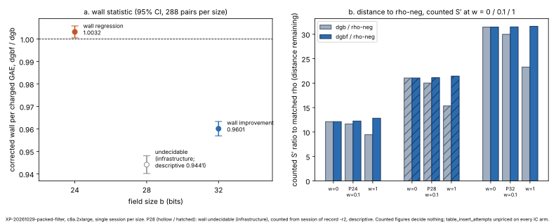

# XP-20261029-packed-filter: membership filter on the packed pair table

**Class:** engineering (constant). **Protocol:** [`backlog/XP-20261029-packed-filter/PROTOCOL.md`](../../backlog/XP-20261029-packed-filter/PROTOCOL.md), frozen at `f870408c17`.
**Decisions:**
- `DEC-20261029-5eb8e6`: the verdict, [`cards/VERDICT-P32.md`](cards/VERDICT-P32.md);
- `DEC-20261030-04fe6d`: the evidence review, support, [`cards/REVIEW-P32.md`](cards/REVIEW-P32.md);
- corrections `CORR-20261030-1e501e` and `CORR-20261030-1153f8`.

**Figure:** [`figures/summary.svg`](figures/summary.svg) (data [`figures/summary.data.json`](figures/summary.data.json), source [`figures/plot_summary.py`](figures/plot_summary.py)). **PDF:** [`REPORT.pdf`](REPORT.pdf).

## What was compared

**Arms.** `mitm-prime-blocked:m=2,filter=1` (`dgbf`) against `mitm-prime-blocked:m=2` (`dgb`), with position and A/A controls `dgbf-edge` and `dgb-aa`. Each size ran two sessions:
- a **wall** session (four IC arms, interleaved blocks);
- a **counted** session that adds the matched rho reference `rho-neg` (`rho.negation`) and its A/A arm `rho-neg-aa`.

**Fixed conditions:** host class c8a.2xlarge (AMD EPYC 9R45) on EKS; image `32144a29e437376b9bf8b902aef4ba6b9cc723a15f01d296fb7b09eb131b817b`; ecbench sha256 `21701be6c420c3507a81767ed20f759e230f1fe5ec002ef3f7bb63a9c0b64503` from `3271a25d02`. The run used N_inc 1,024, `targets = stride-renew-deferred-guard`, `incremental-gauss` and the packed layout (p < 2³², at most 2,048 signed points). Each size ran two curves, 6 rounds of 24 targets per curve and 288 measured pairs.

**Decision statistic** (PROTOCOL §6.2): the whole-solve wall per charged GAE, `dgbf / dgb`, corrected by the A/A ratio `dgb-aa / dgb`. It reads as an improvement when the corrected 95% upper bound is below 1, and as a regression when the lower bound is above 1.

## Results, per size (different curves; not a fitted scaling)

| b | curves | standing | corrected `dgbf / dgb` [95%] | `dgb / rho-neg` (S′, w = 0 / 0.1 / 1) | `dgbf / rho-neg` (S′) | `dgbf / dgb` (S′) |
|--:|:--|:--|:--|:--|:--|:--|
| 24 | `icv1-fp24-t217-e1fbffd2`, `icv1-fp24-tm567-4accd0e8` | regression (decided) | 1.0032 [1.0006, 1.0058] | 12.12 / 11.65 / 9.45 | 12.12 / 12.24 / 12.82 | 1.0 / 1.0506 / 1.3560 |
| 28 | (§3 curves) | **undecidable (infrastructure)**; counted from the `-r2` session of record, descriptive | descriptive only: 0.9441 [0.9402, 0.9481] | 21.04 / 20.02 / 15.34 | 21.04 / 21.12 / 21.44 | 1.0 / 1.0548 / 1.3980 |
| 32 | `icv1-fp32-t89141-95879fe3`, `icv1-fp32-tm68303-f902d2f0` | **improvement: decided under the frozen rule, validated** (independent recomputation and replay, TASK-20261029-654f73; DEC-20261030-04fe6d), single session, not replicated | **0.9601 [0.9569, 0.9633]** | 31.47 / 29.99 / 23.28 | 31.47 / 31.50 / 31.63 | 1.0 / 1.0505 / 1.3586 |

**Sources.**
- The wall figures come from each size's native `ecbench compare` output, `P*/wall/analysis/compare-dgb__dgbf-w0.json` (`wall.corrected_ratio`, `wall.corrected_ci95`).
- The counted S′ figures for P24 and P32 come from the validator's [`validation/code/out/j4.json`](validation/code/out/j4.json). For P28 they come from [`validation/validator-report.json`](validation/validator-report.json) → `p28_counted_session_of_record.sprime`.
- S′ = (band.rs priced GAE at w + w × `table_filter_bit_sets`) / √r, with w GAE per unpriced native operation (PROTOCOL §5).

### 32 bits: a wall-clock component speed-up

**The result.** Corrected `dgbf / dgb` is **0.9601 [0.9569, 0.9633]**. That is 3.99% less whole-solve wall per charged GAE (95%: 3.67% to 4.31%), at identical charged GAE.
- The time includes the filter's own build pass.
- The scope is the fixed conditions above: one session and 288 pairs.

**Beside it, always:**
- **`bitop/v1` +0.301%** (`dgbf / dgb` = 1.0030127; the difference, 115,931,990,016 bitops, equals 384 × 144 × (1,048,276 + 1,048,295)). Its three limits (PROTOCOL §5):
  - the rise is build-side only (`table_filter_bit_sets`);
  - the probe-side filter test is not counted separately;
  - the build's pass over the empty slots is not counted.
- **S′ `dgbf / dgb` 1.0 / 1.0505 / 1.3586** at w = 0 / 0.1 / 1, with three statements:
  - `dgbf`'s counted cost exceeds `dgb`'s at w > 0, by the ratio shown;
  - `table_insert_attempts` is unpriced on every IC arm, identically between `dgb` and `dgbf`, a gap that predates this study;
  - these figures decide nothing.

**The counted unit does not move.** Counted `ops dgbf / dgb` is exactly 1 at every weight. This is a component (wall) speed-up, not a counted, GAE or band improvement. It changes no baseline and no row of tables A–C.

**Distance remaining at 32 bits** (counted, per the success criterion; not a pass/fail gate):
- `dgb / rho-neg` 31.47 / 29.99 / 23.28;
- `dgbf / rho-neg` 31.47 / 31.50 / 31.63.

`rho-neg` is cheaper than both IC arms at every weight on both curves, so the §5a band permits that ranking. In the counted unit `dgbf` is never ranked ahead of `dgb`: they tie at w = 0, and `dgbf` is costlier by 5.05% and 35.86% at w = 0.1 and 1. The filter does not narrow the counted gap to rho.

**Descriptive mechanism** (phase sums, `P32/wall/analysis/phase_sums.json`, decide nothing): the filter adds +1,770.9 ms of build, 3.67% of `dgb-aa`'s solve wall.
- `target_PDP`: 14,047.8 ms → 10,413.1 ms (−25.9%);
- `oracle_setup`: 6,396.3 ms → 8,167.2 ms (+27.7%, the filter build);
- `target_query`: unchanged.

**Prediction miss** (a model miss; it decides nothing). PROTOCOL §7 predicted 0.82 to 0.94; the whole interval lies above it. Two model inputs were wrong:
- the set-up rise is 3.67% of the solve wall, not below 2%;
- `target_PDP` is 29% of the solve wall, not the larger part; `target_query` (56%) is untouched by the filter.

**Memory beside time** (descriptive): the median max RSS is 62,350 KiB for `dgb` and `dgb-aa`, 63,412 KiB for `dgbf` and 63,380 KiB for `dgbf-edge`.

### 24 bits: a small wall regression

Corrected 1.0032 [1.0006, 1.0058]. The protocol predicted "undecidable" at 24 bits. The size was decidable, and the value lies inside the predicted range of 0.97 to 1.01. **Descriptive reading** (it decides nothing): while the table sits in L2, the probe saving is outweighed by the filter build.

### 28 bits: undecidable for infrastructure reasons

The wall session exited 143 (pod loss, [`P28/P28-HOSTLOSS.md`](P28/P28-HOSTLOSS.md)), so there is no in-pod audit and no decision ([`cards/RULING-P28.md`](cards/RULING-P28.md), [`cards/RULING-P28-ADDENDUM-1.md`](cards/RULING-P28-ADDENDUM-1.md)).
- The wall figure above is descriptive only. It supports no improvement, no null and no regression.
- The counted distances come from the session of record `ic-dgbf-rho-p28-20261029-r2`. The original counted prefix holds no objects.

**Across sizes:** a regression at 24 bits, an improvement at 32 bits, and 28 bits undecidable. These are per-size readings on different curves. The growth of the counted gap to rho, from about 12× to about 21× to about 31× at w = 0, is a comparison across sessions, not a fitted scaling. No crossover size is located.

## Validation (PROTOCOL §10; TASK-20261029-654f73)

**Files:**
- [`validation/validator-report.json`](validation/validator-report.json): sha256 `df9624c2849a9496c44598e1b27d5c671bd4275bcfe4dba87740ada8c8797a6a`, status pass, independent;
- [`validation/replay-certificate.json`](validation/replay-certificate.json): sha256 `b357028b1c2187dc67abfbafe8999bf5f1b1a79e9c74c2471304b16e14f4d533`, verified, scalars verified;
- [`validation/REPORT.md`](validation/REPORT.md).

**What was checked:**
- **Joint verdicts:** J1 (decision statistic), J2 (instrument), J3 (charged-work identity), J4 (counted route and band) and J5 (independent replay) all hold.
- **The proves-too-much control holds:**
  - the P24 regression is reproduced;
  - both P32 A/A intervals contain 1;
  - the counted A/A ratios are exactly 1 at every weight;
  - the label-swap null is centred on 1, with the observed value outside it.
- **The replay** re-executed every measured deterministic run (1,152 per session) with `ecbench verify --replay-all`, on a host of another class. Every replay was identical. The validator verified [recovered]G = Q on every record with its own arithmetic.
- **The gate files:** [`VALIDATION.json`](VALIDATION.json) pins these files for the leaderboard component section, and [`../../benchmarks/20261029-ic-packed-filter/VALIDATION.json`](../../benchmarks/20261029-ic-packed-filter/VALIDATION.json) pins them for the benchmarks row.
  - They cover the two P32 curves only, with the matched `rho-neg` reference and its §5a band (`order_holds_across_band` true).
  - `python3 scripts/validation_gate.py evidence <dir>` says `valid` for both.

**Evidence strength:** `preliminary` (one wall session on one host class). Knowledge promotion: not warranted.

**What the replay does not show.** The replay reproduces deterministic counters and logarithms. The wall statistic was measured once. The counted session's second-pod execution replicates counted records only, not the wall result. "Validated" here does not mean replicated, general or transferable.

**Caveats** (REVIEW-P32 (1)):
1. `ecbench work` was not re-run by the validator. It re-priced each record's `work` block from primitive counts with its own code and checked the 384 × counter identity phase by phase.
2. Warm-ups were not replayed, because the binary's replay modes refuse them. They are covered by the validator's own [d]G = Q check on 1,344/1,344 records, and by the counted session's second-pod execution of every `dgb` and `dgbf` input.
3. For the three counted jobs the launcher exited 23, so `verify-build` did not run. For all six jobs the image digest cannot be verified from S3 without pod status. The binary is bound by `binary.sha256`, `build-info.json`, every record's `binary_sha256` and the auditor binary. This is disclosed, not cured.
4. The validator report has no allocated id. It is named by path and sha256.
5. The validator was dispatched by the main session that relayed the producer's cards. It shared no code or outputs with the producer, which is disclosed and accepted.

**Corrections:**
- `CORR-20261030-1e501e`: VERDICT-P32 printed S′ `dgbf / dgb` at w = 0.1 as 1.0500; the value is 1.0500605, which is **1.0501** at four decimals.
- `CORR-20261030-1153f8`: the report field `c2_identity_facts` carries a mislabelled value from the validator's report assembly. It touches no joint, headline or gate field.

### Descriptive intervals (decide nothing; from `validation/REPORT.md` J1)

| size | curve | corrected [linearised-t 95%] | target-clustered bootstrap 95% |
|:--|:--|:--|:--|
| P32 | `icv1-fp32-t89141-95879fe3` | 0.959215 [0.954834, 0.963617] | [0.956933, 0.961605] |
| P32 | `icv1-fp32-tm68303-f902d2f0` | 0.961017 [0.956294, 0.965762] | [0.958666, 0.963704] |
| P32 | both (48 clusters) | 0.960108 [0.956898, 0.963328] | [0.958482, 0.961943] |

- **Per-round corrected ratio at P32:** 0.964606, 0.959237, 0.959433, 0.959079, 0.958218, 0.960343.
- **Label-swap null at P32:**

| pairs | null median | null 95% band | observed corrected |
|--:|:--|:--|:--|
| 72 | 0.999818 | [0.990605, 1.009555] | 0.961942 |
| 144 | 0.999995 | [0.992388, 1.007595] | 0.959215 |
| 288 | 0.999986 | [0.994665, 1.005242] | 0.960108 |

### Position control (PROTOCOL §10; REPORT.md J2)

**Measured block orders, at P24 and at P32:** `dgb dgb-aa dgbf dgbf-edge` (144 blocks) and the reverse (144).
- `dgbf` and `dgb-aa` each sit 144 times at position 1 and 144 times at position 2.
- Each of them has 144 filtered and 144 unfiltered predecessors.

| size | edge `dgbf-edge / dgb` [95%] | decision corrected [95%] | `dgbf / dgbf-edge` | overlap |
|:--|:--|:--|:--|:--|
| P32 | 0.959282 [0.956531, 0.962040] | 0.960108 [0.956898, 0.963328] | 0.999197 [0.997648, 1.000749] | yes |
| P24 | 1.005304 [1.002677, 1.007938] | 1.003200 [1.000564, 1.005842] | 0.998411 [0.996270, 1.000557] | yes |

At P28 the position figures come from the producer's processing and are descriptive (`P28/wall/analysis/positions.json`).

## What this study does not claim

It does **not** claim any of the following:
- a counted, GAE or band improvement of `dgbf` over `dgb`, or any baseline change;
- that the filter is free;
- that `dgbf` narrows the gap to rho;
- anything at 28 bits beyond "undecidable", including a located crossover;
- transfer to other hosts, factor bases, target rules, filter densities, layouts, sizes or curves;
- replication;
- a composition with XP-20261029-dg-blocked;
- the pilot's L0 ratios as evidence, or any pooling of sessions;
- any exponent or asymptotic claim.

## Layout

| path | what |
|:--|:--|
| `P24/`, `P28/`, `P32/` | per size: `wall/` and `counted/` (`eks-results/` raw session copies, `analysis/` the producer's native analysis outputs) |
| `cards/` | launch and analysis cards, the P28 rulings, VERDICT-P32 and REVIEW-P32 |
| `validation/` | the independent validator's report, replay certificate and code |
| `figures/` | the summary figure, its data and its layout script |
| `VALIDATION.json` | the validation-gate file of the leaderboard component section |
