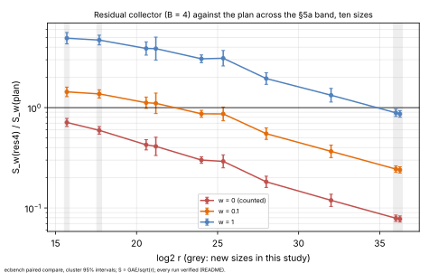
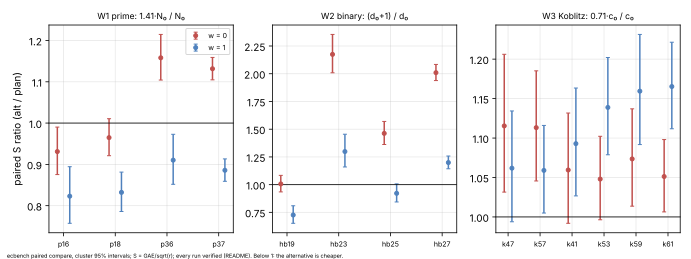
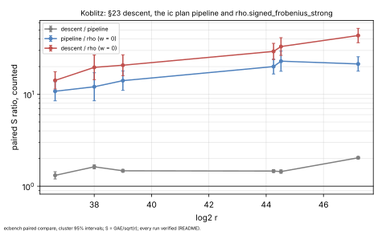
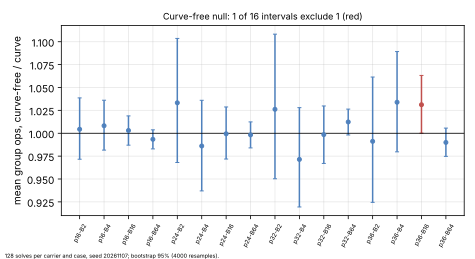

# The three planner studies, re-tested exhaustively, with their arithmetic checked in Lean

Measured 2026-10-26 under [`PROTOCOL.md`](PROTOCOL.md), which was frozen in
`0ca110399` before any session. PDF: [`REPORT.pdf`](REPORT.pdf). Lean:
[`lean/`](lean/README.md).

The owner asked for three results to be re-tested more exhaustively and
proven in Lean:
- the residual collector on prime curves (`research/ic_prime_residual_lp_20261026`);
- the Koblitz descent routing (`research/ic_koblitz_descent_routing_20261026`);
- the binary/Koblitz weight rule (`research/ic_planner_weight_rule_binkob_20261026`).

The prime weight rule (`research/ic_planner_weight_rule_20261021`) was
re-tested with them.

The re-test covered:
- 14 new `ecbench` sessions on 14 curves not measured before: 4 prime
  (15.7–36.3 bits), 4 random binary and 6 Koblitz (36.6–47.2 bits);
- 3,328 records, all verified;
- the curve-free null at 4 sizes × 4 base sizes;
- 2,428 band verdicts from these and the four earlier studies, restated in
  integers and checked by Lean's `decide`.

## Result

| | prediction | outcome |
|:--|:--|:--|
| Residual | R1–R5 | **all held** |
| Null | N1 | **held**: 1 of 16 intervals excludes 1 |
| Koblitz routing | K1 | **held**: the descent is dearer at all six sizes |
| | K2 | **failed narrowly**: pipeline/rho dips from k59 to k61 |
| Weight rules | W1 prime | **failed**, on its w = 0 clause |
| | W2 binary | **failed** at w = 1 |
| | W3 Koblitz | **failed** at every weight |

### 1. The residual collector is cheaper than the plan across the whole band from 36 bits

The collector is ranked below the plan, **as a generic collision search**, at
36.0 and 36.25 bits. That is the preregistered R3, the risky prediction.

From the protocol's base sizes, `res2` and `res4` are each cheaper than the
`ic plan` recipe at every band weight, with every interval below 1:

| curve | slug | log2 r | S plan | S res2 | S res4 | S rho | res2/plan w = 0 | w = 0.1 | w = 0.3 | w = 1 | res4/plan w = 1 |
|:--|:--|--:|--:|--:|--:|--:|:--|:--|:--|:--|:--|
| p16 | `icv1-fp16-t295-8d3c3165` | 15.70 | 10.77 | 6.48 | 7.66 | 1.91 | 0.602 [0.543, 0.666] | 0.975 [0.861, 1.104] | 1.566 [1.360, 1.803] | 2.768 [2.365, 3.239] | 4.919 [4.317, 5.604] |
| p18 | `icv1-fp18-tm337-d28d5e09` | 17.70 | 10.23 | 4.84 | 6.08 | 1.45 | 0.473 [0.438, 0.511] | 0.845 [0.771, 0.927] | 1.406 [1.269, 1.558] | 2.448 [2.188, 2.739] | 4.713 [4.215, 5.270] |
| p36 | `icv1-fp36-t454193-44a20818` | 36.00 | 46.37 | 2.94 | 3.67 | 1.13 | 0.063 [0.056, 0.071] | 0.151 [0.134, 0.171] | 0.277 [0.245, 0.314] | **0.493 [0.433, 0.561]** | **0.888 [0.817, 0.965]** |
| p37 | `icv1-fp37-t277-91fd6e29` | 36.25 | 49.17 | 2.84 | 3.82 | 1.05 | 0.058 [0.053, 0.063] | 0.137 [0.125, 0.151] | 0.251 [0.229, 0.276] | **0.445 [0.405, 0.489]** | **0.865 [0.802, 0.933]** |

- **Method:** paired `ecbench compare` (`--weight` for w > 0), cluster 95% intervals.
  Mean S comes from `ecbench band` at w = 0. The R comparisons pair 48
  measured runs and the B and K comparisons 24; every run verified.

Over all ten sizes, the res4/plan ratio at w = 1 falls steadily with size:
- 4.92 at 15.7 bits and 4.71 at 17.7 bits (new);
- 3.89–1.33 at 20.6–32 bits (the earlier study);
- 0.888 at 36.0 bits and 0.865 at 36.25 bits (new).

It crosses 1 between 32 and 36 bits. The earlier study had extrapolated the
crossing to about 35 bits.

**The gain is generic, and rho is still far cheaper.** On the curve-free
carrier (`Z/r` with a random-bijection key, same seeds), the collector costs
the same: 15 of 16 intervals contain 1 (N1). Its exponent matches rho's
(R4): the fitted slope of ln GAE on ln r over the ten sizes is 0.460 for
res4, against 0.619 for the plan.

At 36 bits, the distance remaining to `rho.negation` is:

| curve | plan / rho, w = 0 | w = 1 | res2 / rho, w = 0 | w = 1 | res4 / rho, w = 0 | w = 1 |
|:--|:--|:--|:--|:--|:--|:--|
| p16 | 5.6 [4.9, 6.5] | 6.4 [5.4, 7.5] | 3.4 [3.0, 3.9] | 17.6 [14.8, 20.9] | 4.0 [3.5, 4.6] | 31.3 [26.2, 37.3] |
| p18 | 7.1 [6.0, 8.3] | 8.4 [6.9, 10.1] | 3.3 [2.9, 3.8] | 20.5 [17.2, 24.4] | 4.2 [3.7, 4.8] | 39.5 [34.2, 45.5] |
| p36 | 40.9 [35.5, 47.0] | 47.2 [40.8, 54.7] | 2.6 [2.2, 3.0] | 23.3 [20.1, 27.0] | 3.2 [2.9, 3.6] | 41.9 [37.9, 46.4] |
| p37 | 46.9 [42.1, 52.2] | 54.7 [49.0, 61.0] | 2.7 [2.3, 3.1] | 24.3 [21.0, 28.2] | 3.6 [3.3, 4.0] | 47.3 [42.9, 52.1] |

So at 36 bits the collector moves the IC framework's cheapest one-target arm:
- in counted S, from 41–47× rho down to 2.6–2.7× rho;
- at 1 GAE per native operation, from 47–55× down to 23–24×.

The arm is a birthday search on `Z/r` with a base attached. It is not an index
calculus that uses the curve: the null and `KeyedInvariance.lean` say so.

### 2. All three weight rules fail out of sample and are withdrawn (`ic-planner/4`)

**W1, prime (1.41·N₀ at w = 1).** The operative half held:

| curve | log2 r | 1.41·N₀ / N₀, w = 0 | w = 0.3 | w = 1 |
|:--|--:|:--|:--|:--|
| p16 | 15.70 | 0.931 [0.875, 0.990] | 0.883 [0.823, 0.947] | 0.823 [0.757, 0.894] |
| p18 | 17.70 | 0.965 [0.921, 1.011] | 0.902 [0.857, 0.950] | 0.832 [0.786, 0.881] |
| p36 | 36.00 | 1.158 [1.104, 1.215] | 1.035 [0.978, 1.095] | 0.910 [0.852, 0.973] |
| p37 | 36.25 | 1.132 [1.105, 1.159] | 1.009 [0.982, 1.036] | 0.886 [0.859, 0.913] |

- **Operative half: held.** At w = 1 it is cheaper on 4 of 4 curves, each
  interval below 1.
- **Control half: failed.** The rule needed the ratio at w = 0 to be at least
  1 on at least 3 of 4 curves, so that the gain could be attributed to the
  weight. At 15.7 and 17.7 bits, 1.41·N₀ is cheaper even at w = 0: the
  counted optimum N₀ is slightly too small there.

**W2, binary (d₀ at every weight).**
- **Fewer columns (d₀ − 1):** dearer at both weights on all four curves.
- **More columns, w = 0:** d₀ + 1 is dearer on all four.
- **More columns, w = 1:** d₀ + 1 is cheaper on hb19 (0.726 [0.651, 0.810]) and
  on hb25 (0.922 [0.844, 1.007]). That leaves 2 of 4 above 1, not the 3
  required.

| curve | slug | log2 r | (d₀−1)/d₀ w = 0 | w = 1 | (d₀+1)/d₀ w = 0 | w = 0.3 | w = 1 | plan / rho w = 0 |
|:--|:--|--:|:--|:--|:--|:--|:--|:--|
| hb19 | `icv1-f2m19-tm649-a9133fe6` | 18.00 | 1.541 [1.411, 1.682] | 1.811 [1.641, 1.998] | 1.006 [0.935, 1.084] | 0.869 [0.794, 0.950] | 0.726 [0.651, 0.810] | 11.0 [9.1, 13.2] |
| hb23 | `icv1-f2m23-tm4129-45500fce` | 22.00 | 1.193 [1.069, 1.332] | 1.567 [1.385, 1.772] | 2.175 [2.009, 2.354] | 1.763 [1.602, 1.939] | 1.299 [1.159, 1.455] | 15.3 [11.3, 20.8] |
| hb25 | `icv1-f2m25-tm489-c50a8fb9` | 22.42 | 1.364 [1.102, 1.689] | 1.647 [1.295, 2.095] | 1.462 [1.362, 1.570] | 1.190 [1.099, 1.288] | 0.922 [0.844, 1.007] | 23.7 [19.3, 29.1] |
| hb27 | `icv1-f2m27-t20811-3d0fd5a1` | 24.41 | 1.292 [1.107, 1.508] | 1.671 [1.413, 1.975] | 2.010 [1.939, 2.084] | 1.620 [1.553, 1.689] | 1.199 [1.143, 1.258] | 31.8 [25.0, 40.3] |

**W3, Koblitz (0.71·c₀ at w ≥ 0.3).** Held out at 36.6–47.2 bits, the smaller
base is dearer at every weight on every curve: 1.06–1.17× at w = 1, with 0 of 6
intervals below 1. The earlier hold-out had found it cheaper at 18–26 bits
(0.80–0.88×). The rule does not carry to large curves.

**Decision.** The protocol's rule withdraws a family's rule when that rule
fails out of sample, and `ic-planner/4` withdraws all three:
- `ic plan --native-weight w` now keeps the counted optimum at every weight:
  N₀, d₀ and c₀.
- It warns about the withdrawn rule and cites this study.

This also costs something. On these held-out prime curves, 1.41·N₀ would have
saved 9–18% at w = 1, and the 0.71·c₀ base helped on the small Koblitz
hold-outs. A replacement rule would have to depend on size, and it needs its
own preregistered protocol; it may not be read off these data.

### 3. Koblitz routing: the §23 descent stays dearer than the pipeline

| curve | slug | log2 r | 0.71·c₀ / c₀ w = 0 | w = 0.3 | w = 1 | descent / pipeline | pipeline / rho | descent / rho |
|:--|:--|--:|:--|:--|:--|:--|:--|:--|
| k47 | `icv1-f2m47-t22705043-f4e44623` | 36.64 | 1.115 [1.031, 1.206] | 1.079 [1.006, 1.157] | 1.062 [0.994, 1.134] | 1.313 [1.199, 1.437] | 10.8 [8.5, 13.7] | 14.2 [11.4, 17.6] |
| k57 | `icv1-f2m57-tm747311035-c1f545af` | 38.00 | 1.113 [1.046, 1.185] | 1.076 [1.018, 1.138] | 1.059 [1.005, 1.116] | 1.626 [1.544, 1.712] | 12.1 [8.5, 17.2] | 19.6 [14.4, 26.7] |
| k41 | `icv1-f2m41-tm2308219-7f48b14a` | 39.00 | 1.059 [0.992, 1.132] | 1.081 [1.014, 1.152] | 1.093 [1.027, 1.163] | 1.471 [1.420, 1.524] | 14.1 [11.0, 18.0] | 20.7 [16.0, 26.9] |
| k53 | `icv1-f2m53-tm56619371-dac20a85` | 44.26 | 1.048 [0.996, 1.102] | 1.103 [1.046, 1.163] | 1.139 [1.079, 1.202] | 1.462 [1.410, 1.515] | 20.0 [16.6, 24.1] | 29.3 [23.9, 35.8] |
| k59 | `icv1-f2m59-tm943548413-98844ecc` | 44.52 | 1.074 [1.014, 1.137] | 1.126 [1.061, 1.194] | 1.159 [1.092, 1.231] | 1.443 [1.382, 1.507] | 22.9 [17.8, 29.5] | 33.1 [26.5, 41.3] |
| k61 | `icv1-f2m61-t158598901-ab42b6c5` | 47.21 | 1.051 [1.006, 1.098] | 1.119 [1.069, 1.171] | 1.165 [1.112, 1.221] | 2.039 [1.977, 2.103] | 21.4 [17.9, 25.6] | 43.6 [36.4, 52.1] |

- **K1, held.** The descent costs 1.31–2.04× the pipeline in counted S at all
  six sizes, every interval above 1. The routing is unchanged.
- **K2.**
  - descent/rho rises at every step, from 14.2 to 43.6.
  - pipeline/rho rises from 10.8 to 22.9 and then reads 21.4 at k61. The
    intervals overlap, so this is a literal failure of "grows with log2 r", not
    a reversed trend.
- **Distance remaining to `rho.signed_frobenius_strong`:** 10.8–22.9× for the
  pipeline and 14–44× for the descent.

### 4. Curve-free null

| case | ratio (curve-free / curve) | 95% | case | ratio | 95% |
|:--|:--|:--|:--|:--|:--|
| p16 B2 | 1.004 | [0.972, 1.039] | p32 B2 | 1.026 | [0.950, 1.108] |
| p16 B4 | 1.008 | [0.982, 1.036] | p32 B4 | 0.971 | [0.919, 1.028] |
| p16 B16 | 1.003 | [0.987, 1.019] | p32 B16 | 0.999 | [0.967, 1.030] |
| p16 B64 | 0.993 | [0.983, 1.004] | p32 B64 | 1.012 | [0.998, 1.026] |
| p24 B2 | 1.033 | [0.968, 1.104] | p36 B2 | 0.991 | [0.924, 1.061] |
| p24 B4 | 0.986 | [0.937, 1.036] | p36 B4 | 1.034 | [0.980, 1.089] |
| p24 B16 | 0.999 | [0.972, 1.029] | **p36 B16** | **1.031** | **[1.000, 1.063]** |
| p24 B64 | 0.998 | [0.984, 1.012] | p36 B64 | 0.990 | [0.975, 1.006] |

- **Design:** 128 solves per carrier and case, all verified, seed 20261107.
- **Result:** one interval just touches 1 at its lower end, about the 0.8
  expected by chance among 16.

## What Lean proves (`lean/`)

Lean core only, `leanprover/lean4:v4.34.1`; the details are in
[`lean/README.md`](lean/README.md).

- **`Band.lean`.** Priced cost is affine in the weight. A reversal between
  w = 0 and w = 1 forces an exact crossing weight in (0, 1), with fixed orders
  on either side, so "not ranked across the band" is a theorem, not a
  statistical accident. As the weight rises, the optimum can only move to an
  arm with no more native work.
- **`KeyedInvariance.lean`.** An algorithm that sees elements only through
  add, neg, handle equality and a key has an identical transcript (every
  observation, the cost and the answer) on two carriers joined by an
  injective map that preserves the key. Corollary: the residual collector
  on E is the collector on `Z/r` with E's key pulled back. What the curve
  contributes is the key function, and the null measures exactly that.
- **`Certificates.lean`.** 2,428 verdicts from 39 band files, each closed by
  `decide`:
  - **Sources:** this study and the four earlier ones, recomputed with exact
    sums by `scripts/rebands.sh`.
  - **Pairwise orders (2,010):** every arm against its references, at every
    weight.
  - **Crossing weights (58):** every exact crossing weight.
  - **Argmin facts (360):** the argmin facts behind every `m*(w)`. The
    generator stops if a reported `m*` disagrees, and both earlier derivations
    match.
- **Audit.** No sorry, admit, `native_decide` or custom axiom. The
  certificates use no axioms at all, and the main theorems use only propext,
  Classical.choice and Quot.sound. `leanchecker --fresh` passes on all three
  modules. CI: [`.github/workflows/planner-proofs-lean.yml`](../../.github/workflows/planner-proofs-lean.yml).

**Not proven in Lean:**
- the bootstrap intervals, which are statistics;
- that the Rust collector touches elements only through those four
  operations, which is checked by reading the code;
- that `ecbench band` adds correctly, which its test
  `exact_sums_reproduce_the_band_means` checks.

## Predictions (PROTOCOL.md), scored by `examples/ic_planner_exhaustive_summary.rs`

- **R1** (res4/plan < 1 at w = 0, interval below 1, at every new size):
  **held**, 0.078–0.712.
- **R2** (S₁(res4)/S₁(plan) < 1.33 at p36 and p37): **held**, 0.888 and 0.865.
- **R3** (risky: the w = 1 point estimate of res4/plan below 1 at p37):
  **held**, 0.865 [0.802, 0.933].
- **R4** (ten-size slopes: res4 in [0.45, 0.55], plan in [0.60, 0.70]):
  **held**, 0.460 and 0.619.
- **R5** (cheapest residual arm at w = 0 is res2 or res4): **held**, res2 at
  all four sizes.
- **N1** (at most 2 of 16 null intervals exclude 1): **held**, 1.
- **W1**: **failed**. The w = 1 part was 4 of 4; the w = 0 part was 2 of 4,
  where at least 3 were needed.
- **W2**: **failed**. d₀ + 1 at w = 1 was above 1 on 2 of 4 curves, where at
  least 3 were needed.
- **W3**: **failed**. 0 of 6 intervals were below 1 at w = 1, where at least 4
  were needed.
- **K1**: **held**, 6 of 6.
- **K2**: **failed**, because pipeline/rho falls from k59 to k61 (the
  intervals overlap). descent/rho is monotone.

## Classification and decision

Engineering and measurement, as the protocol said.
- **Planner.** `ic-planner/4` withdraws the three weight rules (section 2).
  Routing is unchanged (K1).
- **Residual collector.**
  - It is ranked below the plan across the §5a band at 36–36.25 bits, as a
    generic collision search only (decision rule, R3).
  - It is a measured improvement over the IC baseline's cost at that size. But
    it is not an index-calculus improvement, and it remains 2.6–24× above rho.
- **No leaderboard row moves.** The validation gate
  (`docs/VALIDATION_GATE.md`) needs an independent validator report before a
  row lands, and no validator has run. The candidate row is res2 at
  p36/p37: 2.6–2.7× rho at w = 0 and 23–24× at w = 1.
- **Not done, for a later preregistered protocol:**
  - routing prime curves of 36 bits and more to the collector;
  - a size-dependent weight rule.

## Deviations from the protocol

- **No resume checkpoint.** `scripts/checkpoint.sh gate` could not upload: the
  session has no `CHECKPOINT_UPLOAD_TOKEN`. The owner told the session to
  proceed, and every input and output was committed and pushed.
- **Card 3, first attempt: disk full.** The run crashed during R-p18 when the
  session's Lean install filled the disk. No receipt was written. The partial
  R-p16 and R-p18 outputs were deleted unread.
- **Card 3, second attempt: background limit.** The harness stopped the
  executor's background shell at its 30-minute limit, during R-p37.
  - Kept: R-p16, R-p18 and R-p36, complete sessions run by the card's exact
    commands (their stdout and stderr are in `cards/`). Card 3 has no receipt;
    `ecbench verify` audited all three on card 9.
  - Rerun: the partial R-p37 (394 of 512 records) was deleted unread and rerun
    on card 4.
  - The rest went to cards 4–12b, each sized to fit the window and each with a
    receipt.
- **Card 8: launched by the main session.** The executor's relay of K-k61
  would have overrun the window (30 of 128 records after 12 minutes). The
  session stopped it, deleted the partial unread, and ran the same card,
  unchanged, with `tools/task_card.py` from its own shell under a 2-hour
  limit. Its log is `cards/CARD-ic-improve-20261026-8.launcher.log`. That
  card skipped the executor tier.
- **Commits between sessions.** Cards 4–12b ran at the successive commits
  that added the earlier cards' data. Each commit added only data. Every
  session ran the same three binaries, which the cards bind by sha256.
- **Null bootstrap.** The protocol does not fix the null intervals' method.
  The summary uses a seeded resampler with 4,000 resamples (CPython's
  MT19937 `random.Random(20261107)`, reproduced exactly by the native
  `examples/ic_planner_exhaustive_summary.rs`); the earlier study used jq's
  MINSTD with 2,000.
- **Lean, built locally without lake.** For lack of disk space the local build
  used `lean -o` directly. CI builds with `lake` (the workflow).

## Evidence

- **Specs:** `specs/*.json`, from `scripts/make_specs.sh`.
- **Cards:** `cards/CARD-ic-improve-20261026-{3,…,12b}.yaml` with their
  receipts. Chain: `experiment-director` → `executor-mechanical`, except card 8
  (above).
- **Sessions:**
  - R sessions: 512 records each; B and K sessions: 128 each.
  - All verified. `sessions/*.audit.json`: 14 of 14 OK, 12 exact replays each.
  - Binaries, by sha256:
    - `ecbench` `8de80ce7…5519`;
    - `ic` `46b191d3…d975`;
    - the null example `0810ac9f…1560`.
- **Derived files:**
  - `analysis/band-*.{txt,json}` and `sessions/*/comparisons/`, from
    `scripts/analyse.sh`;
  - `analysis/summary.json`, from `scripts/analyse.sh`, whose last step is
    `cargo run --release --example ic_planner_exhaustive_summary`;
  - `analysis/null-*.json`;
  - `analysis/rebands/`, from `scripts/rebands.sh`;
  - `lean/Certificates.lean` and `lean/certificates.json`, from
    `scripts/lean_certificates.sh`
    (`cargo run --release --example ic_planner_exhaustive_lean_certs`);
  - the figures, laid out by `scripts/plots.py`.
