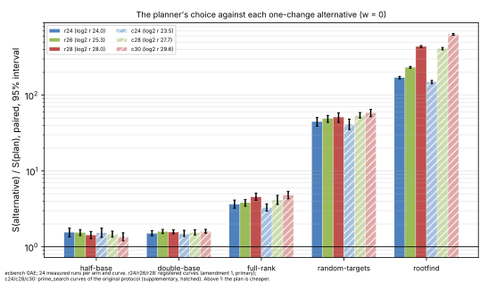
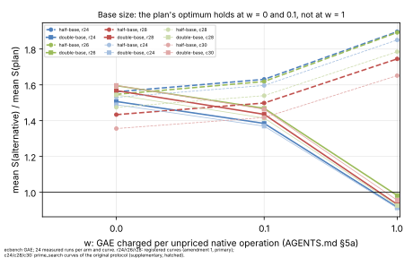
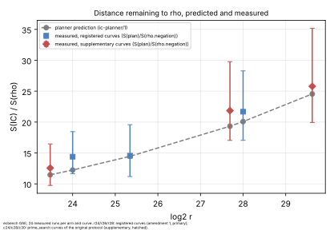

# Does the `ic` planner pick the best configuration on curves it has not seen?

Measured 2026-10-20 under [`PROTOCOL.md`](PROTOCOL.md) (frozen in `05a0ebd92`)
and [`PROTOCOL_AMENDMENT_1.md`](PROTOCOL_AMENDMENT_1.md) (frozen in
`d1be0c1c8`), with the planner at `a29bead23` (`ic-planner/1`), each before its
sessions. PDF: [`REPORT.pdf`](REPORT.pdf). Run reports: [`reports/`](reports/).

`ic plan` and `ic bench --auto` (`src/cryptanalysis/ic_framework/planner.rs`)
choose every `ic.pipeline` stage from the repository's earlier measurements,
and say how far the result is from the matched rho. This study tests those
choices on prime-order curves that the planner's evidence never touched. On
each curve, the plan runs against every alternative one change away from it.

- **Primary (amendment 1):** three registered curves.
  - `icv1-fp24-tm5099-a6f137c6`, log2 r 24.00 ("r24");
  - `icv1-fp26-tm1775-7e8fb6df`, 25.35 ("r26");
  - `icv1-fp28-t28201-65099091`, 28.00 ("r28").
- **Supplementary (original protocol):** three ecbench `prime_search` curves.
  They are `find_prime_order_curve(24, 3)`, `(28, 1)` and `(30, 1)`, at log2 r
  23.47, 27.69 and 29.62 ("c24", "c28", "c30"). They are not in the curve
  registry, so they are not named here (amendment 1 says why).

## Result

**In the counted unit (w = 0), every choice the planner made was the better one,
on all six curves.** No alternative beat the plan, and every paired interval
lies above 1.

`S(alternative) / S(plan)` on the registered curves, ecbench `compare` (paired
by target and round, 24 pairs each; cluster 95% interval):

| change from the plan | r24 | r26 | r28 | across the §5a band |
|:--|:--|:--|:--|:--|
| base ⌈N/2⌉ | 1.56 [1.35, 1.77] | 1.55 [1.41, 1.69] | 1.43 [1.28, 1.60] | confirmed |
| base 2N | 1.51 [1.40, 1.64] | 1.60 [1.50, 1.70] | 1.57 [1.49, 1.68] | **not separated**: below 1 at w = 1 |
| `rootfind-subtract` oracle | 171 [164, 176] | 233 [226, 239] | 439 [424, 450] | confirmed |
| full-rank stop rule | 3.64 [3.24, 4.14] | 3.84 [3.43, 4.21] | 4.56 [4.10, 5.12] | confirmed |
| random targets | 44.9 [39.0, 50.7] | 49.1 [43.7, 54.0] | 51.5 [43.8, 58.5] | confirmed |
| A/A (`plan-aa`) | 1.000 [1, 1] | 1.000 [1, 1] | 1.000 [1, 1] | — |

Plans: `prime-abscissa:size=N` with N = 128, 175 and 323;
`mitm-prime-blocked:m=2`; `incremental-gauss`; `walk`.

The supplementary curves give the same picture:
- half base 1.36–1.53;
- double base 1.49–1.60, again below 1 at w = 1;
- `rootfind` 150–637;
- full rank 3.30–4.81;
- random targets 41.5–58.7;
- A/A exactly 1.

The per-curve numbers are in `analysis/summary.json`.

**Across the pricing band, the base size is the one choice that does not hold.**
An `ic.pipeline` run leaves five native counters unpriced: Legendre symbols,
square roots, table lookups, `row_ops` and target-guard probes. Charge each at
1 GAE (AGENTS.md §5a, every arm alike), and the doubled base is cheaper than the
plan by 2–8% on the registered curves:
- r24: 29.6 against 32.3;
- r26: 35.1 against 35.7;
- r28: 45.1 against 48.4.

It is cheaper by 4–9% on the supplementary curves. A larger base needs fewer
trials, and each trial is one lookup and one guard probe. So the planner's
size rule is right for the counted unit, and too small if lookups are priced
near an addition. Halving the base, root-finding, full rank and random targets
lose to the plan at every weight.

## Distance remaining to rho, predicted and measured

| curve | planner's prediction | measured S(plan) / S(rho.negation) |
|:--|--:|:--|
| r24 (log2 r 24.00) | 12.2 | 14.4 [11.6, 18.5] |
| r26 (25.35) | 14.5 | 14.6 [11.2, 19.6] |
| r28 (28.00) | 20.1 | 21.7 [17.0, 28.3] |
| c24 (23.47) | 11.5 | 12.6 [9.75, 16.5] |
| c28 (27.69) | 19.3 | 21.8 [17.0, 29.8] |
| c30 (29.62) | 24.5 | 25.8 [19.9, 35.2] |

Every prediction lies inside the measured interval, and within 18% of the point
(P4). The planner reads a slightly low gap at every size here (by 1–18%).
Rho is cheaper on every curve, by 12.6× to 25.8×, as the planner's verdict said.
These are the distances remaining, not a pass/fail gate.

## Predictions (PROTOCOL.md)

- **P1** (the plan has the lowest S of the IC arms on each curve): **held** on
  all six.
- **P2** (half and double base both above 1): **held** at w = 0. Measured
  1.36–1.56 and 1.49–1.60, against the cost model's 1.4 and 1.7.
- **P3** (root-finding ≥ 10×, full rank ≥ 1.5×, random targets ≥ 1.5×, each
  interval above 1): **held**. Measured 150–637×, 3.30–4.81× and 41.5–58.7×.
- **P4** (plan/rho within 2× of the prediction): **held**, within 18%.
- **P5** (each order holds across the band): **failed for the doubled base**,
  which reverses at w = 1 on all six curves. Held for the other four
  alternatives.

## Classification and decision

Tooling validation, engineering (AGENTS.md §3).
- No `S` improves on a measured baseline, so no leaderboard row moves. The plan
  is the existing best recipe, now chosen automatically and checked on six
  unseen sizes.
- The planner's oracle, stop-rule and target choices are confirmed at every
  band weight. Its base-size rule is confirmed in the counted unit, and not
  separated across the band.
- Follow-up, as its own change with its own evidence: a weight-aware size rule.
  It would shift the base up when unpriced native operations are charged.
  Under the protocol, the planner is not edited here.

## Deviations from the protocol

- **Amendment 1.** The original curves are not in `docs/curves/registry.json`,
  which AGENTS.md §11 requires before a curve is cited. Registering them needs a
  registry regeneration that `main` cannot take in this change:
  - the registry is stale on `main`, at 2,572 curves against the 8,034 a fresh
    build finds;
  - the cover-transfer ledger asserts exactly 2,572.

  The identical design was therefore repeated on three registered curves,
  frozen before their sessions. The original sessions are kept as a
  supplementary replication, and their tables are kept as `.txt`, because
  they name unregistered slugs.
- The protocol did not fix a replay count. Each audit replayed 12 of its
  session's 256 records; all reproduced exactly.
- No IC wall time is used. Isolation was mixed (L1 and L2 per arm; see the run
  reports), which affects nothing here, since only counts are compared.
- **A discarded launch.** The first launch of the original sessions ran an
  `ecbench` binary built before the freeze commit. It was stopped within
  seconds, its partial output deleted unread, and the binary rebuilt from the
  clean tree. Every kept session records its freeze commit and `git_dirty:
  false`, and all six ran the same binary, `d0527101…7771`.

## Evidence

- **Specs:** `specs/r24.json`, `specs/r26.json` and `specs/r28.json` (primary);
  `specs/c24.json`, `specs/c28.json` and `specs/c30.json` (supplementary).
- **Primary sessions** (commit `d1be0c1c8`, clean tree, environment class
  `ECBENV2h2196cccd7a31`), 256 records each, all verified:
  - `sessions/r24` (`ECBS1hcf6d4ac07e64`), 17:40–17:41 UTC;
  - `sessions/r26` (`ECBS1h339ff9352e64`), 17:41–17:42 UTC;
  - `sessions/r28` (`ECBS1h7d5230a73add`), 17:42–17:46 UTC.
- **Supplementary sessions** (commit `05a0ebd92`, clean tree), 256 records
  each, all verified: `sessions/c24` (`ECBS1h4087e7eb1b5a`), `sessions/c28`
  (`ECBS1haabb242baa49`) and `sessions/c30` (`ECBS1h0d23937f2c51`).
- **Audits:** `sessions/*.audit.json`, all OK with 12 exact replays each.
- **ecbench output:**
  - comparisons in `sessions/*/comparisons/` (`compare --save`);
  - tables in `analysis/table-*.txt` (`table`);
  - the pricing band in `analysis/band-*.{txt,json}` (`band`).
- **Derived:** `analysis/summary.json`, from `scripts/summary.sh` and
  `scripts/summary.jq` (jq over the ecbench output). The figures,
  `figures/*.svg` and `.png`, come from `scripts/plots.py` (layout only).
- **Host:** 4-vCPU Intel Xeon @ 2.80 GHz VM (AVX-512), Linux 6.18; `ecbench run
  --cpus auto`.
