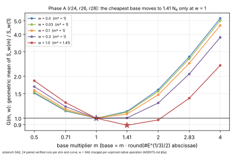
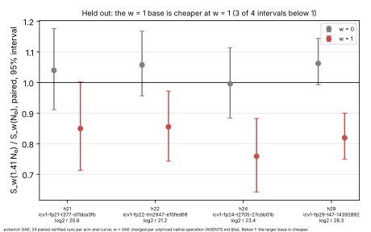
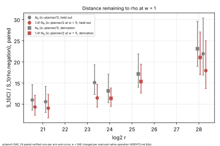

# A weight-aware factor-base size for the `ic` planner (`ic-planner/2`)

> **2026-10-26, withdrawn.** The rule adopted here (1.41·N₀ at w = 1) failed its preregistered
> held-out test in [`../ic_planner_exhaustive_20261026`](../ic_planner_exhaustive_20261026/README.md) (W1).
> It was cheaper at w = 1 on 4 of 4 new curves, but also at w = 0 on 2 of 4.
> `ic-planner/4` withdraws it. The measurements below are unchanged.

Measured 2026-10-21. The protocol is [`PROTOCOL.md`](PROTOCOL.md), frozen in
`7cf06ed6e`; [`PROTOCOL_AMENDMENT_1.md`](PROTOCOL_AMENDMENT_1.md) was frozen in
`66f1642d1`, after Phase A and before Phase B. PDF: [`REPORT.pdf`](REPORT.pdf).

`research/ic_planner_validation_20261020` found that the planner's prime
factor base, `N₀ = round(#E^{1/3}/2)` abscissae, is the cheapest base size in
counted `S`. That stops being true once the run's unpriced native work is
charged (AGENTS.md §5a): at 1 GAE per operation, a doubled base was 2–9%
cheaper. The work in question is lookups, guard probes, Legendre symbols,
square roots and row operations.

This study asks whether the planner can take a declared weight `w` and size
the base for it.

## Result

**Yes, at `w = 1`; below that, the current size stays.**
- `ic plan --native-weight 1` and `ic bench --auto --native-weight 1` now choose
  `round(1.41 · N₀)` abscissae.
- Every weight up to 0.3 keeps `N₀`, so the default plan (`w = 0`) is unchanged.
- The rule was fitted on three registered curves and tested on four others.
  At `w = 1` the larger base was cheaper on all four held-out curves, with the
  paired interval below 1 on three of them.

### Phase A: derivation (`r24`, `r26`, `r28`)

`G(m, w)` is the geometric mean, over the three curves, of `S_w(m·N₀) / S_w(N₀)`
(`analysis/derivation.json`, from `ecbench band` at five weights):

| w | m = 0.5 | 0.71 | **1** | 1.41 | 2 | 2.83 | 4 | m*(w) |
|:--|--:|--:|--:|--:|--:|--:|--:|--:|
| 0 | 1.513 | 1.126 | 1 | 1.119 | 1.601 | 2.760 | 5.208 | **1** |
| 0.03 | 1.536 | 1.138 | 1 | 1.103 | 1.558 | 2.668 | 5.019 | **1** |
| 0.1 | 1.584 | 1.161 | 1 | 1.072 | 1.471 | 2.478 | 4.629 | **1** |
| 0.3 | 1.686 | 1.210 | 1 | 1.005 | 1.287 | 2.076 | 3.801 | **1** |
| 1 | 1.858 | 1.295 | 1 | **0.890** | 0.972 | 1.392 | 2.394 | **1.41** |

Paired `S(m141) / S(m100)` from `ecbench compare --weight`, with the cluster 95%
interval:

| curve | slug | log2 r | w = 0 | w = 1 |
|:--|:--|--:|:--|:--|
| r24 | `icv1-fp24-tm5099-a6f137c6` | 24.00 | 1.085 [1.005, 1.171] | 0.865 [0.781, 0.956] |
| r26 | `icv1-fp26-tm1775-7e8fb6df` | 25.35 | 1.128 [1.051, 1.219] | 0.895 [0.821, 0.985] |
| r28 | `icv1-fp28-t28201-65099091` | 28.00 | 1.144 [1.088, 1.204] | 0.911 [0.849, 0.977] |

### Phase B: held out (`h21`, `h22`, `h24`, `h29`)

These four registered prime-order curves are in none of the planner's evidence.
Each arm pair is `v1` (`N₀`, the `ic-planner/1` plan) against `v2-m141`
(`round(1.41 · N₀)`). The table gives paired `S(v2-m141) / S(v1)`:

| curve | slug | log2 r | `N₀` → `v2` | w = 0 | w = 1 |
|:--|:--|--:|:--|:--|:--|
| h21 | `icv1-fp21-t377-d7bba3fb` | 20.59 | 58 → 82 | 1.040 [0.911, 1.176] | 0.850 [0.713, 1.002] |
| h22 | `icv1-fp22-tm2947-e15fed69` | 21.19 | 67 → 94 | 1.058 [0.956, 1.167] | 0.855 [0.743, 0.972] |
| h24 | `icv1-fp24-t2705-27cbb01b` | 23.38 | 111 → 157 | 0.996 [0.884, 1.113] | 0.759 [0.642, 0.883] |
| h29 | `icv1-fp29-t47-14392892` | 28.25 | 342 → 482 | 1.062 [0.993, 1.144] | 0.819 [0.749, 0.900] |

## Distance remaining to rho

`S(IC) / S(rho.negation)`, paired. Rho pays its own native work at `w = 1` too.

| curve | w = 0, `N₀` | w = 1, `N₀` | w = 1, `1.41 N₀` |
|:--|:--|:--|:--|
| h21 | 9.2 [7.4, 11.9] | 11.0 [8.6, 14.6] | 9.3 [7.4, 12.1] |
| h22 | 9.0 [7.0, 11.7] | 10.6 [8.0, 14.2] | 9.1 [6.8, 12.3] |
| h24 | 12.2 [10.1, 15.3] | 15.1 [12.3, 19.3] | 11.5 [9.3, 14.7] |
| h29 | 18.3 [14.3, 25.3] | 21.9 [16.9, 30.4] | 17.9 [13.7, 25.0] |
| r24 | 10.8 [8.7, 13.8] | 13.2 | 11.4 [9.5, 13.8] |
| r26 | 14.3 [11.9, 18.1] | 17.1 | 15.4 [12.6, 19.5] |
| r28 | 19.6 [16.1, 25.0] | 23.1 | 21.1 [17.0, 27.1] |

- **Rho is cheaper on every curve, at both weights.**
- At `w = 1` the weighted base closes part of the gap that pricing the native
  work opens. On h29 that gap goes from 21.9× to 17.9×.
- These are distances remaining, not a pass/fail gate.

## Predictions (PROTOCOL.md)

- **P1** (`m*(w)` non-decreasing in `w`): **held**. It is 1, 1, 1, 1, 1.41.
- **P2** (`m*(0) = 1`, `m*(1) ∈ {1.41, 2, 2.83}`): **held**, with `m*(1) = 1.41`.
- **P3** (held out, `w = 1`, interval below 1 on at least 3 of 4 curves): **held**,
  on 3 of 4. h21's interval reaches 1.002.
- **P4** (held out, `w = 0`, every `v2` costs at least as much as `v1`): **not
  strictly held.** h24 reads 0.996 [0.884, 1.113], and every `w = 0` interval
  contains 1.
  - On the held-out curves, the counted price of the larger base is within
    noise.
  - On the derivation curves it is 8.5–14.4%, and every interval lies above 1.

## Classification and decision

Engineering (AGENTS.md §3): a configuration choice conditional on the weight.
- **Adopted as `ic-planner/2`, by the decision rule (P3).** The planner's other
  choices are untouched: the oracle, the stop rule, the targets and every
  non-prime class.
- **The weight is a declared pricing assumption, not a measurement.**
  - A `w = 1` plan is cheaper only at `w = 1`. It is never reported as a
    ranking across the §5a band.
  - Across the band the two sizes cross, so their order there is "unresolved",
    as the band requires.
- **No counted `S` improves on a measured baseline**, so no row of tables A–C
  moves.
- **Validation gate.** No `benchmarks/README.md` row and no leaderboard section
  is added here. The gate requires an independent replay certificate and an
  independent validator report, and this session produced the result.
  `VALIDATION.json` is left to an independent session.

## Deviations from the protocol

- **Cards 2 and 3 stopped before writing any session file.**
  - `ecbench run` refused a busy host (PSI cpu avg10 6.02 and 6.37 > 5), caused
    by agent processes starting.
  - Card 4 adds a wait for 30 s of avg10 ≤ 1 before each run.
  - All three cards and their receipts are kept in `cards/`.
  - The specs, seeds and binary did not change.
- **The planner's mapping for weights between grid points is a step function.**
  It uses `m*` at the largest measured weight not above `w`, as the protocol
  fixed. Those weights report their support as `interpolated`.
- **Rounding.** `1.41 · 128 = 180.48` was run as 180, per `round(m·N₀)`; the
  r24 table therefore has 180, not 181.

## Evidence

- **Specs:** `specs/A-*.json`, `specs/B-*.json`, from `scripts/make_specs.sh`.
- **Cards:** `cards/CARD-…-{1,2,3,4}.yaml` and their receipts. The runs went
  `experiment-director` → `executor-mechanical`.
- **Sessions:**
  - Phase A: `sessions/A-r24` (`ECBS1h5efef3103338`), `A-r26`
    (`ECBS1h7435dcbad7dd`) and `A-r28` (`ECBS1hf555c9b78468`), 256 records
    each, all verified.
  - Phase B: `sessions/B-h21` (`ECBS1h2973f4f1298e`), `B-h22`
    (`ECBS1hed29e4805a29`), `B-h24` (`ECBS1h965648e19e1e`) and `B-h29`
    (`ECBS1h15d2acdf38fa`), 96 records each, all verified.
  - Binary sha256 `25e1e76f…c53f`, built from `7cf06ed6e` on a clean tree.
  - Every session records a clean tree.
- **Audits:** `sessions/*.audit.json`, all OK, each with 12 exact replays.
- **Comparisons:** `sessions/*/comparisons/`, written by the frozen binary
  (`7cf06ed6e`) with `ecbench compare --save --weight`.
  - Those files use a cluster-bootstrap interval.
  - `main` has since gained its own `compare --weight` (PR #2441), which this
    branch now uses.
  - It gives identical point ratios, with a linearised-t interval.
  - Under it the held-out `w = 1` intervals are h21 [0.699, 1.032], h22
    [0.747, 0.979], h24 [0.665, 0.865] and h29 [0.759, 0.884].
  - That is still 3 of 4 below 1, so P3's verdict is the same.
- **Derived:**
  - `analysis/band-*.{txt,json}` (`ecbench band`);
  - `analysis/derivation.json` (`scripts/derive.jq`);
  - `analysis/summary.json` (`scripts/summary.sh`, jq).
  - The figures come from `scripts/plots.py`, which only lays out the plot.
- **Host:** the 4-vCPU Intel Xeon VM of the earlier study; `--cpus auto`. Only
  counts are compared.
