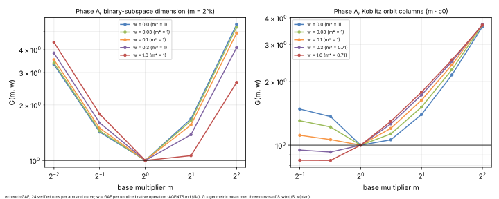
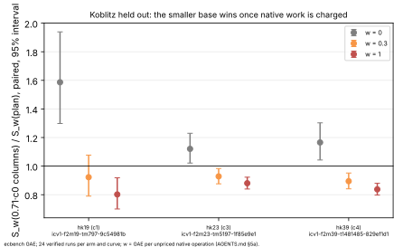

# Does the weight-aware base size carry to binary and Koblitz curves? (`ic-planner/3`)

> **2026-10-26, withdrawn.** The Koblitz rule adopted here (0.71·c₀ at w ≥ 0.3) failed its
> preregistered held-out test at log2 r 36.6–47.2, where it was dearer at every weight, in
> [`../ic_planner_exhaustive_20261026`](../ic_planner_exhaustive_20261026/README.md) (W3).
> The binary claim that d₀ is cheapest at every weight also failed out of sample (W2).
> `ic-planner/4` withdraws both rules. The measurements below are unchanged.

Measured 2026-10-26. The protocol is [`PROTOCOL.md`](PROTOCOL.md), frozen in
`1fffc5c45`; [`PROTOCOL_AMENDMENT_1.md`](PROTOCOL_AMENDMENT_1.md) was frozen in
`2f87b17ad`, after Phase A and before Phase B. PDF: [`REPORT.pdf`](REPORT.pdf).

On prime curves the planner's cheapest factor base grows 1.41× once unpriced
native work is charged at w = 1 GAE per operation
(`research/ic_planner_weight_rule_20261021`). The same question here, for the
planner's other two recipes, has two answers.

## Result

**Random binary curves: no weight rule.**
- The planner's subspace dimension `d₀` was the cheapest base at every
  weight from 0 to 1 on all three Phase A curves, taken together.
- At w = 1 the nearest alternative, `d₀ + 1`, reads G = 1.061.
- The planner keeps its binary rule, and now says it was measured.

**Koblitz curves: the base shrinks, the opposite of prime curves.**
- At w ≥ 0.3 the cheapest orbit-column count is 0.71 · c₀.
- Held out on three other Koblitz curves at w = 1, that base costs 0.802–0.880×
  the plan, with all three intervals below 1.
- At w = 0.3 it costs 0.895–0.928×, with two of three intervals below 1.
- `ic-planner/3` adopts it. `ic plan --native-weight w` gives
  `max(1, round(0.71 · c₀))` columns for w ≥ 0.3.
- The default (w = 0) plan is unchanged.

### Phase A: derivation

`G(m, w)` is the geometric mean, over the family's three curves, of
`S_w(m) / S_w(plan)`, taken from `ecbench band` (`analysis/derivation.json`):

| w | binary m = ¼ | ½ | **1** | 2 | 4 | m* |
|:--|--:|--:|--:|--:|--:|--:|
| 0 | 3.308 | 1.426 | 1 | 1.680 | 5.470 | 1 |
| 0.1 | 3.516 | 1.496 | 1 | 1.558 | 4.911 | 1 |
| 0.3 | 3.824 | 1.599 | 1 | 1.380 | 4.094 | 1 |
| 1 | 4.376 | 1.786 | 1 | 1.061 | 2.650 | 1 |

| w | Koblitz m = 0.5 | 0.71 | **1** | 1.41 | 2 | 2.83 | 4 | m* |
|:--|--:|--:|--:|--:|--:|--:|--:|--:|
| 0 | 1.482 | 1.365 | 1 | 1.060 | 1.396 | 2.151 | 3.639 | 1 |
| 0.1 | 1.114 | 1.062 | 1 | 1.201 | 1.632 | 2.398 | 3.726 | 1 |
| 0.3 | 0.948 | **0.928** | 1 | 1.260 | 1.728 | 2.487 | 3.717 | 0.71 |
| 1 | 0.848 | **0.847** | 1 | 1.295 | 1.783 | 2.534 | 3.695 | 0.71 |

The binary rows at w = 0.03 and the Koblitz rows at w = 0.03 also give
`m* = 1` (`analysis/derivation.json`).

The Phase A curves:
- binary: `icv1-f2m21-t2845-e2683765`, `icv1-f2m23-tm1957-8891f5a2` and
  `icv1-f2m25-t4775-4830dca7`;
- Koblitz: `icv1-f2m23-t5197-69e76b73`, `icv1-f2m31-tm90707-c95f16f5` and
  `icv1-f2m37-tm534059-32aad96b`.

### Phase B: Koblitz held out

Paired `S(alt) / S(plan)`, ecbench `compare --weight`, cluster 95% interval,
24 pairs each:

| curve | slug | log2 r | plan → alt | w = 0 | w = 0.3 | w = 1 | plan / rho (w = 0) |
|:--|:--|--:|:--|:--|:--|:--|:--|
| hk19 | `icv1-f2m19-tm797-9c54981b` | 18.00 | 2 → 1 | 1.587 [1.298, 1.939] | 0.923 [0.790, 1.077] | 0.802 [0.700, 0.919] | 2.6 [2.4, 2.8] |
| hk23 | `icv1-f2m23-tm5197-1f85e9e1` | 22.00 | 4 → 3 | 1.121 [1.022, 1.230] | 0.928 [0.876, 0.983] | 0.880 [0.840, 0.923] | 2.8 [2.2, 3.5] |
| hk39 | `icv1-f2m39-t1481485-829ef1d1` | 26.03 | 6 → 4 | 1.166 [1.043, 1.303] | 0.895 [0.841, 0.952] | 0.838 [0.797, 0.880] | 4.8 [4.0, 5.8] |

The reference is `rho.signed_frobenius`, the planner's. Rho is cheaper on every
curve; the plan sits 2.6–4.8× above it in counted `S`. That is the distance
remaining.

## Predictions

- **P1** (`m*(w)` non-decreasing in w): **held for binary** (constant).
  **Failed for Koblitz**: it falls from 1 to 0.71.
  - A Koblitz trial's native work (canonicalisation and table probes) grows
    with the base.
  - A prime trial's native work is one lookup and one guard probe, whatever
    the base.
- **P2** (`m*(0) = 1` in both families): **held**.
- **P3** (Koblitz, held out, at each weight with `m*(w) ≠ 1`, interval below 1
  on 2 of 3 curves): **held** at w = 0.3 (2 of 3; hk19 reaches 1.077) and at
  w = 1 (3 of 3).
  - Binary had no Phase B, since its `m*(w) = 1` everywhere.

## Classification and decision

Engineering: a configuration choice conditional on the weight.

- **Adopted** under the decision rule, as `ic-planner/3`
  (`src/cryptanalysis/ic_framework/planner.rs`).
  - Koblitz takes `KOBLITZ_WEIGHT_MULTIPLIERS`.
  - Binary keeps `d₀` and cites this study when a weight is declared.
  - The warning "not modelled for this class" is gone, because every planner
    recipe has now been measured across the band.
- **Cost of the smaller Koblitz base.** At w = 0 it costs 1.12–1.59× the plan,
  so it trades counted `S` for native work. It is cheaper only at the
  declared weight, never across the band.
- **No leaderboard row moves.** No counted `S` improves on a measured
  baseline, and the validation gate needs an independent validator before any
  row lands.

## Deviations from the protocol

- **No resume checkpoint.** `scripts/checkpoint.sh gate` could not upload: the
  session has no `CHECKPOINT_UPLOAD_TOKEN`. The owner told the session to
  proceed. Every input was committed and pushed before its run, and every
  output after it.
- **Binary built after the freeze.** The sessions ran on the binary built at
  `b561ebca8`, later than the protocol freeze `1fffc5c45`.
  - The commits in between add `ic.koblitz_descent` and thread-local operation
    counters in the Koblitz arithmetic.
  - Those counters change no count, and no result of `ic.pipeline`: the
    port's equivalence test, and `ecbench plan`'s identical spec ids.
- **Duplicate Koblitz arms.** Grid multipliers that round to one column count
  were run once, as the protocol said. For example, at k31, m = 0.5 and 0.71
  both give 1 column; `G` reads that arm for both.

## Evidence

- **Specs:** `specs/A-*.json` and `specs/B-*.json`, from `scripts/make_specs.sh`.
- **Cards:** Phase A ran on `CARD-ic-improve-20261026-1` (in
  `research/ic_prime_residual_lp_20261026/cards/`) and Phase B on
  `CARD-ic-improve-20261026-2` (in `research/ic_koblitz_descent_routing_20261026/cards/`),
  with their receipts. The chain was `experiment-director` → `executor-mechanical`.
- **Sessions:**
  - Phase A: `sessions/A-b21`, `A-b23` and `A-b25` (192 records each) and
    `A-k23`, `A-k31` (224 each) and `A-k37` (256).
  - Phase B: `sessions/B-hk19`, `B-hk23` and `B-hk39` (96 each).
  - All verified. Audits are OK, each with 12 exact replays.
- **Derived:**
  - `analysis/band-*.{txt,json}` (`ecbench band`);
  - `analysis/derivation.json` (`scripts/derive.jq`);
  - `analysis/summary.json` (`scripts/summary.sh`);
  - figures from `scripts/plots.py`, which only lays out the plot.

## Note, 2026-11-01: byte counters are no longer priced as operations

This README and its `analysis/band-*` files are frozen as measured. The band
priced `factor_base_vec_bytes_floor_uncharged`, a byte count, at `w` GAE per
byte. The owner decided (option B, 2026-11-01) that the band prices operations
only (`band.rs` `NON_OPERATION_COUNTERS`); the counter stays listed.
[`analysis/exbytes/`](analysis/exbytes/) holds the bands and the 6 weighted
comparisons re-run under that rule (`sessions/` untouched). Rows of arms that
name the counter change; the others are identical. Two of the six comparisons go
from "unresolved inside the band" to resolved, four stay unresolved
([`CHANGES.md`](analysis/exbytes/CHANGES.md)); three band-rank verdicts
(`plan` against `c1`, `c2`, `c5`) go from unresolved to `plan` cheaper.
Audit and rationale: [`research/ic_byte_counter_pricing_20261101`](../ic_byte_counter_pricing_20261101/README.md).
