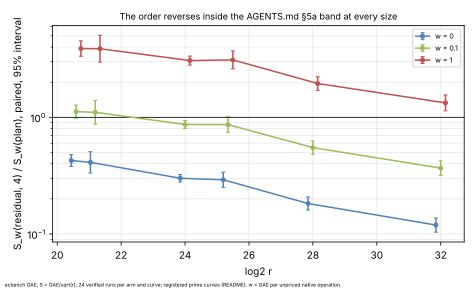
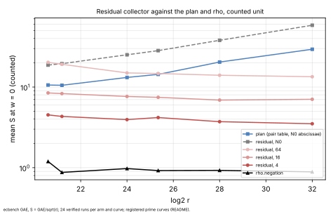
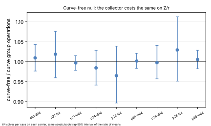

# The residual collector (large-prime limit) on prime curves

> **2026-10-26, follow-up.** The extrapolated crossing near log2 r ≈ 35 was measured in
> [`../ic_planner_exhaustive_20261026`](../ic_planner_exhaustive_20261026/README.md). At 36.0 and 36.25
> bits, res2 and res4 are cheaper than the plan at every band weight, with the intervals below 1. The gain
> is still generic (16-case null), and res2 is 2.6–24× rho across the band.

Measured 2026-10-26 under [`PROTOCOL.md`](PROTOCOL.md) (frozen in `c77297bda`,
wording fixed in `4aafbbffa`, both before any session). PDF: [`REPORT.pdf`](REPORT.pdf).
Atlas lead `LEAD-ICP-residual-partial-relations` and hypothesis `H-PFDR-cb9606`
(crypto-autoresearcher) asked for this prime-field measurement.

The residual collector is `ic_framework::residual` (`targets=residual`): it
keeps every residual of a partial decomposition and turns residual collisions
into relations, the `|D| = r` limit of the large-prime variation. It ran on six
registered prime curves (20.6–32 bits), against the `ic plan` recipe and
`rho.negation`.

## Result

**In the counted unit (w = 0) the collector with a 4-point base is 2.3–8.4×
cheaper than the plan.** The paired interval is below 1 at every size.

**That gain is entirely unpriced native work, so under AGENTS.md §5a it is not
an improvement:**
- At 1 GAE per native operation the same arm costs 1.33–3.89× the plan, with
  every interval above 1.
- The order reverses inside the band at every size, so the two are not ranked.
- The collector buys its group-operation savings with a table probe and insert
  on every step.

**The gain is also generic.** On a curve-free carrier (`Z/r`, random-bijection
key, same seeds) the collector costs the same: all nine intervals contain 1.

| curve | log2 r | S(plan) | S(res4) | S(rho) | res4/plan, w = 0 | w = 0.1 | w = 1 | res4 / rho, w = 0 |
|:--|--:|--:|--:|--:|:--|:--|:--|:--|
| `icv1-fp21-t377-d7bba3fb` | 20.59 | 10.59 | 4.51 | 1.19 | 0.426 [0.379, 0.479] | 1.119 [0.983, 1.274] | 3.886 [3.338, 4.525] | 3.78 [2.77, 5.16] |
| `icv1-fp22-tm2947-e15fed69` | 21.19 | 10.51 | 4.32 | 0.87 | 0.411 [0.333, 0.507] | 1.104 [0.873, 1.397] | 3.871 [2.972, 5.043] | 4.94 [3.65, 6.70] |
| `icv1-fp24-tm5099-a6f137c6` | 24.00 | 13.15 | 3.95 | 0.98 | 0.300 [0.279, 0.324] | 0.868 [0.801, 0.940] | 3.067 [2.806, 3.351] | 4.05 [3.38, 4.85] |
| `icv1-fp26-tm1775-7e8fb6df` | 25.35 | 14.36 | 4.18 | 0.92 | 0.291 [0.251, 0.339] | 0.866 [0.740, 1.013] | 3.105 [2.600, 3.709] | 4.54 [3.62, 5.70] |
| `icv1-fp28-t28201-65099091` | 28.00 | 20.40 | 3.72 | 0.93 | 0.182 [0.160, 0.207] | 0.550 [0.482, 0.628] | 1.949 [1.706, 2.228] | 4.01 [2.87, 5.61] |
| `icv1-fp32-t7319-90da43e9` | 32.00 | 29.40 | 3.51 | 0.89 | 0.119 [0.104, 0.137] | 0.367 [0.318, 0.424] | 1.330 [1.137, 1.555] | 3.95 [3.24, 4.82] |

- **Source:** paired `ecbench compare` (`--weight` for w > 0), cluster 95%
  intervals, 24 pairs each. Mean S per arm comes from `ecbench band`.
- **All arms:** in `analysis/summary.json`. Every arm verified 24 of 24 runs on
  every curve.

### Exponents (least-squares slope of ln total GAE on ln r, six sizes)

| plan | resN0 | res4 | res8 | res16 | res32 | res64 | rho |
|--:|--:|--:|--:|--:|--:|--:|--:|
| 0.634 | 0.644 | 0.470 | 0.480 | 0.475 | 0.470 | 0.449 | 0.480 |

- **Plan:** the pair-table recipe grows as about `r^{2/3}`.
- **Collector:** at any fixed base it grows as about `r^{1/2}`, with rho's
  exponent, at a constant 3.8–4.9× rho's counted cost.
- **Same collector at the plan's base:** `resN0` keeps the plan's exponent and
  costs 1.8–2.0× more.
- **Interpretation:** the collector is a birthday search with a base attached.
  The smaller the base, the cheaper.

### Curve-free null (H-PFDR-cb9606 part E)

`examples/ic_residual_curve_free_null.rs` gave the following ratios of mean
group operations per solve, curve-free / curve, with bootstrap 95% intervals
(64 solves each, both carriers 64/64 verified):

| | B = 4 | B = 16 | B = 64 |
|:--|:--|:--|:--|
| p21 | 1.018 [0.959, 1.075] | 1.009 [0.976, 1.042] | 0.996 [0.977, 1.015] |
| p24 | 0.964 [0.896, 1.038] | 0.984 [0.941, 1.028] | 1.001 [0.982, 1.020] |
| p28 | 1.029 [0.950, 1.112] | 0.997 [0.956, 1.040] | 1.005 [0.982, 1.028] |

## Predictions (PROTOCOL.md)

- **P1** (the cheapest `res*` arm below `plan`, interval below 1): **held in the
  counted unit** at every size (`res4`, 0.119–0.426). It does not hold across
  the band.
- **P2** (S grows with B; the cheapest arm is res4 or res8): **held**. res4 is
  cheapest at every size, and S rises monotonically from res4 to res64.
- **P3** (`resN0 / plan > 1` from p24 up): **held, at every size** including
  p21 and p22. The ratio is 1.77–1.98.
- **P4** (slopes about 1/2 for res16 and about 2/3 for plan): **held**, at
  0.475 and 0.634.
- **P5** (null intervals contain 1): **held**, 9 of 9.
- **P6** (every `res*` arm above rho): **held**, with res4 at 3.8–4.9× rho.

## Classification and decision

**Generic collision search, and not ranked against the plan across the §5a
band.**
- The counted-unit gain is a birthday search on `Z/r` (P4, P5) that moves its
  cost into native table work.
- Priced at 1 GAE per native operation it loses to the plan at every measured
  size.
- It moves no leaderboard row and changes no planner rule.

The lead's discriminator ("a fitted exponent near (1+β)/2 with total S below
the incumbent") is met only in the counted unit. Its own control (part E)
says the gain is generic, and the band says it is not an improvement.
Proposed disposition for the atlas: `closed_known`. Residual crediting on
prime fields is the birthday bound. It ties rho's exponent at about 4× rho's
constant, and it is band-dominated by the plan at 20–32 bits.

The w = 1 ratio falls with size, 3.89 to 1.33. It would cross 1 near log2 r ≈
35 if the trend held. That is an extrapolation, not a measurement; above that
size both arms would still be about 4× rho or more.

## Deviations from the protocol

- **No resume checkpoint.** `scripts/checkpoint.sh gate` could not upload: the
  session has no `CHECKPOINT_UPLOAD_TOKEN`. The owner told the session to
  proceed. Every input was committed and pushed before the run, and every
  output right after it.
- **Binary built after the freeze.** The binary was built at `b561ebca8`,
  later than the freeze. The commits in between add `ic.koblitz_descent` and
  operation counters in the Koblitz arithmetic, which no arm here uses.
  `ecbench plan` gives the same spec ids.
- **Bootstrap fix.** The null bootstrap first used an LCG that overflows jq's
  doubles, and its intervals did not contain their own points. It was replaced
  by MINSTD before these numbers were read (`scripts/null.jq`).

## Evidence

- **Specs:** `specs/p*.json` from `scripts/make_specs.sh`.
- **Card:** `cards/CARD-ic-improve-20261026-1.yaml` and its receipt (the same
  card ran the binary/Koblitz Phase A). The chain was `experiment-director` →
  `executor-mechanical`.
- **Sessions:** `sessions/p21`, `p22`, `p24`, `p26`, `p28` and `p32`, 256
  records each, all verified. Binary sha256 `d0ff6d06…85fa`; clean tree.
- **Audits:** `sessions/*.audit.json`, all OK with 12 exact replays each.
- **Derived:** `analysis/band-*.{txt,json}` (`ecbench band`);
  `sessions/*/comparisons/` (`ecbench compare --save`); `analysis/null-*.json`
  (the example); `analysis/summary.json` (`scripts/summary.sh`, with
  `scripts/null.jq` and `scripts/slope.jq`). Figures come from
  `scripts/plots.py`, which only lays out the plot.

## Note, 2026-11-01: byte counters are no longer priced as operations

This README and its `analysis/band-*` files are frozen as measured. The band
priced `residual_table_bytes_uncharged`, a byte count, at `w` GAE per byte; on
the `res*` arms that was 83-99% of S at w = 1 (63-98% at w = 0.1). The owner
decided (option B, 2026-11-01) that the band prices operations only
(`band.rs` `NON_OPERATION_COUNTERS`); the counter stays listed.
[`analysis/exbytes/`](analysis/exbytes/) holds the bands and the 24 weighted
comparisons re-run under that rule (same arms, weights and bootstrap seeds;
`sessions/` untouched). What changes:

- `plan` and `rho` rows are identical; every `res*` row at w > 0 drops. At w = 1,
  res4 / rho falls from 41-58x to 3.6-4.8x.
- All 24 weighted comparisons of `res4`/`res8` against `plan` go from
  "unresolved inside the band" to "res cheaper at every weight"
  ([`CHANGES.md`](analysis/exbytes/CHANGES.md)). The w = 0 results are unchanged.
- Any statement above that the residual collector loses to `plan` at w = 1 rests
  on the byte price and does not hold under the rule now in force.
Audit and rationale: [`research/ic_byte_counter_pricing_20261101`](../ic_byte_counter_pricing_20261101/README.md).
