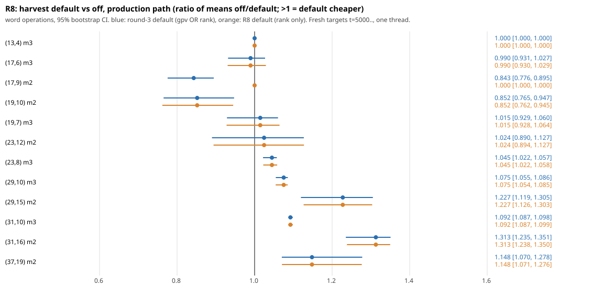

# R8: the linear-harvest default against "off" (2026-10-26)

Repair R8 of the 2026-10-16 audit (`docs/audits/REPAIR_FRAMEWORK_20261016.md`): shipped defaults had never been paired against "off". Status of the claim "the harvest default is not worse than off": **MEASURED, with two cells where it was worse; default narrowed** (below).



## 1. What ships, and the row that disagreed with the README

- The switch is `KIC_LINEAR_HARVEST` in `src/cryptanalysis/koblitz_groebner.rs` (`linear_harvest()`). Unset means `LINEAR_HARVEST_DEFAULT`.
- Before this PR the default was `root,gpv=0.9607,rank=331` (round 3 item 02, commit `9e69f57ef7`; harvest-on-by-default since `d1d034d942`).
- The regressing row is `research/ic_improve3_20261015/02-harvest-gate/runs/fit_test.jsonl`, line 78:

  `{"ratio":"I/G0","cell":"pipe-n17-l9-m2-a1/prod","targets":12,"gm":0.8731,"lo":0.7832,"hi":0.9736,"verdict":"REGRESSES",...}`

  `I` is harvest off and `G0` is the gpv-gated default; at this cell the item-02 default C fires exactly where G0 does, so the line is also off against the shipped default (line 102, I/C: 0.8721 [0.7709, 0.9880], REGRESSES; word operations line 162: 0.7653 [0.6864, 0.8564]). The item's README said "no cell regressed" and labelled the cells MATCHES, because it compared only against G0.

## 2. Paired default-vs-off measurement

- **Harness:** `examples/ic_improve3_02_harvest_gate.rs`, the item-02 instrument, unchanged. Arms `i:off / d:env / (r:r3) / i2:off`, one thread, arm order rotated by target index (the harness's own balanced rotation), `nice`, shared 14-core host under load (load average about 80). Fresh targets t = 5000.., not the train (0..11) or test (2000..) targets. Both `bench` (the root-set solve) and `prod` (`groebner_decompose`, node budget 4096, the path the default ships on) modes.
- **Cells:** the same 12 as item 02's test (12 targets, 8 at n >= 29), so the sizes the default ships for are covered.
- **Statistic:** per cell, ratio of means off/default (sum of thread CPU, or of word operations, over the targets) with a 95 % bootstrap CI over targets (`pool.py`). The pooled figure is the geometric mean of the 12 cell ratios, bootstrapped over targets within cells. A cell "loses" when its CI upper bound is below 1. Ratios above 1 mean the default is cheaper.
- **Metric caveat:** at the smallest cells a solve takes 2 ms and CPU is noise-dominated. The A/A arm (`i2`, a second off) and, after the change, the cells where default and off run identical code both show CPU ratios of 0.92 to 1.09. Word operations are deterministic and are the reliable metric for the small-cell question.
- **Same decomposition:** 247 of 248 prod and bench rows. The one difference is (37,19) target 5005, prod: off exhausted the node budget with no decomposition and the default found one.

### Round-3 default (`gpv OR rank >= 331`) against off, `runs/pool_r3default.txt`

| path | metric | geo-mean of 12 cell ratios | cells that lose |
|---|---|---|---|
| prod | CPU | 1.109 [1.066, 1.145] | 0 |
| prod | word operations | 1.044 [1.021, 1.062] | **2**: (17,9) m2 0.843 [0.778, 0.894], (19,10) m2 0.852 [0.759, 0.942] |
| bench | CPU | 1.145 [1.111, 1.176] | 0 |
| bench | word operations | 1.134 [1.124, 1.143] | 1: (17,9) m2 0.947 [0.936, 0.961] |

CPU at (17,9) m2 prod was 1.030 [0.913, 1.157] here against 0.873 [0.783, 0.974] in item 02's data. The two datasets agree on word operations (0.843 and 0.765) and disagree on CPU, so the CPU regression is neither reproduced nor excluded; the word-operation regression is reproduced.

### Per-cell, prod, ratio of means off/default (r3 default, then the R8 default)

| cell | CPU r3 default | word ops r3 default | word ops R8 default |
|---|---|---|---|
| (13,4) m3 | 1.082 [0.971, 1.213] | 1.000 | 1.000 (identical to off) |
| (17,6) m3 | 1.069 [0.985, 1.154] | 0.990 [0.935, 1.026] | 0.990 |
| (17,9) m2 | 1.030 [0.913, 1.157] | **0.843 [0.778, 0.894]** | 1.000 (identical to off) |
| (19,10) m2 | 1.014 [0.726, 1.353] | **0.852 [0.759, 0.942]** | **0.852** (the rank gate still fires; see 4) |
| (19,7) m3 | 1.036 [0.953, 1.094] | 1.015 [0.928, 1.063] | 1.015 |
| (23,12) m2 | 1.035 [0.913, 1.151] | 1.024 [0.889, 1.128] | 1.024 |
| (23,8) m3 | 1.002 [0.962, 1.036] | 1.045 [1.022, 1.058] | 1.045 |
| (29,10) m3 | 1.061 [1.048, 1.074] | 1.075 [1.055, 1.086] | 1.075 |
| (29,15) m2 | 1.336 [1.148, 1.496] | 1.227 [1.123, 1.300] | 1.227 |
| (31,10) m3 | 1.066 [1.036, 1.100] | 1.092 [1.087, 1.098] | 1.092 |
| (31,16) m2 | 1.232 [1.144, 1.332] | 1.313 [1.239, 1.351] | 1.313 |
| (37,19) m2 | 1.423 [1.365, 1.513] | 1.148 [1.069, 1.280] | 1.148 |

## 3. Decision

The default does not match off everywhere: it costs 15 to 16 % more word operations at (17,9) m2 and (19,10) m2 in production, in two independent datasets, with no CPU gain there. It wins in word operations (CI above 1) at (23,8), (29,10), (29,15), (31,10), (31,16) and (37,19), and in prod CPU at (29,10) m3, (29,15), (31,10), (31,16) and (37,19) (up to 1.42x at (37,19), 1.34x at (29,15)); every one of those cells has rank >= 331. Reverting the whole default to off would discard those wins, so the default is narrowed instead of switched off:

- `LINEAR_HARVEST_DEFAULT` is now `root,gpv=0,rank=331` (the size gate alone). `gpv=0` closes the gpv half. This is the "off at (17,9) m2" entry that the R10 ledger already pins (`kgb-harvest-v1`).
- `KIC_LINEAR_HARVEST=r3` restores the round-3 default as a same-binary control; `=0` is still the pre-harvest engine and `=gpv` still item 05's gate.
- `LINEAR_HARVEST_GPV` now sets its gpv bound explicitly rather than inheriting it from the default.

**Verification of the change** (`runs/r8n_*.jsonl`, `runs/pool_newdefault.txt`, same targets, arms off / new default / r3 / off):

- The new default is counter-identical to off at (13,4) m3 and (17,9) m2 (word operations 12 of 12 each, both modes, 0 harvests), and counter-identical to the round-3 default on every other cell (12 of 12, or 8 of 8, in both modes).
- Against off, prod: CPU geo-mean 1.084 [1.048, 1.119]; word operations 1.059 [1.037, 1.076]. Bench: CPU 1.152 [1.121, 1.183]; word operations 1.139 [1.129, 1.149].
- Cells that still lose: word operations (19,10) m2 prod, 0.852 [0.759, 0.942] (1 of 12). CPU: (17,9) m2 prod reads 0.919 [0.837, 0.997] although its code path is identical to off (word operations 1.000 in all 12 rows), so that is a CPU false positive of about 8 %, the noise floor of this host. The A/A arm there reads 0.947.
- Unit test `linear_harvest_keeps_every_root` passes with the new default, `r3` and the parse identities (`cargo test --release --lib linear_harvest`, 1 passed). The full koblitz_groebner unit-test sweep and the counter-identity checks against item 02's committed runs were not rerun.

## 4. What is left open (not fixed here)

- **(19,10) m2 still harvests under the rank gate** although its reported root rank is about 208: the size gate reads the largest rank among the node's inherited bases at the harvest point, not the root-rank column in the item's diagnostics, and that is at least 331 here. In production the harvest costs 15 % more word operations with no CPU gain beyond noise (bench CPU 1.20 [0.97, 1.49]). Fixing it needs a new gate fit, outside this repair.
- The gate threshold 331 and the cells above come from item 02's training; this repair did not re-fit them.

## 5. Caveats

- A broken `main`: at `baa1951357` the library does not compile (`src/cryptanalysis/binary_semaev_chain_sat.rs` has a missing closing brace from merge `4f1fa86ac1`, and `src/cryptanalysis/ecbench/methods.rs` has an unclosed delimiter at line 2298 from merge `671a5fb6c7`). The measurements were therefore built from the last first-parent commit that compiles, `be650cb44e`, with only `koblitz_groebner.rs` replaced by this branch's version (main differs from `be650cb44e` in that file by one line). The engine is the same; I did not repair main's compile errors (out of scope).
- Single host, one thread, shared and loaded (load average about 80 on 14 cores); thread CPU time was used. A unit-test build ran during part of the second measurement. CI could not run.
- 12 targets per cell (8 at n >= 29): intervals are wide at small cells.
- Binary and PDF outputs (`REPORT.pdf`) are pending S3 upload (credentials rejected); the SVG is committed.

## Reproduce

```sh
# build examples ic_improve3_02_harvest_gate on a commit where the lib compiles, then:
research/ic_r8_harvest_default_20261026/run_default_vs_off_r3default.sh   # r3 default vs off (needs the pre-change binary)
research/ic_r8_harvest_default_20261026/run_default_vs_off_new.sh         # new default vs off and r3
python3 -I pool.py runs/r8_a.jsonl runs/r8_b.jsonl
python3 -I pool.py runs/r8n_a.jsonl runs/r8n_b.jsonl
python3 -I plot.py
```

The run scripts hard-code the scratchpad build path used here; edit `B` and the working directory.
