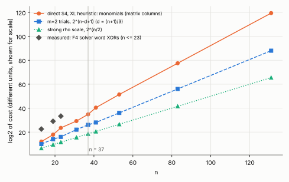

# A direct S4 solve at m = 3: why it does not run at n = 37

**Status: analysis plus prior measurements. No new experiment was run.** The XL figures are a
heuristic (labelled below), not a measurement. Script: `xl_estimate.sh`; data: `xl_estimate.csv`.

## Answer

A direct solve of the fourth summation polynomial over the factor base (`S4(x1, x2, x3, xR) = 0` with
`x1, x2, x3` in `V`) cannot be done at n = 37. Three independent routes agree:

| route | at n = 37 | source |
|---|---|---|
| linear oracle over symmetric coordinates | determined only while `31 l - 24 <= n`, so `l <= 1`; the m = 2 base here has `d = 12` | `research/geometric_v_linear_20261006` (measured at n = 131: reach `l <= 5`) |
| XL on the descended system (heuristic) | `D = 17`, about `2^34.8` monomials, about `2^70` matrix cells, **per anchor point** | `xl_estimate.sh` |
| F4 / F6 on the Weil descent (ecbench `pdp3-koblitz`) | word XORs `6.01e6, 5.42e8, 1.06e10` at n = 13, 19, 23; timed out at 3,600 s at n = 31; about `3.7e14` at n = 37 on the least-squares slope 1.079 per bit through the three medians (computed here) | `research/f6_ic_ecbench_ladder_20261005` (medians and the n = 31 timeout) |

That F4 baseline is itself a direct S4 solve at m = 3. The algebraic ladder (PR #2493) was compared with it by
fitted exponent (0.647 per bit in decomposition trials against 1.079 in solver word XORs); the units differ, so
I make no per-size claim.

## What the direct system is

On `y^2 + xy = x^3 + 1`, `S4` is the resultant of two `S3`'s, and in characteristic 2 it is a perfect
square. Working from that resultant by hand (`S3(x1, x2, t) = s^2 t^2 + p t + p^2 + 1`, `s = x1 + x2`,
`p = x1 x2`), I get `S4 = G^2` with

    G = (e1 + e3)^2 + e1 e4 + e3 + sqrt(e4) (e1 + e3),

`e_k` the elementary symmetric functions of `x1, x2, x3, xR`. This matches the identity the repository
verified numerically before (20,000 of 20,000 random quadruples at each of n = 13, 17, 23, 31, and `G = 0`
on all true 3-sums); I did not re-run that check.

With `x_i = u_i^2` and `x4 = xR` known, the descent of `G = 0` has n equations over F2 in `3d` unknown bits.
The term `sqrt(e4) e3` contains `u1^3 u2^3 u3^3 u4`, and `u^3 = u * u^2` is a product of two linear forms in the
bits of `u`, so the system has degree 6. Fixing `x1` and `x2` leaves a quartic in `x3`, which is the
pair-enumeration (collision) approach the owner excluded; fixing only `x1` leaves a system that is still not
linear in `(x2, x3)`. The only linear route is the "2 + 1" split through an intermediate point, which
reuses the two-summand solve.

## The XL estimate (heuristic)

For `N = 3d` unknown bits (`d = (n+1)/3`, the m = 2 optimum), n degree-6 equations, and multilinear monomials
(`b^2 = b`), XL needs `n * sum_{i<=D-6} C(N, i) >= sum_{i<=D} C(N, i) - 1`. This is the random-system
assumption; the real system is structured, and F4 can exploit structure that dense XL cannot.

| n | d | N | linear oracle `l_max` | XL degree D | log2 monomials | log2 m=2 trials `n-d+1` | log2 rho `n/2` |
|--:|--:|--:|--:|--:|--:|--:|--:|
| 13 | 4 | 12 | 1 | 10 | 12.0 | 10 | 6.5 |
| 19 | 6 | 18 | 1 | 11 | 17.8 | 14 | 9.5 |
| 23 | 8 | 24 | 1 | 13 | 23.5 | 16 | 11.5 |
| 31 | 10 | 30 | 1 | 15 | 29.2 | 22 | 15.5 |
| **37** | **12** | **36** | **1** | **17** | **34.8** | **26** | **18.5** |
| 41 | 14 | 42 | 2 | 19 | 40.4 | 28 | 20.5 |
| 53 | 18 | 54 | 2 | 23 | 51.4 | 36 | 26.5 |
| 83 | 28 | 84 | 3 | 31 | 77.5 | 56 | 41.5 |
| 131 | 44 | 132 | 5 | 45 | 119.4 | 88 | 65.5 |

The monomial count grows about `2^(0.9 n)` to `2^(1.0 n)` (slope 0.91 over the whole table, about 1.15 over
n = 13 to 23), faster than the m = 2 trial count `2^(n - d + 1) = 2^(2n/3 + 2/3)` and far above rho's `2^(n/2)`. The `l_max` column reproduces the
repository's measured `l <= 5` at n = 131, which is a consistency check on the formula, not a new result.
The measured F4 slope (1.079 per bit in word XORs over n = 13 to 23) is similar to the XL monomial slope over
the same range (about 1.15 per bit).

## Cost units

The ecbench ladder reports F4 at 1.1x, 1.6x and 2.1x the same-target rho at n = 13, 19, 23 (in group-addition
equivalents). Its report states that these are lower bounds: the solver's word XORs (`1.06e10` at n = 23)
are counted but not charged. Priced at 0.1 or 1 group addition each, as the cross-method rule requires, the
direct solve is far above rho at n = 23 already, so the ratios say nothing in its favour.

## The one m = 3 construction that does run at n = 37

The 2 + 1 split (PR #3212) produces three-term relations with the same yield per trial as m = 2 and needs
19x to 41x more relations to close an equation: 26x to 43x more decomposer calls than the two-summand cycle
stop. So three summands, direct or split, are measured worse than two summands here.

## What this does not show

- It does not run a direct solve. At n = 37 the heuristic and the extrapolation say it is out of reach; I did
  not measure it. The F4 extrapolation uses the fitted slope from n = 13 to 23 and the timeout at n = 31.
- A structured hybrid (fix some bits, linearize the rest) is not covered. The repository's earlier negative
  results at m = 3 and 4 (`ic_m3_algebraic_vs_mitm_20261014`) address chained and hybrid F4 / F6 / SAT variants.
- The XL count is for one anchor point and one right-hand side; relations per anchor point are about
  `2^(3d - n)` up to a small constant, so a full index calculus needs many such solves.

## Files

`xl_estimate.sh`, `xl_estimate.csv`, `plot.py`, `s4_direct_scaling.svg/png`, `REPORT.pdf`.
