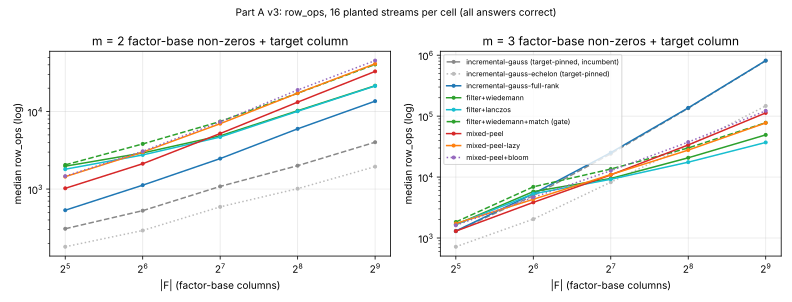
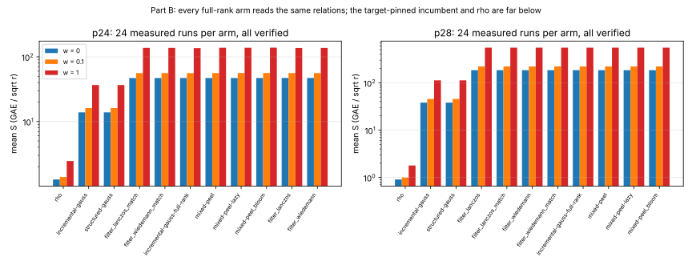

# Sketches, a structural-rank gate and a mixed solver for the IC relation-solving step

2026-11-15 to 2026-11-18. Protocol: [`PROTOCOL.md`](PROTOCOL.md), frozen in `735883bee6`
before any data. Changes after data: [`AMENDMENTS.md`](AMENDMENTS.md) (A1 bug fixes, A2 a new
arm with its own predictions, A3 a defect found on real curves). PDF: [`REPORT.pdf`](REPORT.pdf).
Every figure here is **[pcc:unverified]**: no validator report, no `VALIDATION.json`, no
leaderboard row is claimed.

## Result in one paragraph

No sketch (Bloom, HyperLogLog, count-min, XOR/ribbon, cuckoo) and no linear-algebra device
(structural-rank gate, mixed peel/Markowitz solver, Dulmage–Mendelsohn, nested dissection,
sort-merge join) reduced the counted cost of index calculus. On real prime curves the cost
is fixed by the **relations read**, and the target-pinned incumbent (`incremental-gauss`)
already stops at the earliest row that can determine the target: Dulmage–Mendelsohn found
zero slack on 128 of 128 streams. Every full-rank arm, the new ones included, reads
3.4–4.9× more relations than the incumbent, and the incumbent is still 11–42× rho at
w = 0. **There is no improvement over the IC baseline here; the gap to rho is unchanged.**

## What was built (`src/cryptanalysis/ic_framework/linalg_mixed.rs`, `linalg.rs`)

| arm | what it is |
|:--|:--|
| `filter+wiedemann+match`, `filter+lanczos+match` | the deferred sparse solvers behind a **structural-rank gate**: an incremental maximum row–column matching; no solve while it is below `cols` |
| `mixed-peel` | gate decides *when*; the matching picks a square block; two-sided **IBLT-style peeling**; **Markowitz** on the 2-core; non-zero pivots certify rank (one solve, not two); surplus rows checked. A3: if the block is singular, eliminate over all rows |
| `mixed-peel-lazy` | the same with a lazily built gate, worklist peeling and a bucket-queue pivot (A2) |
| `mixed-peel+bloom` | `mixed-peel` with a **Bloom duplicate screen** before an exact check |

Every new arm charges its bookkeeping (matching visits, queue and weight updates, hashes)
in `row_ops`; the existing arms do not charge theirs, so the new arms are measured
conservatively. Unit tests: 12 of 12 pass (`cargo test --release --lib -- ic_framework::linalg`).

## Part A: planted streams (`examples/ic_mixed_solver_stream.rs`, 1,760 records, all correct)

|F| ∈ {32…512}, m ∈ {2, 3}, 16 seeds, random coefficients. Medians: [`analysis/partA_v3_summary.json`](analysis/partA_v3_summary.json).

| prediction | outcome |
|:--|:--|
| P1 gate reads ≤ rows and costs less | **failed**: same rows on 98.75 % of streams; its visits raise row_ops at every |F| ≥ 64 |
| P2 `mixed-peel` reads the rows of `incremental-gauss-full-rank` | held, 100 % — **on random coefficients only** (A3) |
| P3 `mixed-peel` row_ops below `filter+wiedemann` / full-rank Gauss | partial: below `filter+wiedemann` only at |F| ≤ 64; below full-rank Gauss only at m = 3 (113k vs 816k at |F| = 512) |
| P4 Bloom screen is pure overhead | held: 0 duplicates, more row_ops on every stream |
| Q1 / Q4 lazy arm reads the same rows; old arms reproduce | held / held (v3 = v2 byte for byte; v4 after A3 = v3 byte for byte) |
| Q2 / Q3 lazy arm cheaper than `mixed-peel` / best full-rank arm | failed (2/10 cells) / failed (1/10) |



## Part B: ecbench on p24 and p28 (`specs/partB-*.json`, 704 records, all verified)

`prime-abscissa:size=128`, `mitm-prime-blocked:m=2`, `walk`, 8 targets × 3 measured rounds,
`rho.negation` as the matched reference. Audits: 352/352 verified and 12/12 replays reproduced
on each curve ([`analysis/partB-p24.audit.json`](analysis/partB-p24.audit.json),
[`analysis/partB-p28.audit.json`](analysis/partB-p28.audit.json)). Wall time is L0
(`--allow-busy`: the container's idle CPU pressure is above ecbench's quiet threshold).

| curve | arm | mean S, w = 0 / 0.1 / 1 | relations read |
|:--|:--|:--|--:|
| p24 | `rho.negation` | 1.27 / 1.39 / 2.45 | — |
| p24 | `incremental-gauss` (incumbent, target-pinned) | 13.85 / 16.13 / 36.66 | 74 |
| p24 | `incremental-gauss-full-rank` | 47.06 / 55.99 / 136.39 | 341 |
| p24 | `filter+wiedemann` / `+match` | 47.06 / 56.08 / 137.23 · 47.06 / 56.12 / 137.63 | 341 |
| p24 | `mixed-peel` / `-lazy` / `+bloom` | 47.06 / 56.16–56.22 / 138.10–138.68 | 341 |
| p28 | `rho.negation` | 0.90 / 0.99 / 1.79 | — |
| p28 | `incremental-gauss` | 37.98 / 45.45 / 112.63 | 69 |
| p28 | every full-rank arm | 184.29 / 220.93–221.00 / 550.69–551.38 | 362 |

Paired comparisons (`ecbench compare`, verdicts in [`analysis/partB_comparisons.json`](analysis/partB_comparisons.json)):

- `mixed-peel` / `incremental-gauss-full-rank` at w = 1: 1.0125 [1.008, 1.017] (p24), 1.0010 [1.001, 1.001] (p28); at w = 0 exactly 1: **unresolved inside the band**.
- gate / no gate (`filter+wiedemann`): 1.0029 [1.000, 1.006] (p24), 1.0003 (p28): unresolved.
- Bloom / no Bloom: 1.0042 (p24), 1.0003 (p28): overhead.
- full-rank / target-pinned: 3.72 [3.42, 4.05] (p24), 4.89 [4.14, 5.78] (p28), **dearer at every weight**.
- **Distance remaining**, incumbent / rho: 10.9 / 11.6 / 15.0 at w = 0 / 0.1 / 1 (p24); 42.0 / 45.8 / 63.1 (p28).

**A3, the finding of this part.** Real index-calculus rows are `±x_i ± x_j + b·t = a`. With ±1
coefficients a full matching does not make the matched square block non-singular (an even ±1
cycle is singular whatever rows are matched), so the protocol's Schwartz–Zippel argument fails.
Part B v1 ([`sessions/aborted-A3/`](sessions/aborted-A3/)) exhausted the 10⁸-trial cap on 11 of 32
p24 runs; after the all-rows fallback every run verified, and the fallback fired on 8/24 (p24)
and 10/24 (p28) runs per `mixed-peel` arm. Structural rank is therefore a sound *necessary*
gate on IC matrices but not a sufficient one.



## Part C: a Bloom "seen-twice" gate on large-prime partials (`ic.large_prime`, 32 runs verified)

Large-prime merge work is 55 of 67,353 native operations a run (0.08 %); the large-prime store
holds 3.7 pivots a run. A Bloom gate has nothing to save, and what it could save is native
work, so S at w = 0 cannot move ([`analysis/partC_summary.json`](analysis/partC_summary.json)).

## Six more algorithms, run in parallel with independent checks (`alt/`)

Each lane was written by one agent and re-run by a second agent told to refute it. Every
lane reproduced. Details and the checkers' notes: `alt/<lane>/README.md`, `alt/<lane>/SKEPTIC.md`.

| lane | result | lever |
|:--|:--|:--|
| XOR / ribbon filter, desk model (N83) | +13–21 % factor base in the same 15.25 GiB, but only against the weakest layout (`root4`); `root11` already sits within 3 % of its payload. Cold cost rises 663 s → 850–951 s (gap 284× → 364–407×) | memory only |
| XOR / ribbon filter, built | 9.8 bits/key (XOR8), 8.8–9.2 (ribbon8) vs 11.5 (Bloom); FPR at theory. No gain on p24/p28; the 1.06–1.55× memory-bound gain is a cost model, not a run | memory only |
| cuckoo filter / table | load 0.95, 28.4 bits/key; worse than exact once lookups are priced; deletion-based base eviction lost to a static base | memory only |
| Dulmage–Mendelsohn | **zero slack** on 128/128 streams: the incremental solver already stops at the earliest determining row | linear algebra only |
| nested dissection / AMD | neither beats Markowitz on the 2-core; none beats `filter+lanczos` at |F| = 128–512 | linear algebra only |
| sort-merge batch join | same group operations and hits; native word ops up 5–43× | none |

## What this rules in and out

- Sketches only replace exact structures; in this cost model they can move memory and native
  work, never group operations, and where memory does bind (N83) the larger base they allow
  raises the one-target cost.
- The relation-solving step cannot reduce the relations read: the target-pinned solver is
  already optimal in rows (Dulmage–Mendelsohn). Further progress has to come from the
  decomposition step or the factor-base design.
- Kept as engineering: the structural-rank gate is a cheap, sound necessary condition, and
  the A3 observation (±1 IC rows defeat matching-based rank certificates) applies to any
  future solver that tries to certify rank structurally.

## Deviations

- No resume checkpoint upload (no token or AWS identity in the container); every input was
  committed and pushed before each run.
- Runs were local, not on EKS (no AWS identity); unit is deterministic counted GAE; wall L0.
- `research-kb` and the `crypto-autoresearcher` lead atlas are absent from the container;
  "untried" means "not found in `crypto` or `cryptanalysis`".
- Part A v1 and Part B v1 aborted on defects; both kept as observed (A1, A3).
- P1's attempt-count clause is not scorable: the ungated arms emit no attempt counter
  (kept so their records stay byte-identical); P1 fails on row_ops regardless.

## Reproduce

```sh
cargo build --release --bin ecbench --example ic_mixed_solver_stream
./target/release/examples/ic_mixed_solver_stream partA/stream-v3.jsonl 16   # Part A
./target/release/ecbench run --wait --allow-busy --spec specs/partB-p24.json --out sessions/partB-p24
./target/release/ecbench verify --dir sessions/partB-p24 --replay 12
./target/release/ecbench band --dir sessions/partB-p24
python3 analysis/partA_summary.py partA/stream-v3.jsonl; python3 analysis/partB_summary.py
python3 analysis/partC_summary.py; python3 analysis/figures.py; python3 analysis/figures_partB.py
```
