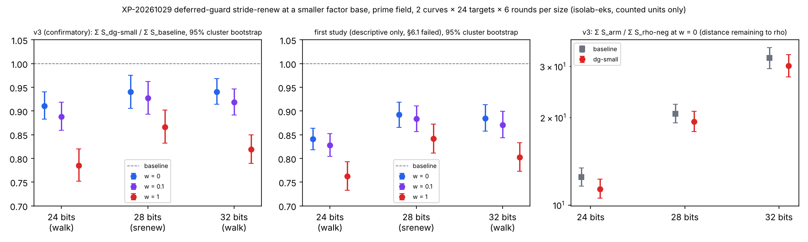

# Prime-field IC: deferred-guard stride-renew at a smaller factor base (XP-20261029)

Two studies of the same question share this directory. Neither study's numbers are pooled with the other's.

- **First study:** `backlog/XP-20261029-srenew-deferred-guard/`, `PROTOCOL.md` + `AMENDMENT-01.md` (route only). Its §6.1 failed at every size, so it is **undecidable** and reported **descriptively** only (`first-study/`).
- **v3 follow-up:** `backlog/XP-20261029-srenew-deferred-guard-v3/`, `PROTOCOL.md` + `APPROVAL.md` + `P32-TRIGGER.md`. Fresh curves, frozen before any execution. This study is **confirmatory** (`v3/`).

Unit: `S = total GAE / √r`, cold, whole pipeline, priced at w = 0, 0.1 and 1 GAE per unpriced native operation (AGENTS.md §5a). Every number below is a counted-unit figure read from `ecbench compare --weight` or `ecbench band --ranks` output in `*/P<b>/analysis/`. **No wall-time figure is a claim here** (v3 §10).

## Decisions (v3)

`dg-small` is `targets = stride-renew-deferred-guard` (#2831) at the smaller factor base N_b. The baseline is the current leaderboard baseline at each size. The table gives Σ S_dg-small / Σ S_baseline with its 95% cluster bootstrap (targets, 4,000 resamples, seed 20261002). Each size has 288 matched pairs.

| b | baseline (N_inc) | N_b | w = 0 | w = 0.1 | w = 1 | band (§6.4) | outcome |
|--:|:--|--:|:--|:--|:--|:--|:--|
| 24 | `walk` (162) | 130 | 0.9105 [0.8824, 0.9402] | 0.8884 [0.8594, 0.9189] | 0.7848 [0.7519, 0.8197] | `dg-small < walk` on both curves | **improvement** |
| 28 | `srenew` (407) | 267 | 0.9400 [0.9057, 0.9756] | 0.9270 [0.8929, 0.9625] | 0.8658 [0.8318, 0.9016] | `dg-small < srenew` on tm16691; **unresolved** on tm7951 | **not an improvement** (§6.4 fails); baseline kept |
| 32 | `walk` (1024) | 741 | 0.9406 [0.9144, 0.9681] | 0.9187 [0.8918, 0.9468] | 0.8189 [0.7897, 0.8496] | `dg-small < walk` on both curves | **improvement** |

§6.1–§6.3 hold at all three sizes: 288/288 `dg-small` and 288/288 baseline runs verified `[d]G = Q`, there are no censored pairs, and all three upper bounds are below 1. At 28 bits the per-curve band on `icv1-fp28-tm7951-a51cdbf3` is unresolved. The per-curve S figures there are `dg-small` 20.844 / 22.500 / 37.411 against `srenew` 20.646 / 22.745 / 41.640 at w = 0 / 0.1 / 1: higher at w = 0 and lower at w = 0.1 and w = 1. That fails §6.4, so 28 bits keeps `srenew`, as frozen. The pooled ratio does not overrule the per-curve rule.

## Distance to matched rho (v3)

This is Σ S_arm / Σ S_rho-neg (`rho.negation`, same session, same targets), with a 95% interval. It is the distance remaining, not a gate.

| b | arm | w = 0 | w = 0.1 | w = 1 |
|--:|:--|:--|:--|:--|
| 24 | `walk` | 12.48 [11.60, 13.41] | 12.49 [11.60, 13.44] | 12.56 [11.60, 13.58] |
| 24 | `dg-small` | 11.36 [10.55, 12.26] | 11.10 [10.30, 11.99] | 9.86 [9.10, 10.68] |
| 28 | `srenew` | 20.62 [19.18, 22.24] | 20.49 [19.05, 22.11] | 19.90 [18.44, 21.55] |
| 28 | `dg-small` | 19.39 [17.87, 21.04] | 19.00 [17.51, 20.62] | 17.23 [15.82, 18.76] |
| 32 | `walk` | 32.07 [29.48, 34.87] | 32.00 [29.42, 34.80] | 31.71 [29.11, 34.50] |
| 32 | `dg-small` | 30.16 [27.61, 32.93] | 29.40 [26.91, 32.11] | 25.96 [23.73, 28.37] |

Rho remains about 11× cheaper at 24 bits and 30× at 32 bits. The gap grows with size, as it did before this change.

## Predictions against results (v3)

The predictions are frozen in the first study's §7 and carried byte for byte into v3 §1.

| # | prediction | v3 measured | held? |
|:--|:--|:--|:--|
| 1 | `dg / srenew` = 1.000 ± 0.002 at w = 0; ≈ 0.95–0.97 at w = 0.1; ≈ 0.75–0.79 at w = 1 | 1.0000 / 0.956–0.959 / 0.756–0.766 (24, 28, 32) | yes |
| 2 | `srenew-small / srenew` < 1 at w = 0 (≈ 0.83–0.95), > 1 at w = 1 (≈ 1.10–1.12): relabelling | 0.927 / 0.940 / 0.950 at w = 0; 1.074 / 1.233 / 1.176 at w = 1 | in direction; magnitudes outside the modelled ranges at 32 bits (w = 0) and at all sizes (w = 1) |
| 3 | `dg-small` < baseline at every weight; vs `srenew`: 0.95/0.92/0.79 (24), 0.83/0.82/0.80 (28), 0.89/0.88/0.80 (32) | 28 bits: 0.940/0.927/0.866. Against `walk` (prediction × measured `srenew/walk`): 24 bits predicted ≈ 0.93/0.91/0.80, measured 0.911/0.888/0.785; 32 bits predicted ≈ 0.88/0.87/0.79, measured 0.941/0.919/0.819 | in direction everywhere; smaller than modelled at 28 and 32 bits |
| 4 | Model risk: if the trial count does not scale as 1/N, prediction 3 fails first at w = 0 at 24 bits | 24 bits passed; the shortfall is at 28 and 32 bits | the stated failure mode did not occur where predicted |

**Attribution (descriptive).**
- `dg-small / srenew-small` is the guard at N_b. It is exactly 1.000 at w = 0 and 0.70–0.73 at w = 1 at all sizes.
- `srenew-small / srenew` is N alone. It is the relabelling pattern: lower at w = 0, higher at w = 1.
- So the gain at w = 0 comes from the smaller N, and the deferred guard is what stops it turning into a loss at w = 1.

## First study (descriptive only)

**Why it is undecidable.** The first study's §6.1 required that "the L2 gate admits every execution". The image's ecbench (`be2969ce`) grades with version 3 (`MIN_SOLVE_WALL_NS_V3 = 1 ms`, af5c849922, 2026-10-23), which never admits the wall time of a solve under 1 ms. The gate refused the following `rho-neg` / `rho-neg-aa` executions:

| b | refused | solve times |
|--:|--:|:--|
| 24 | 672 (all) | — |
| 28 | 236 | 140–998.5 µs |
| 32 | 12 | 704–965 µs |

Every IC execution was graded L2, every audit was ok and every replay identical. **This was a design error in that protocol:** its §6.1 was written against expectations from an image that predates grading v3. The rule was not relaxed after the fact. The v3 protocol was frozen on fresh curves before any of its executions, and 32 bits ran in v3 only because the first study's P32 failed §6.1 as written (`P32-TRIGGER.md`, recorded before any first-study P32 compare was opened).

Its ratios are Σ S_dg-small / Σ S_baseline, read from `first-study/P<b>/analysis/compare-*.json`:

| b | w = 0 | w = 0.1 | w = 1 |
|--:|:--|:--|:--|
| 24 (`walk`) | 0.8407 [0.8185, 0.8633] | 0.8281 [0.8047, 0.8522] | 0.7624 [0.7327, 0.7931] |
| 28 (`srenew`) | 0.8922 [0.8653, 0.9190] | 0.8837 [0.8565, 0.9109] | 0.8415 [0.8108, 0.8727] |
| 32 (`walk`) | 0.8847 [0.8572, 0.9134] | 0.8709 [0.8435, 0.8994] | 0.8026 [0.7731, 0.8330] |

These ratios are larger effects than v3's, on other curves. They are reported next to v3 as v3 §8 requires and play no part in any decision.

## What ran

| study | b | job | curves | outcome of §6.1 |
|:--|--:|:--|:--|:--|
| first | 24 | `ic-dg-p24-20261029` | `icv1-fp24-t553-4d349218`, `icv1-fp24-tm589-5e500858` | failed (672 rho executions below L2) |
| first | 28 | `ic-dg-p28-20261029` | `icv1-fp28-tm13337-3a482fe3`, `icv1-fp28-tm5065-1146b4a5` | failed (236) |
| first | 32 | `ic-dg-p32-20261029` | `icv1-fp32-t46781-77aa234d`, `icv1-fp32-tm11535-8e4578de` | failed (12) |
| v3 | 24 | `ic-dg3-p24-20261029` | `icv1-fp24-tm241-91a7fdd0`, `icv1-fp24-tm2519-cce74591` | held: exit 42, single pod, 672 rho executions waived under condition 5 (84.7–996.3 µs) |
| v3 | 28 | `ic-dg3-p28-20261029` | `icv1-fp28-tm16691-2ecb61f0`, `icv1-fp28-tm7951-a51cdbf3` | held: exit 42, 200 waived |
| v3 | 32 | `ic-dg3-p32-20261029` | `icv1-fp32-tm103307-fa421912`, `icv1-fp32-tm24839-2a7bda13` | held: exit 42, 14 waived (547.5–933.1 µs) |

**v3 §6.1 checks.** At every v3 size:
- the audit is ok and complete, with 0 problems and 2,304/2,304 replays identical;
- both A/A ratios are exactly 1.0 at all three weights;
- `input-spec.json` is JSON-equal to the frozen spec, and `build-info.json` names `be2969ce` and ecbench `88070375…412c`;
- every IC execution is L2;
- `invalid_outcomes` is empty.

`v3/P<b>/analysis/gate_v3.json` recomputes the exit-42 clause from both `l2-gate.json` and `session/records.jsonl`, and the two agree.

**Route.** The route is `AMENDMENT-01.md`:
- image `isolab/tasks@sha256:cf0dcc8b…620c`, built from `be2969cebf30a0cfb79088fd10094324c3efb3bb` with ecbench sha256 `88070375e77648aa12a561ff9ee59e34d469c55e1da56987234811b0956e412c`;
- `launch-remote` on EKS Spot (c8a.2xlarge, L2 isolation requested, 3,600 s);
- frozen `experiment-director` cards run unchanged by `executor-mechanical` (`launch/`, `cards/`).

Results were checked against each job's `SHA256SUMS`. Large result files are stored through `tools/artifacts` (`.artifacts.json` pointers); `python3 tools/artifacts/artifacts.py pull research/ic_srenew_deferred_guard_20261029` restores them.

**Disclosure.** The first study's analysis card header says the jobs were "launched … with GitHub workflow_dispatch". That wording is stale: the jobs were launched by `launch-remote`, per `AMENDMENT-01.md`. The card was not edited after freezing.

## Validation

Independent validation **VAL-20261029-e85dcc: passed** (`v3/validation/`, `VALIDATION.json`; `scripts/validation_gate.py evidence` → valid). Rows: the four 24- and 32-bit curves. 28 bits is not covered.

| b | verdict |
|--:|:--|
| 24 | pass |
| 32 | pass with caveats: the gain is smaller than the §7 model, and the w = 0 upper bound is 0.9681 |
| 28 | agrees: not an improvement (band unresolved on `tm7951`) |

What the validator checked:
- **Data integrity.** All 57 worker files match the S3 originals byte for byte, and the committed evidence matches S3. The protocol was pushed (07:56:20Z) before the first job (08:01:04Z).
- **Replay.** `ecbench verify --replay-all` on another host reproduces 2,304/2,304 measured runs identically at 24 and at 32 bits. It used the same binary, because no older binary has the target source.
- **[d]G = Q.** The validator's own arithmetic confirms it on all 2,688 records per size.
- **Recompute.** A standard-library recompute of every compare file and the band table agrees with the analysis exactly. Over 11 more bootstrap seeds, every upper bound stays below 1.
- **§6.1.** It was rechecked from `records.jsonl`, including the exit-42 clause and the waived sub-ms rho executions (672 at 24 bits, 14 at 32).
- **Arms.** `walk` and `dg-small` differ only in `targets` and `factor_base`.
- **Charging.** The deferred guard's confirming additions are charged.
- **Mechanism.** At w = 0 the gain is the smaller set-up N(N+1), net of extra trials; the trials follow T ∝ 1/N. At w > 0 it is the guard probes no longer made. Charged GAE itself falls (0.910 at 24 bits, 0.941 at 32), so this is not an accounting shift.
- **Not resolved.** The stride-renew stream alone is not resolved against `walk` at either size.

Promotion of `dg-small` to the baseline at 24 and 32 bits follows the frozen §6 rule. The validator's report records evidence admissibility, not authorization.

## Limits

- Two curves per size and 24 targets per curve. The 28-bit verdict turns on one curve's band, and another sample could go either way.
- The result is engineering at a fixed oracle (`mitm:negation_folded=1`) and `linalg = incremental-gauss`. It makes no exponent claim.
- N_b came from a design-time model. It was not swept, so the optimum N under the deferred guard is not measured.
- Counted units only. The `rho-neg` executions waived under v3 condition 5 contribute counts and never wall time.
- Rho is still 11–30× cheaper over this range in this unit.
