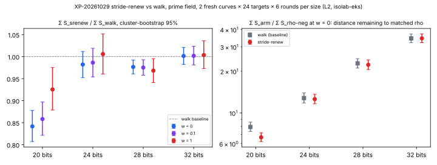

# Prime-field IC: `stride-renew` relation targets against the walk (XP-20261029), 2026-10-29

This is the run of the frozen protocol [`backlog/XP-20261029-stride-renew-prime/PROTOCOL.md`](../../backlog/XP-20261029-stride-renew-prime/PROTOCOL.md)
(commit `4d4593a`, no amendments). One parameter changes in the prime-field `ic.pipeline` baseline: the relation-target
source, from `targets = walk` (16 precomputed jumps `[a]G + [b]Q` plus pooled restart offsets, each a charged
scalar multiplication) to `targets = stride-renew` (`R ← R + S`, renewing `S ← S + T` after every relation;
four scalar multiplications of set-up). The factor base and the oracle (`mitm:negation_folded=1`) are the incumbents
at each size. Each size is decided on its own.

## Decisions (§6)

`Σ S_srenew / Σ S_walk` over 288 matched pairs per size (2 fresh curves × 24 targets × 6 rounds), with
cluster-bootstrap 95% intervals (4,000 resamples, seed 20261002). The values are *recorded*: `ecbench compare --weight W`,
the `ops` block of `P<b>/analysis/compare-walk__srenew-w*.json`.

| bits | N | w = 0 | w = 0.1 | w = 1 | band, per curve | decision |
|--:|--:|:--|:--|:--|:--|:--|
| 20 | 45 | **0.842 [0.807, 0.878]** | **0.858 [0.821, 0.897]** | **0.926 [0.879, 0.975]** | srenew < walk on both | **improvement** |
| 24 | 162 | 0.982 [0.952, 1.012] | 0.986 [0.954, 1.019] | 1.006 [0.961, 1.052] | split (one each way) | null at this sample size |
| 28 | 407 | **0.977 [0.961, 0.992]** | **0.975 [0.958, 0.993]** | **0.968 [0.941, 0.995]** | srenew < walk on both | **improvement** |
| 32 | 1024 | 1.001 [0.983, 1.021] | 1.002 [0.981, 1.023] | 1.004 [0.973, 1.036] | split (one each way) | null at this sample size |

- **§6.1 instrument: holds at every decided size.**
  - Each session audit is `ok`.
  - Each L2 gate admitted all 1,680 executions.
  - `walk-aa/walk` and `rho-neg-aa/rho-neg` are exactly 1.000 at every weight.
  - Each worker's `input-spec.json` is JSON-equal to the frozen `spec-P<b>.json`. The worker re-serialises it, so the bytes differ.
  - Every downloaded file verifies against its job's `SHA256SUMS`.
- **§6.2 completeness: holds at every size.** All 288 measured runs of `srenew` and of `walk` verified `[d]G = Q`, with 0 censored pairs.
- **§6.3–6.4:** see the table.

Both improvements passed the validation gate: an independent validator (P20 pass, P28 pass with caveats) and
[`VALIDATION.json`](VALIDATION.json) (`scripts/validation_gate.py evidence` reports `valid`). See [Validation](#validation).

Figure. Left: `Σ S_srenew / Σ S_walk` per size and weight. Right: the distance to matched rho at w = 0 (log scale).
Intervals are cluster-bootstrap 95%. The values are copied from `P<b>/analysis/compare-*.json`;
[`figures/plot.py`](figures/plot.py) does layout only.

## Distance remaining to matched rho

`Σ S_arm / Σ S_rho-neg` (`P<b>/analysis/compare-rho-neg__*.json`), at w = 0 / 0.1 / 1:

| bits | walk (baseline) / rho-neg | srenew / rho-neg |
|--:|:--|:--|
| 20 | 7.92 / 8.19 / 9.51 | **6.67 / 7.03 / 8.80** |
| 24 | 12.81 / 12.89 / 13.28 | 12.58 / 12.72 / 13.36 |
| 28 | 22.78 / 22.33 / 20.23 | **22.25 / 21.77 / 19.59** |
| 32 | 34.50 / 34.04 / 31.98 | 34.55 / 34.10 / 32.10 |

Rho stays ahead at every size and weight. At 20 bits stride-renew lowers the ratio to rho by about a sixth at w = 0 (7.92 to 6.67). The
gap grows with size for both arms, because the IC baseline's cost exponent is above rho's.

## Pre-registered predictions (§7)

- **Prediction 1 holds.** At 20 bits `srenew/walk` is below 1 at every weight. It is 0.842 at w = 0, at the low edge
  of the predicted 0.85–0.90 and above the pilot's 0.74.
- **Prediction 2 mostly holds.** The gain shrinks with size, and at 32 bits it is under 5% and the interval contains 1.
  It does not shrink monotonically, though: 24 bits is null while 28 bits resolves a gain of about 2–3%.
- **Prediction 3 fails at 20 bits.** There the ratio at w = 1 (0.926) is well above the ratio at w = 0 (0.842).
  Stride-renew removes charged work (scalar multiplications) more than unpriced native work, so the native share of
  its cost is larger. At 24–32 bits the ratio is flat across the band, as predicted.

## Run 1 at 32 bits (inadmissible, kept)

The first 32-bit job, `ic-srenew-p32-20261029` (pod `871976a3-bb93-4450-93cd-e22ed581bc61`), completed and its audit
passed. Its L2 gate, however, refused 1 of 1,680 executions: seq 1605, arm `rho-neg`, "L2: 51.0 preemptions per second".
The job exited with code 42 and Kubernetes recorded BackoffLimitExceeded. This fails §6.1, so the size was rerun whole
under a new job name, `ic-srenew-p32r2-20261029`, as §4 provides for a host failure. The rerun's request is
byte-identical apart from `job_name`, and so is its spec. Run 1's files are in [`P32-run1/`](P32-run1/), with the
launcher's Kubernetes receipts in `P32-run1/launch/k8s-diagnosis/`. Its counted costs are identical to the
rerun's on every record (arm, workload, round, `cost`), as the seed law predicts. Only the isolation evidence differs.

## What ran

- **Specs:** `spec-P{20,24,28,32}.json`, frozen. Each session has 5 arms (`walk`, `srenew`, `walk-aa`, `rho-neg`,
  `rho-neg-aa`), 2 fresh `prime_search` curves, 24 public targets per curve, and 1 warm-up plus 6 measured rounds in
  `alternate` order, at L2.
- **Route:** isolab-eks, using the AWS launcher (`taskq/deploy/eks-karpenter/remote/launch-remote`), on c8a.2xlarge
  EKS Spot (AMD EPYC), with a 3,600 s deadline and the image's ecbench (sha256 `583e62f0…`, source `cb2ec687`).
- **Cards:** the cards in [`launch/`](launch/) were written by the experiment director and run unchanged by the
  mechanical executor.
  - Card -01 launched 28 and 32 bits. Its 20- and 24-bit StartBuild calls were refused by the project limit of
    2 concurrent builds, and no builds were created.
  - Card -02 was refused before any launch, because its build-count check passed a pagination token as a build id.
  - Card -03 launched 20 and 24 bits.
  - Card -04 launched the 32-bit rerun.
  - Relay cost: about $0.70 for the director and $0.03 for the executor across the four cards.

| bits | job | pod UID | launcher build |
|--:|:--|:--|:--|
| 20 | `ic-srenew-p20-20261029` | `8d5ba87a-31b6-46fb-9d07-14bee7f6c08b` | `39249581-2bd0-4de9-9074-a52dddaf2bfc` |
| 24 | `ic-srenew-p24-20261029` | `2ff68e87-1772-49af-a486-ff30289d8a02` | `d8cbafda-bdfb-4a9a-9dc7-d4884b81367f` |
| 28 | `ic-srenew-p28-20261029` | `e8fc61b5-4fb6-4257-b3ae-0692df8ff7c4` | `9f4ced4b-54d8-4399-8768-67116a7eadc2` |
| 32 | `ic-srenew-p32r2-20261029` | `d81ec87e-f144-49ae-8a91-4f7aff1fa08c` | `51eddb57-255f-4261-a151-1c5b3b89e548` |

Results are under `s3://isolab-results-104186811093-us-east-2/runs/<job>/<pod UID>/`, and are copied to
`P<b>/eks-results/`. Large files are in the artifact store.

## Validation

An independent validator (report `VAL-20261029-4aed57`, [`validation/validation_report.yaml`](validation/validation_report.yaml)) re-checked
P20 and P28 from the raw records. Verdict: **P20 pass, P28 pass with caveats**. What it checked:

- **Hashes:** every file against its job's `SHA256SUMS`, streamed from S3.
- **Spec and instrument:** the spec equals the frozen one, the worker audit is ok, the L2 gate admitted all executions, and both A/A controls are exactly 1.
- **Completeness:** 288/288 runs verified per arm, with 0 censored.
- **Recomputation:** its own stdlib code ([`validation/recompute.py`](validation/recompute.py)) reproduced all 60 ratios to 1.5e-15, and its own two-stage bootstrap reproduced the intervals to about 0.001.
- **[d]G = Q:** checked with its own affine arithmetic on all 2,880 measured records.
- **Replay:** `ecbench verify --replay-all` with a different binary on a different host class reproduced 1,440/1,440 runs per session.
- **One parameter:** `srenew` and `walk` differ only in `targets`, in the specs and in all 288 paired records.
- **Charging:** in the code that ran (`ic_boundary.rs` at `cb2ec687`), the stride-renew set-up, restarts, steps and renewals are charged through the counted ledger. Every `srenew` record shows 4 + 2·restarts scalar multiplications.

The mechanism, from the validator's [`validation/mechanism-P20.json`](validation/mechanism-P20.json) and [`validation/mechanism-P28.json`](validation/mechanism-P28.json):

- **P20:** about 60 charged scalar multiplications per run fall to about 6, while the trial count is unchanged (ratio 0.995 [0.937, 1.057]).
- **P28:** only about a third of the 2.3% gain is the scalar-multiplication saving. The other two thirds come from 4.4% fewer relations (203.3 against 212.7, CI [0.916, 0.996]) and 4.3% fewer trials. The protocol did not predict this, no mechanism is established for it, and it sits about two standard errors from zero.

Further P28 caveat: its w = 1 upper bound is 0.9955 (0.9945 to 0.9965 across 11 validator bootstrap seeds). Four sizes were
each decided at 95% with no multiplicity correction, as frozen.

## Limits

- **Engineering class:** one parameter at four sizes, each decided separately. No exponent claim.
- **Counted unit only:** ecbench GAE with §5a pricing. Wall times are L2 records, but they are not analysed.
- **Two curves per size:** the 24- and 32-bit band splits mean that the per-curve effect there is within curve-to-curve variation.
- **Older binary:** the image's ecbench does not emit the newer bitop/v1 `work` fields. The decision uses only S and
  the band, which it does emit.
- **Not tested:** combining stride-renew with the larger 20-bit factor base (N 64, XP-20261029, unresolved inside the band).
