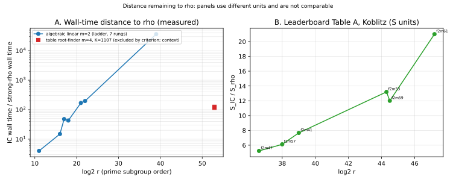

# Semaev decomposition parameter sweeper: assessment and plan (2026-10-24)

Status: **proposed**. No code is written and no measurement is made by this
note. Every statement below is labelled *measured* (from a committed record),
*derived* (computed from recorded values) or *proposed*. Sources are named by
path and branch; where a source is not on `origin/main` that is said.

## 0. Decisions fixed by the owner (2026-10-24, in chat)

1. The sweeper is written in **Rust** (no Python driver, no Optuna).
2. Curves are **generated**, and the sweep covers every family: prime
   j = 0, prime j = 1728, generic prime, Koblitz, and binary.
3. The primary target is the **a = 0, n = 83 Koblitz curve** (81-bit prime
   subgroup). The a = 1, n = 83 curve (52.9-bit subgroup) is the control that
   can run end to end.

## 1. Goal

Search the space of summation-polynomial (Semaev) point decompositions for
m = 2…8 summands at group order about 2^83, over factor bases, large-prime
variants, symmetry reductions and degree-of-regularity reductions, with an
Optuna-style sequential optimiser: a typed search space, a trial store,
pruning, and one scalar objective.

## 2. What exists (measured / read from source)

### 2.1 Harness

- `ic bench` runs `factor base × oracle × targets × solver × linalg` through
  `run_pipeline` (`src/cryptanalysis/ic_framework/mod.rs:311`) and reports
  `S = total GAE / √r`, `verified`, and the ratio to a matched rho
  (`docs/ic/FRAMEWORK.md` §2–§4). `ic bench --sweep FILE.json` expands a
  Cartesian matrix (`SweepFile`/`expand_matrix`, `src/bin/ic/bench.rs:715-746`);
  a configuration that errors is recorded in `configurations_skipped`.
  Shipped matrices: `docs/ic/sweeps/*.json`.
- The sweep is **serial, un-resumable, and writes its report once at the end**.
  There is no Optuna, TPE, Bayesian or pruning code anywhere in the repository
  (grep over `optuna|tpe|bayesian|hyperopt|hyperband` finds nothing relevant).
- Plug-ins: 12+ factor bases (`prime-abscissa`, `binary-subspace`,
  `koblitz-orbit`, `compact-orbit-scan` with `norm=`/`mult=`, `glv-orbit`,
  `cm-multiplier`, `binary-multiplier`, `prime-kummer`, `prime-isogeny`, …);
  oracles `subtract`, `mitm`, `mitm-frobenius` (with `large_primes={0,1,2}`),
  `descent-algebraic`, `symmetrised`, `rootfind-*`; solvers `f4-f2`,
  `matrix-f4`, `matrix-f5`, `inherited-f4`, `crossbred-f2`, `fes-f2`, `xl-f2`,
  `sat-cdcl`, `exhaustive`. ecbench adds `pdp3-koblitz`, `pdp-split` (chained
  S3, plans of the form [2,1,…,1]) and `sixsum-extract`.
- Prior sweeps: `examples/fb_hyperparam_sweep.rs` (n = 8…16, **m = 2 only**,
  wall-time cost model, 208 cells) and the two branch efforts in §2.4.
- Accounting an objective must obey (`AGENTS.md` §2, §3, §5a, §8a):
  S in group-addition equivalents with every phase inside it; a row without a
  verified answer is not a result; unpriced native work priced at 0, 0.1 and
  1 GAE/op with arms ranked only where the order holds across the band;
  relabelling and accounting changes are not improvements; any claim meant to
  transfer to ECC2K-130 needs the n = 83 K_0 gate (`AGENTS.md` §8a).

### 2.2 Where the framework stops (read from source)

| limit | where | consequence |
|---|---|---|
| binary field `Gf2`, n ≤ 63 | `semaev_decomp.rs:231`; `koblitz_instance` does `group_order.to_u64()?` | `ic bench` cannot build n = 83 |
| prime field `Fp64`, p < 2^62 | `prime_fast.rs:60` | no 83-bit prime curve through the framework |
| m ≥ 4 oracle | `decompose_mitm` returns `None` for m ≥ 4 (`ic_boundary.rs:5350`) | m ≥ 4 exists only as standalone diagnostics |
| algebraic descent | `max_n_prime(m)` = ⌊64/m⌋ for m = 2, 3, else 0; `MAX_VARS = 64` | descent oracles are m = 2, 3 only |
| m = 7, 8 | no implementation found | only the chained-S3 SAT circuit reaches them |
| wide pieces | `Gf2_128`, `koblitz_wide.rs`, `wide_groebner.rs` (≤ 128 unknowns), `wide_sixsum.rs`, `binary_semaev_chain_sat.rs` (MAX_VARS 512) | exist, are **not plugged into the framework** |

### 2.3 Large primes, symmetries, regularity (technique inventory)

- **Large primes.** Five code paths: `large_prime.rs` (Koblitz m = 3 pair-table
  collector; oracle `mitm-frobenius:large_primes=…`), `ecbench_large_prime.rs`
  / `ic large-prime`, `gaudry_cubic.rs` (`LargePrimeEliminator`),
  `large_prime_filter.rs` (graph cycles / 2LP; **no callers outside its own
  tests**), `hyperelliptic_index_calculus.rs`. Measured at n = 41
  (`research/ic_techniques_20261012/double_large_prime/`): best cell 2LP,
  |D| = 10|F|, 2.21·10⁶ GAE, **17.7× counted signed-Frobenius rho**, but only
  **2.1×** better than an equal-envelope control; single LP is 1.07–1.98×
  *worse* than that control. At n = 23, 31 every LP cell is 2.2–750× worse than
  plain.
- **Symmetry reduction.** Negation (everywhere); Frobenius/Koblitz orbit fold
  (pair table 122× fewer entries at n = 61); FGHR 2-torsion translation
  (`fghr_full.rs`: degree 64 → 16, S ÷ 27); D₄-symmetrised S5
  (`gaudry_quartic_d4.rs`); ψ and τ_T folds. Refuted: u-frame symmetrisation
  (worse at n = 31), Z/3 grading (12–70× worse), isogeny-transported bases.
- **Degree of regularity.** Weil descent (`pq_descent_symbolic.rs`), matrix
  F4/F5, inherited F4, crossbred (crosses fes-f2 at ~26 unknowns, fails at 30
  with default parameters), FES, hybrid guess + Macaulay (optimum is
  exhaustive), degree falls (D\* 4 → 2 to N = 16, then dies), Shantz–Teske δ
  (δ = +1…+2 lowers D\* by ~1 at n = 8, 9). Not found in the repo:
  Fourier–Motzkin / sparse-basis code.
- **Falsified (do not spend sweep budget):** 4/5/6-sum extraction on
  compact-orbit (`S·T² ≳ r/2n` bound), first-fall-degree measurement,
  m = 2 factor-base shape search (trace-class artefact), cyclotomic bases
  (yield-neutral), isogeny/volcano/conductor routes for Koblitz, hybrid
  slicing, single large prime with bounded D, Z/3 grading, Veronese PDP,
  merge-level caps on the F_{p³} 2LP.

### 2.4 Two prior efforts that are **not on `origin/main`** (verified this session)

Both are on remote branches only; a plan that assumes they are merged is wrong.

**N83 summand sweep, m = 2…9** (`origin/claude/sweep-n83-varied-algorithms-rovr0x`,
tip `45208c41f2`; `research/n83_msweep_20261024/`, preregistered at
`b654e95b6`). *Measured*, on the **a = 1** curve (53-bit subgroup), 4-vCPU
cloud container, wall time:

- Every Weil-descent engine (F4/F5/F6/crossbred/SAT/FES) **silently returned
  "proved UNSAT" on planted n = 83 relations** because `FieldStructure`
  truncated the field to one 64-bit word; the descent builders now refuse an
  inexact field. A sweeper must treat *refused* as invalid, never as a score.
- Chained-S3 full-width SAT is the only decomposer that runs at n = 83 for
  every m, and within a 180 s cap decides only **m = 2** (17.3 s per public
  query; derived projection 2^75.9 s = 2^75.3 × rho). All m = 3…9 cells and
  every orbit-domain cell hit the cap.
- The m = 4 root-table rootfinder (complete DLP, K = 1107): 188.5 s (root11),
  175.2 s (root22) against strong-rho 1.509 s: **116–125×** from rho.
- Companion n = 61 (exact one-word field), m = 2: native-XOR SAT fastest at
  D ≥ 12 (0.79–2.41 ms/query); inherited F4 fastest Gröbner engine; matrix F5
  0.78–1.05× of F4; **m ≥ 3 refused by the 64-variable descent mask.**

**Algebraic IC ladder** (`origin/claude/ic-m2-linear-ladder-20261024`, tip
`96e016772e`; `research/ic_m2_linear_ladder_20261024/`). *Measured*: the
linear Weil-descent of S3 over `V = span{1..z^{d-1}}` solved 52/52 one-target
DLPs on seven rungs n = 13…41; work slope **0.647 [0.639, 0.655]** log₂
trials per bit of n against **1.079** for the F4 arm; n = 41 takes ≈ 8 min and
is **36,440×** strong rho in wall time, widening with n. Its report records an
**owner criterion dated 2026-10-24: an index-calculus pipeline counts only
when its relations come from solving summation-polynomial systems over an
algebraically defined factor base, without table collisions** (table
pipelines — PDP4root, `engine=rootfind`, "aimed m = 3", pair enumeration — are
excluded). That sentence is not yet in `AGENTS.md` on `origin/main` (grep
found nothing); §6 turns it into an explicit decision.

Graph data and source: `graph_data.json`, `plot.py`. Recorded values only.
Panel B's six values were checked against `origin/main:docs/ic/LEADERBOARD.md`;
those rows are marked "unvalidated (pre-gate)" there (validation gate,
2026-10-19), so they are context, not admitted results.

### 2.5 Same-day skeptical review (desk review, not a measurement)

`/Volumes/SSD990-2/ic-regime-review-20261024/REVIEW.md` (2026-10-24; outside
the repository, written by another session; every number in it is quoted from a
file it names, and I did not re-verify them). The points that bear on this plan:

- **No published-IC baseline exists in the repo.** No experiment runs a standard
  FGHR-style symmetric Gröbner decomposition with the standard base
  `{P : x(P) ∈ F_q}` as the reference arm, and WDSat appears only in
  cryptanalysis `pdp-scaling`. Every "× times" in the program is against rho or
  against the program's own previous producer. The stated goal (2026-10-22) is
  to beat published IC at matched (q, n, m). The review's F2 proposes the
  reference protocol: standard base, FGHR symmetrised S_{m+1}, msolve (and
  WDSat for binary) as solver, cold whole-solve S in GAE.
- **The repo's own F4 is not a published engine.** `E3.md` on branch
  `prime-semaev-20261019` finds it needs 10³–10⁷ more operations than a brute
  grid on the same PKM systems, so any cost comparison that used the in-house F4
  (e.g. "383–46,911× faster than F4" root-finding) is not evidence about
  published Gröbner solvers. Degree measurements that used msolve are unaffected.
- **Multiplier-closure wins at toy sizes do not transfer** (cm-multiplier,
  binary-multiplier, Z[τ] norm bases): the gain is at most the multiplier-set
  size and per-relation cost is unchanged; the review also records unfair
  controls in the Z[τ] n = 71 row. Its stop list includes toy-size multiplier
  comparisons, further twist/GLS at p < 1000, and new Koblitz rungs n = 85, 89.
- **The "+10 bits" m = 4 row is a w = 1 lower bound**; at the measured exponent
  (w ≈ 2.2–2.3) and K = 4–16 it is about +45 bits (the review's arithmetic, its
  F1 is the check). cryptanalysis `pdp-scaling` finds MITM best over 35–51 bits
  with algebraic solvers scaling worse (WDSat 3.0, CryptoMiniSat 3.95–6.97,
  msolve 5.25 bits per unit of l against MITM's 2).
- Rho conventions differ across documents (three in use), adding 25–30% unit
  noise to any cross-document ratio. The review asks which canonicalisation the
  N83 panel's rho uses; the sweeper's rho reference must record it.

## 3. Curves

Koblitz curves are `y² + xy = x³ + a x² + 1`. Frobenius has order n and acts
as λ on the prime subgroup; the signed orbit has size 2n.

| id | family | n | log₂ r | cofactor | role |
|---|---|--:|--:|--:|---|
| a = 0, `debefd74` | Koblitz | 83 | **81.0** | 4 | **primary** |
| a = 1, `9eba6cd5` / `cdcc5432` | Koblitz | 83 | 52.9 | 1,128,547,018 | **control** |
| a = 0, `f27192f3` | Koblitz | 97 | 95.0 | 4 | registered, no runs |
| a = 1, n = 79 / 85 / 89 / 97 | Koblitz | — | 69.7 / 64.5 / 64.7 / 87.4 | 634 / 1.4·10⁶ / 2.1·10⁷ / 778 | unregistered, no runs |
| prime ≈ 83 bits | any | — | — | — | none exists |

Slugs are abbreviated to their hash suffix; the full ICV1 slugs are
`icv1-f2m83-tm6151469093347-debefd74`, `icv1-f2m83-t6151469093347-9eba6cd5`,
`icv1-f2m83-t6151469093347-cdcc5432` and `icv1-f2m97-t378251973071909-f27192f3`,
all in `docs/curves/registry.json`.

- **Primary (a = 0, n = 83).** Modulus `z^83+z^45+z^2+z+1` (`known_n83_k0()`).
  Registered with order 9671406556923184866742756 but **no generator recorded**
  (`ec1_unresolved`: `KoblitzCurve` covers n ≤ 63). Rho only (~2^37.5 steps).
- **Control (a = 1, n = 83).** Two registered representations of one group
  (same trace and order): `9eba6cd5` (modulus `z^83+z^7+z^4+z^2+1`) and
  `cdcc5432` (modulus `z^83+z^45+z^2+z+1`, fixture `known_n83_k1`). The summand
  sweep ran its decomposers on `cdcc5432` and its rho reference on the
  `9eba6cd5` basis (its PROTOCOL.md says so). Results are quoted per
  representation and never merged by degree. IC runs end to end on this curve.
- **a = 1, n = 79 / 85 / 89 / 97.** Computed in the audit, not registered.
  n = 85 and 89 are on the §2.5 review's stop list, so not a priority.
- **Prime ≈ 83 bits.** None exists in the repository. The nearest, `fp-j0-b80`
  (cryptanalysis catalog), has a 32-bit prime subgroup.

Two curve names for degree 83 must never be merged by degree
(`research/n83_evaluation_20261012/verification/CURVE_ID_ERRATUM.md`); the
repository's curve-name lint (`AGENTS.md` §11, `scripts/check_curve_names.py`)
applies to everything the sweeper emits.

**Generation constraints (derived; to be confirmed as each generator lands).**

- *Binary j = 0 / 1728.* In characteristic 2, 1728 ≡ 0, so j = 0 = 1728 is a
  single class and is **supersingular** (embedding degree ≤ 4). It is not an
  ECDLP target. It is included only as a labelled MOV/Frobenius control, not
  as a sweep objective.
- *Prime j = 1728* (`y² = x³ + ax`) always has the point (0,0) of order 2, so
  prime order is impossible: target cofactor 2 (or 4). *Prime j = 0*
  (`y² = x³ + b`, `4p = t² + 3v²`, six twists) can reach prime order.
- *Random binary* curves always have a 2-torsion point (b ≠ 0): the minimum
  cofactor is 2. Point counting over F_{2^83} needs Satoh/AGM/SEA-type code;
  whether the repository has it (candidates: `ai_schoof.rs`,
  `binary_velu.rs`) is **unverified**.
- *Prime ≈ 83-bit* needs a wide prime field: `Fp64` stops at 62 bits. The
  Montgomery code in `certicom131-native-*` is a candidate to reuse.
- Koblitz counts are cheap (trace recurrence) and already done for the table
  above.

## 4. Objective

At n = 83 no end-to-end `S` exists (a = 0: no relation, rank or DLP solve;
a = 1: only the root-table pipeline completes). So the objective cannot be an
`S` measured at n = 83.

- **Primary scalar: projected S at the target size.** Fit log₂ S against n on
  a ladder of at least four rungs (`AGENTS.md` §5 requires ≥ 4 sizes), and
  optimise the fitted value extrapolated to n = 83 — for the a = 0 curve,
  with its own rungs (a = 0, n = 13, 19, 23, 41, … primes with #E = 4·prime) —
  plus the n = 83 diagnostics measured directly (decided fraction, seconds per
  query, capacity). *Derived, not measured*; reported as such.
- **Baselines, named and frozen before the search starts.** (i) *Incumbent
  algebraic baseline* per family: ecbench `pdp3-koblitz` with inherited F4 on
  the S4 Weil descent over `span{1..z^{d-1}}`, m = 3 (named by the ladder
  report), with the linear m = 2 ladder as the current best algebraic arm.
  (ii) *Matched rho*, with the canonicalisation recorded. (iii) *Published-IC
  reference arm*: **missing** (§2.5). Until P4b builds it, every result is
  reported as "vs the repository's incumbent" and "distance to rho", and none
  is called an improvement over published index calculus.
- **Scale-relative knobs.** Optimising S at one toy size selects
  configurations that only work at that size, because the base size scales
  like r^{1/3}. Every size-like knob is expressed relative to scale: base size
  as a multiple of the family optimum `(#E·t/k)^{1/3}`, `lp_domain_factor` as
  a ratio, descent dimension d as d/n.
- **Band-robust scalar.** Score a trial by the worst case of
  `S_trial / S_baseline` over unpriced-work weights w ∈ {0, 0.1, 1} (§5a), so a
  winner holds across the band by construction. The baseline is named and
  frozen before the search starts.
- **Two tracks, both reported, one counted.** Track A (algebraic: relations
  from solving summation-polynomial systems, no table collisions) is the
  counted track if the owner criterion in §2.4 governs this work. Track B
  (table / rootfinder / pair table / `mitm-frobenius` large primes) is run as
  the reference and context track and is never ranked against Track A as an
  improvement. This split is decision D1 in §6.
- **Determinism.** Budgets are operation or trial counts, never
  `solver_budget_seconds > 0` (non-deterministic). Counts stay single-threaded;
  parallelism is across trials, one process each. Only 25 instances have pinned
  calibration (`docs/ic/calibration.json`); elsewhere a solver row is
  `measured`, comparable only on the same host, and a `S` is a lower bound.
- **Failure classes.** Every trial ends in `ok` (verified), `exhausted`
  (budget hit, count recorded), `refused` (the model cannot represent the
  instance, e.g. inexact field, 64-variable mask), or `invalid` (verification
  failed). Only `ok` is scored. `refused` and `invalid` are logged and never
  silently dropped or treated as "no solution" (the n = 83 UNSAT bug in §2.4).

## 5. Plan

**P0 — Setup and hygiene.**
Branch from `origin/main` (`ec77beacc9`). The two efforts in §2.4 are on
unmerged branches: build on a branch that can later rebase onto them, and
re-read their cells before running anything so nothing is repeated
(m = 2…9 on a = 1 n = 83; the m = 2 linear ladder n = 13…41). New cargo target
directory, not an existing `cargo-target-ic-*`/`-sixsum-s4`. Avoid files held by
live worktrees: `ghs_generalized.rs`, `ghs_quadratic.rs`,
`binary_ecc/operation_tally.rs`, `f2m.rs`, `binary_ecc/mod.rs`,
`cryptanalysis/mod.rs`. Register a Conductor task first (the control plane was
unreachable from this session, §7).

**P1 — Trial interface (Rust).** A subcommand `ic sweep-trial` taking one
configuration as JSON and printing one JSON record: failure class, `s` over the
band, `verified`, per-stage counts, native counters, solver `priced_by`.
Built on `run_pipeline`, so the objective is defined in one place and `ic bench`
stays unchanged. Includes the §4 failure classes and an operation-count budget.

**P2 — Search space.** One typed schema, conditional where a parameter exists
only for some choices:

| group | dimensions |
|---|---|
| instance | family ∈ {prime-j0, prime-j1728, prime-generic, koblitz-a0, koblitz-a1, binary}; n or log₂ r |
| arity | m ∈ {2…8}; split plan ([2,1,…,1] chain, [2,2], [3], [2,1]) |
| factor base | kind (§2.1); size relative to family optimum; `norm=`, `mult=`, `divisor=i;j`, subspace dimension d/n, basis (polynomial / orbit / coordinate / random) |
| symmetry | negation, Frobenius-orbit fold, FGHR torsion invariants, GLV/GLS/CM group, D₄ / ψ folds |
| large primes | none / single / double; domain ratio; partial-relation cap; merge depth |
| solver | engine; D, k (crossbred); max_degree, split, node budget (matrix/inherited F4); XOR encoding (SAT) |
| linear algebra | incremental, structured, sparse |

Known-dead regions (§2.3 falsified list) are excluded and cited in the schema.

**P3 — Optimiser (in-tree Rust, no new dependency).** TPE over a conditional
categorical/log-integer space is small enough to write directly. `rand` and
`rayon` are already in `Cargo.lock`; the trial store is an append-only JSONL
file (resumable, mergeable across hosts, no SQLite dependency). Pruning:
successive halving on the rung ladder — evaluate at the two smallest rungs
first, promote only trials whose early S/S_baseline is within a margin of the
running median. Parallel workers are separate OS processes. Deterministic given
a seed. The optimiser is a library module with tests; it does not touch the
framework traits.

**P4 — Calibration tier (n ≤ 41), where S is measured.** Run m = 2 and 3
first, over every family that exists. Extend `fb_hyperparam_sweep` to m = 3
(its report names this as the next arm). Fit exponents over ≥ 4 rungs against a
frozen baseline per family. Replay the ladder's seven rungs as a regression
test of the trial interface. Expected outcome (*derived from prior fits*): the
sweep finds constants, not a changed exponent; both measured IC exponents
(0.59–0.62) sit above rho's (0.44), so a verified constant-factor gain with
the gap to rho reported as distance remaining is the realistic success under
the owner's criterion.

**P4b — Published-IC reference arm and external solvers.** Specify and build
the arm the review's F2 describes (standard base, FGHR symmetrised S_{m+1},
msolve, WDSat for binary, cold whole-solve S in GAE) on the existing ladder
sizes, and add adapters that run msolve, WDSat and CryptoMiniSat as sweepable
engines beside the in-house ones. External-solver cost is priced by wall time
(`measured`), so such rows are comparable only on the same host. This is the
precondition for using the words "beats published".

**P5 — Wide tier (n = 61…83).** Lift the u64 caps so `S` is measured above
n = 63: plug `Gf2_128`/`koblitz_wide`/wide mod-r arithmetic into the framework
(the `InstanceCtx r: u64`, `CountedGroup::mul k: u64` and linalg u64 limits are
the known blockers). Descent builders must keep refusing inexact fields. For
prime curves, add a wide prime field. n = 83 on the a = 0 curve gets
diagnostics only (decided fraction, seconds per query, capacity per query),
labelled as stage diagnostics (§4).

**P6 — m = 4…8.** Cheapest route: wrap `pdp-split` chained-S3 plans
([2,1,…,1]) as a framework oracle; check the longest plan it accepts before
promising m = 7, 8 (it needs b = 1 Koblitz and refuses unsplit S5). The n = 61
companion shows m ≥ 3 algebraic descent is blocked by the 64-variable mask, so
a precondition is moving the descent builders to the wide (≤ 128-variable)
monomial type from `wide_groebner.rs`. The summand-sweep result (all m ≥ 3 SAT
cells capped at n = 83) is the prior to beat, not to repeat.

**P7 — Curves.** One generator per family behind a common trait, each emitting
the curve, its group order, prime-subgroup order, cofactor and a primality
certificate; registered in `docs/curves/registry.json` with full ICV1 ids. The
a = 0 n = 83 curve is already registered but has no generator or subgroup
record; completing that record (generator, prime-subgroup order, EC1
representation) is the first P7 item. A delegated audit reported it as
unregistered; that was wrong and is corrected here.

- Prime j = 0: CM construction (4p = t² + 3v²), choose the twist with prime or
  smallest-cofactor order; wide `Fp` required.
- Prime j = 1728: cofactor 2 or 4 (§3).
- Generic prime and random binary: needs a point counter first (§3).
- Binary j = 0/1728: supersingular, labelled control.
- Ladders per family at sizes spaced to give ≥ 4 rungs below 62 bits, then the
  83-bit instance.

**P8 — Reporting and landing.** Every run leaves a report, a graph and a PDF
(`research-visuals` skill). Performance gains also copy into `benchmarks/`.
No leaderboard row without a replay certificate, validator report and matched
rho with the §5a band (validation gate, 2026-10-19). Each landed trial batch
is a preregistered protocol plus raw records plus fit, mirroring the ladder's
layout (`PROTOCOL.md`, `raw/*.json`, `fit.json`).

## 6. Decisions still open

- **D1 (needs the owner).** Does the 2026-10-24 algebraic-only criterion govern
  the sweeper's counted track? It excludes the large-prime collector that
  exists today (`mitm-frobenius:large_primes`) and every pair-table arm. If it
  does, double-large-prime has to be rebuilt on the algebraic side (the
  `gaudry_cubic.rs` eliminator and the unwired `large_prime_filter.rs` are the
  starting points). The plan above defaults to two tracks, one counted.
- **D2.** Are n = 61 companion curves (unregistered by design, for registry
  size reasons) acceptable as calibration rungs for the a = 0 family?
- **D3.** Is a supersingular binary j = 0 control wanted at all, given that it
  cannot be an ECDLP target?

## 7. Risks, and what this note does not establish

- Both measured IC exponents exceed rho's, and the algebraic arm is 36,440×
  rho at n = 41 and widening. A sweeper cannot change that slope; it can
  shrink constants and find the regions where an engine is least bad.
- Everything at n = 83 on the a = 0 curve is a diagnostic until a decomposition
  oracle decides queries there (it does not today: every attempt ended
  UNKNOWN, `BOUNDED_*` or at the cap).
- Several ratios in the cited documents are weight-0 lower bounds recorded
  before the §5a rule.
- **Rung gap on the primary family.** The a = 0 curves with cofactor 4 and
  prime degree are n = 41, 83, 97 in the 24–130 range (cryptanalysis README);
  the intermediate a = 0 rungs (53, 61, 71, 73) have cofactors of 10⁴–10⁶. A
  fit projected to n = 83 therefore either extrapolates by 2× in n from n = 41,
  or mixes cofactors across rungs. The note does not resolve this; the fit must
  report which it did. The a = 1 control has the opposite problem (large
  cofactor at every rung).
- The Conductor control plane was unreachable from this session (404), and the
  sandbox blocked creating `.mcp.json` in the worktree. The lead atlas named in
  `CLAUDE.md` was not found in the sibling `crypto-autoresearcher` checkout
  (an old commit), so it was **not consulted**.
- The "Optimal-shift" session works in `crypto-autoresearcher`
  (`tools/smallroot_reach.py`); it reports its reach calculator has a sign
  error (S3 reach ≈ 0.28, not 0.8408). Nothing here relies on those figures.
- Sources read by delegated read-only audits and not re-verified line by line:
  the technique and curve inventories, and the leaderboard values in
  `graph_data.json` panel B.

## 8. Status: plan steps 1–3 built (2026-10-24, later the same day)

Implemented on branch `feat/ic-sweep-trial-20261024` (stacked on this note's
branch), documented in [`docs/ic/SWEEPER.md`](../../docs/ic/SWEEPER.md):

- **P1, the trial interface** — `ic sweep-trial`. Scores from operation counts
  alone, `S(w) = (adds + doubles + w · native operations) / √r`. This follows
  from §5a: the pinned calibration ratios cancel between `G − C` and `n_C`, so
  no host timing or calibration enters. *Measured:* the n = 13 `m = 3` baseline
  scored `S = [19.1, 143911.0, 1438937.6]` in both a debug and a release build
  on one host (not checked across hosts).
  Failure classes `exhausted / invalid / refused / invalid_config / crashed`
  are never scored. Time and memory limits are enforced from inside the
  process (`ps` is unavailable in the sandbox; macOS ignores `RLIMIT_AS`);
  the time limit fired at 600.1 s in the three runs that reached it.
- **P2, the search space** — four typed, conditional, scale-relative spaces.
  The algebraic ones are the counted track; the table ones are tagged
  reference-only in code. `rootfind-*` is offered by no space, pending the
  owner's ruling (§6, D1 follow-up).
- **P3, the optimiser** — in-tree TPE, median pruning over the rung ladder,
  an append-only resumable store, one child process per trial. 42 unit tests,
  two of them end-to-end through the real pipeline.

**Findings from building it** (each measured):

1. A tagged-enum parse of the store failed on every `f64`, because the
   workspace enables `serde_json`'s `arbitrary_precision`. The store now reads
   through `Value`.
2. My first sampler defaults were wrong. On three synthetic problems
   (`tune_defaults`, 40 studies × 60 trials) a wider good-fraction
   (`gamma` 0.25) was worse everywhere; `gamma` 0.10 with a 15% exploration
   probability gave regret 0.211 against random's 0.407 (smooth), 0.004 against
   0.050 (conditional), and 0.157 against 0.118 on a problem built to defeat
   independent models, the one case where it is worse than random.
3. **The ladder report's baseline does not run through this framework.** The
   framework's `descent-algebraic` with inherited F4 at `m = 3` finishes only
   at n = 13 (21 s in release); n = 15, 19 and 23 each hit a 600 s limit. The
   `m = 2` arm finishes on all four (about 1, 1, 1 and 27 s). The study
   baseline is therefore the `m = 2` arm, and §4's reference to the `m = 3`
   `pdp3-koblitz` arm stands only for ecbench, not for the sweeper.
4. **K_0 degrees that exist** (`koblitz_instance(0, n)`, n ≤ 63): 9, 13, 15,
   19, 23, 31, 37, 39, 41, 45, 51, 53, 57, 59, 61. n = 17 does not. K_1:
   9, 11, 15, 17, 19, 23, 29, 43, 45, 47, 51, 57, 59, 61.

**First study (a smoke run of the tool, not a result).** `koblitz-algebraic`,
K_0, rungs 13/15/19/23, 24 trials, 3 workers, 120 s per trial, run with the
solver-unit guard. Records, graph and PDF:
[`reports/run-20261024T2332Z/`](reports/run-20261024T2332Z/report.md). It
finished in 5 min 31 s with all four baselines scored, so the objective is a
projection to log2 r = 81. Outcomes: 6 complete, 8 pruned, 10 failed. The
failures: 5 trials were not rankable because the solver counts in another unit
(`crossbred-f2`, `sat-cdcl`, `buchberger-f2`), 3 hit the 120 s limit, and 2
recovered no logarithm within the counted-trial cap. **No configuration beat
the baseline at any rung**: every measured log2 ratio is positive (best
completed trials +1.5 to +6.2 per rung), and the best projected objective is
+16.5 (slope 0.20 per bit), which §8 item 6 says to read with the per-rung
ratios beside it. Twenty-four trials on a small space says little about which
configuration is best; it shows the loop, the classes, the unit guard, the
pruning and the store behave. An earlier run without the guard (18 trials,
store not kept) is not cited.

5. **The solver axis mixes operation units, and a search exploits that.**
   Measured at n = 13: inherited F4, `f4-f2`, `matrix-f4`, `matrix-f5` and
   Gray-code `fes-f2` count word XORs (one priced family in the repository);
   `buchberger-f2` counts monomial operations, `sat-cdcl` conflicts, and
   `crossbred-f2` partial word operations. A ratio across units rewards the
   unit, which is AGENTS.md §6's "changing the unit". Trials whose solver unit
   differs from the baseline's are now recorded in full and fail the trial;
   a unit test shows a 100× cheaper-by-unit solver cannot win.
6. **The projected objective amplifies rung-to-rung noise.** With four rungs
   spanning about 10 bits and a target 60 bits away, rounding in the integer
   descent dimension is multiplied roughly sixfold: in a synthetic test a
   configuration better than the baseline at every measured rung scored worse
   at the target. The per-rung ratios are stored and reported beside the
   objective; a confidence interval on the slope is future work.
7. **Rung constraint for the first real study.** K_0 at n = 15 has log2 r = 9.6
   (cofactor about 42), so the F4-reachable K_0 rungs 13, 15, 19, 23 mix
   cofactors; the cofactor-4 ones are 13, 19 and 23, which is below
   `--min-fit 4`. A baseline that reaches n = 31 or 41, or an accepted
   mixed-cofactor ladder, is needed before a projection means anything.

**Not done:** widening the framework past n = 63 and `m ≥ 4` (plan P5, P6); the
published-IC reference arm (P4b); prime and random-binary curve generation
(P7); the §5a band for rho itself (the record's rho gap is a `w = 0` lower
bound); a larger study with four usable rungs and a projection.
