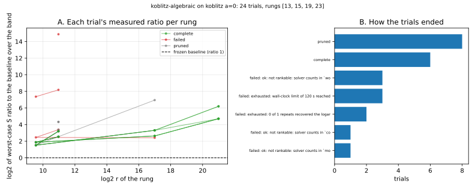

# Run report: `koblitz-algebraic` on koblitz a=0

Observations only. A smoke run of the sweeper on a small space; it is not a result about index calculus.

## What ran

- Command: `target/release/ic --json sweep run --space koblitz-algebraic --koblitz-a 0 --rungs 13,15,19,23 --target-log2r 81 --trials 24 --workers 3 --repeats 1 --rho-runs 2 --max-trials 100000 --startup-trials 6 --prune-startup 3 --timeout-seconds 120 --max-rss-mb 4096 --store store.jsonl`
- Commit: not recorded (the build could not read it from a git worktree; see the Host line); binary BLAKE3 `dcdae5089963ec6093fc558913f5daeb7b20427504acf0b9a7e7a303e356cd05`
- Host: Apple silicon (arm64) macOS, shared with other work; the binary was built from commit a0173bca92 plus the then-uncommitted solver-unit guard, committed afterwards as a5c51d3757. Isolation level: L0 (shared host, no CPU pinning, 3 trials at a time). Counts are unaffected; wall time is not used by the score.
- Track: **algebraic** (counted). Rungs requested: [13, 15, 19, 23]; usable (baseline scored): [13, 15, 19, 23].
- Target for the projection: log2 r = 81.0; `min_fit` 4; repeats 1; seed 1; counted-trial cap 100000.
- Raw records: [`store.jsonl`](store.jsonl) (every baseline and trial line, as written).

## Baseline (frozen before the search)

| rung n | class | S(w=0) | S(w=0.1) | S(w=1) | detail |
|--:|:--|--:|--:|--:|:--|
| 13 | ok | 18.25 | 166.9 | 1505 |  |
| 15 | ok | 33.28 | 928.4 | 8985 |  |
| 19 | ok | 14.54 | 3516 | 3.503e+04 |  |
| 23 | ok | 13.14 | 4.653e+04 | 4.652e+05 |  |

## Trials

Ratio columns are log2 of the worst-case (over w) `S_trial / S_baseline`; negative would be better than the baseline.

| id | state | solver | m | dim_frac | n=13 | n=15 | n=19 | n=23 | objective | note |
|--:|:--|:--|:--|--:|--:|--:|--:|--:|--:|:--|
| 1 | failed | crossbred-f2 | 2 | 0.18 | — |  |  |  | — | rung 13: not rankable: solver counts in `word operations (partial: ext |
| 3 | failed | crossbred-f2 | 2 | 0.23 | — |  |  |  | — | rung 13: not rankable: solver counts in `word operations (partial: ext |
| 4 | failed | sat-cdcl | 3 | 0.16 | — |  |  |  | — | rung 13: exhausted — 0 of 1 repeats recovered the logarithm within max |
| 5 | failed | crossbred-f2 | 3 | 0.34 | — |  |  |  | — | rung 13: exhausted — 0 of 1 repeats recovered the logarithm within max |
| 0 | failed | sat-cdcl | 3 | 0.28 | — |  |  |  | — | rung 13: not rankable: solver counts in `conflicts`, the baseline in ` |
| 7 | complete | f4-f2 | 2 | 0.29 | +3.20 | +1.51 | +3.30 | +6.20 | +25.27 |  |
| 6 | failed | inherited-f4 | 2 | 0.48 | +8.18 | +7.36 | — |  | — | rung 19: exhausted — wall-clock limit of 120 s reached |
| 2 | failed | f4-f2 | 3 | 0.34 | +14.87 | — |  |  | — | rung 15: exhausted — wall-clock limit of 120 s reached |
| 10 | pruned | matrix-f4 | 2 | 0.26 | +4.32 |  |  |  | — | worse than the median at rung 13 |
| 11 | failed | crossbred-f2 | 2 | 0.45 | — |  |  |  | — | rung 13: not rankable: solver counts in `word operations (partial: ext |
| 12 | pruned | matrix-f4 | 2 | 0.27 | +3.20 | +1.51 | +6.95 |  | — | worse than the median at rung 19 |
| 13 | pruned | matrix-f4 | 2 | 0.30 | +3.20 | +1.51 | +3.30 |  | — | worse than the median at rung 19 |
| 14 | pruned | f4-f2 | 2 | 0.43 | +3.34 |  |  |  | — | worse than the median at rung 13 |
| 15 | failed | buchberger-f2 | 2 | 0.37 | — |  |  |  | — | rung 13: not rankable: solver counts in `monomial operations`, the bas |
| 16 | pruned | matrix-f5 | 2 | 0.22 | +4.32 |  |  |  | — | worse than the median at rung 13 |
| 9 | complete | fes-f2 | 2 | 0.40 | +2.54 | +1.87 | +2.63 | +4.70 | +16.47 |  |
| 18 | pruned | fes-f2 | 2 | 0.39 | +2.54 | +1.87 |  |  | — | worse than the median at rung 15 |
| 19 | pruned | fes-f2 | 2 | 0.39 | +2.54 | +1.87 |  |  | — | worse than the median at rung 15 |
| 8 | failed | f4-f2 | 2 | 0.44 | +3.39 | +2.46 | +2.41 | — | — | rung 23: exhausted — wall-clock limit of 120 s reached |
| 20 | complete | fes-f2 | 2 | 0.41 | +2.54 | +1.87 | +2.63 | +4.70 | +16.47 |  |
| 22 | pruned | fes-f2 | 2 | 0.49 | +3.38 |  |  |  | — | worse than the median at rung 13 |
| 17 | complete | matrix-f4 | 2 | 0.30 | +3.20 | +1.51 | +3.30 | +6.20 | +25.26 |  |
| 21 | complete | matrix-f4 | 2 | 0.33 | +3.20 | +1.51 | +3.30 | +4.70 | +17.48 |  |
| 23 | complete | fes-f2 | 2 | 0.41 | +2.54 | +1.87 | +2.63 | +4.70 | +16.47 |  |

## How the trials ended

| outcome | trials |
|:--|--:|
| pruned | 8 |
| complete | 6 |
| failed: ok: not rankable: solver counts in `wo | 3 |
| failed: exhausted: wall-clock limit of 120 s reached | 3 |
| failed: exhausted: 0 of 1 repeats recovered the logar | 2 |
| failed: ok: not rankable: solver counts in `co | 1 |
| failed: ok: not rankable: solver counts in `mo | 1 |

*Figure: recorded values from `store.jsonl`; no value is computed in the plot. Left: each trial's log2 worst-case ratio at the rungs it completed. Right: trial outcomes.*

## Limits

- Few trials on a small space; this says nothing about which configuration is best.
- Rungs below `min_fit` are not projected: the objective is then the last rung's measured ratio.
- K_0 at n = 15 has a larger cofactor than the cofactor-4 rungs, so the rungs mix cofactors.
- Solver rows in a different unit than the baseline's are recorded and not rankable; see the failed rows' notes.
