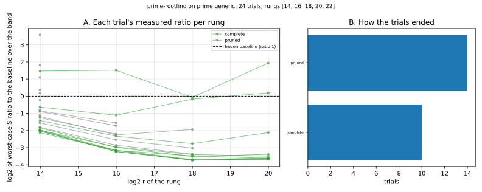

# Run report: `prime-rootfind` on prime generic

Observations only. A smoke run of the sweeper on a small space; it is not a result about index calculus.

## What ran

- Command: `target/release/ic --json sweep run --space prime-rootfind --family generic --rungs 14,16,18,20,22 --target-log2r 80 --trials 24 --workers 3 --repeats 2 --rho-runs 4 --max-trials 400000 --startup-trials 6 --prune-startup 3 --timeout-seconds 300 --max-rss-mb 4096 --store store.jsonl`
- Commit: not recorded (the build could not read it from a git worktree; see the Host line); binary BLAKE3 `944f829eb8e289fc4877bffea8c424424cef6e62972dfa60ad1adfa0357d851f`
- Host: Apple silicon (arm64) macOS, shared with other work; binary built from commit 1328d12bec. Isolation level: L0 (shared host, no CPU pinning, 3 trials at a time). Counts are unaffected; wall time is not used by the score.
- Track: **unclassified** (unclassified: not counted, not ranked against the other tracks). Rungs requested: [14, 16, 18, 20, 22]; usable (baseline scored): [14, 16, 18, 20].
- Target for the projection: log2 r = 80.0; `min_fit` 4; repeats 2; seed 1; counted-trial cap 400000.
- Raw records: [`store.jsonl`](store.jsonl) (every baseline and trial line, as written).

## Baseline (frozen before the search)

| rung n | class | S(w=0) | S(w=0.1) | S(w=1) | detail |
|--:|:--|--:|--:|--:|:--|
| 14 | ok | 77.02 | 84.54 | 152.2 |  |
| 16 | ok | 186.2 | 204.9 | 372.6 |  |
| 18 | ok | 328.2 | 361.2 | 658.1 |  |
| 20 | ok | 347.1 | 382 | 695.6 |  |
| 22 | refused | — | — | — | no prime instance at 22 bits |

## Trials

Ratio columns are log2 of the worst-case (over w) `S_trial / S_baseline`; negative would be better than the baseline.

| id | state | solver | m | dim_frac | n=14 | n=16 | n=18 | n=20 | n=22 | objective | note |
|--:|:--|:--|:--|--:|--:|--:|--:|--:|--:|--:|:--|
| 0 | complete | None | 3 | 0.00 | -1.41 | -2.33 | -2.76 | -2.12 |  | -10.17 |  |
| 1 | complete | None | 3 | 0.00 | -0.63 | -1.11 | -0.17 | +0.20 |  | +10.33 |  |
| 2 | complete | None | 2 | 0.00 | +1.47 | +1.52 | -0.07 | +1.94 |  | +0.66 |  |
| 4 | pruned | None | 2 | 0.00 | +1.10 |  |  |  |  | — | worse than the median at rung 14 |
| 3 | complete | None | 3 | 0.00 | -2.03 | -3.22 | -3.72 | -3.66 |  | -20.12 |  |
| 5 | pruned | None | 2 | 0.00 | +1.80 |  |  |  |  | — | worse than the median at rung 14 |
| 6 | pruned | None | 3 | 0.00 | -0.85 | -1.55 |  |  |  | — | worse than the median at rung 16 |
| 9 | pruned | None | 3 | 0.00 | +0.37 |  |  |  |  | — | worse than the median at rung 14 |
| 7 | pruned | None | 3 | 0.00 | -0.90 | -1.72 |  |  |  | — | worse than the median at rung 16 |
| 8 | complete | None | 3 | 0.00 | -1.96 | -3.15 | -3.69 | -3.60 |  | -20.24 |  |
| 11 | pruned | None | 3 | 0.00 | -1.18 | -2.25 | -1.94 |  |  | — | worse than the median at rung 18 |
| 10 | complete | None | 3 | 0.00 | -2.04 | -3.17 | -3.74 | -3.63 |  | -19.96 |  |
| 14 | pruned | None | 3 | 0.00 | -1.26 | -2.20 |  |  |  | — | worse than the median at rung 16 |
| 12 | complete | None | 3 | 0.00 | -1.99 | -3.23 | -3.72 | -3.68 |  | -20.70 |  |
| 15 | pruned | None | 3 | 0.00 | -1.80 | -2.86 | -3.37 |  |  | — | worse than the median at rung 18 |
| 13 | complete | None | 3 | 0.00 | -1.84 | -2.99 | -3.52 | -3.38 |  | -19.17 |  |
| 16 | pruned | None | 3 | 0.00 | -1.56 | -2.54 | -3.03 |  |  | — | worse than the median at rung 18 |
| 18 | pruned | None | 3 | 0.00 | -0.78 |  |  |  |  | — | worse than the median at rung 14 |
| 19 | pruned | None | 3 | 0.00 | -1.11 |  |  |  |  | — | worse than the median at rung 14 |
| 20 | pruned | None | 3 | 0.00 | -0.24 |  |  |  |  | — | worse than the median at rung 14 |
| 21 | pruned | None | 2 | 0.00 | +0.18 |  |  |  |  | — | worse than the median at rung 14 |
| 23 | pruned | None | 2 | 0.00 | +3.58 |  |  |  |  | — | worse than the median at rung 14 |
| 17 | complete | None | 3 | 0.00 | -1.98 | -2.96 | -3.40 | -3.49 |  | -18.61 |  |
| 22 | complete | None | 3 | 0.00 | -2.13 | -3.16 | -3.47 | -3.62 |  | -18.09 |  |

## How the trials ended

| outcome | trials |
|:--|--:|
| pruned | 14 |
| complete | 10 |

*Figure: recorded values from `store.jsonl`; no value is computed in the plot. Left: each trial's log2 worst-case ratio at the rungs it completed. Right: trial outcomes.*

## Observations

- The track is `unclassified`: the root-finding oracles are included at the owner's request and are **not counted** and not ranked against the algebraic or table tracks until the owner rules.
- Rung 22 has no baseline (the roster has no 22-bit prime instance: `no prime instance at 22 bits`), so it is dropped; the four usable rungs are 14, 16, 18, 20 bits.
- Every one of the top five completed trials is `m = 3` over `prime-abscissa` with `targets = random`, and each is below the baseline at every rung (log2 ratio −1.8 to −3.7, i.e. a worst-case band ratio of about 0.28 to 0.08). The per-rung ratios flatten between the 18- and 20-bit rungs (−3.72 to −3.68 for the best trial), so the projection to log2 r = 80 (fitted slope about −0.28 per bit, objective −20.7) is an extrapolation over 60 bits from a flattening trend and is **not a claim**.
- Measured here: two planted targets per rung, 14–20-bit prime curves, operation counts only. No comparison with rho is made.

## Limits

- Few trials on a small space; this says nothing about which configuration is best.
- Rungs below `min_fit` are not projected: the objective is then the last rung's measured ratio.
- Solver rows in a different unit than the baseline's are recorded and not rankable; see the failed rows' notes.
