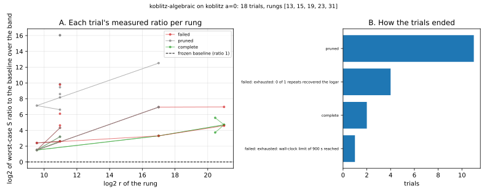

# Run report: `koblitz-algebraic` on koblitz a=0

Observations only. A smoke run of the sweeper on a small space; it is not a result about index calculus.

## What ran

- Command: `target/release/ic --json sweep run --space koblitz-algebraic --koblitz-a 0 --rungs 13,15,19,23,31 --target-log2r 81 --trials 18 --workers 3 --repeats 1 --rho-runs 2 --max-trials 100000 --startup-trials 6 --prune-startup 3 --timeout-seconds 900 --max-rss-mb 4096 --store store.jsonl`
- Commit: not recorded (the build could not read it from a git worktree; see the Host line); binary BLAKE3 `944f829eb8e289fc4877bffea8c424424cef6e62972dfa60ad1adfa0357d851f`
- Host: Apple silicon (arm64) macOS, shared with other work and with a concurrent report build; binary built from commit 1328d12bec. Isolation level: L0 (shared host, no CPU pinning, 3 trials at a time). Counts are unaffected; wall time is not used by the score.
- Track: **algebraic** (counted). Rungs requested: [13, 15, 19, 23, 31]; usable (baseline scored): [13, 15, 19, 23, 31].
- Target for the projection: log2 r = 81.0; `min_fit` 4; repeats 1; seed 1; counted-trial cap 100000.
- Raw records: [`store.jsonl`](store.jsonl) (every baseline and trial line, as written).

## Baseline (frozen before the search)

| rung n | class | S(w=0) | S(w=0.1) | S(w=1) | detail |
|--:|:--|--:|--:|--:|:--|
| 13 | ok | 18.25 | 166.9 | 1505 |  |
| 15 | ok | 33.28 | 928.4 | 8985 |  |
| 19 | ok | 14.54 | 3516 | 3.503e+04 |  |
| 23 | ok | 13.14 | 4.653e+04 | 4.652e+05 |  |
| 31 | ok | 77.4 | 4.322e+05 | 4.321e+06 |  |

## Trials

Ratio columns are log2 of the worst-case (over w) `S_trial / S_baseline`; negative would be better than the baseline.

| id | state | solver | m | dim_frac | n=13 | n=15 | n=19 | n=23 | n=31 | objective | note |
|--:|:--|:--|:--|--:|--:|--:|--:|--:|--:|--:|:--|
| 1 | failed | None | 2 | 0.16 | +6.11 | — |  |  |  | — | rung 15: exhausted — 0 of 1 repeats recovered the logarithm within max |
| 3 | pruned | None | 3 | 0.33 | +9.86 |  |  |  |  | — | worse than the median at rung 13 |
| 4 | pruned | None | 3 | 0.33 | +8.60 |  |  |  |  | — | worse than the median at rung 13 |
| 0 | failed | None | 3 | 0.28 | +9.79 | — |  |  |  | — | rung 15: exhausted — 0 of 1 repeats recovered the logarithm within max |
| 6 | pruned | None | 3 | 0.48 | +16.06 |  |  |  |  | — | worse than the median at rung 13 |
| 7 | failed | None | 3 | 0.20 | +4.63 | — |  |  |  | — | rung 15: exhausted — 0 of 1 repeats recovered the logarithm within max |
| 5 | complete | None | 2 | 0.34 | +3.20 | +1.51 | +3.30 | +4.70 | +5.59 | +20.84 |  |
| 8 | pruned | None | 3 | 0.42 | +16.03 |  |  |  |  | — | worse than the median at rung 13 |
| 10 | failed | None | 2 | 0.25 | +4.32 | +1.51 | +6.95 | +6.97 | — | — | rung 31: exhausted — 0 of 1 repeats recovered the logarithm within max |
| 11 | complete | None | 2 | 0.35 | +2.62 | +1.51 | +3.31 | +4.70 | +3.73 | +16.94 |  |
| 12 | pruned | None | 3 | 0.33 | +9.46 |  |  |  |  | — | worse than the median at rung 13 |
| 13 | pruned | None | 2 | 0.39 | +2.61 | +2.41 |  |  |  | — | worse than the median at rung 15 |
| 14 | pruned | None | 2 | 0.25 | +4.32 | +1.51 | +6.95 |  |  | — | worse than the median at rung 19 |
| 15 | pruned | None | 2 | 0.39 | +2.61 | +2.41 |  |  |  | — | worse than the median at rung 15 |
| 16 | pruned | None | 2 | 0.43 | +8.18 |  |  |  |  | — | worse than the median at rung 13 |
| 17 | pruned | None | 2 | 0.29 | +3.20 | +1.51 | +6.95 |  |  | — | worse than the median at rung 19 |
| 2 | pruned | None | 2 | 0.49 | +6.62 | +7.14 | +12.52 |  |  | — | worse than the median at rung 19 |
| 9 | failed | None | 2 | 0.39 | +2.61 | +2.41 | +3.31 | +4.59 | — | — | rung 31: exhausted — wall-clock limit of 900 s reached |

## How the trials ended

| outcome | trials |
|:--|--:|
| pruned | 11 |
| failed: exhausted: 0 of 1 repeats recovered the logar | 4 |
| complete | 2 |
| failed: exhausted: wall-clock limit of 900 s reached | 1 |

*Figure: recorded values from `store.jsonl`; no value is computed in the plot. Left: each trial's log2 worst-case ratio at the rungs it completed. Right: trial outcomes.*

## Observations

- All five baselines scored, including n = 31 (inherited F4 on the `m = 2` descent; `S(w=1)` about 4.3e6), so the objective is a projection from five rungs. Their log2 r are 11.0, 9.6, 17.0, 21.0 and 20.5: mixed cofactors, accepted by the owner.
- **No configuration was below the baseline at any rung.** Only two of 18 trials completed (ids 5 and 11); both use `koblitz-closure` with `m = 2` and a subspace dimension of about 0.34–0.35 · n (the baseline's is about n/3). Their log2 ratios are +1.5 to +5.6, and the projected objectives are +16.9 and +20.8 (fitted slope about +0.21 per bit), which are extrapolations and not claims.
- Eleven trials were pruned for being worse than the median at their rung. Five failed: four recovered no logarithm within the counted-trial cap (three at n = 15, one at n = 31) and one reached the 900 s wall-clock limit at n = 31.
- The space offers one counting scope (inherited F4), so no trial was refused for its unit.
- Measured here: one planted target per rung, 18 trials, operation counts only. Eighteen trials on this space say little about which configuration is best.

## Limits

- Few trials on a small space; this says nothing about which configuration is best.
- Rungs below `min_fit` are not projected: the objective is then the last rung's measured ratio.
- K_0 rungs mix cofactors (log2 r is not n minus 2), and n = 23 and n = 31 have almost the same log2 r.
- Solver rows in a different unit than the baseline's are recorded and not rankable; see the failed rows' notes.
