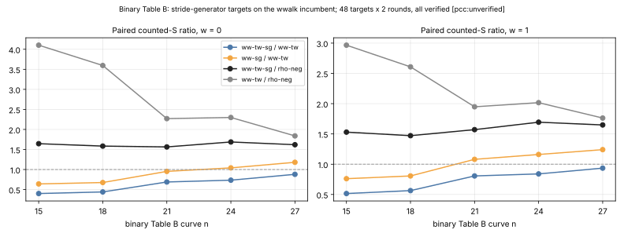

# Stride-generator targets on the binary wwalk incumbent (L5-BINSG), 2026-11-20

Every number here is `[pcc:unverified]`. The protocol [`PROTOCOL.md`](PROTOCOL.md) was frozen in `d2e129ceac`, before any measured row.

- **Code:** none changed. `ecbench` was built from `ce71cfa8f1`.
- **Evidence:** 720/720 runs verified per curve, and every candidate run was replayed. The run script is `run.sh`; sessions are in `sessions/B*`, with `audit-B*.json`, `compare-*.txt` and `band-*.txt` alongside. `summary.json` and `plot.py` produce the graph `binary_sg.{svg,png,pdf}`.
- **Bench record:** `benchmarks/records/20261120T0420Z-tableb-binary-sg.json`.

## Result

Counted GAE, 48 public targets per curve, 2 rounds, L0. Each cell gives the paired ratio at w = 0 [95%], then the band's w = 0.1 and w = 1 values.

| n | ww-tw-sg / ww-tw | ww-sg / ww-tw | ww-tw-sg / rho-neg | ww-tw / rho-neg (this session) | ww-tw-sg / bsgs-neg (w = 0) |
|---|---|---|---|---|---|
| 15 | 0.401 [0.395, 0.408]; 0.415, 0.516 | 0.641; 0.655, 0.761 | 1.65 [1.53, 1.77]; 1.63, 1.53 | 4.10 | 3.03 |
| 18 | 0.441 [0.432, 0.450]; 0.456, 0.564 | 0.676; 0.692, 0.806 | 1.59 [1.49, 1.69]; 1.57, 1.47 | 3.60 | 2.71 |
| 21 | 0.689 [0.677, 0.701]; 0.707, 0.806 | 0.954; 0.973, 1.081 | 1.56 [1.38, 1.77]; 1.57, 1.57 | 2.27 | 2.10 |
| 24 | 0.734 [0.725, 0.744]; 0.751, 0.840 | 1.042; 1.060, 1.161 | 1.69 [1.52, 1.88]; 1.69, 1.69 | 2.30 | 1.84 |
| 27 | 0.880 [0.874, 0.887]; 0.890, 0.935 | 1.180; 1.191, 1.241 | 1.62 [1.44, 1.82]; 1.62, 1.65 | 1.84 | 1.78 |

- **ww-tw-sg against the incumbent:** `ecbench band` orders `ww-tw-sg` below `ww-tw` at every weight on all five curves. It is the new binary incumbent.
- **The gain shrinks with size,** from 0.40 at n = 15 to 0.88 at n = 27, as the same change did on the prime rows.
- **ww-sg (the plain walk with stride-generator targets):** it helps only on the small curves. It is unresolved at n = 21 and worse than `ww-tw` at n = 24 and 27.
- **Distance remaining to rho:** 1.56–1.69× at w = 0 and 1.57–1.69× at w = 1 on the primary rows n = 21–27. That is down from 2.2–2.3× in L4-BINWALK. bsgs-neg stays ahead by 1.8–3.0×.
- **Run-to-run spread of the incumbent:** `ww-tw / rho-neg` at n = 27 is 1.84 here against 2.19 in L4-BINWALK, on fresh seeds. The paired candidate/incumbent ratios are the stable reading.

## Against the registered predictions
- **G-a holds:** 3,600/3,600 runs verified.
- **G-b is partly falsified, favourably.** At n = 21–27 the ratio is inside [0.55, 0.90] (0.69, 0.73, 0.88). At n = 15 and 18 it is below the range (0.40, 0.44). Every upper end is below 1.
- **G-c holds:** below at every weight at n = 21–27, and also at n = 15 and 18.
- **G-d holds:** 1.56, 1.69 and 1.62, inside [1.2, 2.0].

## Reading
- **Not a √r break:** this is the generic C = 2 track.
- **Comparison with prime curves:** the prime incumbent (`sib8-p256`) also has x-only siblings, which reach about 0.9× rho at w = 0. Binary curves have no siblings yet; the port is in progress as L5-BINSIB.
- **Accounting:** `BinaryGroup` does not count field operations, so there is no `bitop/v1` reading.
- **Validation gate:** not produced for this run, so there is no leaderboard row.
