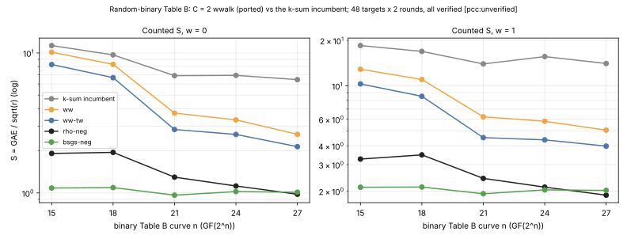

# The C = 2 wwalk walk on Table B's random-binary curves (L4-BINWALK measurement), 2026-11-19

Every number here is `[pcc:unverified]`. The protocol [`PROTOCOL.md`](PROTOCOL.md) was frozen in `0341e615ae`. Addendum A, written before any measured data, is in `ce71cfa8f1` and restores binary `ksum`, which main had lost.

| item | where |
|---|---|
| code (port) | `3a90dba6ae` (`research/ic_tableb_l4_binwalk_20261119/README.md`) |
| code (binary `ksum` restored) | `ce71cfa8f1` |
| run | `run.sh`, `ecbench` built from `ce71cfa8f1` |
| sessions and audits | `sessions/B*`; `audit-B*.json`, 720/720 verified per curve, every candidate run replayed |
| comparisons and band | `compare-*.txt`, `band-*.txt` |
| summary and graph | `summary.json`, `plot.py`, `binary_wwalk.{svg,png,pdf}` |
| bench record | `benchmarks/records/20261119T1836Z-tableb-binary-wwalk.json` |

## Result (counted GAE; 48 public targets per curve, 2 rounds, L0)

Each cell gives the paired S ratio at w = 0 with its 95% interval, then the band values at w = 0.1 and w = 1.

| n | incumbent | ww-tw / incumbent | ww / incumbent | ww-tw / rho-neg | ww-tw / bsgs-neg (w = 0) |
|---|---|---|---|---|---|
| 15 | ksum4 | 0.729 [0.709, 0.749]; 0.705, 0.557 | 0.892; 0.865, 0.697 | 4.32 [4.01, 4.65]; 4.13, 3.15 | 7.63 |
| 18 | ksum4 | 0.684 [0.662, 0.707]; 0.658, 0.504 | 0.852; 0.822, 0.651 | 3.42 [3.11, 3.76]; 3.26, 2.45 | 6.11 |
| 21 | ksum5 | 0.410 [0.391, 0.430]; 0.396, 0.324 | 0.537; 0.523, 0.446 | 2.19 [1.97, 2.44]; 2.13, 1.86 | 2.94 |
| 24 | ksum5 | 0.376 [0.355, 0.398]; 0.359, 0.280 | 0.478; 0.459, 0.372 | 2.34 [2.09, 2.61]; 2.29, 2.06 | 2.56 |
| 27 | ksum5 | 0.330 [0.314, 0.348]; 0.323, 0.283 | 0.405; 0.398, 0.361 | 2.19 [1.91, 2.51]; 2.17, 2.11 | 2.12 |

- **Band ordering.** `ecbench band` orders both `ww` and `ww-tw` below the k-sum incumbent at every weight on all five curves. It orders `ww-tw` below `ww` everywhere, by 0.76–0.82×.
- **Distance remaining to rho on the primary rows (n = 21–27).** It falls from 5.3–7.5× (the binary k-sum study) to 2.2–2.3× at w = 0 and 1.9–2.1× at w = 1. On the secondary rows, n = 15 and 18, it is 3.4–4.3×.
- **Distance to bsgs-neg.** bsgs-neg stays ahead by 2.1–7.6×; it is the cheaper reference at these sizes.
- **Wall time.** End to end, `ww-tw` takes 0.37–0.85× of the incumbent's wall time. The runs were on one host at L0 with no other agents running.

## Against the registered predictions
- **W-a holds:** 3,600/3,600 runs verified.
- **W-b holds.** At n = 21–27 the better arm (`ww-tw`) is 0.41, 0.38 and 0.33 of the incumbent, at most the predicted 0.6, and every upper end is below 1.
- **W-c holds.** ww-tw / rho-neg is 2.19, 2.34 and 2.19, inside [1.6, 2.6].
- **W-d holds.** The band orders ww-tw below the incumbent at every weight at n = 21–27, and also at n = 15 and 18.

## Verdict
Under the frozen rule, `ww-tw` is an improvement over the binary Table B incumbent at every size and weight, and it is the new incumbent on these rows. The result transfers the round-2 prime result to binary curves: 0.33–0.41× of k-sum here, against 0.41–0.48× on the prime rows.

## Caveats
- **No √r break.** This is the generic C = 2 track.
- **Siblings and `aut` stay prime-only,** so the sibling arm that reaches about 0.9× rho at w = 0 on prime curves has no binary counterpart yet.
- **No bit-op reading.** `BinaryGroup` counts group operations but not field operations, so there is no `bitop/v1` reading. This is an accounting gap, not a zero.
- **Main's binary `ksum` regression.** Main had lost the binary `ksum` dispatch. It is restored in `ce71cfa8f1` and should land on main independently of this study.
- **Validation gate:** not produced for this run, so there is no leaderboard row.
