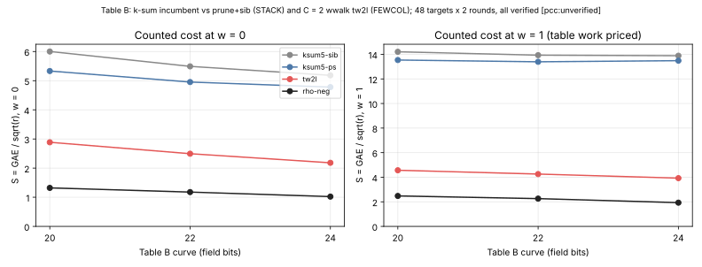

# Table B: prune + sib stacked (L2-STACK), and the C = 2 wwalk arm transferred (L2-FEWCOL), 2026-11-18

Every number here is `[pcc:unverified]`. The protocol [`PROTOCOL.md`](PROTOCOL.md) was frozen in `b0c61aee53`, before any measured row. The leads come from [`docs/leads/2026-11-18/ic-leads-round2/PROPOSALS.md`](../../docs/leads/2026-11-18/ic-leads-round2/PROPOSALS.md).

| file | contents |
|---|---|
| `run.sh` | runner |
| `specs/P20,P22,P24.json` | specs |
| `sessions/` | one ecbench session per curve |
| `audit-*.json` | audits (every run replayed) |
| `compare-*.txt`, `band-*.txt` | paired comparisons and §5a bands |
| `summary.json`, `plot.py` | summary and plot script |
| `tableb_fewcol.{svg,png,pdf}` | graph |

The bench record is `benchmarks/records/20261118T1738Z-tableb-fewcol-stack.json`. Neither arm needed a code change. Both are existing plugin parameters, run with ecbench built at the freeze commit.

## Result (three Table B curves, 48 public targets each, 2 rounds, L0, counted cost; 720/720 runs verified per curve, all 480 candidate runs replayed)

The headline ratio columns marked "w = 0 [95%]" are `ecbench compare`'s paired ratio of recorded S with its interval. The band's own w = 0 value differs slightly; for example tw2l / ksum5-sib at P20 is 0.475 against the band's 0.481. Both are in `compare-*.txt` and were reproduced by the validation gate (`validation/REPORT.md`).

| bits | ksum5-ps / ksum5-sib, w = 0 [95%] | w = 0.1 | w = 1 | tw2l / ksum5-sib, w = 0 [95%] | w = 0.1 | w = 1 | tw2l / rho-neg, w = 0 / 0.1 / 1 | end-to-end wall, tw2l / ksum5-sib |
|---|---|---|---|---|---|---|---|---|
| 20 | 0.890 [0.886, 0.894] | 0.902 | 0.953 | 0.475 [0.453, 0.498] | 0.448 | 0.321 | 2.18 / 2.13 / 1.84 | 0.64 |
| 22 | 0.904 [0.901, 0.906] | 0.915 | 0.961 | 0.448 [0.430, 0.467] | 0.422 | 0.306 | 2.12 / 2.08 / 1.88 | 0.62 |
| 24 | 0.923 [0.921, 0.926] | 0.933 | 0.971 | 0.414 [0.389, 0.440] | 0.389 | 0.283 | 2.14 / 2.12 / 2.03 | 0.57 |

S at P24 (w = 0 / 1):

| arm | w = 0 | w = 1 |
|---|---|---|
| ksum5-sib | 5.18 | 13.89 |
| ksum5-ps | 4.78 | 13.49 |
| tw2l | 2.18 | 3.93 |
| rho-neg | 1.02 | 1.93 |

### L2-STACK holds

- **S-a (identity):** 144 of 144 paired runs per size made identical trials and relations. The only change is the build: adds fell from 2,424 to 1,738, from 4,266 to 3,290, and from 7,106 to 5,768. The P24 figure is exactly the 5,768 the proposal derived. [pcc:unverified]
- **S-b (cost):** the ratio is below 1 at every size and every weight, with the upper ends of the intervals at most 0.926. `ecbench band` orders ksum5-ps < ksum5-sib at every weight.
- **Verdict:** STACK improves on the Table B incumbent across the whole band. At w = 0 the cut is 8–11%, shrinking as size grows because the build share falls. At w = 1 it is 3–5%, since prune removes priced table work.
- **Distance remaining to rho:** 4.0–4.7× at w = 0.

### L2-FEWCOL holds, beating its predicted magnitude

- **Verification:** every tw2l run verified ([d]G = Q), and every replay reproduced. [pcc:unverified]
- **Ratio:** tw2l / ksum5-sib is 0.41–0.48 at w = 0 and 0.28–0.32 at w = 1, against the registered maxima of 0.60 and 0.55. `ecbench band` orders tw2l < ksum5-sib at every weight. The ratio falls with size.
- **Verdict:** FEWCOL is an improvement over the Table B incumbent at every size and weight. With it the distance to matched rho falls from 4.5–5.1× (this session's ksum5-sib / rho-neg, S ratio; P2's session read 4.6–5.3×) to 2.1–2.2× at w = 0, and from 5.7–7.2× (P2: 6.3–6.7×) to 1.8–2.0× at w = 1. That is inside the predicted 1.7–2.4×.
- **Wall time:** tw2l pays 1.37× more wall time per GAE (`compare-P24`). End to end it still takes 0.57–0.64× of the incumbent's wall time.
- **Unpriced counters:** tw2l lists three small uncharged base-construction counters, `projected_base_*_uncharged`, at about 4 per run. That is negligible against about 7k GAE.

### A/A: the prediction was wrong in kind

`tw2l-aa / tw2l` is exactly 1.000 at every size. I predicted that `seed=run` would make the A/A a genuine noise floor. It is not: the run seed is derived from the per-target algorithm seed, which both arms share, so the two arms are the same computation. The A/A holds, but only as a determinism check. The uncertainty in the table comes from the paired bootstrap across 48 targets, not from this control.

## Reading

Neither result breaks the generic √r wall. Both arms are table-and-probe designs bounded near the generic collision floor, which is about 1.88× rho at F = 2 (Γ(F+3/2)/(Γ(F+1)Γ(3/2)) × rho). tw2l reaches about 2.1× at w = 0. The owner's 2026-11-04 ruling counts C = 2 seed arms with known-log jumps as index calculus (`research/curve25519_autolab_20261104/README.md`). [pcc:unverified]

FEWCOL transfers the Curve25519-autolab incumbent to Table B, where it had never been run. The remaining headroom in this family is at most about 1.88/2.14 ≈ 0.88× at w = 0. Beating rho needs a non-generic relation source. The hit-rate diagnostic found none in the k-sum table: L2-HRATE closed with H = 0.97–1.02 ([`HRATE.md`](../../docs/leads/2026-11-18/ic-leads-round2/HRATE.md)).

## Not done

- **Leaderboard:** no leaderboard or `benchmarks/README.md` row. The validation gate needs an independent replay certificate and a validator report, and neither was produced.
- **Scope:** L0 only, one host, no isolation. Counted cost is unaffected by this; wall time is.
- **Other leads:** L2-INNER, L2-FREE and L2-WSIB were not run. They target the k-sum arm, which tw2l now dominates by about 2×, so they matter only if they transfer to the wwalk table.
