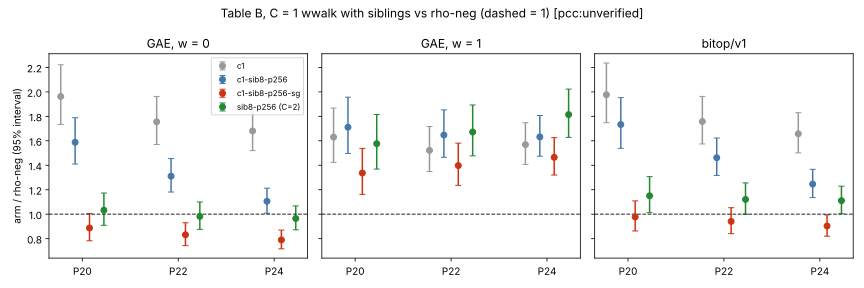

# Table B round 4: C = 1 wwalk with x-only siblings (L4-C1SIB), 2026-11-19

Every number here is `[pcc:unverified]`. The protocol [`PROTOCOL.md`](PROTOCOL.md) was frozen before any measured row, in the commit "L4-C1SIB: freeze protocol and specs before measured rows".

**Classification.** The C = 1 arms sit at the baby-step giant-step boundary (one seed logarithm plus the target). Whether they count as index calculus is pending an owner ruling; the 2026-11-04 ruling counts C = 2 arms. Nothing below is claimed as an improvement of the index-calculus baseline. [pcc:unverified]

**Contamination.** Run with `--cpus none --allow-busy` on a 4-core container shared with four other agents (L0, measurement quality 0/100). Counted cost (GAE, `bitop/v1`) is exact; wall times are contaminated and not used. No code change; `target/release/ecbench` (sha256 prefix `b4fcf0ecdb3d0a0f`).

Bench record: `benchmarks/records/20261119T1720Z-tableb-l4-c1sib.json` (not closed).

## Arms
Factor base `prime-projected-abscissa:size=1,scan_cap=32` for C = 1 arms, `size=2,scan_cap=32` for the incumbent.

| arm | method params |
|---|---|
| `rho-neg` | `rho.negation` |
| `bsgs-neg` | `bsgs.negation` |
| `sib8-p256` (C = 2) | `wwalk:x=2.0,g=1,grow=2,tw=2,cj=1,seed=run,lazy=1,sib=8,pool=256`, `targets=stride-generator` |
| `c1` | `wwalk:x=2.0,g=1,grow=2,tw=1,cj=1,seed=run,lazy=1` |
| `c1-sib8-p256` | `wwalk:x=2.0,g=1,grow=2,tw=1,cj=1,seed=run,lazy=1,sib=8,pool=256` |
| `c1-sib8-p256-sg` | same oracle, `targets=stride-generator` |

48 public targets per curve, 2 rounds, 1 warm-up. Audits: 864/864 verified per curve, 576 replays reproduced, 0 problems (`audit-P*.log`). [pcc:unverified]

## Results: arm / rho-neg, 95% interval (`summary.json`, `compare-*.txt`, `bitop-*.txt`)

| size | arm | w = 0 | w = 0.1 | w = 1 | bitop/v1 |
|---|---|---|---|---|---|
| P20 | c1 | 1.96 [1.73, 2.22] | 1.91 | 1.63 | 1.98 [1.75, 2.24] |
| P20 | c1-sib8-p256 | 1.59 [1.41, 1.79] | 1.61 | 1.71 | 1.73 [1.54, 1.95] |
| P20 | c1-sib8-p256-sg | 0.887 [0.783, 1.005] | 0.965 | 1.34 | 0.978 [0.863, 1.109] |
| P20 | sib8-p256 (C = 2) | 1.03 [0.91, 1.17] | 1.13 | 1.58 | 1.15 [1.01, 1.31] |
| P22 | c1 | 1.76 [1.57, 1.96] | 1.71 | 1.52 | 1.76 [1.57, 1.96] |
| P22 | c1-sib8-p256 | 1.31 [1.18, 1.46] | 1.37 | 1.65 | 1.46 [1.32, 1.62] |
| P22 | c1-sib8-p256-sg | 0.832 [0.743, 0.930] | 0.931 | 1.40 | 0.941 [0.841, 1.053] |
| P22 | sib8-p256 (C = 2) | 0.98 [0.88, 1.10] | 1.10 | 1.67 | 1.12 [1.00, 1.26] |
| P24 | c1 | 1.68 [1.52, 1.86] | 1.66 | 1.57 | 1.66 [1.50, 1.83] |
| P24 | c1-sib8-p256 | 1.11 [1.01, 1.21] | 1.20 | 1.63 | 1.25 [1.14, 1.37] |
| P24 | c1-sib8-p256-sg | 0.790 [0.717, 0.870] | 0.907 | 1.47 | 0.903 [0.820, 0.995] |
| P24 | sib8-p256 (C = 2) | 0.97 [0.87, 1.07] | 1.11 | 1.81 | 1.11 [1.00, 1.23] |

Intervals at w = 0.1 and w = 1 are in `summary.json`. Mean S (w = 0 / w = 1) from `band-P*.txt`: rho-neg 1.30/2.44, 1.16/2.23, 1.05/2.00; bsgs-neg 1.08/2.16, 0.93/1.85, 1.06/2.11; c1-sib8-p256-sg 1.16/3.26, 0.97/3.12, 0.83/2.93 (P20, P22, P24).

Other pairs, B/A, w = 0 and bitop/v1 (`summary.json` has all weights):

| size | c1-sib8-p256-sg / sib8-p256 | c1-sib8-p256-sg / bsgs-neg | bsgs-neg / rho-neg | c1-sib8-p256 / c1 | c1-sib8-p256-sg / c1-sib8-p256 |
|---|---|---|---|---|---|
| P20 | 0.859 [0.808, 0.913]; bitop 0.850 [0.797, 0.906] | 1.069 [0.985, 1.160]; bitop 1.215 | 0.830 [0.720, 0.958]; bitop 0.805 | 0.809; bitop 0.877 | 0.559; bitop 0.564 |
| P22 | 0.847 [0.787, 0.911]; bitop 0.840 [0.778, 0.906] | 1.041 [0.937, 1.155]; bitop 1.208 | 0.799 [0.693, 0.921]; bitop 0.779 | 0.747; bitop 0.832 | 0.634; bitop 0.644 |
| P24 | 0.818 [0.769, 0.871]; bitop 0.813 [0.763, 0.867] | 0.788 [0.715, 0.868]; bitop 0.928 [0.842, 1.023] | 1.002 [0.883, 1.137]; bitop 0.974 | 0.658; bitop 0.752 | 0.714; bitop 0.725 |

`ecbench band`: `c1-sib8-p256-sg < sib8-p256` at every weight at all three sizes; against `rho-neg` the band order is unresolved at all sizes (below 1 at w = 0, above at w = 1); `c1` and `c1-sib8-p256` are above `rho-neg` at every weight.

## Does any C = 1 arm sit below rho?
- **w = 0:** `c1-sib8-p256-sg` has an upper 95% end below 1 at P22 (0.930) and P24 (0.870). At P20 the interval is [0.783, 1.005], so it contains 1.
- **bitop/v1:** only at P24 (upper end 0.995). At P22 and P20 the interval contains 1.
- **w = 0.1:** the point estimates are 0.97, 0.93 and 0.91; every interval contains 1. **w = 1:** 1.34-1.47, above rho.
- `c1` and `c1-sib8-p256` (default targets) are above rho-neg at every size and weight.
- The sub-1 readings come with `targets=stride-generator`. Round 3's ablation (`research/ic_tableb_sib_20261119/ablation/README.md`) found this target mode lowers the cost at C = 2 as well; here it lowers `c1-sib8-p256` by 0.56-0.71 at w = 0, a larger effect than the siblings give.

## Predictions against outcomes
- **C-a (all verify): holds.** 864/864 per curve.
- **C-b (c1-sib8-p256 / c1 at most 0.65 at w = 0): falsified.** 0.809, 0.747, 0.658. The siblings give less at C = 1 than at C = 2 (0.44-0.48); the ratio improves with size.
- **C-c (best sibling C = 1 arm / rho-neg in bitop/v1, [0.80, 1.00] at P22 and P24, [0.85, 1.10] at P20): holds.** 0.941, 0.903, 0.978. The memo's 0.93 is inside the P22 and P24 spread.
- **C-d (point estimate at most 1.00 at w = 0): holds.** 0.887, 0.832, 0.790.
- **C-e (best C = 1 / sib8-p256 in [0.75, 0.95] at w = 0 and bitop/v1): holds.** 0.82-0.86 at w = 0, 0.81-0.85 in bitop/v1 (memo: 0.81).
- **C-f (w = 1 ratio above 1.3 for every C = 1 arm): holds.** Lowest is 1.34 (sg, P20).
- **C-g (sg / non-sg in [0.9, 1.1]): falsified.** 0.56, 0.63, 0.71 at w = 0; stride-generator matters a lot at C = 1.
- **C-h (bsgs-neg / rho-neg in [0.9, 1.1] at w = 0): falsified at P20 and P22** (0.83, 0.80; bsgs-neg is cheaper than rho-neg there), holds at P24 (1.00). Against bsgs-neg the best C = 1 arm is 1.07, 1.04 (intervals contain 1) and 0.788 [0.715, 0.868] at P24; in bitop/v1 it is 1.22, 1.21 and 0.93 [0.84, 1.02].

## Reading
Decision rule: the sg arm meets "below rho" at w = 0 (P22, P24) and in bitop/v1 (P24 only). It is below the C = 2 incumbent `sib8-p256` in every unit at every size (upper ends 0.867-0.926, including w = 1), so it is an improvement over the incumbent under the frozen rule, as a C = 1 boundary result only. At P24, w = 0 it is also below `bsgs-neg`; at P20 and P22 it is not (bsgs-neg is the cheaper reference there). Distance remaining to rho-neg at w = 1: 1.34-1.47. No leaderboard row without the validation gate (replay certificate, validator report, matched rho with the §5a band). Whether C = 1 counts as index calculus is pending an owner ruling.

Files: `run.sh`, `specs/`, `sessions/`, `audit-*`, `compare-*.txt`, `bitop-*.txt`, `band-*.txt`, `summarize.py`, `summary.json`, `plot.py`, `tableb_c1sib.{svg,png,pdf}`.
