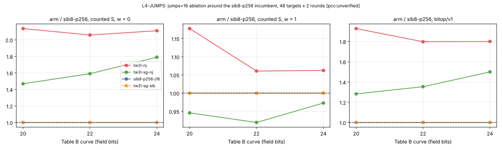

# L4-JUMPS: jumps=16 ablation around the sib8-p256 incumbent (2026-11-19)

Every number is `[pcc:unverified]`. Protocol [`PROTOCOL.md`](PROTOCOL.md) was frozen in the first commit of this directory, before the measured data. L0, shared 4-core container (`--cpus none --allow-busy`): counted GAE and bitop/v1 are exact, wall times are contaminated and not interpreted. `ecbench verify --replay-all`: 864/864 verified and 576 replays reproduced at each of P20, P22, P24, 0 problems. Bench record: `benchmarks/records/20261119T1720Z-tableb-l4-jumps.json` (not closed). Files: `compare-*`, `bitop-*`, `band-*`, `audit-*`, `summary.json`, `plot.py`, `jumps.{svg,png,pdf}`.

Ratios are arm / sib8-p256 (incumbent) and arm / rho-neg, counted GAE at w = 0 / 0.1 / 1, then bitop/v1.

| bits | arm | / sib8-p256 w=0 / 0.1 / 1 (band) | / rho-neg w=0 / 0.1 / 1 | bitop/v1 / sib8-p256, / rho-neg |
|---|---|---|---|---|
| 20 | sib8-p256 (incumbent) | 1 | 1.039 / 1.135 / 1.596 | 1, 1.158 |
| 20 | tw2l-nj | 2.136 / 1.903 / 1.177 (higher at every weight) | 2.218 / 2.160 / 1.879 | 1.927, 2.232 |
| 20 | tw2l-sg-nj | 1.469 / 1.342 / 0.946 (unresolved) | 1.525 / 1.523 / 1.509 | 1.283, 1.486 |
| 20 | sib8-p256-j16 | 1.000 / 1.000 / 1.000 (unresolved) | 1.039 / 1.135 / 1.596 | 1.000, 1.158 |
| 20 | tw2l-sg-sib | 1.000 / 1.000 / 1.000 (unresolved) | 1.039 / 1.135 / 1.596 | 1.000, 1.158 |
| 22 | sib8-p256 | 1 | 1.117 / 1.259 / 1.931 | 1, 1.276 |
| 22 | tw2l-nj | 2.057 / 1.790 / 1.061 (higher at every weight) | 2.298 / 2.254 / 2.048 | 1.797, 2.293 |
| 22 | tw2l-sg-nj | 1.590 / 1.410 / 0.919 (unresolved) | 1.776 / 1.776 / 1.775 | 1.354, 1.727 |
| 22 | sib8-p256-j16, tw2l-sg-sib | 1.000 / 1.000 / 1.000 (unresolved) | 1.117 / 1.259 / 1.931 | 1.000, 1.276 |
| 24 | sib8-p256 | 1 | 0.921 / 1.062 / 1.732 | 1, 1.061 |
| 24 | tw2l-nj | 2.110 / 1.812 / 1.062 (higher at every weight) | 1.943 / 1.925 / 1.840 | 1.800, 1.911 |
| 24 | tw2l-sg-nj | 1.790 / 1.558 / 0.973 (unresolved) | 1.648 / 1.655 / 1.685 | 1.500, 1.591 |
| 24 | sib8-p256-j16, tw2l-sg-sib | 1.000 / 1.000 / 1.000 (unresolved) | 0.921 / 1.062 / 1.732 | 1.000, 1.061 |

(Band-order wording is from the `ecbench compare` line; see `compare-*.txt` for intervals.)

## Decision
No arm replaces sib8-p256: none is ordered below it at every weight at any size. `sib8-p256-j16` and `tw2l-sg-sib` are bit-identical in counted cost to sib8-p256, so `jumps=16` has no effect once siblings are on (the oracle probably ignores or already uses it); dropping it is not a source of gain. Distance remaining to rho-neg for the incumbent: 1.04, 1.12, 0.92 at w = 0 and 1.60, 1.93, 1.73 at w = 1.

## Predictions against outcomes
- P-a holds: all runs verified, `sib8-p256-j16 / tw2l-sg-sib` exactly 1.
- P-b holds (range [0.95, 1.10]) and P-f holds (exactly 1.000 at every size).
- P-c is half falsified: tw2l-sg-nj / sib8-p256 at w = 0 is 1.47, 1.59, 1.79, in [1.2, 1.7] at P20 and P22 but above it at P24; at w = 1 it is 0.95, 0.92, 0.97, below the predicted [0.95, 1.10] at P22 and P24 (siblings cost something at w = 1).
- P-d holds: tw2l-nj / sib8-p256 at w = 0 is 2.06 to 2.14 (at least 1.4).
- P-e holds: sib8-p256 / rho-neg at w = 0 is 1.04, 1.12, 0.92, within 1.0 +- 0.15.
