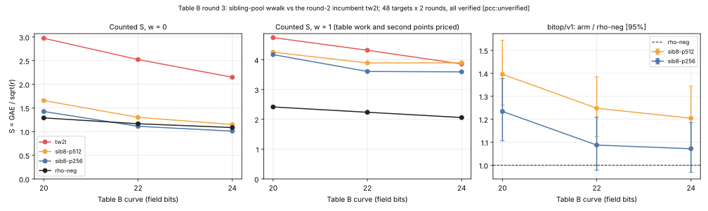

# Table B round 3: sibling-pool wwalk against the round-2 incumbent tw2l (L3-SIB), 2026-11-19

Every number here is `[pcc:unverified]`. The protocol [`PROTOCOL.md`](PROTOCOL.md) was frozen in `e4f23cb89c`, before any measured row.

| file | contents |
|---|---|
| `run.sh` | runner |
| `specs/P20,P22,P24.json` | specs |
| `sessions/` | sessions |
| `audit-*.json` | audits (720/720 verified per curve, every candidate run replayed) |
| `compare-*.txt` | paired comparisons, counted GAE |
| `bitop-*.txt` | paired comparisons, `bitop/v1` |
| `band-*.txt` | §5a band |
| `summary.json`, `plot.py` | summary and plot script |
| `tableb_sib.{svg,png,pdf}` | graph |

Bench record: `benchmarks/records/20261119T0319Z-tableb-sib-l3.json`. There is no code change; every arm is an existing plugin parameter.

## Result (three Table B curves, 48 public targets each, 2 rounds, L0)

| bits | sib8-p256 / tw2l, w = 0 [95%] | w = 0.1 | w = 1 | bitop/v1 | sib8-p256 / rho-neg, w = 0 [95%] | w = 1 | bitop/v1 [95%] | end-to-end wall / tw2l |
|---|---|---|---|---|---|---|---|---|
| 20 | 0.480 [0.459, 0.502] | 0.540 | 0.880 | 0.532 | 1.108 [0.994, 1.236] | 1.73 | 1.234 [1.106, 1.377] | 0.92 |
| 22 | 0.441 [0.417, 0.467] | 0.504 | 0.835 | 0.504 | 0.956 [0.861, 1.063] | 1.61 | 1.088 [0.978, 1.209] | 0.99 |
| 24 | 0.471 [0.442, 0.502] | 0.547 | 0.932 | 0.550 | 0.934 [0.844, 1.033] | 1.74 | 1.072 [0.969, 1.185] | 1.08 |

S (w = 0 / w = 1):

| arm | P20 | P22 | P24 |
|---|---|---|---|
| rho-neg | 1.29 / 2.41 | 1.17 / 2.24 | 1.09 / 2.06 |
| tw2l | 2.97 / 4.74 | 2.52 / 4.32 | 2.15 / 3.86 |
| sib8-p512 | 1.66 / 4.25 | 1.30 / 3.89 | 1.15 / 3.90 |
| sib8-p256 | 1.42 / 4.17 | 1.11 / 3.61 | 1.01 / 3.59 |

### Against the registered predictions
- **B-a holds.** Every run verified. `tw2l-aa / tw2l` is exactly 1, as a determinism check (as in round 2).
- **B-b holds.** The best sibling arm / tw2l is 0.44 and 0.47 at P22 and P24, at most the predicted 0.80. Every upper end is below 1. `sib8-p256` beats `sib8-p512` at every size, not only at P20.
- **B-c is falsified, in the favourable direction.** I predicted no band order at w = 1, with the ratio in [0.9, 1.15]. Measured, it is 0.880, 0.835 and 0.932, and `ecbench band` orders sib8-p256 < tw2l at every weight at all three sizes.
- **B-d holds.** In `bitop/v1`, sib8-p256 / tw2l is 0.50–0.55, and sib8-p256 / rho-neg is 1.07–1.23.

### Verdict under the frozen rule
- **sib8-p256:** an improvement over tw2l across the whole band at all three sizes. It is the new Table B incumbent for the C = 2 track.
- **sib8-p512:** also below tw2l at every weight at P20 and P22. At P24 the order is unresolved at w = 1, at 1.010.

### Distance remaining to matched rho (sib8-p256)
- **w = 0:** 1.11, 0.96 and 0.93. At P22 and P24 the 95% interval contains 1, so the arm is within noise of rho in counted additions. `ecbench band` leaves the order unresolved at P22 and P24, and puts rho lower at P20.
- **w = 1:** 1.6–1.7×.
- **Field work (`bitop/v1`):** 1.07–1.23×. At P22 and P24 the interval again contains 1.

## What changed between tw2l and sib8-p256 (confound)

The sibling arm is the autolab's arm as published. It differs from tw2l in three parameters at once:
- `sib=8,pool=256`: eight x-only sibling pairs per parent from a 256-point jump pool;
- `targets=stride-generator`;
- no `jumps=16`.

So the measured gain belongs to the combined arm, not to the siblings alone. The autolab's stage 1 isolates the sibling effect at 28–32 bits: 0.49–0.55× of the same walk without siblings at w = 0. Addendum A ([`ablation/README.md`](ablation/README.md)) separates them. Stride-generator targets alone give 0.68–0.85× of tw2l, below it at every weight. Siblings alone give 0.62–0.80× at w = 0 and tie at w = 1. The combined arm stays best.

## Reading
- **Not a break of √r.** This is still the generic C = 2 table-and-walk track.
- **Two cheaper-per-point effects.** The w = 0 gain comes from second points that the counted unit charges at w (x-only, sharing one inversion), and from cheaper target handling. In field work, which charges second points at their real cost, the arm is 1.07–1.23× rho. That is consistent with the autolab's 0.98–1.09 at 28–40 bits.
- **Wall time:** end to end, 0.92–1.08× of tw2l on this host.

## Not done
- **Validation gate:** no leaderboard or `benchmarks/README.md` row, because the replay certificate and validator report were not produced.
- **Scope:** L0 only, one host.
