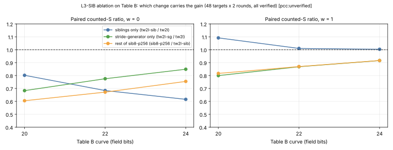

# Addendum A: ablation of the L3-SIB gain on Table B (2026-11-19)

Every number here is `[pcc:unverified]`. The protocol [`PROTOCOL.md`](PROTOCOL.md) was frozen in `dc4363f68d`, before any data. 720/720 runs verified per curve, and every candidate run was replayed (`audit-*.json`).

| file | contents |
|---|---|
| `compare-*.txt` | paired comparisons, counted GAE |
| `bitop-*.txt` | paired comparisons, `bitop/v1` |
| `summary.json`, `plot.py` | summary and plot script |
| `ablation.{svg,png,pdf}` | graph |

Bench record: `benchmarks/records/20261119T0322Z-tableb-sib-l3-ablation.json`. The arms and binary are as in `../PROTOCOL.md`, with a new measurement seed.

| bits | tw2l-sib / tw2l, w = 0 / w = 1 (band) | tw2l-sg / tw2l, w = 0 / w = 1 (band) | sib8-p256 / tw2l-sib, w = 0 / w = 1 (band) | sib8-p256 / rho-neg, w = 0 [95%] / w = 1 | bitop/v1 sib8-p256 / rho-neg [95%] |
|---|---|---|---|---|---|
| 20 | 0.802 / 1.092 (unresolved) | 0.683 / 0.800 (lower at every weight) | 0.605 / 0.817 (lower at every weight) | 1.075 [0.990, 1.168] / 1.66 | 1.197 [1.101, 1.300] |
| 22 | 0.684 / 1.010 (unresolved) | 0.775 / 0.868 (lower at every weight) | 0.672 / 0.870 (lower at every weight) | 0.972 [0.885, 1.068] / 1.65 | 1.106 [1.006, 1.215] |
| 24 | 0.616 / 1.004 (unresolved) | 0.849 / 0.916 (lower at every weight) | 0.755 / 0.916 (lower at every weight) | 0.891 [0.802, 0.990] / 1.67 | 1.024 [0.921, 1.137] |

## Against the registered predictions
- **A-a holds:** every run verified.
- **A-b is falsified.** Siblings alone give 0.80, 0.68 and 0.62 at w = 0, against the predicted ≤ 0.60. The gain grows with size, but at w = 1 siblings alone tie tw2l: ratios 1.00–1.09, band unresolved.
- **A-c is falsified.** I predicted no effect from stride-generator targets alone, but they give 0.68, 0.78 and 0.85, ordered below tw2l at every weight at every size. They are an improvement across the band on their own; the effect shrinks with size.
- **A-d is falsified.** Once siblings are on, dropping `jumps=16` and switching targets still matters: sib8-p256 / tw2l-sib is 0.61–0.76, below at every weight.

## Reading
- **The w = 1 gain is not from siblings.** The round-3 gain at w = 1 comes from the target walk (`targets=stride-generator`, no `jumps=16`). The siblings add a w = 0 gain that grows with r and is neutral at w = 1. That is consistent with the second point being priced as a full addition at w = 1, and with the autolab's stage 1.
- **Replication:** sib8-p256 is replicated on fresh seeds. Against rho-neg at w = 0 it is 1.075, 0.972 and 0.891 here, against 1.108, 0.956 and 0.934 in round 3. At P24 the 95% interval [0.802, 0.990] now lies wholly below 1 at w = 0. At w = 0.1 and w = 1 it is above rho (1.02 and 1.67), so the band leaves the order unresolved. In field work (`bitop/v1`) it is 1.02–1.20× rho.
- **The √r wall is not broken:** this is still the generic C = 2 track.

## Not done
- **Validation gate:** no leaderboard row, because no gate evidence was produced.
- **Scope:** L0 only.
- **`jumps=16` alone:** not isolated. `sib8-p256 / tw2l-sib` mixes it with the target change.
