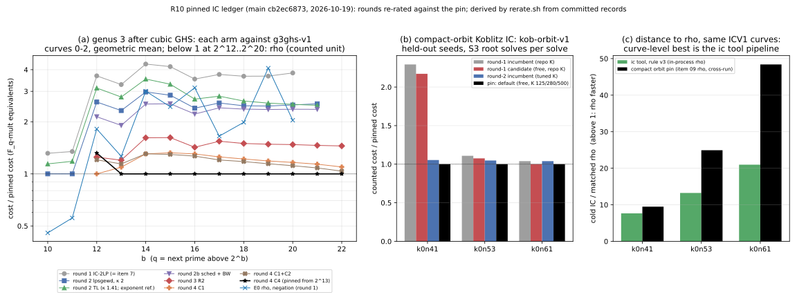

# R10: the pinned IC baseline ledger (2026-10-19)

Repair R10 of the 2026-10-16 audit (`docs/audits/REPAIR_FRAMEWORK_20261016.md`)
found that `research/ic_tool_program/baselines.json` stopped at v3
(2026-10-06). Each IC improvement round since then picked its own
incumbent. This change pins the current best measured IC configuration for
each curve family and size that landed after 2026-10-06. It writes them into
the ledger as `pinned_r10` and re-rates the rounds' headline claims against
that ledger.

- **Pinned from:** main at `cb2ec6873`.
- **No new measurement.** Nothing is re-run. Every number is either copied
  from a committed record or derived from one by [`rerate.sh`](rerate.sh)
  (jq and awk over the raw records). Derived values land in [`data/`](data/).

- **Class:** accounting. Pinning a baseline improves nothing. It fixes what
  later rounds must beat.

PDF (generated at the original R10 ledger cut; later text-only history annotations are in this README): [`report.pdf`](report.pdf).

## What is pinned

The ledger is `research/ic_tool_program/baselines.json`, key `pinned_r10`.

**Rules.** From this pin on, a round names the entry it compares against.

- A cost claim is a paired ratio against the pinned configuration of its
  track, on the same instances.

- A fitted-exponent claim is stated against the track's exponent reference,
  over the same range.

- Every row carries its gap to the matched rho.
- An accepted round appends an entry to its track. No entry is edited.

| entry | curve family, sizes | pinned configuration | commit, binary | unit | distance to matched rho |
|:--|:--|:--|:--|:--|:--|
| suite sizes (`baselines[]`) | ic tool programme, 11 suite curves | v3 (R07, `995ea207`) on main; rule v3 for one-target cold | `9c332039…` | ledger S = time / (unit_ns·√r) | cold 7.66 / 13.24 / 20.97× at k0n41 / k0n53 / k0n61 (rule v3). Open #1978/#2277 add v4–v8 and rule v7 (3.43–11.51×); they become the pin when merged. |
| `g3ghs-v1` | genus 3 after cubic GHS, curves 0–2, q = 2^10..2^22 | round 4 **C4** (`c4:lpsgebw2o100c+C1C2`) at 2^13..2^22; round 4 C1 at 2^12; round 2 `main:lpsgewd` at 2^10..2^11 | `225211fef`, `9f4cb966…` (2^10..2^11: `0a724dc8…`) | F_q-mult equivalents per solve | counted: 2.19 / 1.80 at 2^10 / 2^11; 0.25–0.79 at 2^12..2^20 (E0 rho, negation; uncharged work listed; §5a band not applied) |
| `kob-orbit-v1` | compact-orbit Koblitz IC, k0n41 / k0n53 / k0n61 | `construct:<n>:0` default: free relations on, K = 125 / 280 / 500 | `e15ef5dfe` over `80184d522`, `31ba5945…` | S3 root solves per solve (+ wall, + ledger S cross-host) | cold wall 9.49 / 24.93 / 48.40× strong rho (item 09, cross-run); online 26 / 37 / 10× precomputed rho |
| `kgb-harvest-v1` | Koblitz Gröbner oracle, 12 pipeline cells (component) | `KIC_LINEAR_HARVEST` default `root,gpv=0.9607,rank=331`, except **off** at (17,9) m2 | `9e69f57ef`, not recorded | thread CPU s per production decomposition | component, none |
| `d4fp4-v1` | k = 4 on E(F_{p⁴}), D₄ y-line, p = 101..1601 | `d4-ed` (ecbench `yline-d4-ed`, C₄ = 2.54e10) | `d3d4f191a`, `9c4210f8…` | S = GAE / √r | 1.34e8× (p = 101) to 6.27e6× (p = 1601) |
| `la-engine-v1` | IC linear algebra, synthetic m = 3 matrices (component) | legacy filter below 4,096 columns; CADO-style filter from 8,192 | `ae8ac7df9`, not recorded | solve_s | component, none |

**Not pinned, with reasons (the entry's `not_pinned` list):**

- The barrel-system oracle levers: the equivariant pass and the fall-row gate. Production never builds these systems.
- ic_next10's negative and instrument items.
- 04b, which is off the genus-3 instance chain.
- The single-study D₄ runs of #1792 (characteristic 2, and p = 29 end to end).

### Three findings of the pin itself

1. **On the ledger's own curves, the compact-orbit example is not the best IC.**
   - `construct:41/53/61:0` are k0n41, k0n53 and k0n61: r and log₂ r agree.
   - There, the ic tool pipeline is 7.66 / 13.24 / 20.97× rho cold (rule v3, in-process).
   - The compact-orbit default is 9.49 / 24.93 / 48.40× item 09's strong rho (cross-run).
   - In the ledger's unit the compact-orbit default reads S = 79 / 103 / 149, against 11.2 / 17.0 / 24.9 for rule v3. These are cross-host values, recorded and not ranked.
   - Rounds that improved "the production IC" (free relations, the K retune) improved the slower of the two pipelines on these curves.
2. **No genus-3 arm is lowest in both cost and exponent.**
   - C4 is cheapest from 2^13 up. Its fit is 1.393 over 12..21 and 1.413 over 16..22.
   - The lowest fits are round 2's exploratory `tuned:lpsgewd` (κ = 1.41, 1.371 over 12..21) and round 4's `w:lpsgebw2+C1C2` (1.368 over 16..22).
   - The entry pins C4 for cost and these as the exponent reference per range.
3. **The best measured k = 4 components have never been run together.**
   - `d4-ed-all` gives 0.9953× `d4-ed`.
   - The #1792 D₄ solve is C₄ = 6.9e7–8.5e7, 311–370× below the 2.54e10 every D₄ round charged.
   - The pin stays `d4-ed` at 2.54e10 until a round measures them together. The cheaper C₄ is a stage result.

## Round claims re-rated against the ledger

The table re-rates each claim two ways:

- **"Against the ledger at the time":** against the best measured configuration when the round ran, which is what a pinned ledger would have named.
- **"Against today's pin":** the candidate's cost over the configuration pinned now.

Status labels follow the framework's §0. Ratios are candidate over reference, so below 1 means cheaper.

| claim (file:line) | as stated, against the round's own incumbent | against the ledger at the time | against today's pin | status |
|:--|:--|:--|:--|:--|
| genus 3, round 1 item 04: IC-2LP advances, Δ −0.525 (`ic_improve_20261014/README.md:14`, `04-genus3-2lp/README.md:18`) | against IC-basic (full factor base) | **Two comparators.** The prior best, item 7's IC-2LP, is the same code (gate 0 42/42), so Δ 0 and ratio 1. The round's own tuned IC-1LP: Δ **−0.061** (1.3835 vs 1.4447, 10..18), ratio 0.554 at 2^18. | 3.83× C4 at 2^20 (C4 / IC-2LP 0.261) | **SUPERSEDED as an advance.** It re-measures item 7. The gain against the best other arm is −0.06, not −0.525. |
| genus 3, round 2 item 06: block Wiedemann advances, Δ −0.008, 0.945 at 2^21 (`ic_improve_20261015/README.md:16`) | against `main:lpsgewd` κ 2 | Against TL (`tuned:lpsgewd`, same round 2): 0.965 at 2^21. Exponent 1.398 vs 1.371 over 12..21: **+0.027**. | 2.40× C4 at 2^21 | **Exponent ADVANCES → REGRESSES.** The constant still advances, by less. |
| same item: combination TRADES (16..21 MATCHES), 0.929 at 2^21 | " | Against TL: 0.949 at 2^21. 1.423 vs 1.381 over 16..21: **+0.042**. | 2.36× C4 | **16..21 MATCHES → REGRESSES.** |
| same item: schedule 0.968 at 2^21; schedule and combination "flatten toward 4/3" | " | Against TL: **0.989** at 2^21. TL's local exponent at 20–21 (1.379) is below both. | 2.46× C4 | The constant gain nearly vanishes, and "flattens below the best" does not hold. |
| genus 3, round 3: R2 ADVANCES (constant), exponent MATCHES +0.0008 (`ic_improve3_20261015/README.md:11`) | against `sched:lpsgebw2` | Cost: that incumbent was the cheapest then, so the cost claim holds. Exponent against TL: 1.435 vs 1.371 over 12..21, **+0.064**. | 1.46× C4 at 2^21 | **Exponent MATCHES → REGRESSES.** The constant holds. |
| genus 3, round 4: C1 ADVANCES the exponent, Δ −0.015 (12..22), −0.034 (16..22) (`ic_improve4_20261015/README.md:11`) | against R2 (`r2:lpsgebw2`) | Against TL: 1.422 vs 1.371 over 12..21, **+0.051**. Over 16..21: 1.3745 vs 1.3811, −0.0066. At 2^12 against round 3's R1, the cheapest there: 0.815. | 1.10× C4 at 2^22 | **The 12..top exponent claim REGRESSES.** The 16..21 advance is about 5× smaller. |
| same: C1+C2 16..22 Δ −0.041; C4 TRADES, cheapest 0.690 at 2^22 | " | C1+C2 over 16..21: 1.370 vs TL 1.381, −0.012, so it still ADVANCES by about ¼ of the claim. C4: the R2 incumbent was the cheapest from 2^15, so 0.690 holds. Its exponent against TL is +0.022 (12..21) and +0.032 (16..21). | C4 is the pin | C1+C2 still ADVANCES, smaller. C4's cost claim stands and it is now the pin. |
| genus 3 vs rho: "no crossover in sight" (`04-genus3-2lp/README.md:48`); crossover about 2^22–2^23 extrapolated (`01-genus3-linalg/README.md:102`) | against E0 negation rho | — | C4 / E0 rho, counted: 0.25–0.79 at 2^13..2^20, 0.49 at 2^20 | **Not a beat.** IC's large-prime bookkeeping, mod-ell inversions and ±1 SGE products are uncharged, the §5a band was not applied, and rho has one or two targets a curve. The extrapolations are SUPERSEDED by a measured counted ratio below 1. A priced comparison is the next step. |
| `ic_leads_review_20261018/README.md:80`: "linear algebra (local q^1.52) is the next lever" | — | — | In C4 the local exponents at 20–22 are 1.09–1.17 for LA and 1.54–1.57 for the relation phase | **Stale.** The relation phase now carries the larger exponent. |
| `docs/ic/progress-timeline.json` `genus3-ghs-2lp`: 0.252× rho at 2^14 (04b) | rho on Jac(C), about 290 F_q mults a step | E0 negation rho is about 75 a step. 04b is on other instances. | — | **MEASURED-UNMATCHED.** The reference is not the matched (E0) rho. |
| Koblitz compact orbit, round 1 item 03: free relations 0.957× (`ic_improve_20261014/README.md:15`; `benchmarks/README.md:82`) | against the untuned repository K (255 / 220 / 500) | Holds: no tuned K had been measured as a complete solve then. | free@255 / pin = **2.17×** at n = 41; 1.08× at n = 53; 1.00× at n = 61 | **SUPERSEDED** by round 2's K retune. R10 follow-up now annotates the benchmark row: the 0.957× result is against untuned K and is superseded by the later K retune. |
| same round: "pick K so the harvested rank is a large fraction, as at n = 41 (63%)" (`ic_improve_20261014/README.md:33`) | — | — | that K (255) costs 2.17× the pin | **Contradicted.** |
| round 2 item 02: free relations 0.960× pooled (`ic_improve_20261015/README.md:11`, `benchmarks/README.md:78`, `ic_leads_review_20261018/README.md:67`) | `free@K*free` against `inc@K*inc` (K chosen per arm on training seeds) | At the same K, which is the default-vs-off pair: **0.972** (n = 41) and **0.984** (n = 53), both MATCHES (intervals 0.940–1.003 and 0.963–1.008); 0.962 (n = 61) ADVANCES. | the pin | **ADVANCES only at n = 61.** The item README, round summary, benchmark row and leads review now distinguish same-K MATCHES at n=41/53 from the n=61 advance. |
| Gröbner harvest, round 3 item 02: "ADVANCES, REGRESSES nowhere" (`02-harvest-gate/README.md:11`, `ic_improve3_20261015/README.md:12`, `benchmarks/README.md:66`) | against G0 (round 2's gpv gate) | Against harvest off, the best measured at (17,9) m2: production CPU **0.872 [0.771, 0.988]**, word operations 0.765 (`fit_test.jsonl:102`). | the pin is off at (17,9) m2 | **REGRESSES at (17,9) m2.** The former CPU MATCHES sentence has been corrected: its table's (17,9) ratio 0.873 [0.783, 0.974] is a regression; see the R10 holdout re-rate. |
| Gröbner harvest, round 2 item 05: (17,9) m2 ADVANCES 1.073 (`ic_improve_20261015/README.md:13`, `benchmarks/README.md:75`) | against off | Not reproduced on round 3's held-out targets with the same configuration: 0.922 bench (off/G0, REGRESSES), 0.873 production. | — | **Not replicated.** |
| fall-row gate: 4.42× / 11.9× at barrel n = 11 / 13 (`ic_improve_20261015/README.md:14`, `benchmarks/README.md:77`) | against InheritedF4 | Round 1's equivariant pass C is cheaper on the same systems. G ≈ F, so G / C ≈ **1.25 / 1.34× slower** (round-1 targets). | not pinned (barrel) | Against the best measured barrel configuration, the gate is the slower arm. Production is unaffected. |
| k = 4, round 1 item 01: D₄+2LP 1.025× (`ic_improve_20261014/README.md:17`) | against `d4` | Holds (d4 was the best then). | **1.048×** `d4-ed` | REGRESSES, by more. |
| k = 4, round 2 item 04: `d4-ed` 0.979× (`ic_improve_20261015/README.md:12`) | against `d4` | Holds. | the pin | Holds. The exploratory `d4-ed-all` is 0.9953× of it and not frozen. |
| k = 4, all rounds: absolute S and gaps to rho, model handovers (2^116.5, 2^128.9) | charged at C₄ = 2.54e10 | #1792 measured the D₄ solve 311–370× cheaper (stage) | not combined with `d4-ed` | **DERIVED on a superseded input.** Gaps would be about 310–370× smaller, an estimate and not measured. |
| ic_next10 item 01: D₄ vs plain 18.2× (`ic_next10_20261014/README.md:32`) | plain S₄ at C₄ = 1.213e12 | The plain arm never got the sparsest-pivot fix (#1792 attributes 26× of its 370× to it). | — | **MEASURED-UNMATCHED.** The incumbent was not a best-effort solve. |
| LA engine: 10.40× at 262,144 columns (`benchmarks/README.md:92`, leaderboard LA section) | legacy filter, synthetic | Holds at ≥ 8,192 synthetic columns. Below 4,096 the shipped `ic logs` default is the slower filter (0.40× at 1,024). | the pin is legacy below 4,096 | Holds where measured. The default is unvalidated where real IC matrices are (repair R11). |

### How the re-rated numbers were obtained

- **Genus 3.**
  - Rounds 0–4 share one instance chain: each round's gate 0 reproduces its predecessor's incumbent bit for bit.
  - So costs are compared directly, per curve, as geometric means over curves 0–2.
  - Fits are least squares of log₂ cost on b, with every solve a point (`data/genus3_derived.txt`, lines `gm`, `fit`, `pair`, `rho`).
  - TL against the round-2b/3/4 arms is paired on instance and target, not on walk.
  - The A/A floors are about 0.004 in exponent and 1–2% per size.

- **Compact orbit.** Means over held-out seeds (`data/koblitz_derived.txt`). Ratios are ratios of means; the item's own seed bootstrap gives the intervals quoted.
- **k = 4.** Geometric means over the three curves a size, and paired per-curve ratios over 27 curves (`data/d4_derived.txt`).
- **Copied, not derived.** The Gröbner, fall-row and LA figures are copied from the rounds' `fit_test.jsonl` and `summary.json`, at the lines given.

## Caveats

- **Hosts and isolation.**
  - Every track was measured on shared 4-vCPU containers at L0, and most records do not name the CPU.
  - The ledger S values of `kob-orbit-v1` use v0's `unit_ns` for the same curves on another host. They are recorded, not ranked.

- **Binaries.**
  - `kgb-harvest-v1` and `la-engine-v1` have no recorded binary hash.
  - For `kob-orbit-v1` the hash is that of the measured default-on binary. The K default (`e15ef5dfe`) only fills an omitted K, and was checked identical at n = 41.
  - Nothing was rebuilt here: this host (arm64) is not the measuring host, so a rebuild hash would not identify the measured binary.

- **Engine drift.** `d72e8b04d` (#2043, 2026-10-17) changed the Gröbner engine's default order after the harvest rounds. A round on `kgb-harvest-v1` first re-measures the entry on its own head.
- **Python provenance.** Round 0 of the genus-3 chain (item 7, `ghs3.py`) is a Python tool and is not pinned. Every pinned configuration is a native example.
- **Conductor.** The control plane returned 404 for this project (`conductor check` could not connect), so no task was claimed.

## Next

- **Genus 3.** Price the counted-unit rho ratio (§5a band, charged bookkeeping) at 2^18..2^20. It is the first row where a matched rho might be beaten, and it needs a priced comparison before any claim.
- **k = 4.** Run `d4-ed` with the #1792 D₄ solve on the ladder curves. That is the next pin candidate.
- **Compact orbit.** Port its levers (free relations, tuned K) to the ic tool pipeline, which is the curve-level best on these curves, or record why they do not apply.
- **Gröbner harvest.** Re-measure the entry on main after #2043, together with R8's paired default-vs-off run.
- **Graphs checked and left unchanged.**
  - `docs/index-calculus-scoreboard.html`, `docs/ic/progress-timeline.json`, `docs/ic/leaderboard.json`: no new measurement moves a ranked row. The 04b point is now labeled unmatched to the pinned E0 rho track, and the dashboard timeline digest is repinned.
  - The IC leaderboard is not regenerated, because nothing is an improvement.
