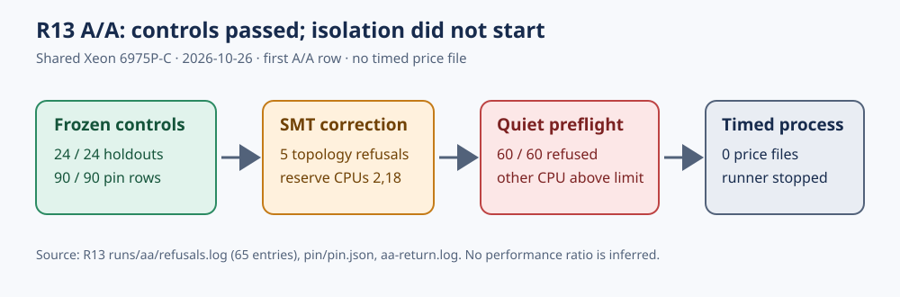

# R13 shared-host A/A preflight: bounded infrastructure failure

**Run status:** stopped resumably after the declared 60 quiet-host refusals on the first A/A row. This report records a failed isolation start, not an IC cost comparison. The [protocol](../../PROTOCOL.md) and its pre-timing amendments freeze the candidate, controls, target law, and single-target decision rule.

## Identity and requested work

- Shared host: EC2 `i-03d5e15a586275e77`, `m8i-flex.8xlarge`, Intel Xeon 6975P-C, 32 logical CPUs, 129,800,720 kB reported memory. CPU 2's SMT sibling is CPU 18; the corrected launch reserved both with `ICPROG_BENCH_CPUS=2,18`.
- Source: clean worker snapshot `381415d41320bde44fff7c214ba2bf5169238c84`; frozen base revision `261482646ee89b332dca69e2f296b0774c25d2c2`, candidate revision `efc6336d55c59cceb92cb82de73598ebe15ff3ca`; Cargo.lock SHA-256 `c2c0049f265e78432b79c5fe14a7ce6668cd44c3816012256dfcd7b40e5f4f6d`; rustc 1.99.1.
- Binaries: base SHA-256 `df0c4df05632d002d9d7be4b3ebeaf675b15495e16b6c0fe8592bfd6cbc7f96d`; candidate `2537d8b4d356cb3bc7534dd48edd859a9b20451418681eb32d9fad02b7d79c9f`. The [host manifest](../../runs/host.json) records these and the instruction features. Both arms use the same toolchain and lockfile.
- Requested: five-round byte-identical baseline A/A, followed by five ABAB rounds for the M1 suite and fresh holdouts in the [protocol](../../PROTOCOL.md). Each timed process would use cold `ic price --single-target`, the same public target for IC and signed-Frobenius rho, a verified scalar, and one qualified isolated core. `KIC_RHO_CANON` was unset. No such timed process started.
- Untimed controls: 24/24 frozen holdouts regenerated exactly and the corrected [native pin](../../runs/pin/pin.json) held 90/90 outputs with matching names. The earlier strict v0 schema failure is retained in [pin-strict-v0.json](../../runs/pin/pin-strict-v0.json). On this worker, 114 native `icprog` tests passed. The release library test run had one inherited `ecbench` zero-weight legacy-ID assertion failure among 4,862 executed tests; this is tracked separately and does not supply a timing record.

## Observed preflight

The initial launch at 20:30:41 UTC produced five SMT-topology refusals because it reserved CPU 2 without CPU 18. The corrected launch began at 20:55:55 UTC. Its first A/A output path was `A/icv1-f2m19-tm797-9c54981b/M1-T01/r1.price.json`. The isolation tool refused all 60 attempts because the machine was busy; the final refusal at 21:48:33 UTC recorded 64.09 other-process CPU seconds in a two-second window against the unchanged 0.20-second limit, with PSI some avg10 at 73.59 against 5.0. The native runner then reported that it stopped resumably. The worker held its benchmark lock at times and unrelated builds repeatedly consumed CPU.

**Completed:** zero A/A price files; zero suite or holdout timed files. There is no measured cold ratio, `S` value, uncertainty interval, candidate verdict, or leaderboard row from this run. No timing from the two separately reclaimed Spot hosts is pooled with it. The on-demand replacement remained explicitly denied by AWS IAM at this report's time.

Raw evidence is the [65-line refusal log](../../runs/aa/refusals.log) (five topology plus 60 busy-machine entries), [runner exit log](aa-return.log), [runner configuration](../../runs/runner-config.json), [host manifest](../../runs/host.json), pin records and retained pin output tree in `../../runs/`. The final run tree is also copied to `s3://setec-astronomy-artifacts/checkpoints/crypto/codex__ic-single-target-tournament-20261026/20261026T212010Z-567a3f37aab0/worker-runs-final/`. The transferred run archive SHA-256 was `8f519b0fa1aeea0e407f7f235ec45b3af36ee5e0763e62d6cbe72680ce90a092`.

The diagram shows the executed controls and refusal path. It contains no inferred performance value because the run had fewer than two comparable timed values. No canonical leaderboard or performance graph changes: there is no admitted measurement to plot. The [host obstruction record](../../../../../../problems/r13-single-target-isolated-host.md) tracks the next discriminating step: a quiet shared-host window or one owner-authorized on-demand host after AWS removes the explicit IAM deny. Repeat all host and source controls on a new host, then run the frozen A/A and ABAB schedule without pooling host times.

This report is rendered as [report.pdf](report.pdf) from [report.typ](report.typ).
