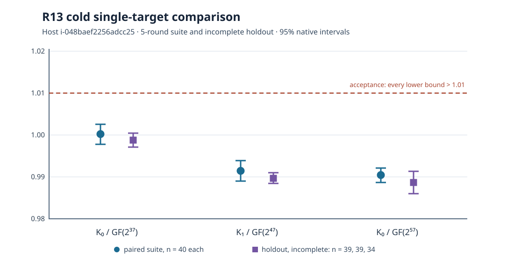

# R13 pair-table prefetch gate: replacement-host run

**Status:** the five-round A/A and paired suite have completed on EC2 `i-048baef2256adcc25`. The holdout runner stopped resumably at its unchanged isolation limit, with 267 price records retained. This is a partial run record, not a leaderboard promotion. The [protocol](../../PROTOCOL.md) fixes the candidate, panel, single-target process, decision rule, and CPU reservation before timing.

## Identity and execution

- Host: `i-048baef2256adcc25`, us-east-2b, `m8i.8xlarge`, Intel Xeon 6975P-C, 32 logical CPUs. Timed processes reserved both siblings of one physical core, CPUs `2,18`, with one Rayon thread and `KIC_RHO_CANON` unset. The [host manifest](../../runs-host-048baef2/host.json) and [runner configuration](../../runs-host-048baef2/runner-config.json) bind this cohort. EC2 reassigned its public IP during the holdout; the instance identity stayed the same.
- Source: frozen base algorithm revision `261482646ee89b332dca69e2f296b0774c25d2c2`, candidate revision `efc6336d55c59cceb92cb82de73598ebe15ff3ca`. Clean worker snapshots are base `e0c1570149327ceae8c2a915f357acdd1dfe7e43` and candidate `574742e00deb26986b03ad4d2e4ac6e194843494`. Their `src/` trees differ only in `src/cryptanalysis/koblitz_index_calculus.rs`; both used rustc 1.99.1 and Cargo.lock SHA-256 `c2c0049f265e78432b79c5fe14a7ce6668cd44c3816012256dfcd7b40e5f4f6d`.
- Binary SHA-256: base `87d4dacf96cb369ec64038d9e8866ba2c44dbd4d51b890e0cbfa9651e6d054a5`, candidate `d0989e0273b44e6831942e080bc8208de23e37be7e8e8cb243ec53f3692769cf`, native runner `ca8b91924cfc540c86b1eb74e9ebf61b64eeeed6fa72e99a2c7fcb5c47bdfb6b`, isolation tool `03d5b835157361b997c9643b5320bb8df2a778463c9fe50d66bcad133b3ed3df`.
- Untimed controls: `icprog host-class r13` passed, all 24 frozen holdout fixtures rederived byte-for-byte, and the [native pin](../../runs-host-048baef2/pin/pin.json) held 90/90 v0 outputs with matching names.

The schedule uses one public target per cold `ic price --single-target` process. Each price record includes same-target signed-Frobenius rho and verified scalar certificates. The 11-size suite includes K0/F2^37, K1/F2^47, and K0/F2^57 as primary sizes; the 24 fresh holdout rows use seeds 242–245 and targets 175–182. Base and candidate run in five interleaved rounds on this one host. Times, counts, and ratios from earlier R13 hosts are not pooled here.

## Completed controls and paired suite

The byte-identical base/base-copy A/A produced 220 scheduled price records and eight retained retry records. The native analysis found zero missing cold pairs across 11 sizes. The K0/F2^57 A/A cold base/copy geometric ratio was 0.984873, with native 95% interval [0.976267, 0.993554]; this observed offset remains in the control record.

The five-round ABAB suite produced 400 scheduled price records and 25 retained retry records. Native analysis found zero missing cold pairs. Its primary cold base/candidate geometric ratios are:

| Size | Pairs | Ratio | Native 95% interval |
|:--|--:|--:|:--|
| K0/F2^37 | 40 | 1.000182 | [0.997784, 1.002585] |
| K1/F2^47 | 40 | 0.991425 | [0.989017, 0.993839] |
| K0/F2^57 | 40 | 0.990408 | [0.988664, 0.992154] |

The ratio is base cold cost divided by candidate cold cost; values below one mean greater candidate cost on this cohort. The native suite analysis does not meet the preregistered lower-bound threshold above 1.01 and marks K1/F2^47 and K0/F2^41 as regressions beyond their A/A bands. This is a suite-stage observation; the full R13 decision still requires all holdouts and the conditional extension check.

The graph's plotted values are in [`graph-data.json`](graph-data.json), transcribed from native R13 analysis of this run tree. The holdout series is explicitly partial. A rendered [PDF run report](REPORT.pdf) and its [Typst source](report.typ) contain the same graph; `ratios.png` is the 150 dpi render of the SVG.

Raw records are in [`runs-host-048baef2/`](../../runs-host-048baef2/) and were copied incrementally to the checkpoint S3 prefix `s3://setec-astronomy-artifacts/checkpoints/crypto/codex__ic-single-target-tournament-20261026/20261027T152605Z-b89388529067/worker-runs-host-048baef2/`. The native analysis JSON and launcher logs are retained separately from the sealed run tree.

## Remaining execution and validation

The five-round holdout stopped at `cand/icv1-f2m57-tm747311035-c1f545af/M43-T177/r5.price.json` after 60 unchanged busy-machine preflight refusals. The separate run tree retains 267 holdout price files and the refusal log. No contended attempt was admitted as a clean timed sample. The host was still busy at the 16:57 UTC check, with unrelated Cargo and Rust processes and load average 57.15. Resume the missing records only on this instance, with the same binaries, CPU reservation and isolation guard, after a sustained quiet window. After holdout completion, the frozen half-width rule alone decides whether to extend a set to ten rounds. Independent native certificate checks, sampled reruns, raw-data recomputation, the matched-rho pricing band, and the final visual report are still due.

A same-instance resume began at 18:47 UTC after the lock was free, CPU pressure had fallen to zero for 15 seconds, and all four binary hashes and CPU sibling topology matched the pre-timing manifest. Background Git, EFS and other jobs then repeatedly exceeded the unchanged 0.20 CPU-second per two-second preflight limit; another benchmark held the global lock for part of the wait. The resumed runner stopped at 19:13 UTC after its 60-attempt bound on the same missing row. It produced no new price file. The holdout tree still contains 267 price files and now 282 refusal lines; the complete tree and resume log were copied to checkpoint `20261027T184737Z-b89388529067/worker-{runs,logs}-host-048baef2/`. A future attempt requires sustained low other-process CPU use as well as a free lock. The incomplete holdout remains an open requirement.

The former A/A host `i-0250d75e16bbdafb0` terminated after completing its own five-round A/A. Its root snapshot `snap-0ac0539f266bbe1a6` was mounted read-only after the current host's timed process stopped. The separate tree held 220 scheduled A/A price files, 39 retained retry price files and 90 pin price files. Native analysis found 11 A/A sizes and zero missing cold pairs; its K0/F2^57 base/copy ratio was 0.998332 [0.993237, 1.003453]. The tree and log were copied to `/tmp/r13-host-0250d75e-{runs,logs}/` and archived at `s3://setec-astronomy-artifacts/checkpoints/crypto/codex__ic-single-target-tournament-20261026/20261027T165438Z-b89388529067/former-host-custody/r13-host-0250d75e-custody.tgz` (SHA-256 `aa765ef6fb37d8ec8e2604e6544edf885d445d2c796b4324bd8dd47edff34a7b`). The temporary clone was unmounted, detached and deleted; the original volume and snapshot remain. This former-host A/A is a separate cohort and is not pooled with current-host suite or holdout timings.

Independent native `ic_validate certverify` checked the current host's 1,010 retained price records and 2,020 IC/rho scalar certificates, and the former host's 349 records and 698 certificates; both checks passed. These are certificate checks on records present at the 16:58 UTC custody snapshot. They do not establish completion of the missing holdout pairs or replace the later independent replay and raw-data validator report. The current host's partial native analysis had 39, 39 and 34 paired holdout observations at F2^37, F2^47 and F2^57 respectively, with one missing pair flagged at each size. Its partial cold base/candidate ratios were 0.998770 [0.997126, 1.000417], 0.989689 [0.988387, 0.990993] and 0.988685 [0.986033, 0.991344]. These are interim descriptive values; the frozen five-round holdout is still incomplete.

Local test evidence: the touched `koblitz_index_calculus` library filter passed 177 tests. The full release library test had 4,840 passing and nine failures in untouched ecbench and Jacobian paths; `icprog` integration had 10 passing and one R07 committed-analysis mismatch. These gates are not reported as green.
