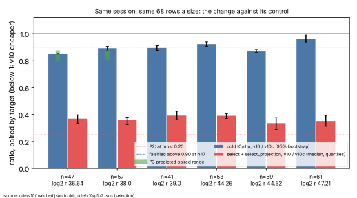
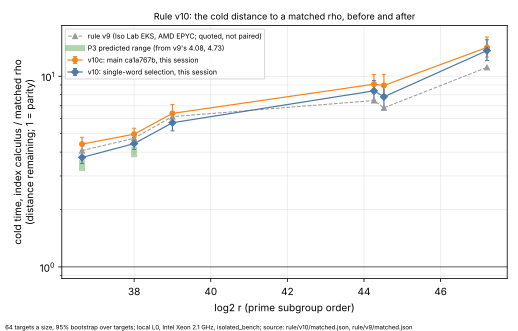

# Rule v10: single-word factor-base selection, against its control

**Run 2026-11-11, 20:26–23:30 UTC, local L0** (Intel Xeon @ 2.10 GHz,
4 vCPU, no PMU; `runs/host.json`). The protocol
([`PROTOCOL.md`](PROTOCOL.md)) was committed at `ef39d1e472`, before the
change was implemented and before any row. Amendment 0 (`9d492639ce`) added
the binaries and one implementation detail, also before the first row.

## Outcome

- **P1 held at every size: the factor base and every logarithm are
  unchanged.** Every paired row has equal `identity_inputs` (which include
  the factor base's orbit representatives) and equal `counts` hashes, and
  recovers the same logarithms: 408 of 408 rows per run (`p1p2.json`).
  Both pins held against §23. In both analyses `logarithms_as_earlier` is
  68 of 68 at every size, and `matched`'s `walks_checked` is 64 of 64.
- **Selection is 2.6–3.0x cheaper, short of P2's 4x.** The paired median
  of `select + select_projection` for `v10 / v10c` is 0.34–0.39. P2 asked
  for at most 0.25. It is **not met** at any size.
- **The cold distance to the matched rho fell at every size.** At n47 the
  paired cold ratio `v10 / v10c` is **0.851 [0.848, 0.855]**. That is
  inside P3's declared 0.81–0.86, so P3 is **met** there. At n57 it is
  **0.892 [0.876, 0.905]**, outside the declared 0.82–0.87, so P3 is
  **not met** there. The falsification bound (above 0.90 at n47) is not
  reached.
- **Distance remaining on this host.** The matched rho is still cheaper
  cold, by 3.75x [3.49, 4.07] at n47 (the control's distance is 4.41x),
  4.43x at n57 (control 4.97x) and 13.64x at n61 (control 14.16x).

Under the owner's success criterion, this is a measured improvement [pcc:unverified] over
the index-calculus baseline at all six sizes, with every answer checked.
It is an engineering change to set-up. The algorithm and its counted work
are unchanged.

## What ran

| | |
|---|---|
| change | `build_subgroup_orbit_factor_base_with_cost` takes a `u64` path for odd `n < 64` with an endomorphic Frobenius: one lift per Frobenius orbit, `MixHasher` tables and a single lowering. `projected_signed_orbit_map_fast` keeps its tables in `MixHasher`. Both are in `src/cryptanalysis/koblitz_index_calculus.rs`. |
| `v10` | `ic` from `f67d6c481b`, SHA-256 `deffa5b1…` |
| `v10c` (control) | `ic` from `ca1a767b1f` (the branch base, `main`), SHA-256 `07cd6558…` |
| harness | `icprog` from `f67d6c481b` (`V10`/`V10C`, `matched --comparison v10`). `isolated_bench` and `koblitz_rho_fixture` from `ca1a767b1f` ([`binaries.sha256`](binaries.sha256)). |
| sizes, targets | §23's six curves, 64 public targets and 4 A/A repeats a size, 408 rows a run. Seeds and parameter files are rule v9's. |
| order | manifests and pins first, then each size with `v10` before `v10c` |
| isolation | `isolated_bench run --wait --cpus 2`, `RAYON_NUM_THREADS=1`. The tool refused a start for load 37 times (`v10`) and 35 times (`v10c`). Six `v10` and four `v10c` attempts were contended and retried. Each kept row is the harness's first clean attempt. |
| unit | in-process wall time in each row's own unit (`unit_ns`). The cold ratio is the IC's cold cost over its in-process matched rho's. |

The steps are in [`run.sh`](run.sh). `claims` stopped once on a file
outside the sparse checkout
(`research/sat_factor_base_review_20260908/autolab/protocol.json`). Once
that file was added, the remaining steps ran by hand in `run.sh`'s order
([`run.log`](run.log)). The bench record store (benchrec, S3) is not
reachable from this container, so no benchrec record was opened. The raw
run trees are committed as they are (29 MB and 28 MB).

## Results

The cold figures are from `icprog rule matched --comparison v10`
([`matched.json`](matched.json); 64 targets, 95% bootstrap over targets,
10,000 resamples). The selection and set-up figures are from
[`p1p2.json`](p1p2.json), made by [`p1p2.sh`](p1p2.sh) with jq. Each is
the median over a row's repetitions, then the median over 68 rows. The
brackets are the quartiles of the per-row ratio. The v9 column is quoted
from rule v9 (Iso Lab EKS, AMD EPYC 9R45). It comes from another host and
is not paired with these rows.

| size | log2 r | v9 cold (EKS) | v10c cold | v10 cold [95%] | paired cold v10/v10c [95%] | select+proj ms v10c → v10 | select ratio median [q25, q75] | set-up ms v10c → v10 |
|---|---|---|---|---|---|---|---|---|
| n47 (a=1) | 36.64 | 4.08 | 4.41 | 3.75 [3.49, 4.07] | 0.851 [0.848, 0.855] | 4.66 → 1.72 | 0.369 [0.335, 0.397] | 20.5 → 17.8 |
| n57 (a=0) | 38.0 | 4.73 | 4.97 | 4.43 [4.13, 4.78] | 0.892 [0.876, 0.905] | 7.02 → 2.59 | 0.360 [0.325, 0.380] | 34.9 → 30.7 |
| n41 (a=0) | 39.0 | 6.14 | 6.39 | 5.71 [5.17, 6.33] | 0.894 [0.875, 0.911] | 5.87 → 2.29 | 0.392 [0.362, 0.424] | 49.4 → 45.7 |
| n53 (a=0) | 44.26 | 7.46 | 9.09 | 8.39 [7.48, 9.49] | 0.923 [0.907, 0.939] | 27.53 → 10.79 | 0.391 [0.371, 0.406] | 359.8 → 336.8 |
| n59 (a=1) | 44.52 | 6.83 | 8.95 | 7.80 [6.87, 8.94] | 0.872 [0.861, 0.883] | 37.35 → 12.29 | 0.336 [0.289, 0.377] | 421.3 → 368.8 |
| n61 (a=0) | 47.21 | 11.13 | 14.16 | 13.64 [12.11, 15.54] | 0.963 [0.938, 0.989] | 51.59 → 17.83 | 0.352 [0.312, 0.393] | 1524.6 → 1467.7 |

### Predictions against the outcome

| | declared | measured | |
|---|---|---|---|
| P1 | base, counters and logarithms identical | 408/408 rows a run identical, pins held, logarithms 68/68 a size | **met** |
| P2 | select+proj ratio ≤ 0.25 | 0.34–0.39 (medians) | **not met** at any size |
| P3 n47 | paired cold 0.81–0.86 (3.3–3.5 of 4.08) | 0.851 [0.848, 0.855]; 3.75 absolute here | **met** on the paired reading. The absolute reading cannot be compared across hosts. |
| P3 n57 | paired cold 0.82–0.87 (3.9–4.1 of 4.73) | 0.892 [0.876, 0.905]; 4.43 absolute here | **not met** |
| falsifier | paired cold at n47 > 0.90 | 0.851 | not falsified |

### Notes on the reading

- **Why P2 fell short.** A Callgrind profile (development only, not a row)
  put the two phases at 9.0 M instructions against 32.5 M, a factor of
  3.6. What remains is representation work that the base's
  `Vec<BinaryPoint>` format still requires: the projection's orbit walks
  and tables, lowering about 13,000 field elements into `BinaryPoint`s
  (`F2mElement::from_words`), and the packed orbit walk.
- **IC online time** was not targeted. Its paired ratio is 0.95–1.04
  (`ic_online_matched_over_control`), and `v10` always ran first at each
  size. Set-up is about 99% of the cold cost, so this barely moves the cold
  ratio. It does show that a few percent of drift on the host within one
  size is inside these figures. No separate A/A run of two copies of one
  binary was made in this session; §23's four repeats a size are the
  in-run A/A.
- **The host.** This container's absolute ratios are higher than v9's EKS
  figures at every size, for the control as much as for `v10`. The v9
  column is context only.
- **§5a.** Each run times both arms, the IC and its matched rho, in one
  process, so no native work is left unpriced. The 0, 0.1 and 1 GAE band
  gives one figure, and the order (rho cheaper cold at every size) holds
  across it. The reference check found each run's rho no slower per step
  than the strong walk at every size (`rho_over_strong` 0.57–0.74).

## What the validation gate would need

None of these was run here:

- The 2026-10-19 gate: a replay certificate and a validator report from
  `ic_validate`, like `rule/v9/replay-certificate.json` and
  `validator-report.json` (`src/bin/ic_validate.rs` would need a `v10`
  entry), plus `VALIDATION.json` and an independent review.
- An Iso Lab EKS (L2) rerun of this pairing, if Table A's rows are to
  move. Table A reads v9, which ran on EKS. These rows are local L0 on
  another host.
- A benchrec record with the raw tree in S3 (AGENTS.md §13a), and a
  `benchmarks/<date>-<slug>/` copy with a row in `benchmarks/README.md`,
  as the performance-results rule asks of the PR.

## Next

Selection now costs about 0.35 of the control's. At n47 that is about
1.7 ms of 17.8 ms of set-up. The next set-up levers are `build` and
`collect`, by size (from the rows' `setup_phases_ns`). Within selection,
the remaining lever is to keep the base packed end to end instead of
lowering every point.

## Files

`PROTOCOL.md`, `run.sh`, `p1p2.sh`, `binaries.sha256` and `run.log`; the
run trees `runs/` (v10) and `../v10c/runs/`; `claims/`, `manifests/` and
`analysis.json` for each run; `matched.json` and `p1p2.json`; and
`report/` (`plot.py`, the SVGs and PNGs, and `report.pdf`).
