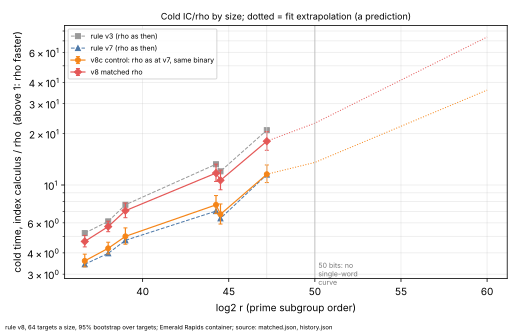
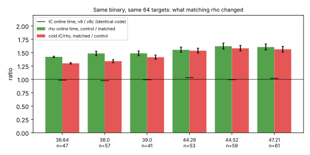

# The rule's comparison at baseline v8, with a matched rho: results

Protocol: [`PROTOCOL.md`](PROTOCOL.md), declared before any row, with two
amendments (the pin, and three names; both before or without touching a timed
row). Two runs of one binary (`ic` from commit `370e1919`) on the six sizes of
ledger §23, 64 targets a size, four A/A repeats, 408 rows each:
- **`v8`** ([`claims/`](claims/), [`analysis.json`](analysis.json)): rho with
  its signed-Frobenius canonicalisation batched 16 lanes at a time;
- **`v8c`** ([`../v8c/`](../v8c/)): the same binary with
  `KIC_RHO_CANON=scalar`, rho as at rule v7.
Read-out: [`matched.json`](matched.json) (`icprog rule matched`). Ran
2026-10-19, Emerald Rapids container (family 6 model 207, kernel
`6.18.44-fc-v139`), `isolated_bench run --wait --cpus 2`. The cards that ran it
are in [`cards/`](cards/) with their receipts (cards 1–5 stopped at the pin and
are kept as the record).

**Class (every claim below):** the matched rho and its cost, **engineering**
(rho side); the larger distance to a matched rho, **accounting** (a corrected
reference; the index calculus did not get slower); the slope,
**measurement**. **No advance. No index-calculus improvement in this PR.**

## What the pre-registered checks found

- **408 of 408 rows pass the `vs_rho` check in both runs**, and every
  logarithm is §23's (68 of 68 a size, both runs).
- **The matched rho takes the same walks.** On 64 of 64 paired targets at every
  size: same rho steps, same logarithms, same target hash.
- **The pin failed on the first attempt** and nothing was timed: `counts` held
  a counter (`row_ops`) added to main after §23. Amendment 1 lets the pin
  accept added counters while every earlier one must still match exactly.
- **The reference check** (rho against the strong walk `koblitz_rho_fixture
  strong`, admissible when no slower a step): the **matched rho is admissible
  at all six sizes** (0.57–0.82 of the strong walk's time a step). The
  **control is not admissible at four of six** (1.05, 1.20, 1.04, 1.03 at
  2^36.6, 2^38.0, 2^44.3, 2^44.5; 0.93 and 0.94 at the others). Under the
  rule's own test those four control sizes are "not run" as references. It is
  reported, not substituted. Why the control now measures about the strong
  walk's speed, where at v7 it measured 0.57–0.78 of it, was not established
  (different container session, same host class).

## Results

Cold = (set-up + online) / (set-up + online), index calculus over rho; above 1
rho is faster. Intervals: 95% bootstrap over the 64 targets. "v7" and "v3" are
those rules' published figures, rho as then.

| log₂ r | n | **v8, matched rho** | v8c control | v7 | v3 | matched / control | rho online, control / matched | IC online, v8 / v8c |
|--:|--:|:--|--:|--:|--:|:--|:--|:--|
| 36.64 | 47 | **4.67×** [4.34, 5.07] | 3.59 | 3.43 | 5.23 | 1.30 [1.29, 1.31] | 1.42 | 0.984 [0.967, 1.002] |
| 38.0 | 57 | **5.70×** [5.33, 6.13] | 4.25 | 3.97 | 6.12 | 1.34 [1.31, 1.37] | 1.48 | 0.976 [0.954, 1.000] |
| 39.0 | 41 | **7.07×** [6.43, 7.84] | 5.00 | 4.74 | 7.66 | 1.41 [1.38, 1.45] | 1.49 | 0.994 [0.962, 1.026] |
| 44.26 | 53 | **11.75×** [10.49, 13.25] | 7.65 | 7.03 | 13.24 | 1.54 [1.49, 1.58] | 1.55 | 1.033 [0.984, 1.078] |
| 44.52 | 59 | **10.65×** [9.38, 12.21] | 6.74 | 6.37 | 12.03 | 1.58 [1.53, 1.64] | 1.62 | 0.995 [0.955, 1.037] |
| 47.21 | 61 | **18.07×** [15.98, 20.58] | 11.56 | 11.51 | 20.97 | 1.56 [1.51, 1.62] | 1.60 | 1.019 [0.968, 1.077] |

PDF: [`report/report.pdf`](report/report.pdf).

- **Distance remaining (the success criterion's figure): rho is 4.67–18.07×
  faster cold at the six sizes** with a matched rho. That is the v8 column.
- **Prediction, declared before the rows:** 4.7–5.2, 5.4–6.0, 6.9–8.0,
  10.6–12.4, 9.5–11.1, 17.5–20.6. All six measured values lie inside their
  ranges (4.67 at the lower edge of the first).
- **Matching rho moved the gap by 1.30–1.58×**, an increase at every size
  (paired, intervals above), and rho's online time fell 1.42–1.62×. Rho's step
  went from 2.1–2.4 to 1.3–1.7 times the canonical-step model; the model gap
  (rho priced at the canonical step) is 6.45, 7.41, 10.06, 15.84, 13.55 and
  23.32× and does not depend on which rho ran (`cold_ratio_rho_at_canonical_step`).
- **The index calculus is the same in both runs.** Its online time, v8 over
  v8c, is 0.976–1.033 with every interval containing or touching 1: the noise
  and drift of the measurement is within about 3%. The control reproduces v7's
  published cold ratios to within +0.4% (2^47.2) to +9% (2^44.3), so
  the host moved little between sessions.
- **The 1.52–1.89× narrowing since v3 is not at issue.** v3 and v7 used the
  same rho, so their ratio of ratios is the index calculus's own speed-up. A
  matched rho does not undo it; it moves the whole line up. But the matched v8
  figures (4.67–18.07) sit about where v3's did against the old rho (5.23–20.97):
  **at a matched rho, v8's distance to rho is about v3's distance to the
  unmatched one.** The rho kernel gained about what #1978's index-calculus
  kernels did. (Engineering on each side; neither is an advance.)

## The slope: does the gap still grow with size?

Slope of ln(cold ratio) on ln r, six points (rule's t interval; bootstrap over
targets within each size; each size left out):

| arm | slope | 95% t, six sizes | bootstrap over targets | leave one size out |
|:--|--:|:--|:--|:--|
| v3 (rho as then) | 0.1756 | [0.137, 0.214] | | |
| v7 (rho as then) | 0.1440 | [0.092, 0.196] | | |
| v8c control | 0.1409 | [0.096, 0.186] | [0.125, 0.157] | 0.120 – 0.151 |
| **v8 matched** | **0.1679** | **[0.128, 0.208]** | [0.152, 0.184] | 0.153 – 0.176 |

Predicted (declared): 0.160–0.167.

- **Kill condition 2 (slope not below v3's 0.1756): not triggered**, by the
  protocol's rule: the point estimate, 0.1679, is below. It is **"fell below,
  within the interval"**: the t interval contains 0.1756, and so does the v3
  interval; the difference from v3 is −0.008. Leaving out the 2^44.5 size gives
  0.1762, above.
- **What the matched rho did to the slope:** +0.027 (0.141 → 0.168), the
  bootstrap intervals do not overlap. The apparent fall in the slope from v3
  to v7 (0.176 → 0.144) was **mostly an artefact of an unmatched rho**: against
  a matched rho the slope is back within 0.008 of v3's.
- **So the record, stated narrowly:** #1978 lowered the constant of the cold
  gap (1.52–1.89×); no change in its growth with size is distinguishable from
  zero by these six curves. The pre-registered "constant only" wording was
  for the slope condition triggering; it did not trigger, and the data do not
  establish a smaller exponent either.
- **Confound, as declared:** n and log₂ r are not independent here (n = 41 has
  log₂ r 39.0, n = 57 has 38.0). A fit on ln r and n together (six points,
  three parameters, no interval) gives 0.179 on ln r and −0.0066 per unit of n
  for the matched arm: descriptive, not a separation. Curves of one n and two
  r (K_0 and K_1 twins) with retuned recipes would be the test.

## Kill condition 1, and the ≥ 50-bit requirement: not run

- No Koblitz curve over `GF(2^n)`, `n ≤ 63`, has `log₂ r ≥ 50` (largest 47.21,
  `roster_n31_n63.txt`). Four at `64 ≤ n ≤ 81` do (`roster_n64_n81.txt`; best
  `K_0` over GF(2^71), 52.29 bits), registered in the protocol before timing.
- `ic price --single-target` stops on them with "no single-word Koblitz
  instance for this curve": this pipeline's field, rho and pair table are one
  64-bit word. Nothing was timed above 47.21 bits.
- **Extrapolation, a prediction, not a measurement:** the matched arm's fit
  gives 23.0× [18.3, 29.0] at 50 bits and 73.8× [44.5, 122] at 60, and the
  control's 13.6× [10.4, 17.6] and 36.0× [20.2, 64]. The v7-era fit's "about
  15×" was the unmatched rho's; with a matched rho the same method gives 23×,
  above the 15× line the kill condition names. It is untested (no curve), and
  its band comes from the slope's interval through the centroid only.

## Reading it against the success criterion

- **Not an improvement of the index-calculus baseline**: the index calculus was
  not changed here, and its time is the same in both runs (above). The
  leaderboard is not regenerated for that reason.
- **The distance to rho, corrected:** 4.67–18.07× (matched), not
  3.43–11.51×. By AGENTS.md §5a both arms are timed in one process on one core,
  so no native operation is unpriced on either side and the 0 / 0.1 / 1 GAE
  band gives one figure; the canonical-step model gap is a lower-bound reading
  and ranks nothing.
- **Rho's remaining overhead** (1.3–1.7× its canonical step) is rho's; it does
  not change the gap's growth, which comes from the index calculus's set-up
  (about 99% of S in v7's analysis).
- **Next improvement to try:** the set-up. The pair-table build costs 31–35 ns
  per stored pair, of which about 8 ns is arithmetic (#1978); it is the part
  of the index calculus that grows fastest with size. A second line: the
  two-word pipeline for single-target `price`, without which nothing above
  47.21 bits can be measured.

## Non-claims

No statement past `n = 61`; one host class; the six recipes were tuned at v3
and not retuned; the control reference check failed at four sizes (above);
nothing about precomputation rho; no claim that the index calculus beats rho.
