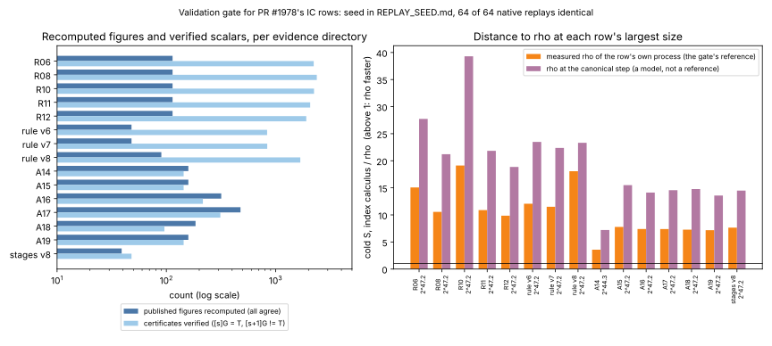

# Validation gate evidence for PR #1978's IC rows

**What this is.** The validation gate (owner rule 2026-10-19,
[`docs/VALIDATION_GATE.md`](../../../docs/VALIDATION_GATE.md)) admits a row to
`benchmarks/README.md` or the IC leaderboard only with a replay certificate, an
independent validator report and a matched rho reference with the §5a band.
PR #1978's rows landed after the gate's freeze, so each needed all three. This
directory holds the tool, the seed and the raw outputs; each evidence directory
holds its `VALIDATION.json`, `replay-certificate.json` and `validator-report.json`.

PDF: [`report/report.pdf`](report/report.pdf).

## Result

- **15 evidence directories validated:** 14 benchmark rows and `rule/v7/`, which
  carries the leaderboard's six rule-v7 rows.
  `python3 scripts/validation_gate.py check --base origin/main` reports every
  row validated or frozen.
- **Every published figure recomputes.** 2,192 figures from the raw records, including the 30 the leaderboard shows for rule v7:
  - the five rounds' A/A, suite and holdout intervals and rule v6/v7's S figures
    agree to 1e-9;
  - the explorations' paired cold times agree exactly, and their summaries
    agree at the three decimals they print.
- **Every recorded scalar verifies.** 6,809 records and 13,618 certificates
  (both arms of every process) pass `[s]G = T` and `[n]G = O`, and the scalar+1
  negative control is rejected each time. The curves are GF(2^19) to GF(2^61).
- **56 of 56 native replays are identical.** Four records per directory were
  drawn by the seed committed in [`REPLAY_SEED.md`](REPLAY_SEED.md) (commit
  `766d2dede`, before any replay). Each was rerun with its own recorded binary,
  hash-checked, and reproduced the same certificates, counts and flags.

## Finding: the published distance to rho is the smaller of two

Each `ic price --single-target` process records two rho figures for the same
point:
- **as built:** the walk as it ran;
- **canonical step:** the walk priced at the batched step that the same process
  measures.

The rows quote rho as built. In rule v6 and v7 that rho pays 1.98 to 2.38 times
the canonical step for each walk step (`rho_step_over_model_median`), which
validation sweep A also found for rule v3.

The gate asks for the strongest available reference, so every `VALIDATION.json`
uses the canonical-step rho. At each row's largest size the distance to rho is
then 1.84 to 2.05 times the published one:

| row | size | IC / rho as built (published) | IC / rho, canonical step |
|:--|:--|--:|--:|
| rule v7 | 2^47.2 | 11.51 | 22.37 |
| rule v6 | 2^47.2 | 12.06 | 23.48 |
| R12 (v8) | 2^47.2 | 9.86 | 18.86 |

Every row's values are in its `VALIDATION.json` (`rho_reference`). The order
holds across the §5a band: rho is faster at 0, 0.1 and 1 GAE for each of rho's
uncharged canonicalisations. The speed-ups between IC versions are unaffected,
because both arms of each round meet the same rho.

**The leaderboard now uses the canonical-step reference** (owner's decision,
2026-10-22). Table A's six rule-v7 rows show `S, reference` and `× reference`
at the canonical step, and the as-built ratio with its interval beneath. §23's
"was" marks are recomputed the same way from §23's own `s_rho_model_mean`.
At 2^47.2 the row reads **22.4×** (was 58.2×, §23), where it read 11.5×
(was 31.6×). The rule-v7 validator report also recomputes these 30 displayed
figures from the raw records, which brings its total to 78.

## Rows withdrawn from `benchmarks/README.md`

- **`20261017-ic-a20-build-line-streams`.** It is a smoke check transcribed from
  a terminal, and its own README says "not a measurement". It has no raw
  records, so it cannot be validated. The research directory is unchanged.
- **`20261017-two-sylow-fp64`.** Main archived it (`benchmarks/ARCHIVE.json`).
  An old merge had restored its line here.

## How it ran

- **Tool:** [`src/bin/ic_validate.rs`](../../../src/bin/ic_validate.rs), native
  Rust. It does not use the crate's library or `icprog`. It has its own GF(2^m)
  field, Koblitz group law and statistics, and reads only the raw
  `*.price.json` and `*.isolation.jsonl` records.

      cargo build --release --bin ic_validate
      ic_validate certverify <runs.tar.xz | runs/> --out raw/certverify-<key>.json
      ic_validate recompute <round|rule|exploration|stages> <dir>
      ic_validate replay --bin <binaries> --scratch <dir> --out raw/native-replay.json <dirs...>
      ic_validate build [--check]

- **Definitions.** These come from the protocols (IC_TOOL_PROGRAM.md §5; R01
  PROTOCOL, "Accounting"), not from `icprog`'s code:
  - **Cold time:** the median over a process's repetitions of set-up plus the
    online interval.
  - **A process's figure:** its first attempt that the isolation record does not
    mark contended.
  - **Paired comparison:** the geometric mean of the ratios, with a 95% Student t
    interval.
- **Host:** `Linux 6.18.44-fc-v140 x86_64`, Emerald Rapids, the rounds' host
  class. The rounds ran on kernel build `-v139`. Replays compare outputs, not
  times.
- **Binaries:** each one's SHA-256 matches the round's `analysis.json`
  (`host.binaries`) or its `binaries.sha256`.
- **Disclosures.**
  - A first replay pass was driven by a Python script, against AGENTS.md
    ("Implementation language: no Python"). Its log is
    [`raw/native-replay-attempt1-python-driver.log`](raw/native-replay-attempt1-python-driver.log).
    It stopped at A18, whose parameter files were renamed after the run
    (`k0n61-…` became the curve slug). The tool now maps the recorded name to
    the renamed file and records the mapping in each run's `params_renamed`.
    The replays reproduced identical outputs, which shows the contents are the
    same.
  - The Python tools were replaced by `ic_validate` before anything was
    published. `ic_validate` reran every step and drew the same 56 records.
