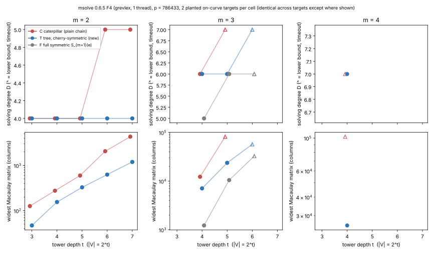

# Tree-glued, cherry-symmetric PDP systems: F4 solving degree against the caterpillar and full-symmetric arms

2026-11-03 · theory and proposal in [`THEORY.md`](THEORY.md) · generator
[`gen.sing`](gen.sing) (Singular 4.3.2, native) with [`instances.txt`](instances.txt)
· equivalence check [`compare.sing`](compare.sing) · runner [`run.sh`](run.sh)
(msolve 0.6.5) · parser [`parse.sh`](parse.sh) · records [`rows.tsv`](rows.tsv),
[`logs/`](logs/) (sha256 in `logs/SHA256SUMS`) · graph [`d_vs_t.svg`](d_vs_t.svg)
([`plot.py`](plot.py), recorded values only) · PDF [`report.pdf`](report.pdf)

**Class: stage diagnostic of the solver axis (AGENTS.md §2). No pipeline is
priced, and there is no `S` value, rho comparison or leaderboard row.** It
measures one new encoding of the prime-field PDP, motivated by phylogenetic
tree models (THEORY.md §3), against the lab's two existing encodings, on
identical targets.

## Result

The tree-glued cherry-symmetric encoding **T** is new to the lab. Every summand
pair ("cherry") is encoded by its symmetric functions (s, q) with a degree-2
remainder tower, and cherries are glued by S₃. All inputs have degree ≤ 4 for
every arity m.

- **Against the plain chain C** (same variable count, same targets), T is
  better in every completed cell:
  - **m = 2:** D stays at **4 for t = 3..7**, while C rises to 5 at t = 6, 7.
    T's matrices are 1.8–3.6× narrower.
  - **m = 3, t = 5:** T finishes at **D = 6**. C selects degree 7 and is cut
    off at 600 s with a matrix ≥ 3.4× wider.
  - **m = 4, t = 4:** T finishes at **D = 7** (697 s). C is cut off at 600 s
    in degree 7 with a matrix ≥ 3.9× wider than T's widest.
  - The pre-registered kill criterion (T's D ≥ C's D in every comparable cell)
    is **not met**.
- **Against the full-symmetric arm F** (S_{m+1} in e₁..e_m, the lab's symmetric PKM):
  - **m = 3:** F is better: D 5 vs 6 at t = 4, and 2–6× narrower matrices.
    Both arms reach D = 6 at t = 5.
  - **m = 4, t = 4:** T's D = 7 is **one below** the D = 8 the lab recorded
    for F (`research/pkm_symmetric_lead1_20261026`, N = 16). But F was 59×
    faster there (11.8 s vs 697 s) and its matrix was narrower (13,926 vs
    25,742 columns). That F row comes from a different engine (`f4_fp`), so
    only its D is comparable here, and even that loosely.
- **The t-growth is delayed, not removed.** At m = 3, t = 6, T selects
  degree 7 before the 600 s cut-off. Lead 1's question (is D bounded in t?)
  stays open for T, as it does for F.

**Reading.** T dominates the plain chain at every measured cell and gives the
first measured cell with a lower solving degree than full symmetrisation
(m = 4). It does not beat F's cost at the sizes measured. Its case is
asymptotic: F's input degree is 2^{m−1}, while T's is bounded. THEORY.md §3
shows that an L(1/2) cost needs D = O(m) and D nearly flat in t, and only a
bounded-input-degree encoding can meet the first condition. Nothing here shows
that T meets the second.

## Tables (recorded values, `rows.tsv`)

D is the largest selected F4 degree. "≥" marks a run stopped by the 600 s
timeout (exit 124); for those runs, D is the degree being reduced when it was
cut off, and the width is the widest matrix reached so far. N is the number of
unknowns. Both targets gave identical D and widths in every cell where both
ran. The two m = 2 C targets differ in sum rows·cols by < 0.1 %.

| m | t | N (C, T / F) | D: C | D: T | D: F | widest: C | widest: T | widest: F | quotient dim C / T / F |
|--:|--:|--:|--:|--:|--:|--:|--:|--:|--|
| 2 | 3 | 6 | 4 | 4 | = T | 126 | 47 | | 2 / 1 |
| 2 | 4 | 8 | 4 | 4 | | 276 | 155 | | 2 / 1 |
| 2 | 5 | 10 | 4 | 4 | | 597 | 327 | | 2 / 1 |
| 2 | 6 | 12 | **5** | **4** | | 2,056 | 627 | | 2 / 1 |
| 2 | 7 | 14 | **5** | **4** | | 4,317 | 1,193 | | 2 / 1 |
| 3 | 4 | 13 / 9 | 6 | 6 | **5** | 12,279 | 7,077 | 1,224 | 6 / 3 / 1 |
| 3 | 5 | 16 / 12 | **≥ 7** | **6** | 6 | ≥ 81,920 | 23,720 | 10,493 | — / 3 / 1 |
| 3 | 6 | 19 / 15 | not run | ≥ 7 | ≥ 6 | | ≥ 57,152 | ≥ 32,678 | |
| 4 | 4 | 18 | ≥ 7 | **7** (697 s run) | lab f4_fp: 8 | ≥ 102,212 | 25,742 | lab: 13,926 | — / 6 / — |

The quotient dimensions equal the orbit sizes of the planted relation:
2! = 2, 3! = 6 and 4!/4 = 6 copies, against 1 for T at m = 2 and for F. This
shows the systems have exactly the planted solution and its relabellings.

Times are contended: up to 5 single-thread jobs shared 4 cores, plus a helper
agent. Use them as an ordering only (AGENTS.md: wall time is evidence only
from uncontended runs). The 600 s cut-offs are wall-clock, so a contended C or
T run could have been cut off earlier than it would have been uncontended.
This affects which cells finished, not the D of any completed run. The m = 4
T run with a 2,400 s budget ran with at most two other jobs.

## Checks and controls

- **Planted check.** Every system is evaluated inside Singular on a planted
  decomposition before it is written, and the generator aborts on any nonzero
  equation. The decomposition uses m distinct points of E(F_p) with x ∈ V,
  random signs, x_R computed by the group law, and partial sums from the
  actual points. The curve is y² = x³ + ax + b over F_786433 with
  (a, b, g) in `instances.txt`.
- **Cross-instrument positive control.** msolve on this generator reproduces
  the lab's recorded `f4_fp` values from `research/pkm_symmetric_tower_20261026`:
  - plain m = 2: D 4, 5, 5 at N = 10, 12, 14;
  - symmetric m = 3: D 5 at t = 4 and 6 at t = 5;
  - symmetric m = 3, t = 4: widest matrix **1,224 columns, identical**.
- **Generator equivalence.** `gen.sing` was ported from a Python pilot that
  was kept outside the repository (AGENTS.md: no Python instruments). Its 60
  outputs are byte-identical to the pilot's. `compare.sing` checked every
  polynomial as well: 60 files, 0 mismatches; a deliberately perturbed copy
  was caught.
- **Parser.** `parse.sh` (awk) agreed with the pilot parser on all 30 logs
  it was compared on.

## What did not run, and why

- **C at m = 3, t = 6–7, and T and C at m = 3, t = 7:** after C was cut off at
  t = 5 these were not started. The main queue was stopped to free cores for m = 4.
- **m = 4 second target:** C target 1 was killed by the operator at about
  300 s, while it was reducing degree 7, to free a core. The partial log is
  kept as `logs/run600/m4_t4_k1_C.killed.log` and is not used in the table.
  T target 1 at m = 4 was not run.
- **m = 4, t ≥ 5**, and F at m = 4 with this generator (S₅(e) is not
  implemented in `gen.sing`). The m = 4 F reference is the lab's recorded row.
- **The S3 resume checkpoint** (`scripts/checkpoint.sh push`) could not upload:
  the container has no AWS profile and no upload token. `.resume/RESUME.md` was
  written locally before the runs and holds the pre-registered prediction and
  kill criterion.
- **Isolab-EKS.** This is a deterministic algebraic diagnostic (degrees,
  matrix widths, quotient dimensions), and it ran locally. No timing claim is made.

## Next measurements

1. **F at m = 4 and 5 against T on one engine** (msolve), so the m = 4 D
   comparison is not cross-instrument. This is the decisive test of the
   asymptotic argument: does D_F − D_T grow with m?
2. **T on a larger host at m = 3, t = 6–7 and m = 4, t = 5**, to measure T's
   t-slope directly.
3. **Separator test of Conjecture B** (THEORY.md §2): in T, replace one
   internal S₃ by a planted known X and measure how much D drops.
4. **Wreath-complete T:** also quotient the root swap at m = 4
   (S₂ ≀ S₂ = D₄, leaving 3 copies instead of 6).

## Round 2 (2026-11-03)

See [`round2/README.md`](round2/README.md), which covers next steps 1–3 above.
Fixing the partial-sum separators brings D to 4 in every cell, so the excess
degree is caused by the elliptic coupling, not the towers. On the same engine
at m = 4, t = 4, F has D = 8 against T's 7, but F is 65× faster. At m = 4,
t = 5 both arms were cut off (D_F ≥ 8, D_T ≥ 7).

## Round 3 (2026-11-03/04)

See [`round3/README.md`](round3/README.md). With every partial sum fixed, the
floor holds to m = 6 (D_S = 4). The coupling excess E = D_T − 4 is at least 5 at
m = 5 and at least 6 at m = 6, exactly on the pre-registered limits, so the kill
test is undecided on a 15 GB host. Eliminating the separators by resultants (G)
raises the input degree to 16, and G is dominated.
