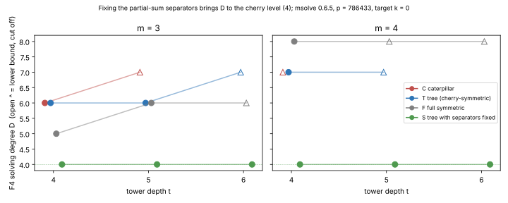

# Round 2: same-engine F at m = 4, the separator test, and the tree's t-slope

2026-11-03 · follow-up to [`../README.md`](../README.md) (#3361) · predictions
pre-registered in `.resume/RESUME.md` (commit `3f8a51d9c1`) before any round-2
run · generator [`../gen.sing`](../gen.sing) with `CELLS` · input hashes
[`SYSTEMS.sha256`](SYSTEMS.sha256) · logs [`logs/`](logs/) · records
[`rows.tsv`](rows.tsv) · graph [`separator.svg`](separator.svg) · PDF
[`report.pdf`](report.pdf)

**Class: stage diagnostic of the solver axis.** No pipeline is priced and no
leaderboard row changes. The engine is msolve 0.6.5 (F4, grevlex, 1 thread, GB only),
the prime is p = 786433, and the curve and planted targets are those of
`../instances.txt`, target k = 0.

## Result

1. **The separators carry the whole excess degree (Conjecture B supported).**
   Arm S is the tree T with every internal partial sum X_c fixed to its
   planted value. **D_S = 4 in all six cells** (m = 3, 4; t = 4, 5, 6), which
   is the D of a single cherry at m = 2. The widest matrix is ≤ 1,285 columns
   and each solve takes under a second. In the same cells D_T is 6, 6, ≥ 7 at
   m = 3 and 7, ≥ 7 at m = 4. The pre-registered prediction holds: the
   membership towers alone do not raise D up to t = 6. Everything above 4 is
   caused by coupling the cherries through the elliptic partial-sum abscissas.
2. **Same engine at m = 4.**
   - **t = 4:** F (S₅ in e₁..e₄) has **D = 8**, widest matrix 13,503 columns,
     10.7 s. This reproduces the lab's `f4_fp` record (D = 8, 13,926 columns,
     11.8 s). T has **D = 7** (697 s, 25,742 columns). So D_F − D_T = +1, as
     predicted, while F is 65× faster, also as predicted.
   - **t = 5:** neither arm finished within 2,400 s, each run alone on a
     13 GiB cap. F was reducing degree 8 (D_F ≥ 8, widest 99,392 columns).
     T was reducing degree 7 (D_T ≥ 7, widest 218,583 columns). The prediction
     D_F − D_T ≥ 1 is consistent with these lower bounds but not decided.
3. **T's t-slope at m = 3.** At t = 6, T selects degree 7, which equals the
   prediction. It was still reducing degree 7 (a 244,072 × 212,269 matrix) when the 2,400 s limit cut it off, so D_T ≥ 7. The prediction holds as a lower bound. Whether D stops at 7 is undecided.

**Reading.** Holding the separators fixed brings D down to the cherry level.
That identifies the PDP's hardness at these sizes: it is the elliptic coupling
between partial sums, which THEORY.md §2 (Elekes–Szabó) predicts no factor-base
structure can simplify. It is not the factor-base membership. Two
consequences:

- **No factor-base symmetry, however chosen, can remove the excess.** The
  towers already contribute nothing above D = 4. Any further degree gain has
  to come from how the separators are encoded or eliminated.
- **The excess grows with the arity:** D_T − D_S = 0, 2, 3 at m = 2, 3, 4
  (t = 4). This is about linear in m, which is condition 1 of THEORY.md §3
  (D = O(m)). F's excess over the cherry level is 1, 4 at m = 3, 4 (t = 4).
  At m = 4 the tree has the smaller excess, but F still has the smaller
  matrices at t = 4.

## Table (recorded; `rows.tsv`)

| cell | arm | N | D (≥: cut off) | widest matrix | quotient dim | wall s | log |
|---|---|--:|--:|--:|--:|--:|---|
| m3 t4 | S | 13 | 4 | 154 | 1 | 0.35 | main |
| m3 t5 | S | 16 | 4 | 350 | 1 | 0.02 | main |
| m3 t6 | S | 19 | 4 | 643 | 1 | 0.06 | main |
| m4 t4 | S | 18 | 4 | 307 | 1 | 0.36 | main |
| m4 t5 | S | 22 | 4 | 699 | 1 | 0.06 | main |
| m4 t6 | S | 26 | 4 | 1,285 | 1 | 0.27 | main |
| m4 t4 | F | 12 | **8** | 13,503 | 1 | 10.7 | main |
| m4 t4 | T | 18 | **7** | 25,742 | 6 | 697 | round 1 (`../logs/run2400/`) |
| m4 t5 | F | 16 | ≥ 8 | ≥ 99,392 | — | 2,400 (timeout) | main |
| m4 t5 | T | 22 | ≥ 7 | ≥ 218,583 | — | 2,400 (timeout) | main |
| m3 t6 | T | 19 | ≥ 7 | ≥ 212,269 (round in progress) | — | 2,400 (timeout) | main |

The quotient dimension of S is 1 at m = 4: fixing X₁ and X₂ also fixes which
pairing is used. Wall times in `main` come from runs with at most two msolve
jobs on four cores; the S runs shared the host with up to three other jobs.
Times are evidence of ordering only.

## Failed and repeated runs

- **Memory-capped first attempts** (`logs/memcap/`, exit 139): F m4 t5,
  F m4 t6, T m4 t5 and T m3 t6 ran four at a time under 4–4.5 GiB caps, and
  all four segfaulted when they reached the cap. The first three were in
  their highest degree (8, 7–8, 7), and T m3 t6 was still in degree 6. They
  were rerun one at a time with a 13 GiB cap and a 2,400 s limit. The
  exception is F m4 t6, which was not rerun because F m4 t5 already timed out.
- Only target k = 0 was run. Round 1 found both targets identical in D and
  width in every cell where both ran.

## Checks

- Every new system passes the planted check inside `gen.sing` before it is
  written, and S and F at m = 4 pass at every t.
- With `CELLS` unset, the generator writes the 60 round-1 systems byte-identical
  to round 1 (60/60 compared).
- F m4 t4 on msolve reproduces the lab's independent `f4_fp` record: D = 8,
  and widths within 3 % (13,503 vs 13,926). The two use different chain
  presentations (N = 12 here vs N = 16).

## Next

1. **Separator elimination, not factor-base symmetry, is now the lever.**
   Candidates:
   - Eliminate each X_c between its two S₃ equations by a resultant, giving a
     degree-8 S₄-type equation in two cherries' (s, q) coordinates.
   - Encode the root pair (X₁, X₂) by its symmetric functions too, making the
     tree D₄-complete.
   - A hybrid that guesses a few bits of X: about p/2^b guesses, so this only
     makes sense if D drops a lot.
2. On a host with more than 32 GB, finish F and T at m = 4, t = 5. This
   decides prediction 1 at t = 5 and gives the first cost crossover point,
   if there is one.
