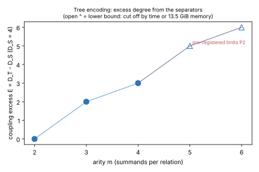

# Round 3: arity scaling of the tree (m = 5, 6) and the glued arm G

2026-11-03/04 · follow-up to [`../round2/README.md`](../round2/README.md) ·
predictions pre-registered in `.resume/RESUME.md`, commit `28fabab36d`,
before any round-3 run · instance generator [`../inst.sing`](../inst.sing)
→ [`../instances_r3.txt`](../instances_r3.txt) · generator
[`../gen.sing`](../gen.sing) (`INSTFILE`, `CELLS`) · input hashes
[`SYSTEMS.sha256`](SYSTEMS.sha256) · logs [`logs/`](logs/) · records
[`rows.tsv`](rows.tsv) · graph [`excess.svg`](excess.svg) · PDF
[`report.pdf`](report.pdf)

**Class: stage diagnostic of the solver axis.** No pipeline is priced and no
leaderboard row changes. Engine: msolve 0.6.5 (F4, grevlex, 1 thread, GB only),
p = 786433, curve as in `../instances.txt`, one planted target per cell.

## Result

| prediction | outcome |
|---|---|
| P1: D_S = 4 at m = 5, 6 | **confirmed**: 4 in all four cells (m = 5, t = 4, 5; m = 6, t = 5, 6) |
| P2 (kill test): E(5) ≤ 5, E(6) ≤ 6, where E = D_T − D_S | **undecided**: E(5, t=4) ≥ 5 and E(6, t=5) ≥ 6. Both lower bounds sit exactly on the registered limits, and neither run finished on this 15 GB host |
| P3: G at m = 4, t = 4 has D in [7, 8] | **falsified**: G's input equation has total degree 16, and F4 reached degree 9 before the run was stopped. G is dominated by T (D = 7) and F (D = 8) |

1. **The cherry floor holds up to m = 6.** With every internal partial sum
   fixed, D = 4 and every solve takes under a second (widest matrix ≤ 1,927
   columns). The membership towers and the pair encodings still add no degree.
2. **Coupling excess E = D_T − 4.** At t = 4–5 it is 0, 2, 3 at
   m = 2, 3, 4 (measured) and at least 5 and at least 6 at m = 5, 6 (lower
   bounds). Averaged from m = 2 to 6, the lower bounds imply a slope of at least 1.5 per added summand, which
   would still be D = O(m), condition 1 of THEORY.md §3. But a lower bound
   cannot confirm a slope. The decisive cells need more than 13.5 GiB:
   - m = 5, t = 4 was cut off at 2,400 s while reducing degree 9 on a
     572,048 × 999,374 matrix.
   - m = 6, t = 5 selected degree 10, then hit the 13.5 GiB cap at 1,304 s.
3. **Size, not only degree.** Even if E is linear, the matrices grow fast:
   2.6·10⁴ columns at m = 4, t = 4, and at least 10⁶ at m = 5, t = 4. The cost law
   binom(N + D, D)^ω with N ≈ m·t and D ≈ 4 + 1.5·(m − 2) is what an L(1/2)
   claim would have to beat. These cells do not test that.
4. **Eliminating the separators backfires.** G = Res_X1(·, Res_X2(·, ·)) is S₅
   written in the two pairs' (s, q). In (s, q) its standard total degree is 16
   (degree 8 in each of s₀ and q₀). That is twice F's degree in e₁..e₄, because
   q = x·x′ counts as degree 1 while carrying x-degree 2.
   - F4 selected degree 16 (the input itself) and was in degree 9 at 83 s,
     when I stopped it to free cores for the kill-test cells. The t = 5 run was
     withdrawn for the same reason; its log records `Input file not found`.
   - A weighted grading (deg q = 2) would put G and F on equal footing. msolve
     does not take weights, so that comparison is not made here.

**Reading.** At these sizes the lever named in round 2, encoding the
separators better, is not a resultant elimination: it moves the coupling into
one high-degree equation, and F4 pays for it. The tree stays the only measured
encoding with bounded input degree. Its excess is consistent with linear growth
up to m = 6, but only as lower bounds. Whether its slope is ≤ 1 per summand
(P2) needs a host with at least 64 GB.

## Table (recorded; `rows.tsv`)

| cell | arm | N | D | widest matrix | wall s | exit | log |
|---|---|--:|--:|--:|--:|---|---|
| m5 t4 | S | 23 | 4 | 307 | 0.35 | 0 | main |
| m5 t5 | S | 28 | 4 | 699 | 0.38 | 0 | main |
| m6 t5 | S | 34 | 4 | 1,048 | 0.11 | 0 | main |
| m6 t6 | S | 40 | 4 | 1,927 | 0.64 | 0 | main |
| m5 t4 | T | 23 | ≥ 9 | ≥ 999,374 (round in progress) | 2,400 | 124 timeout, 13.5 GiB | main |
| m6 t5 | T | 34 | ≥ 10 (selected) | ≥ 734,728 | 1,304 | 139 memory, 13.5 GiB | main |
| m5 t4 | T | 23 | ≥ 9 | ≥ 654,028 | 620 | 139 memory, 6 GiB | memcap6g |
| m5 t5 | T | 28 | ≥ 9 (selected) | ≥ 124,757 | 528 | 139 memory, 6 GiB | memcap6g |
| m6 t5 | T | 34 | ≥ 9 | ≥ 555,349 | 280 | 139 memory, 6 GiB | memcap6g |
| m6 t6 | T | 40 | ≥ 9 | ≥ 308,136 | 793 | 139 memory, 6 GiB | memcap6g |
| m4 t4 | G | 16 | ≥ 16 selected (input); working degree 9 | ≥ 72,406 | 83 | 143 stopped by operator | stopped |

`parse.sh` counts only completed rounds. The m6 t5 degree-10 selection appears
in the log's last, incomplete row (`10 95116 1780719`, then `exit=139`).

## Deviations from the pre-registration

- m = 6 was registered at t = 4 and 5. At t = 4 the base has only 5 usable
  abscissas, too few for 6 distinct summands, so m = 6 ran at t = 5 and 6.
- The registered memory cap was 6 GiB with 2 jobs. All four T runs hit it,
  and the two deciding cells were rerun one at a time at 13.5 GiB.
- G was stopped before its t = 4 run finished, and its t = 5 run was
  withdrawn. Both decisions were made after seeing the input degree (16).

## Checks

- Every round-3 system passed the planted check inside `gen.sing`. The
  instances come from `inst.sing`, natively and deterministically (LCG seed
  `0x7EE51103`). Internal consistency holds: cherry sum 1 equals caterpillar
  sum 1, and Y equals the 4-point partial sum.
- `gen.sing` still writes the round-1 systems byte-identical (60/60), and the
  round-2 spot checks are identical too (3/3).
- S's quotient dimension is 1 in every cell: fixed separators leave one solution.

## Next

The remaining question is P2's slope at m = 5, 6. It needs a host with at least
64 GB, run through isolab-eks under the repository rule. The two cells, with
their inputs, are pinned in `SYSTEMS.sha256`.
