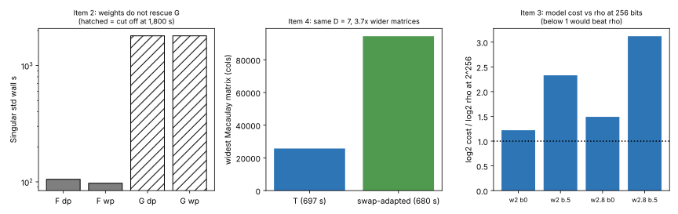

# Round 4: weighted grading (G vs F), the swap-symmetry split, the crossover with rho, and the big-host spec

2026-11-04 · follow-up to [`../round3/README.md`](../round3/README.md) (#3380).
The four items were chosen and their expected outcomes stated in chat before
any run. That is not a formal pre-registration, which this round does not have.
· [`WEIGHTED.md`](WEIGHTED.md) (item 2) · [`parity.sing`](parity.sing)
(item 4) · [`CROSSOVER.md`](CROSSOVER.md) (item 3) · [`BIGHOST.md`](BIGHOST.md)
(item 1) · logs [`logs/`](logs/) · graph [`round4.svg`](round4.svg) · PDF
[`report.pdf`](report.pdf)

**Class: stage diagnostics plus a derived bound.** No pipeline is priced and
no leaderboard row changes.

## Result

1. **Item 2: weights do not rescue the glued arm G.** In Singular 4.3.2 `std`
   at m = 4, t = 4, F finished in 105 s with standard grading (`dp`) and in
   97 s with its natural weights (eᵢ ↦ i). G did not finish within 1,800 s
   under either `dp` or its natural weights (s ↦ 1, q ↦ 2). So G/F is above 17
   under `dp` and above 18 under weights, both lower bounds. At the cut-off G's
   weighted degree (37) already exceeded F's entire run (34). G's round-3
   handicap is not just a grading artefact, at least within this budget.
   Singular is about 10× slower than msolve on F (105 s against 10.7 s), so
   only the ratios matter.
2. **Item 4: the swap-symmetry split is real but buys nothing in msolve.**
   Exchanging the two cherries is a symmetry of the m = 4 tree. In the
   coordinates a = v₀ + v₁, b = v₀ − v₁, all 19 generators are even or odd in
   the 9 b-variables (10 even, 9 odd, none mixed); `parity.sing` checks this.
   - msolve on the adapted system gives the same D = 7 and the same quotient
     dimension (6), in 680 s against T's 697 s. Its widest matrix is 3.7× wider
     (94,422 against 25,742 columns), because the new coordinates make the
     polynomials denser.
   - An engine that used the even/odd block split could save at most about
     2^{ω−1}, roughly 2–3.5×, in linear algebra. That would first have to pay
     back the 3.7× fill. It is a constant factor in any case.
3. **Item 3: the cost law puts the crossover with rho far beyond
   cryptographic sizes** (`CROSSOVER.md`). The model takes the measured degree
   laws (D = 4 + 1.5(m − 2), plus β(t − 4) with β ∈ {0, 0.5}) into the dense
   Macaulay cost ω·log₂ C(N + D, D).
   - **Asymptotically** the model is subexponential: the ratio to √p falls
     without bound.
   - **At 256 bits** even the most optimistic row (ω = 2, β = 0) costs
     2^{156} against rho's 2^{128}. With the measured depth slope it is
     2^{298}–2^{399}.
   - **The crossover** lies roughly between 2^{500} and 2^{6000}.
4. **Item 1: the big-host run is blocked, and its specification is frozen**
   (`BIGHOST.md`). Two things block it:
   - This container's AWS keys are rejected by STS (`InvalidClientTokenId`).
   - The portable `isolab.eks.request/v1` contract runs only ecbench specs of
     at most 3,600 s, while this workload is msolve. It needs the EKS MCP's
     `isolab_k8s_run` or an ecbench extension.

   Inputs, resources, stop conditions and the outcome table are all fixed.
   None of its outcomes changes the 256-bit comparison in item 3.

**Reading.** All four items point the same way. The tree encoding is the only
one of the measured encodings that scales in arity (rounds 2–3), and round 4
finds no encoding trick that lowers its cost: no weighted grading, no
elimination, no symmetry split. Its implied cost law could be subexponential,
but it would beat rho only far beyond cryptographic sizes. That is the
measured distance remaining for this line. Closing it needs a PDP solver whose
cost is not the dense Macaulay size, which is a different research direction
from factor-base symmetry.

## Records

| item | record | key value |
|---|---|---|
| 2 | `logs/weighted/{F,G}_{dp,wp}.log` | F 105 / 97 s; G > 1,800 s under both orders (exit 124) |
| 4 | `logs/parity/m4_t4_k0_P.log` and `SYSTEM.sha256` | D = 7, quotient dimension 6, 680 s, widest 94,422 |
| 3 | `CROSSOVER.md` §4 (awk commands and outputs) | ratio at 2^256: 1.22–3.12 across four model rows |
| 1 | `BIGHOST.md` | not run |

Inputs:

- Item 2 uses the round-2 F and round-3 G systems, hashed in
  `../round2/SYSTEMS.sha256` and `../round3/SYSTEMS.sha256`.
- Item 4's input is the round-1 `m4_t4_k0_T` system, regenerated by
  `../gen.sing`.

## Caveats

- **Item 2:** Singular runs used one pinned core and a 3 GiB cap each. An
  msolve job (item 4) shared the host during the G runs. G's runs are
  timeouts, not completions.
- **Item 4:** wall times are from runs that shared the host. D, quotient
  dimension and widths are deterministic.
- **Item 3:** a model whose degree laws extrapolate lower bounds at m = 5, 6
  and t ≤ 6, with ω ∈ {2, 2.8}. It is a bound, not a measured cost.
