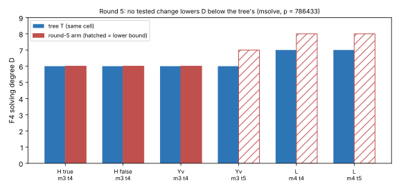

# Round 5: solver side — requirements, barriers, and three pre-registered solver/coupling tests

2026-11-04 · follow-up to [`../round4/README.md`](../round4/README.md) (#3387)
· predictions in `.resume/RESUME.md` (commits `72dde4fd1e`, H; then L and Y),
written before their runs · analysis [`SOLVERS.md`](SOLVERS.md) · generator
[`../gen.sing`](../gen.sing) (new arms L and Y) · input hashes
[`SYSTEMS.sha256`](SYSTEMS.sha256) · logs [`logs/`](logs/) · records
[`rows.tsv`](rows.tsv) · graph [`round5.svg`](round5.svg) · PDF
[`report.pdf`](report.pdf)

**Class: derived bounds plus stage diagnostics.** No pipeline is priced and no
leaderboard row changes. Engine: msolve 0.6.5, p = 786433, target k = 0.

## Result

The question was whether a better *solver*, rather than a better encoding,
could close the gap. None of the options does at 256 bits. `SOLVERS.md` has
the derivations.

1. **Faster Macaulay is not enough (derived).**
   - Beating rho at 2^256 needs ω ≲ 1.3 **and** a solving degree flat in the
     tower depth.
   - With the measured depth slope, even ω = 1 gives a ratio of 1.35.
   - The recorded matrices have 50–1,464 nonzeros per row, so sparse (block
     Wiedemann) elimination has an effective exponent of 2.41–2.72. Sparsity
     does not supply the missing factor.
2. **Enumeration-type solvers cannot beat √p (proved counting bound).** This
   covers SAT/CDCL branching on separators, meet-in-the-middle, dynamic
   programming over the tree, and exact tensor networks.
   - The root's two partial-sum sets satisfy |A|·|B| ≳ p, so one of them has at
     least √p elements.
   - Batching across targets does not help.
   - The coupling's incidence matrix has rank at least |A|/2, so exact tensor
     contraction cannot compress the bond.
3. **Geometric resolution (Kronecker) has intermediate degree ≳ p^{1−1/m}**
   (heuristic count).
4. **Test H, branching on separator characters: a measured no-op.**
   - At m3 t4 both branches reproduce T's matrices exactly (D = 6, widest
     7,077, in 3.6–3.7 s), each with quotient dimension 6.
   - Over F̄_p every X is c·z², so characters, power residues and "bits" carry no
     algebraic information. Making F_p-rationality algebraic takes degree p.
5. **Test L, fewer couplings with a fat leaf (one symmetric triple plus one
   leaf, 1 separator): prediction falsified.**
   - D_L ≥ 8 at t = 4 (cut off at 1,800 s in degree 8, widest ≥ 79,300) and
     at t = 5 (memory cap at 782 s in degree 8), against T's D = 7.
   - The triple's node equation S₄(e; X₁) has total degree 8. The biquadratic
     S₃ node (degree 4) is the minimum, and the pair tree already uses it
     everywhere.
6. **Test Y, a coupling that is a function rather than a 2-to-2 correspondence
   (y-coordinates and the chord slope): no gain, and worse in t.**
   - Unsaturated, it picks up 2,060 solutions over F̄_p at t = 4 (D = 7, 30 s),
     against T's 3. Almost all come from the degenerate chart x₁ = x₂, where
     λ·0 = 0 leaves the slope unconstrained.
   - With the chart removed by v·(w₂ − w₁) = 1 (arm Yv), t = 4 gives D = 6, the
     same as T. It is 5.4× wider (38,133 columns), 20× slower (76 s), and has
     quotient dimension 12, which is 3 × 2 orderings × 2 signs.
   - At t = 5, Yv selects degree 7 and is cut off at 1,800 s, while T has
     D = 6 in 512 s. The function coupling therefore has the *steeper* t-slope.

**Reading.** Of the solver families, only Gröbner bases compress, because their
D stays far below the separators' domain sizes. Their cost is set by two
slopes: about +1.5 per summand and about +0.5 per tower level, both coming from
the couplings. Encoding the couplings differently (lifting, eliminating,
fattening, function form), branching on cheap separator properties, and
speeding up the linear algebra each leave the slopes unchanged or make them
worse. An improvement on this line has to come from a node relation of degree
below 4, which x-only coordinates cannot give, or from outside the
summation-polynomial framework.

## Table (recorded; `rows.tsv`)

| cell | arm | N | D (≥: cut off) | widest | quotient dim | wall s | exit |
|---|---|--:|--:|--:|--:|--:|---|
| m3 t4 | T (round 1) | 13 | 6 | 7,077 | 3 | 3.7 | 0 |
| m3 t4 | H true | 14 | 6 | 7,077 | 6 | 3.70 | 0 |
| m3 t4 | H false | 14 | 6 | 7,077 | 6 | 3.58 | 0 |
| m3 t5 | H true / false | 17 | 6 (stopped) | 19,852 | — | 42 | 143 stopped (redundant) |
| m3 t4 | Y (unsaturated) | 16 | 7 | 57,153 | 2,060 | 29.8 | 0 |
| m3 t5 | Y (unsaturated) | 19 | ≥ 7 | ≥ 204,643 | — | 1,800 | 124 |
| m3 t4 | Yv | 17 | 6 | 38,133 | 12 | 75.8 | 0 |
| m3 t5 | Yv | 20 | ≥ 7 | ≥ 78,989 | — | 1,800 | 124 |
| m3 t5 | T (round 1) | 16 | 6 | 23,720 | 3 | 512–544 | 0 |
| m4 t4 | L | 14 | ≥ 8 | ≥ 79,300 | — | 1,800 | 124 |
| m4 t5 | L | 18 | ≥ 8 | ≥ 278,857 | — | 782 | 139 memory (6 GiB) |
| m4 t4 | T (round 1) | 18 | 7 | 25,742 | 6 | 697 | 0 |

Two of the arms were built by text edits on generated systems:
- **H** appends z and X_c − n·z².
- **Yv** appends v and v·(w₂ − w₁) − 1.

Arms L and Y are generated by `gen.sing` with the planted check. The
appended H and Yv equations hold at the planted point by construction: n was
chosen from the planted X's character, and w₁ ≠ w₂.

## Caveats

- The H runs at m3 t5 and m4 t4 were stopped or not run once the t4 result
  showed the construction adds no algebraic constraint.
- Wall times come from runs with up to 2 msolve jobs on 4 cores, and should be
  read only as an ordering.
- The cut-off cells are lower bounds.
