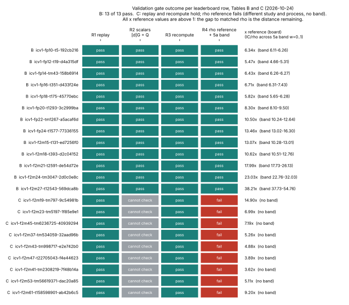

# IC validation gate: Tables B and C (2026-10-24, Conductor T-2)

Question: can the existing rows of leaderboard Tables B and C pass the validation gate
(`docs/VALIDATION_GATE.md`: replay certificate, validator report, matched rho reference with the
section 5a band)? Frozen before any replay: [`PROTOCOL.md`](PROTOCOL.md) (decision rule R1 to R4, the Table C
sample seed, the known-issue test). Nothing here measures a new IC or rho number; nothing here is an improvement.

## Result

- **Table B, 13 of 13 rows pass R1 to R4.** Every counted field of every IC variant repetition, frozen
  rho run and matched-rho run replays identically in a fresh process (1,257 runs compared, 13 of 13
  instances identical); every recovered scalar checks as [d]G = Q in an independent pure-Python verifier
  (633 archive runs, 945 replay runs, 1,578 of 1,578 negative controls rejected); S_IC, S_ref, x reference
  and x floor recompute to relative 1e-9 from the raw ledger and re-priced rho (52 headline numbers); IC
  stays above rho at every weight of the section 5a band, in the repository's own formula and in a
  conservative extension. The gate accepts [`B/`](B/) (`python3 scripts/validation_gate.py evidence research/ic_validation_gate_20261024/B` says `valid`).
  **The rows do not yet validate on the board**: the gate reads `docs/ic/runs/VALIDATION.json`, that
  directory is under `docs/ic/` (off limits to this task) and holds frozen run reports, so the manifest is staged as
  [`B/VALIDATION.docs-ic-runs.json`](B/VALIDATION.docs-ic-runs.json) (paths relative to `docs/ic/runs/`, checked
  with `scripts/check_staged.py`: `valid`). Installing it is one copy, see "Installing the Table B manifest".
- **Table C, 0 of 9 rows pass.** R1 holds on the sample (27 of 27 replays identical) and R3 holds (the 36
  headline numbers recompute exactly), but R4 fails for every row and R2 cannot be checked. Reasons below. No
  `VALIDATION.json` is written for C.
- **Distance to matched rho is unchanged by any of this.** Table B: IC is 5.47x to 38.21x its matched
  negation-map rho (4.05x to 54.76x across the 5a band); Table C: 3.62x to 14.90x its batch rho (no band
  available). No row is below its reference; validation says the numbers are what the archive says and the
  reference is fair, not that IC approaches rho.

Graph source: [`scripts/plot_outcome.py`](scripts/plot_outcome.py) (plots the recorded verdicts only).
PDF: [`REPORT.pdf`](REPORT.pdf) (source `REPORT.typ`), page by page inspected.

## Per-row standing, reason and artifacts

| table | row | standing | S_IC | S_ref | x ref (board) | IC/rho at w = 0 / 0.1 / 1 (formula) | smallest IC/rho, extended band | artifacts |
|:--|:--|:--|--:|--:|--:|:--|--:|:--|
| B | `icv1-fp10-t5-192cb216` | **passes (VALIDATION.json staged)** | 22.85 | 3.605 | 6.34 | 6.26 / 6.24 / 6.11 | 5.00 | [B/](B/) |
| B | `icv1-fp12-t19-d4a315df` | **passes (VALIDATION.json staged)** | 15.62 | 2.855 | 5.47 | 5.31 / 5.21 / 4.66 | 4.05 | [B/](B/) |
| B | `icv1-fp14-tm43-158b6914` | **passes (VALIDATION.json staged)** | 13.07 | 2.034 | 6.43 | 6.27 / 6.27 / 6.26 | 4.81 | [B/](B/) |
| B | `icv1-fp16-t351-d433f24e` | **passes (VALIDATION.json staged)** | 11.68 | 1.74 | 6.71 | 6.31 / 6.49 / 7.43 | 5.80 | [B/](B/) |
| B | `icv1-fp18-t175-45770ebc` | **passes (VALIDATION.json staged)** | 8.414 | 1.446 | 5.82 | 5.65 / 5.76 / 6.28 | 4.97 | [B/](B/) |
| B | `icv1-fp20-t1293-3c2999ba` | **passes (VALIDATION.json staged)** | 10.72 | 1.292 | 8.30 | 8.10 / 8.34 / 9.50 | 7.26 | [B/](B/) |
| B | `icv1-fp22-tm1267-a5acaf6d` | **passes (VALIDATION.json staged)** | 12.77 | 1.216 | 10.50 | 10.24 / 10.66 / 12.64 | 9.50 | [B/](B/) |
| B | `icv1-fp24-t1577-77336155` | **passes (VALIDATION.json staged)** | 13.97 | 1.038 | 13.46 | 13.02 / 13.59 / 16.30 | 12.42 | [B/](B/) |
| B | `icv1-f2m15-t131-ed7256f0` | **passes (VALIDATION.json staged)** | 26.31 | 2.013 | 13.07 | 13.01 / 12.57 / 10.28 | 7.81 | [B/](B/) |
| B | `icv1-f2m18-t393-d2c04152` | **passes (VALIDATION.json staged)** | 21.3 | 2.006 | 10.62 | 10.51 / 10.88 / 12.76 | 9.34 | [B/](B/) |
| B | `icv1-f2m21-t2591-de54d72e` | **passes (VALIDATION.json staged)** | 24.39 | 1.356 | 17.99 | 17.73 / 19.18 / 26.13 | 17.73 | [B/](B/) |
| B | `icv1-f2m24-tm3047-2d0c0e8c` | **passes (VALIDATION.json staged)** | 27.24 | 1.183 | 23.03 | 22.76 / 24.38 / 32.03 | 22.76 | [B/](B/) |
| B | `icv1-f2m27-t12543-569dca8b` | **passes (VALIDATION.json staged)** | 36.93 | 0.9665 | 38.21 | 37.73 / 40.72 / 54.76 | 37.73 | [B/](B/) |
| C | `icv1-f2m19-tm797-9c54981b` | **failed validation** (R4) | 4.873 | 0.3271 | 14.90 | no band (rho not in the same process) | n/a | [C/](C/) |
| C | `icv1-f2m23-tm5197-1f85e9e1` | **failed validation** (R4) | 1.432 | 0.205 | 6.99 | no band (rho not in the same process) | n/a | [C/](C/) |
| C | `icv1-f2m45-tm6236725-40939294` | **failed validation** (R4) | 0.8563 | 0.1191 | 7.19 | no band (rho not in the same process) | n/a | [C/](C/) |
| C | `icv1-f2m37-tm534059-32aad96b` | **failed validation** (R4) | 0.4853 | 0.09224 | 5.26 | no band (rho not in the same process) | n/a | [C/](C/) |
| C | `icv1-f2m43-tm998717-e2e742b0` | **failed validation** (R4) | 0.3248 | 0.06663 | 4.88 | no band (rho not in the same process) | n/a | [C/](C/) |
| C | `icv1-f2m47-t22705043-f4e44623` | **failed validation** (R4) | 0.2344 | 0.06022 | 3.89 | no band (rho not in the same process) | n/a | [C/](C/) |
| C | `icv1-f2m41-tm2308219-7f48b14a` | **failed validation** (R4) | 0.2408 | 0.0666 | 3.62 | no band (rho not in the same process) | n/a | [C/](C/) |
| C | `icv1-f2m53-tm56619371-dac20a85` | **failed validation** (R4) | 0.2605 | 0.05095 | 5.11 | no band (rho not in the same process) | n/a | [C/](C/) |
| C | `icv1-f2m61-t158598901-ab42b6c5` | **failed validation** (R4) | 0.4885 | 0.05308 | 9.20 | no band (rho not in the same process) | n/a | [C/](C/) |

Reasons. **B rows:** R1 to R4 hold; the caveats that remain are stated in the next section and are not gate
criteria. **C rows:** R4 fails (same process / same unit / band), R2 not checkable, see "Table C".

Artifacts:

| artifact | B | C |
|:--|:--|:--|
| replay certificate | [`B/replay-certificate.json`](B/replay-certificate.json) | [`C/replay-certificate.json`](C/replay-certificate.json) (`scalars_verified: false`) |
| validator report | [`B/validator-report.json`](B/validator-report.json) (raw_data relative to `B/`), [`B/validator-report.docs-ic-runs.json`](B/validator-report.docs-ic-runs.json) (relative to `docs/ic/runs/`) | [`C/validator-report.json`](C/validator-report.json) (recompute only) |
| rho reference | [`B/rho-reference.json`](B/rho-reference.json) (per-row band), block inside the manifests | [`C/rho-reference-assessment.json`](C/rho-reference-assessment.json) (why it fails) |
| manifest | [`B/VALIDATION.json`](B/VALIDATION.json), [`B/VALIDATION.docs-ic-runs.json`](B/VALIDATION.docs-ic-runs.json) | none (fails) |
| per-row verdicts | [`B/standing.json`](B/standing.json) | [`C/standing.json`](C/standing.json) |
| raw replay outputs | `raw/replay_B/`, `raw/compare_B.json`, `raw/ec_verify_*.json` | `raw/replay_C/`, `raw/replay_C_summary.json` |

## Table B

Evidence directory: `dirname(source)` = `docs/ic/runs/` (13 board rows, all from
`ic-boundary-ledger-round5-2026-09-22.json`; matched rho from
`research/ic_rho_reference_20260923/reprice/`).

- **Replay.** `ic boundary` with the archive's frozen configuration (seed 123212651130, 3 repeats, the prime
  and char2 ladders), one thread, in a new process on the current binary (blake3 `98e06480...` for the ledger
  replay; `ic rho --reprice` of the archived ledger on binary `4bf7bc1d...`). Compared field by field except clocks
  (`wall_ns`, `total_wall_ns`, `s_wall`). Three differences were found and are not mismatches: (1) the archive rounds some
  phase gae to 6 decimals, the replay differs at the last ulp (tolerance 1e-9 relative); (2) the current
  binary adds a counter `unliftable_systems` (value 0 everywhere) to relations natives; (3) `ratio_to_rho` was
  redefined: the archive divides by the frozen plain walk (A = 1), the current binary by the matched
  negation-map walk of the same repetition (checked: replay `ratio_to_rho` = `s` / that repetition's matched mean, on every variant).
  The current binary writes the IC variants, the frozen plain walk and the matched negation walk into one
  ledger in one process, so IC and matched rho do share a binary and a process in the replay; and the
  archive's `ic rho --reprice` identity check (frozen walk replayed on the recorded seeds, 312 runs) still reproduces on the current binary
  (`all_reproduced: true`).
- **Scalars.** `scripts/ec_verify.py` (pure Python, GF(p) and GF(2^n), no repository code): G on curve,
  [r]G = O, [recovered]G = [t]G for the planted t of the run's target, and [recovered + 1]G rejected.
- **Recompute.** `scripts/validate_B.py`: best recipe = argmin over the 9 recipes of mean total_gae; S = mean / sqrt r;
  every phase's gae decomposes exactly into group ops plus pinned-calibration natives; board rows
  (`docs/ic/leaderboard.json`) agree on all 52 headline numbers.
- **Rho reference and the section 5a band.** Kind `negation` (A = 2; the re-pricing record's `exclusions` say negation is the
  only automorphism of these curves), the protocol's reference (ledger section 18). Unpriced work, per run: rho
  leaves 45 to 4,196 canonicalisations uncharged (`canonicalisations_uncharged`; one per walk step); the IC best recipes
  name no unpriced native counter whose calibration is missing, and their natives are priced by pinned ratios. Band
  S(w) = mean [G - C + w (U + n_C)] / sqrt r with C, n_C the calibration-priced natives (the formula of
  `ecbench/band.rs`), applied to both arms. IC/rho never drops below 4.66 in that formula (fp12, w = 1).
  Conservative extension (not in the repository's formula): IC is also charged its pair-table inserts
  (`pair_table_entries`, up to 16,129 per run) and rho one table operation per walk step (an over-count, since rho emits no
  table counts). The smallest ratio there is 4.05 (fp12, w = 1). **The order holds at every weight in both.** The
  band rises with w for the larger instances because the pinned calibration prices IC's natives below 1 GAE per operation.
- **Caveats, not gate criteria.** The best recipe is the minimum of 9 recipes on the same 3 planted targets (selection in IC's
  favour; the reported gap is therefore if anything understated). One planted target per instance, 3 repetitions. The IC
  arm in the archive and the matched rho re-pricing came from two binaries (`ae6dd73f...`, `ebcafaef...`); the
  unit is a count and the replay reproduces both exactly, so the binary identity does not enter the number.

### Installing the Table B manifest (coordinator)

    cp research/ic_validation_gate_20261024/B/VALIDATION.docs-ic-runs.json docs/ic/runs/VALIDATION.json
    python3 scripts/validation_gate.py evidence docs/ic/runs     # expect: valid
    python3 scripts/build_ic_leaderboard.py                      # then scripts/check_ic_leaderboard_paths.py

The manifest lists exactly the 13 Table B slugs under `rows`, so no other file in `docs/ic/runs/` is covered. The
gate's other allowed mechanism, a sweep verdict, does not apply: the committed `A-leaderboard/verdicts.jsonl` uses the key `row_id` and
the verdicts `validated_with_caveats`/`unvalidated`/`contradicted`, while `load_verdicts` reads `row` and accepts `validated`;
today those 55 lines decide nothing for the gate (`docs/VALIDATION_GATE.md` already warned the format was an assumption).

## Table C

Evidence directory: `research/ic_descent_20260930/` (ordinary research directory, not touched by this study; no
file was written there because no row passes).

- **R1, holds on the sample.** 27 archived isolated price runs (3 per curve, seed `ic_validation_gate_20261024`) re-executed with
  `ic price --params`: counts, all 32 recovered scalars and `all_verified` identical in 27 of 27. The current binary adds counters
  `logs.linear_algebra.{filter.row_ops,row_ops,wiedemann}` (additive).
- **R2, cannot be checked.** The targets are generated inside the binary from `random_seed`; no target point or generator is archived, so
  [d]G = Q has no independent check. `scalars_verified` is false in the certificate.
- **R3, holds.** `scripts/validate_C.py` recomputes S_IC, S_ref, x reference, x floor for all 9 rows from the 372 isolated
  price files and the section-20 rho figure (clean-pair rule re-implemented from the protocol text); 36 numbers agree to 1e-9.
- **R4, fails for every row.** (a) The IC figure is `s_before / (paired wall-time speedup of candidate over baseline)`, a derived
  figure from `ic_descent_20260930`; the reference is the section-20 batch rho of `ic_exponent_20260926` (2026-09-26) priced at that study's
  canonical step: two studies, not one process, not one measurement of one unit. The isolated re-run re-priced rho for one curve and one set only
  (f2m41, M1: 0.05999 against 0.06101, counts equal). (b) The IC arm is a wall-clock figure; neither arm names unpriced
  native counts to which a 0 / 0.1 / 1 GAE band could be applied. So no band exists, and the gate's `same_binary_or_process`, `same_unit` and the band cannot be filled.
  The unit scale of the two processes differs by up to 7 percent (table, an estimate of the effect, not a correction):

| curve dir | unit_ns S20 / unit_ns v2 baseline | x ref (board) | x ref if rho scaled to the v2 unit (estimate) |
|:--|--:|--:|--:|
| `icv1-f2m19-tm797-9c54981b` | 0.982 | 14.9 | 15.17 |
| `icv1-f2m23-tm5197-1f85e9e1` | 0.958 | 6.99 | 7.29 |
| `icv1-f2m45-tm6236725-40939294` | 0.963 | 7.19 | 7.47 |
| `icv1-f2m37-tm534059-32aad96b` | 0.93 | 5.26 | 5.66 |
| `icv1-f2m43-tm998717-e2e742b0` | 0.956 | 4.88 | 5.1 |
| `icv1-f2m47-t22705043-f4e44623` | 0.952 | 3.89 | 4.09 |
| `icv1-f2m41-tm2308219-7f48b14a` | 1.003 | 3.62 | 3.61 |
| `icv1-f2m53-tm56619371-dac20a85` | 0.941 | 5.11 | 5.44 |
| `icv1-f2m61-t158598901-ab42b6c5` | 0.952 | 9.2 | 9.67 |

  **What would unblock it:** a same-process rho arm for each row (batch rho and IC priced by one `ic price`-class run on one binary, 32 targets,
  with the target points archived so [d]G = Q can be checked), and the unpriced native counts of the descent and pair-table phases so the 5a band can be applied.
  The gap stays 3.6x to 14.9x until then; this is not a statement about the numbers being wrong.

## The "96 root-finder replay mismatches"

Question: are the 96 mismatches inherited-F4 `solver_ops` rows and not root-finder rows? Test: `ecbench verify --replay-all` on session
`research/ecbench_rootfind_engine_20261012/sessions/claim-n13` (ECBS1hfd5bf1885227) on the current binary
(`raw/replay_all/`), then every flagged record re-executed with `ecbench profile-input | ecbench exec` and diffed
against the archived record field by field (`scripts/replay_fields.py`).

- 72 of 168 replays identical, 96 differ. All 96 recover the same scalar. By arm: `ic-f4-m2` 24, `ic-f4-m3` 24, `ic-rootfind-m2` 24,
  `ic-rootfind-m3` 24 differ; `rho-strong`, `rho-strong-aa`, `rho-frob` 24 of 24 each identical.
- **The sweep's statement is half right.** The 48 inherited-F4 rows differ in `relations.native.solver_ops` only (m2: 300,531 -> 301,961; m3: 2,832,171 -> 3,732,225),
  and their total_gae changed too, because the current binary prices word XORs that the 2026-10-12 record left unpriced (m2: 741.09 -> 1,436.81; m3: 642.53 -> 9,241.58). The
  other **48 are root-finder rows** (`ic-rootfind-m2/m3`), not F4. Their only difference is two counters that did not exist in the archived record,
  `oracle_setup.native.pair_table_kind` (0) and `pair_table_points` (33), which the "phase counts" comparison treats as a mismatch;
  every existing counter, every GAE (equal after the audit's own serialise-parse round trip) and every recovered scalar is identical. So "96 are inherited-F4 solver_ops rows" is refuted, and
  "the root-finder rows do not change any number they report" is confirmed: 48 F4 rows drift and are repriced, 48 root-finder rows gain two bookkeeping counters.
  This agrees with sweep A's count (72/168, four failing arms) and corrects sweep D's "not affected" wording to "not affected in value".
- **Effect on Table B and C rows: none.** They read `ic boundary` / `ic price` oracle counts, which R1 re-executes and finds identical, not ecbench F4 solver counters.
  The F4/F5/F6 and F6-IC ladder rows (outside B and C) do consume the F4 counters and are not rescued by this finding.
- Caveat: the ecbench binary was built from the working tree with other agents' uncommitted edits (see "Provenance"); the 72/168 split matches
  sweep A's independent run on a clean main build, which argues against the edits mattering.

## Provenance and limits

- Source tree: HEAD `8559b6b67` plus uncommitted edits by other agents during the study (`src/cryptanalysis/koblitz_index_calculus.rs`,
  later `src/bin/ic/price.rs`, `src/bin/ic/workflow.rs`). Binaries: `ic` blake3 `98e06480a3d765...` (Table B ledger replay), `ic` `4bf7bc1d1c792e47...`
  (archive re-pricing and the Table C replay, built after the `price.rs`/`workflow.rs` edits), `ecbench` sha256 `3d1c375e...` (the `ic` binary's sha256 is `9c5c8b2b...`, the one rule v4's host.json records). All replays agree with the archive,
  and the two ic binaries agree with each other where both ran; I did not build a clean-HEAD binary (disk 7 GB free; manifest needs the whole tree). A clean-tree rerun is
  a cheap follow-up (`research/ic_validation_gate_20261024/scripts/replay_B.sh`, resumable).
- Host: Intel Xeon 2.80 GHz, 4 cores shared, rustc 1.97.0; L0. No timing is used anywhere in B; Table C figures are the archive's isolated timings, untouched.
- Heavy jobs ran under the heavy-compute lock. No interruption.
- Not done: Table A (out of scope). The v4 job: `research/ic_tool_program/rule/v4/` exists but holds only PROTOCOL.md, FROZEN.txt, scripts, training and report scripts; no
  README results, no `runs/`, no `replay-certificate.json` at the time of writing, so the validator job has not started (see the final report).

## Rule v4 (second job, 2026-10-24)

Independent validation of `research/ic_tool_program/rule/v4/` (PARTIAL: 1 of 6 sizes improves). Script `scripts/validate_v4.py`
(stdlib; archive extracted into scratch, its sha256 checked); report written to `research/ic_tool_program/rule/v4/validator-report.json`
(copy in `V4/`). **All 157 headline numbers agree** (133 exact to 1e-9: per-size paired cold, set-up and online ratios, S_IC cold, S_rho at the
canonical step, the gaps, the 5a band at w = 0 / 0.1 / 1, A/A and lever control, pooled lever mean; 24 bootstrap interval ends agree within Monte Carlo
tolerance with my own resampler); recomputed verdicts and outcome equal the claimed (n = 57 IMPROVEMENT, others NOT_SEPARATED, PARTIAL). Replay: all 493 processes
re-verified in my own GF(2^n) arithmetic ([scalar]G = target for the ic and the rho certificate, [r]G = O, scalar+1 rejected, scalar equals rule v3's), all 493
file hashes match the certificate, 24 of 24 untimed reruns agree. **`VALIDATION.json` not written**: `strongest_available` cannot honestly be true (the protocol's
admissibility check fails at 4 of 6 sizes and was only reported; on 46 readable pairs the strong fixture needs 0.845 +- 0.08 of ParallelRho's steps). Details in the report's `rho_reference_assessment`.

## Files

`PROTOCOL.md`, `README.md`, `REPORT.typ`, `REPORT.pdf`, `figures/row_outcome.{svg,png}`, `scripts/` (ec_verify.py, validate_B.py, validate_C.py,
compare_B.py, replay_B.sh, replay_C.py, assemble_B.py, assemble_C.py, check_staged.py, replay_all_rootfind.sh, group_replay_all.py, replay_fields.py,
gen_tables.py, plot_outcome.py, build_pdf.py), `B/`, `C/`, `raw/` (replay ledgers, receipts, comparisons).
