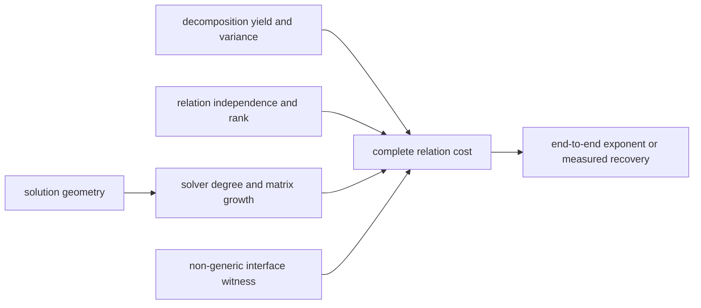

# Index-calculus weak-assumption programme

Date: 2026-11-02

Status: literature-complete first pass, reproducible reanalysis of committed
evidence, and fail-closed obligation graph. No new scientific run was taken.

## Outcome

The security argument is not one hardness assumption. It is a serial chain of
six obligations:

Failure of any one edge is enough to invalidate an index-calculus complexity
claim. The machine-readable version is [`obligations.json`](obligations.json),
validated by [`audit.py`](audit.py). It covers naive prime-field Semaev, generic
pair tables, PKM towers, the proposed arity-three hybrid solver, Wagner filters,
the hashed-factor-base tensor route, and xedni.

The most important result of the reanalysis is that several familiar proxy
measurements do not discharge the obligation for which they are commonly used:

1. A first-fall or even a stable solving degree does not bound matrix size. In
   the committed PKM `m=4` random-target rows, `N=8,12,16` have F4 solving
   degrees `6,7,7`, while maximum columns grow `1,049 -> 9,452 -> 76,837` and
   multiply-adds grow `4.84e7 -> 8.55e10 -> 2.70e13`. From `N=8` to `N=16`,
   columns grow 73.25-fold and multiply-adds 558,304-fold even though the last
   two degrees are equal. Three cells are not an asymptotic fit, but they are a
   direct counterexample to using degree alone as a cost certificate.
2. The prime `m=2` yield sweep tracks the leading size-driven `2B^2/r` model at
   toy scale: in nine `(field bits, B)` cells the observed/model hit-rate ratio
   ranges from `0.764` to `1.108`. Exact double counting fixes a mean
   *decomposition count*, not the probability of at least one decomposition;
   collisions and pair conventions distinguish the two. The collector also
   stops adaptively after recovery, so these records cannot estimate the
   target-wise count variance or zero mass.
3. The same selected records contain 842 rows and report rank 842 with no
   dependent row. That is a useful correctness control, not a relation-rank
   theorem: each episode stops before a full factor-base matrix is collected,
   and MITM and subtraction expose the same relation set.
4. `zero_dim=true` needs semantic typing. All six selected PKM `m=4` natural
   random-target rows are also `inconsistent=true`; their ideal is the unit
   ideal. Separate planted toy rows at `N=8,12` are consistent and report finite
   bases of sizes 28 and 49. Thus the records validate both engine branches at
   toy scale, but random-target zero-dimensionality does not establish the
   geometry of a successful natural decomposition.

The exact extracted values and provenance are in
[`evidence-summary.json`](evidence-summary.json); `extract_existing.py --check`
recomputes them from the committed JSONL records.

## The six obligations

| obligation | what is actually needed | present reading | strongest next falsifier |
|---|---|---|---|
| Solver growth | maximum matrix dimensions, nonzeros, arithmetic work and memory, with timeouts/OOM retained | PKM `m=4` exceeds the recorded degree-4 complete-cost threshold at every measured `N`; constant first fall is not predictive | prove a growing lower bound via a degree-bounded pseudo-solution, or find a representation with a flat *matrix/work* slope under a shape-matched null |
| Non-generic filter | a coordinate predicate whose useful candidate set cannot be reproduced at the same cost by G0/G1 tables | subtract, rootfind, MITM and pair tables fail; PKM/F4 and compact Boolean predicates are genuinely coordinate-algebraic | for Wagner, measure the missing bucket second moment `W`; for any new oracle, provide a simulator-or-separation proof and charge setup/advice |
| Yield and variance | rational decompositions per natural target, including variance, zero mass, multiplicity and solver failures | exact double counting fixes the global mean count, not the hit probability; the committed stopped sweep cannot measure the distribution | execute the frozen fixed-budget count-vector panel against a size-matched random base; reject mean-only claims |
| Relation rank | rank growth, support connectivity, dead columns and full-rank probability, not raw row count | bounded controls show independent early rows; no full-population algebraic rank law exists | collect a fixed, non-stopped relation population and publish rank after every row plus support/2-core nulls |
| Solution geometry | dimension/radicality of the *full* system, rational lifts, exceptional charts and target strata | PKM tower membership quotient is a proved function algebra; the free partial-sum system is not covered by that fact alone | natural successful/UNSAT matched cells with saturation, fibre degree, root extraction and exceptional-chart accounting |
| End-to-end composition | one parameter family charging setup, failed queries, collection, verification, filtering, LA, descent, memory and success | no inspected unconditional route discharges every field | machine gate refuses promotion when any field is missing; fixed arity requires `a<m/2` and `e<m/2-1` |

## Route-by-route reading

### Hashed factor base and Boolean tensor contraction

This remains the highest-upside prime-field route because it is the only
inspected proposal with an explicit end-to-end claimed bound
`2^{O(b/(log b)^(1/4))}`. The claim is conditional on the pinned exact tensor
contraction theorem. The native public dispatcher cannot reach the asymptotic
recursive branch with its current `usize` parameterization. The next work is a
lemma-by-lemma theorem-to-code audit and a symbolic, arbitrary-precision guard
evaluator—not a misleading finite timing run.

The particularly weak bridges are implicit-entry evaluation cost, packet/mode
orientation, precision lifting and exact reconstruction, followed by the paper's
assumptions that enough collected relations have the required rank.

### Arity-three chained S3 with CDCL(T)/Fp

This is the first relevant fixed-arity practical screen. With
`s=log2(p)/m`, setup `2^(a s)` and query cost `2^(e s)`, relation collection is
`2^(a s)+2^((e+1)s)`. At `m=3`, strict admission needs `a<1.5` and `e<0.5`.
There is no measured `e`. The one-hot continuation is itself too large beyond
the development ladder, and a proof-eligible finite-field trail theory does not
yet exist. The proposed screen therefore stays unfrozen.

### PKM tower, m at least four

PKM has a real non-generic algebraic interface and a proved low-degree
membership presentation. It does not yet have a cheap generalized root-finding
algorithm. The measured `m=4` degrees `6,7,7` exceed the recorded threshold 4,
and matrix work grows rapidly. The useful theoretical target is now a lower
bound on last-fall/closure degree or matrix width, not another first-fall plot.
The `N=20` cell is projected at 240--380 GB and should not be launched merely
to reconfirm the existing trend.

### Wagner or representation filters

Ordinary four-list joins need a cheap sum-compatible predicate. The existing
O2 result closes a class of character filters only in a bucket-averaged toy
model; it does not close the lane. The load-bearing missing statistic is the
relative bucket variance `W`. A useful filter must provide density,
subquadratic enumeration, yield, memory, and a non-generic-interface witness
together.

### Generic pair tables

These remain valuable controls and an independently improving generic-
decomposition track. They do not constitute an algebraic escape. For direct
pair enumeration at `m=2`, `a=0,e=1`; the fixed-arity bridge gives total
`p` exponent `max(a,e+1)/m=1`, and the required query gate would be `e<0`.

### Xedni

Xedni is a lifting/height relation calculus rather than the same factor-base
PDP pipeline, so its nodes are kept separate in the graph. The recent Lean
audit repaired the conditional obstruction and refuted several overbroad
inferences. Its weakest live bridges are: a uniform height bound for the points
selected by the actual lift algorithm relative to a global minimal
discriminant; Lang or an unconditional family-specific height gap; guaranteed
nonzero ECDLP denominators; and a repeated/adaptive hazard theorem derived from
the one-shot probability. Until those are composed, JKSST is a strong
conditional obstruction, not an unconditional closure of all lift strategies.

## Priority order

1. Audit the hashed tensor theorem-to-code chain. One counterexample closes the
   only explicit inspected subexponential claim; a clean audit sharply isolates
   the remaining conditional theorem.
2. Run the fixed-budget yield-count-vector and rank panel together. It attacks
   two independent heuristics using the same immutable relation population.
3. Build and exhaustively validate the source-bound arity-three `Fp` theory and
   proof explanations; freeze the solver panel only after this exists.
4. Pursue a PKM pseudo-solution/lower-bound construction and a matrix-width
   model. Treat `N=20` as a gated confirmation cell, not the theory programme.
5. Measure Wagner bucket variance `W` under its existing matched controls.
6. For xedni, formalize one explicit lift selector and try to prove—or find a
   counterfamily to—the selected-height/minimal-discriminant comparison.

The common preregistration and promotion rules are in
[`PROTOCOL.md`](PROTOCOL.md). The managed runtime has current AWS variables and
unrestricted enforced networking, but none of the blocked solver/tensor studies
became scientifically launch-ready merely because credentials are available.

## Literature and prior evidence checked

- Petit, Kosters and Messeng, *Algebraic Approaches for the Elliptic Curve
  Discrete Logarithm Problem over Prime Fields*, PKC 2016, pinned SHA-256
  `a53030a6cde720c354aebfb65b1eb01e07766ce2d26e543d77f2516c0a49ef5b`.
- Akshima et al., *A Subexponential Time Algorithm for Elliptic Curve Discrete
  Logarithm*, Bochum v0.2, pin `1ee44e56`, SHA-256 `82e273...aa11`.
- OpenAI, *The Exponential Time Hypothesis is False*, Appendix D, pin
  `7ef5c0cc`, SHA-256 `5b1612...e8123`.
- JKSST, *Analysis of the Xedni Calculus Attack*, audited in
  [`../jksst_xedni_audit_20261101/README.md`](../jksst_xedni_audit_20261101/README.md).
- Repository lead atlas and the source/evidence paths embedded in
  [`obligations.json`](obligations.json).

This report derives no new ECDLP hardness theorem. Its new contribution is a
typed, executable dependency gate plus a reproducible cross-obligation reading
of existing evidence that prevents proxy results from being silently upgraded.
