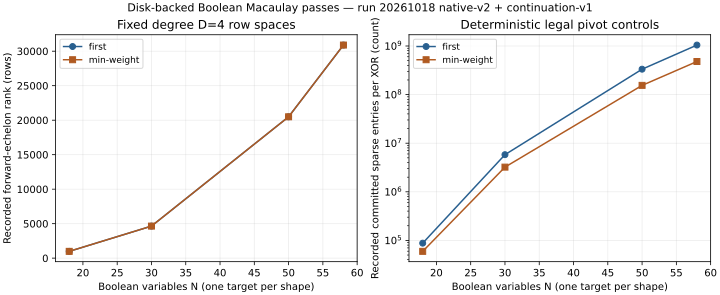

# Run report: bounded-memory Boolean Macaulay passes

Public synthetic K_1 targets [17]G were exported from the repository's actual
chained S3 Weil-descent builder. Eight degree-4 Macaulay passes completed. The
n=5 and n=9 controls, under both deterministic pivot choices, agreed exactly
with an independent dense packed-bit RREF. Larger n=15 and n=17 passes completed
after checkpoint continuation, with independent large-case verification open.

| n / ell / Boolean variables | Rows | Recorded rank, both policies | Independent dense RREF |
|---|---:|---:|---|
| 5 / 2 / 18 | 1,050 | 987 | exact equality |
| 9 / 3 / 30 | 4,752 | 4,648 | exact equality |
| 15 / 5 / 50 | 20,670 | 20,490 | 256 MiB reference budget refused |
| 17 / 6 / 58 | 31,110 | 30,888 | not run on diagnostic continuation |

The graph plots recorded values, one synthetic target per shape and policy,
without uncertainty estimates. Large-case ranks are engine observations rather
than independently certified row spaces. The count panel covers committed
checkpoint history and excludes discarded work after the preceding checkpoint;
it is not a full-cost or speed comparison.

The n=5 zero-cache pass returned the same certified row space. A pause after 31
rows and restart also returned exactly that certified RREF. One hundred seeded
native arithmetic/oracle controls passed. Truncated inputs, insufficient output
disk, a restart with a different input SHA256, and an n=19 / ell=7 / m=4 layout
requiring 66 variables all failed closed. The exporter currently uses 64-bit
monomials.

The first driver attempt did not execute its requested binaries: `/usr/bin/time`
was missing and the launch attempts exited 127. Those logs remain in native-v1.
A native fork/exec/wait4 wrapper replaced that dependency. It enforces a hard
536,870,912-byte child address-space limit and records wall time, CPU time and
peak RSS. Both n=15 first attempts reached the input EOF before the independent
dense reference refused its explicit 256 MiB allocation budget. Both n=17 first
attempts reached their 64 MiB trace-file caps and stopped. Fresh copies of their
checkpoint/journal states were continued. The original failed attempts remain.

The process resource measurements are retained individually in
`*.resources.json`: they are shared-host diagnostics at isolation tier 0, with
no external comparison or speed claim. Initial n=15 runs recorded peak RSS of
26,932 KiB (first) and 27,048 KiB (minimum weight). Build, export, row generation,
failed reductions, verification, state copies and resumed reductions are separate
phases. The 1 MiB cache bound covers cached row payload, while index/LRU metadata
and temporary rows add memory. The address-space cap bounds the whole process.

Pivot journal counters in final checkpoints include prior completed checkpoint
history; they exclude index reconstruction, row-input reads and rolled-back
suffix work. All those activities remain included in the per-process elapsed/CPU
records where executed. No accounting interval is presented as an end-to-end
ECDLP pipeline or rho comparison.

The policy interface exposes only a correctness-preserving choice between an
existing pivot and an incoming row with the same leading monomial. It records
input weight, pivot weight, lead, row index and replacement action, with feature
and decision timer counters. The two controls are first pivot and minimum weight.
No learned policy was trained, and no heldout transfer or learned column policy
was evaluated. There is no full F4 critical-pair scheduler, MutantXL closure,
solving-degree result, GPU kernel, or distributed executor in this deliverable.
The original frontier ell=6/7 and guess-count ell=8/9 closure requirements remain
open; n=17/ell=6 is a diagnostic pass rather than a replacement of a canonical
frozen frontier cell.

Exact source/binary/dependency/input SHA256 files, argv records, UTC starts and
finishes, native stderr, exit statuses, checkpoint states and traces are under
`runs/`. Inputs bind the target coordinates, subgroup order, field structure and
subspace basis. The root base revision was
`e063d98475589d9aba7ae265a8cba830927e3156` with the root agent's four library build
repairs; the standalone reducer changes no library core. The frozen protocols
and scripts are linked from the study README. Gzip preserves original raw record
contents; recorded hashes refer to the uncompressed basenames.

Canonical leaderboard, security-gap and solving-degree graphs stay unchanged:
these runs establish no admitted whole-pipeline or solving-degree finding.
Item 7 is partial; item 9 has executed legal deterministic hooks only.

Sources: `src/cryptanalysis/koblitz_groebner.rs` (exact ANF builder and Macaulay
multiplier traversal), `src/cryptanalysis/sparse_macaulay.rs` (existing in-memory
control context), `src/cryptanalysis/pq_f4_f2.rs` (full F4 semantics not supplied
by this reducer), `protocol.json`, `protocol-large-continuation.json`, and the
per-attempt records in native-v1, native-v2 and large-continuation-v1.
