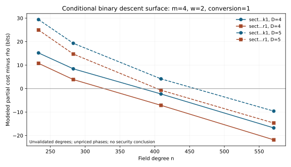

# Item 2 — deployed binary-size calculation

**Partial: derived conditional model, no deployed-curve attack or timing claim.**

The native Rust calculator executed the frozen original model on nine curve rows, four arities, six degree/guessing models, three column-work exponents and three conversion assumptions: 1,944 results in `cost_surface.json`. An additive protocol amendment retained those arms and included the zero-charge sensitivity: 2,592 results in `cost_surface_amendment_01.json`. The four native checks pass, including reproduction of the archived n=131 anchors within 0.02 bits and exact binding to constructor subgroup-order strings.

For m=4, w=2 and assumed conversion=1, constant degree four gives modeled partial-cost gaps against idealized automorphism rho of +15.20,+8.42,-2.30,-16.75 bits on sect233k1, sect283k1, sect409k1 and sect571k1. The corresponding ordinary-curve gaps are +10.77,+3.85,-7.13,-21.83. These values are conditional arithmetic. They do not demonstrate an attack: degree four is unvalidated at deployed sizes, field/column work has no measured group-operation calibration, and factor-base construction, successful extraction and other overhead are unpriced. Constant degree five also changes the crossover. The original audit's n/4-only comparison omits these polynomial and relation-algebra terms.

The cost model minimizes every integer ell in [4,n], charges unsuccessful attempts, includes m*2^(2ell) relation algebra, and treats conversion=0 as an optimistic accounting bound. Named-curve subgroup parameters are bound to source, not independently validated by this calculator. Its rho discounts are idealized; real automorphism-walk overhead is not measured. Storage is a coordinate-storage estimate, not peak RSS or a feasible allocation.

Reproduce using the committed standalone crate (root library linkage is unnecessary):

```sh
CARGO_HOME=/workspace/toolchains/cargo RUSTUP_HOME=/workspace/toolchains/rustup /workspace/toolchains/cargo/bin/cargo test --locked --release --manifest-path research/ideas_execution_20261018/native/Cargo.toml --jobs 2
CARGO_HOME=/workspace/toolchains/cargo RUSTUP_HOME=/workspace/toolchains/rustup /workspace/toolchains/cargo/bin/cargo run --locked --release --manifest-path research/ideas_execution_20261018/native/Cargo.toml --bin cost-surface -- FRESH.json
python3 research/ideas_execution_20261018/render_reports.py
```

The original output used revision `04c3c012`; the amendment used `b3a3321c`. Exact hashes, command metadata and the failed initial binary launch are retained in `execution_manifest.json`. The original archived output is preserved rather than regenerated. Native algorithms and result generation are Rust; Python renders recorded values only.



Completion still requires measured oracle-unit calibration, validated solving/closure-degree behavior with clearly defined metric, successful extraction and all omitted phases, and an end-to-end comparison under matched preprocessing and memory. This calculation does not decide whether a frontier GPU run is justified by a proved deployed-size advantage.
