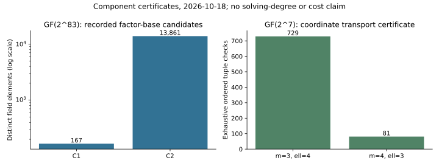
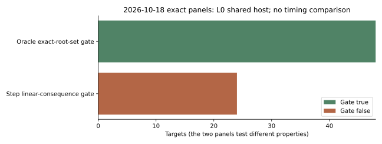
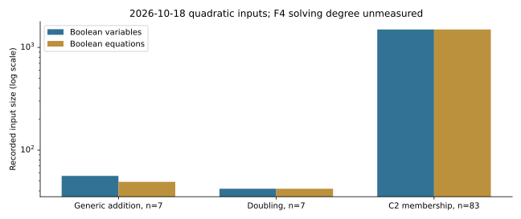
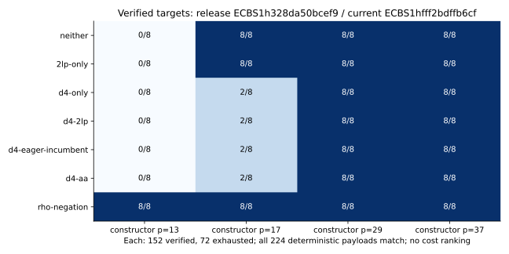

# Items 4, 15, 16, 17: native component execution

The component runs below completed. All four original items remain partial.
Frozen protocols: [initial components](PROTOCOL.md), [factorial](FACTORIAL_PROTOCOL.md),
[addition ANFs](ANF_PROTOCOL.md), [n83 membership ANFs](N83_ANF_PROTOCOL.md),
and [stored-witness replay](VERIFIER_PROTOCOL.md).

## Observed native results

The multiword field/base certificate completed at n=83. The modulus is
`0x800000000000000000095` and the primitive 167th root is
`0x76e02ca1a43987ce0230e`. C1 has **167** elements; C2 has **13,861** distinct
sums of two different roots, with every witness retained. The type-II ONB
has rank **83**. Both sets are Frobenius closed. All **334** generic-backend
arithmetic checks and **4096** full-width C2 probes agreed; all probes were
nonmembers. Generic-backend replay checked all **13,861** stored witnesses
and Frobenius images, plus 167 root-order steps. A deliberately changed
witness was rejected with exit 101; the original certificate passed.

The n83 algebraic-membership continuation also executed: **1494 Boolean
variables, 1494 equations, 159,322 monomials, maximum input degree 2**.
It encodes `z0^167=z1^167=1`, `x=z0+z1`, and `x*w=1`. The inverse witness
excludes the repeated-root diagonal. All **32** positive controls passed;
all **32** changed-x controls and **32** repeated-root controls were rejected.
This uses no exponential subgroup-log table. Production cyclotomic code
remains single-word; the new continuation lives in the native example.
Subgroup projection, useful rank and a full n83 decomposition solve remain
unimplemented in this component.

The coordinate/addition certificate completed on
`icv1-f2m7-t13-616700dd` (K0, modulus 0x83, curve order 116). For the exact
polynomial-prefix bases at `(m,ell)=(3,4),(4,3)`, it checked **100/16** ordered
pairs and **729/81** ordered tuples. Identity, inverse/two-torsion, doubling,
generic addition, infinity and the projective Mobius pole were retained.
There were two pole points in each base. The ell=3 base has only three
lifted points in the small torsion subgroup; it supplies no effectiveness
or yield evidence.

The unprojected Boolean graph trials also completed. Generic addition has
**56 variables, 49 equations, 952 monomials**; doubling has **42 variables,
42 equations, 580 monomials**. Both have maximum **input degree 2**. Curve
ANFs agreed with independent membership on all **16,384** affine coordinate
pairs. Graph zero sets agreed with the independently computed group sum on
all **8280/690** applicable pair/output assignments, over all **115** finite
curve points. Input degree is different from F4 solving degree.

The exact original equivariant panels completed: the step replacement gate
failed **24/24**, while containment held **24/24**. The separate full-oracle
exact-root-set gate passed **48/48**, including the repeated incumbent and
independent brute roots. This reproduces the obstruction to replacing the
step, while retaining correctness of sound extra equations in the full
oracle. No invalid symmetry hook was added to production.

## Additional native factorial diagnostic

The exact frozen seven-arm panel ran with the owner's published
**v0.1.2538** native binary, source commit
`b1bf5b8935f68257dfdd3fc542cb2fef41db741c`, under the prospective
[release fallback](RELEASE_FALLBACK_PROTOCOL.md). Its archive passed the
publisher's checksum; the session records that build commit and binary
SHA256. This preserves the fallback runtime separately from the repaired
current CLI.

Session **ECBS1h328da50bcef9** completed all **224** requested attempts:
**152 verified and 72 exhausted**. Every arm/target/size is retained.
A/A records matched on all **32** paired workloads, including failures.
Native audit passed with **152 verified-run replays**, zero problems;
the framework does not replay the 72 exhausted records. The earlier
36-record D4 session also audited cleanly with 12 exact replays.

After root authorized the missing import, the current CLI built and its
test target passed. Current session **ECBS1hfff2bdffb6cf** repeated all 224
attempts: the same 152 verified/72 exhausted and 32/32 A/A matches. Its audit
passed 152 verified-run replays, zero problems. The native cross-session
checker matched **all 224** deterministic target, outcome, cost, counter and
detail payloads, including all 72 exhausted runs; timings/source labels were
excluded. See `runs/release-current-comparison.json`. Source snapshots,
binary hash and the authorized import diff remain in `runs/current-*`.

At execution, the four extension-field constructor curves had no canonical
registration. The integrating workstream subsequently added exact EC1QpD4
aliases to the IC crosswalk and retained separate native field/order checks
and metadata receipts in
[`benchmarks/20261018-oracle-components/`](../../../benchmarks/20261018-oracle-components/README.md).
All four model slugs remain absent from the main model registry, and the
current ecbench Fp4 branch still emits `registered=false`, `ec1=null`.
This additive crosswalk work does not rewrite frozen plans or promote the
historical report's registration/trait claims.
All IC charges include a historical algebraic-solve model plus an unpriced
exact-enumeration oracle; native comparisons mark the panel incomplete and
diagnostic. Native 0/0.1/1 GAE sensitivity applies to every declared unpriced
counter in every arm, including rho, with missing counters exposed.
Non-emitted bookkeeping remains outside that band. No complete-cost ranking
or citable curve-specific conclusion is admitted. Native comparison output
labels wall values admitted under its permissive L0 spec; this report
rejects that timing admission under AGENTS.md.

## Prior evidence retained

* [D4+2LP](../../ic_improve_20261014/01-d4-2lp/README.md): whole-cost ratio
  1.025 [1.016,1.037] on 24 held-out curves. It had already run.
* [Round 2](../../ic_improve_20261015/04-d4-2lp-fix/README.md): eager
  first-dependency D4 ratio 0.9792 [0.9725,0.9855] over 27 held-out curves.
  The adaptive 2LP rule selected plain D4 throughout the measured panel.
* [Equivariant study](../../ic_improve_20261014/02-equivariant-oracle/README.md):
  prior step gate failed 37/37. Fixed-target production does not have the
  barrel system's Frobenius symmetry.
* [Trace/free relations](../../ic_improve_20261014/03-tracezero-freerel/README.md):
  the trace filter rejected 0/29,624 odd-order subgroup targets.
* [Production free relations](../../ic_improve_20261015/02-freerel-production/README.md):
  already default for n<=63; `KIC_FREE_RELATIONS=0` restores the old path.
  Same-K n=41/n=53 intervals include 1 at the tuned K choices.

## Validation, provenance and blockers

[Native source](../../../examples/ideas_oracle_components.rs). Initial direct
unit tests passed 2/2; the final expanded example's Cargo tests passed 3/3
and its release build passed. Source snapshots, exact source/binary hashes,
revision, raw stdout/stderr, failure logs and return codes are in `runs/`.
The initial source snapshot's SHA256 is
`89c0a56561130895084c2182dd03aff22c5324a91cd365da9d3e17ddea898ec1`.
Historical hash files identify the source path at execution time; snapshots
preserve those bytes after later additions to the example.

[Raw evidence package](EVIDENCE.md) contains the complete `runs/` tree with
its per-file manifest and extraction checks. The unpacked tree is retained
locally; the archive is the proposed repository deliverable.

Current-checkout execution of the factorial was blocked before trials:
the existing ecbench CLI fails to compile because `fbm` is not imported at
two measurement call sites. The module is already exported by the library.
The one-line repair [ecbench-import.patch](ecbench-import.patch) passed
`git apply --check`; root then authorized and applied this scope expansion.
It was added to `src/bin/ecbench.rs`, followed by passing CLI test/build
checks and the exact fresh current-runtime repeat. The frozen
[factorial spec](factorial-spec.json) remained unchanged in both sessions.

Descriptive summary v1 used an overly broad `all_targets_correct` flag that
also required pricing-counter completeness. Version2 separates target
correctness from ratio eligibility. Both outputs are retained; plots use
`factorial-release-summary-v2.json`. No trial or measured value changed.

The initial parent-run full library suite reported **4378 passed, 4 failed,
117 ignored**. Three failures parse missing `levels` from curve-traits
JSON; one Jacobian-transfer test gets Boundary rather than FormulaMarginal.
Those files were not edited here. The complete log is retained. The suite
is not reported as passing.

Failed manual builds are preserved: a nonexistent rlib filename, corrected
point-arithmetic imports, a temporary missing rlib during Cargo rebuild,
and a closure lifetime error caught by metadata checking. None is a
scientific negative result. Conductor was absent. The sparse helper failed
silently; native Git materialised only the required source paths after its
unsupported `add --no-cone` option was removed.

Host: shared Linux x86_64, four-core CPU quota, 16GiB memory cgroup, L0.
Historical raw drivers emit CPU/wall fields; no timing comparison or speedup
is admitted. New component outputs are correctness/input-size records.

## Original requirement status

| Item | Executed scope | Remaining original criteria |
|---|---|---|
| 4 | Coordinate/branch certificates and quadratic unprojected graph tests | Four descended m-sum presentations on one base/target law; Edwards/theta equations; measured D and full Macaulay/solve costs |
| 15 | Prior study replay; release/current factorial attempts/audits and all224 exact deterministic cross-session matches; subsequent exact crosswalk aliases documented separately | Main model/runtime registration; fully priced oracle, graph/filter/LA costs; all targets verified and complete costs |
| 16 | Exact 24-target step and 48-target oracle panels | Production ecbench registration/full ablations; valid replacement for failed step; preserve subgroup-vacuous trace switch |
| 17 | n83 multiword construction, full replay and quadratic membership input/control trials | Separate root-run n23 degree clause; n83 subgroup construction, decomposition/F4 continuation and useful rank |

The IC leaderboard/boundary graphs remain unchanged: these components do
not establish a new complete IC cost or admissible improvement. Prior
frozen figures and reports were not rewritten. No commits or pushes were
made by this workstream.

## Current metadata correction (2026-10-18)

The post-run crosswalk addition described above was withdrawn from the living authoritative mirror after semantic review. The four exact appended candidate records remain in the [unregistered metadata snapshot](../fp4_metadata_erratum/README.md); computed EC1/ICV1 strings do not establish canonical registry membership. Historical registration receipts, source snapshots, plans and reports are unchanged and retain their original commit bindings.

The example has since received formatting and enum ownership maintenance. References above to current source or release tests describe the captured run revision. The [additive source binding](historical-label-binding-v2.json) locates its exact historical source; [software maintenance checks](../runs/pr2148-rust-lint-repair-20261018/REPORT.md) cover the revised example. Historical timings and operation counts do not measure the revised example, which has not been benchmarked again.
