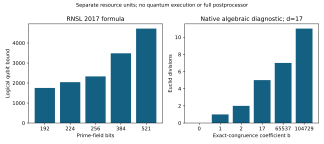
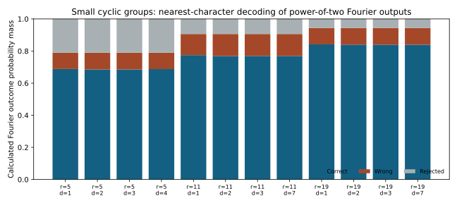

# Item 20 — classical/quantum boundary diagnostic

**Partial: native resource arithmetic and exact modular postprocessing, not a complete Shor estimate.**

The native program produced 75 resource rows and 18 checked synthetic exact-congruence cases. Fifteen invertible cases recovered the chosen synthetic integer; three b=0 cases were rejected. This is a modular-algebra diagnostic and computes no elliptic-curve logarithm. Seven total standalone tests pass, including exhaustive recovery over every secret and nonzero coefficient modulo 101, composite nonunit rejection and the published 256-bit logical-qubit bound.

For prime-field bit sizes 192,224,256,384,521, the resource rows retain separate units for public-point doubling setup, coordinate bytes, logical qubits and Toffoli bounds. Setup counts 2n doublings once for the two n+1-point power tables; their construction is not timed. The RNSL 2017 formula yields 2,330 logical qubits and about 1.287e11 Toffoli gates per shot at n=256. Repeated-shot success is a sensitivity calculation under explicitly assumed independent probabilities 0.25,0.5,0.75, not an estimated success probability of these circuits.

Primary sources:

- Roetteler, Naehrig, Svore and Lauter (2017), [Quantum resource estimates for computing elliptic curve discrete logarithms](https://arxiv.org/abs/1706.06752).
- Haener, Jaques, Naehrig, Roetteler and Soeken (2020), [Improved quantum circuits for elliptic curve discrete logarithms](https://arxiv.org/abs/2001.09580), section 2, for the exponent-register boundary. Its newer circuit counts are not mixed into the 2017 formula.

The exact equation a+b*d=0 mod r is an idealized algebraic input. The implementation does not convert actual power-of-two noisy Fourier samples to that equation. It does not execute point-table construction, elliptic-curve candidate verification, QFT/feed-forward simulation, fault-tolerance scheduling or a quantum circuit. Those remain open before the requested common-assumption Shor resource pipeline and publication draft can be complete.

Reproduce with the `quantum-boundary` binary in `native/Cargo.toml` and a fresh output filename; `quantum_protocol.json` fixes all parameters. Revision: `b3a3321c`. Raw output: `quantum_boundary.json`; command and source hashes: `execution_manifest.json`. Timings from this shared four-CPU host are not compared.

## Finite Fourier-output follow-up

A separately frozen protocol and native binary now calculate the actual power-of-two Fourier outcome law for 12 synthetic cyclic-group fixtures, with orders 5,11,19 and transform sizes 16,32,64. Each calculation traces out the group register and computes the squared 2D Fourier amplitudes of each coset indicator. Every law normalizes within 1e-10. The nearest-character decoder records correct, incorrect and noninvertible/rejected probability mass separately; failures are retained. It is not a complete recovery procedure and its small-group success mass is not transferred to cryptographic parameters.

Three additional tests pass: FFT against naive DFT, output-law normalization/register symmetry, and decoder centers/rejection. The full standalone crate now has ten passing tests. This follow-up is classical numerical simulation of a distribution, with correctness checked against known synthetic integers, and still executes no quantum circuit or elliptic-curve verification.

Evidence: `fourier_protocol.json`, `native/fourier_recovery.rs`, `fourier_recovery.json`, and `runs/extended-native-sources.sha256`. Frozen source revision: `b7528cb5`. Reproduction binary: `fourier-recovery`, with a new output filename.
