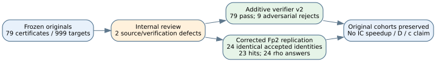
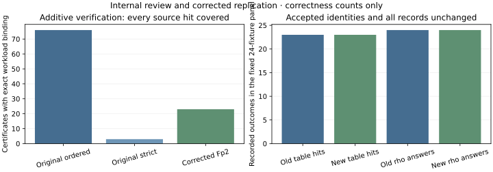

# Internal cross-track correctness review and additive repair

2026-10-18. Reviewed paths: `targets_prime/`, `bounded_memory/`, `native/quantum_boundary.rs` and `native/fourier_recovery.rs`, relative to the campaign directory.

The original prime-decomposition records remain valid after stronger checks. Two P2 source/verification defects were found and repaired additively. The corrected Fp2 replication retained exactly the original cohort and result values. Disk reduction and Fourier normalization are sound within their reported scope. This was an internal cross-track review by the Boolean-workstream agent; after identifying the defects, that reviewer authored the repairs. The v2 work is review-driven replication, not independent external review or formal certification.

## Findings and disposition

| ID | Severity | Original location | Finding | Disposition |
|---|---|---|---|---|
| R1 | P2 | `targets_prime/verify.cpp:13` and `:14` | The original verifier selected curve parameters but did not bind certificate target IDs/points to source result rows, enforce strict distinctness, or require complete certificate coverage. It accepted a wrong-target-ID certificate, a false strictness claim and an empty certificate file. | New `targets_prime/verification_v2/verify_v2.cpp` binds exact workload/results and checks all constraints and coverage. Original verifier and records retained. |
| R2 | P2 | `targets_prime/diagnostic.cpp:50` | Literal 27 was passed as a packed field element. Over F17², it denotes 10+u instead of the prime-subfield coefficient 10. The singular curve A=14,B=2 was incorrectly accepted by `nonsingular()`. | Corrected independently in verifier v2 and in additive `diagnostic_v2.cpp:50` using 27%p. Singular regression and fresh fixed-grid replication pass. |
| R3 | P3, static hardening suggestion | `bounded_memory/src/disk_macaulay.cpp:26` and `:28` | The row reader validates canonical ordering and header caps but does not independently enforce each mask's declared variable range or degree bound. Exact dense equality therefore certifies the supplied row space, while trusting the exported row-family metadata. | No invalid frozen row was observed and the native generator enforces the requested family. Future hardening: check term masks against n and D in both candidate and reference input paths; add out-of-range/over-degree malformed controls. No source change made here. |

R1 does not imply a wrong recorded answer: all 79 original point certificates now pass the stronger verifier. R2 did not admit a singular curve into the frozen panel: all 24 original Fp2 curves pass the independently corrected discriminant, exact point-count, subgroup and projected-base checks.

## Executed amendment and replication

The separately frozen verifier protocol and run are `targets_prime/verification_v2/protocol.json` and `runs/run-20261018-verifier-v2/`. The ordered source has 517 actual target rows plus two explicit unavailable controls, with 76 hits/certificates; the strict source has 482 actual target rows with three hits/certificates. All 79 certificates bind their exact source target, including the three strict results. Nine adversarial cases reject: wrong target ID, missing one/all certificates, duplicate certificate, extra target, altered on-curve target, false distinctness, duplicate JSON key and wrong source-result digest.

The separately frozen corrected replication uses `targets_prime/verification_v2/replication-protocol.json`. The same p={17,29,43,61}, six seeds and component arms produced 24 records. All accepted identities and every full result record agree with the original Fp2 records. Both panels have 23/24 table hits and 24/24 verified rho successes. The fresh candidate trace has 49 draws: 24 accepted, 25 rejected by the subgroup condition, none rejected as singular. The explicit A=14,B=2 regression nevertheless distinguishes the old and corrected gate. The new run's 23 certificates pass complete v2 verification.

These are repair-authored correctness/replication results. The generic two-sum table is still a different task from full rho logarithm recovery, and the original reports correctly forbid end-to-end speed comparisons. Setup, online and verification counters remain separate component data with unpriced hashing, integer and allocation work. No full item 1/item 14 pipeline is completed by this amendment.

## Disk reducer and restart review

The vector XOR operates on canonical, sorted squarefree masks and cancels duplicates correctly. Minimum-weight replacement is legal: it replaces a pivot only with a row sharing its leading monomial, retains the incoming row as the new pivot, and continues with the old pivot XOR the incoming row. This preserves the span and strictly removes that leading term. Forward pivots therefore need not be a reduced basis.

The independent dense oracle uses a packed bit matrix and distinct elimination loops. Comparing its unique RREF with the RREF of the returned pivots establishes exact row-space equality on n=5/n=9 controls. It does not independently validate the Weil-descent builder or the input polynomial family. The n=15/n=17 results correctly keep independent verification false; equal ranks across two policies are not promoted to independent certification.

Restart is sound under the declared trusted-checkpoint/process-restart model: append-only pivot writes preserve the checkpoint prefix, journal suffixes are truncated on resume, the index is rebuilt from the saved prefix and the input stream resumes at the checkpoint boundary. The source binds input SHA256, policy and cache size. It does not bind journal contents cryptographically or call fsync, and the report explicitly excludes arbitrary corruption/power-loss durability. No stronger durability claim is admitted.

The cache limit is payload-only; metadata and temporary vectors add memory, with the separate hard 512 MiB process address-space cap. Logical pivot counters exclude index reconstruction and rolled-back suffix work; per-process records retain failed attempts and resumed work. The report explicitly avoids a full-cost speed ratio. The code is one fixed-degree Macaulay pass, not F4, MutantXL closure or a solving-degree measurement. No expensive disk trial was rerun for this review.

## Quantum boundary and Fourier review

For the declared uniform a,b in [0,Q), a group-register fiber has initial amplitude 1/Q. Two normalized Q-point Fourier transforms add a factor 1/Q. Therefore tracing the group register gives the sum of squared unnormalized 2D transforms divided by Q^4, exactly as implemented. The positive Fourier-sign convention yields character centers v=d*u modulo r, so the decoder's positive t/s sign is consistent. Rounding to the nearest character is correctly labeled a heuristic rather than a complete postprocessor.

A separately authored native direct-DFT check recomputed all 256 output probabilities for r=5,Q=16,d=2, without using the FFT. Maximum absolute discrepancy was 1.8041124150158794e-16; normalization was 0.9999999999999996. The independently counted zero-frequency probability is 0.20001220703125 and the recorded 5,120 butterfly count agrees with r*Q²*log2(Q). This numerical check covers one complete small fixture; it is not a formal proof of every floating-point output. See `boundary_checks.json`.

Independent integer checks passed all 18 exact-congruence records and all 75 resource rows for qubit ceilings, point-table widths and doubling counts. The RNSL 2017 n=256 bound and register/table arithmetic are consistent with the declared model. The repeated-shot success probabilities are explicitly independent-shot assumptions; they are not inferred from the tiny Fourier fixtures or a quantum circuit.

The two harnesses remain partial and unjoined. A completed resource pipeline must additionally price target-dependent Q-table setup and verification of wrong candidates as well as correct ones; scalar verification is currently unexecuted. The current reports disclose these gaps and claim no quantum execution, physical-resource estimate, complete Shor pipeline or deployed-size success probability. No c-exponent claim occurs in the reviewed tracks.

## Preservation, scope and remaining review

Original source hashes remain unchanged: `diagnostic.cpp` 4553b72e9652327f0b8823e4267f01c59ea735166b99fe76ebf79a045010ae83; `verify.cpp` 90d6a00590886cd10a6281444ec9ce5106961618ce0ed9987173f6a2bae4241d; `strict4.cpp` bcbc789ec369eeeb2f0e81446ccc43a720baa64eb14a638553a3d1d2af9a52fe. All original scientific outputs/protocols remain intact. New code and evidence are confined to this review directory and `targets_prime/verification_v2/`.

The JSON parser dependency is nlohmann/json v3.12.0, pinned to SHA256 aaf127c04cb31c406e5b04a63f1ae89369fccde6d8fa7cdda1ed4f32dfc5de63 with its MIT license. All verifier and replication commands, budgets, hashes, return codes and negative-control stderr are retained. The new verifier shares field arithmetic with the original generator and is not a formal independent implementation of every primitive. Coverage is complete over source-declared hits; it does not independently re-search reported misses. The externally pinned source digest fixes workload population, rather than an independent enumeration of every prescribed target ID. An additional internal source check found no blocking flaw for the pinned workload; see `V2_SECOND_CHECK.md`. Fresh v2 code has not received an external review.

No canonical IC/security graph changed: none of these repairs establishes a new algebraic attack or full-DLP speedup. Existing campaign/source graphs were reviewed for claim scope; the figures below document verification and cohort preservation only. Root owns the publication/report amendment, commits and PR work.

