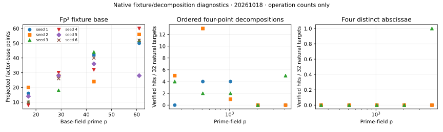

The native runs produced 24 Fp² fixture records and 480 natural prime-field m=4 target records. A separate arm required four distinct abscissae and found 1 natural decomposition out of 480. All reported decompositions passed an independent Jacobian-coordinate replay. These are bounded, exact diagnostic results; the full item 1 and item 14 requests remain partial.

| Recorded population | Observation | Validation |
|---|---|---|
| Fp², p=17,29,43,61; six seeds each | Two-sum table hit on 23/24 targets; rho recovered all 24 known answers | 23 certificates replayed in Jacobian coordinates; even cofactor killed the specified rational 2-torsion in every enumerated base check |
| Prime fields p=251,509,1021,2039,4093; three prime-order curves each; 32 natural targets per curve | 40/480 ordered four-point decompositions, with repetitions and cancelling pairs allowed | All 480 outcomes agree with exhaustive ordered four-point enumeration |
| Same prime fixtures, planted ordered-four-point controls | 13/13 eligible controls pass; two bases were empty | All 493 actual natural/control outcomes agree; 53 total certificates replayed |
| Same prime fixtures, strict four distinct abscissae | 1/480 natural hits; 2/2 eligible positive controls pass | All 482 strict outcomes agree with exhaustive unordered quadruples; three certificates replayed |
| Tampered certificate | Altered target rejected with `off-curve point` | Verifier exit status 1 |

The first run is `run-20261018-native-v1`; the strict arm is `run-20261018-strict4-v1`. Their exact commands, input hashes, exit statuses and raw values are in sibling `runs/` directories. There were 519 JSONL entries in the first run: 517 actual target records plus two explicit unavailable-control entries. The strict run has 482 target records. No launched or unavailable control is counted as a completed solve.

The Fp² field is Fp[u]/(u²-d), using the first quadratic nonresidue d. Field elements are encoded a+p*b. Each curve has y²=x³+A*x+B with a seeded rational 2-torsion point T=(e,0), B=-e³-A*e. Exact point enumeration supplies N; r is its largest prime factor, h=N/r, and G is an exactly checked r-order generator. The curve sampler conditions on r>=p and even h. It does not sample uniformly from curve isomorphism classes. The base contains [h]P for all curve points with x in Fp. Every original base point is checked to satisfy [h](P+T)=[h]P. This check is a fixture property: projecting by the even cofactor removes T. It does not measure a 2-torsion advantage in an algebraic oracle. Subgroup size varies substantially between fixtures, and no exponent fit or FourQ extrapolation is justified.

The two-sum diagnostic precomputes all ordered point pairs, charging the base construction and pair-table setup separately from one lookup and answer verification. This is a generic table oracle. Its output is a decomposition, whereas rho outputs a logarithm. Their operation counters are retained as component context and must not be compared as equivalent end-to-end tasks. The rho reference uses 16 seeded r-adding increments and a collision table indexed modulo negation. The walk itself is unfolded to avoid canonical-negation two-cycles. It is not constant-memory Floyd rho. Its setup, online, verification and peak collision-table entry counts are recorded separately.

Prime curves are selected by seeded exact point counts until a nonsingular prime-order curve is found. All factor-base points satisfy the integer bound 0<=x<B, B=ceil(p^(1/5)), with both signs included. Actual B values are 4,4,4,5,6. The ceiling makes the realized exponent larger than 1/5 at some small rungs; the raw records include log(B)/log(p). Targets are independent seeded scalar multiples of the same public generator. The solver never receives the planted scalar. The additional strict arm prevents a two-point representation padded with a cancelling pair from being called a distinct-abscissa m4 result. Thirteen of the fifteen bases have fewer than four distinct abscissae; they cannot have a strict-arm solution and remain in the denominator rather than being replaced.

`systems.jsonl` describes the full factor-base-constrained multivariate candidate presentation: S3(x1,x2,u)=0, S3(x3,x4,v)=0, S3(u,v,xR)=0, four interval membership polynomials, rational point-lift equations, and both intermediate-infinity branches. It is not a univariate S5 specialization. The polynomial candidate constraints alone are not accepted as point certificates: rational lifts and the actual target sign are checked by summing all four points. No lattice reduction, Groebner solve, first-fall degree or solving degree was measured. A MITM point-decomposition solve does not establish Coppersmith reach at any delta.

Every emitted point certificate was replayed by a separate program using Jacobian addition/doubling formulas, while the experiment uses affine addition. Field arithmetic is shared and is exhaustively checked on small fields. The first unit control exposed failure of a canonical-negation Floyd walk; this failed preparation attempt is retained and was corrected before either research protocol was frozen. Conductor was unavailable (exit 127); this agent stayed within its assigned path.

The native counters are group-operation calls and field multiplication/inversion calls. They include operations involving infinity. They exclude integer factorization, hashing, memory allocation and some fixture metadata arithmetic, and are not converted to group-addition equivalents. The 512 MiB address-space cap was enforced; observed peak RSS was not measured. The host was shared with other campaign jobs. No wall-time, speedup, full cold-cost or deployed-security claim is admitted. The required ecbench/Q-curve/2LP pipeline, a lattice or GB solver, common-unit pricing and full extraction remain unimplemented here. No canonical leaderboard or curve-security graph changes follow from these diagnostics; source scoreboard paths were considered but their conclusions are unaffected.

Source bindings: `src/cryptanalysis/ic_framework/prime_tower.rs`, `research/notes/index-calculus/RESEARCH_GLV_INVARIANT_FACTOR_BASES.md`, and `src/cryptanalysis/semaev_higher.rs` at campaign base e063d98475589d9aba7ae265a8cba830927e3156. Cross-repository evidence: `crypto-autoresearcher/experiments/EXP-ALPF-016/source/round008_exp015_m4_semaev_gated_result.json` already records m4 S5 experiments; `EXP-PFGB-d630f6/specification.yaml` explicitly lacks execution authorization. The latter was read for context and was not executed or edited.

Additive validation amendment, 2026-10-18: internal source review found that the original coordinate verifier did not enforce exact target-record joins, strict distinctness or complete declared-hit coverage. The separately frozen verifier in `verification_v2/` checks all 79 original certificates against all 999 actual target records and rejects nine adversarial cases. It independently confirms corrected discriminants, exact point counts, subgroup identities and projected bases for all 24 Fp² fixtures. Review also found a latent sampler defect: literal 27 was not reduced into the prime subfield before encoded Fp² multiplication at p=17. A separately frozen corrected driver rejects an explicit singular regression and reproduces the complete original 24-fixture panel with every accepted identity and result object unchanged (23 table hits; 24 rho answers; 49 traced draws). Original driver sources and scientific records remain frozen. The [additive review report](../../review/REPORT.md) and its PDF retain the repair, verification and exact replication evidence; use the amended driver for future sampling.
