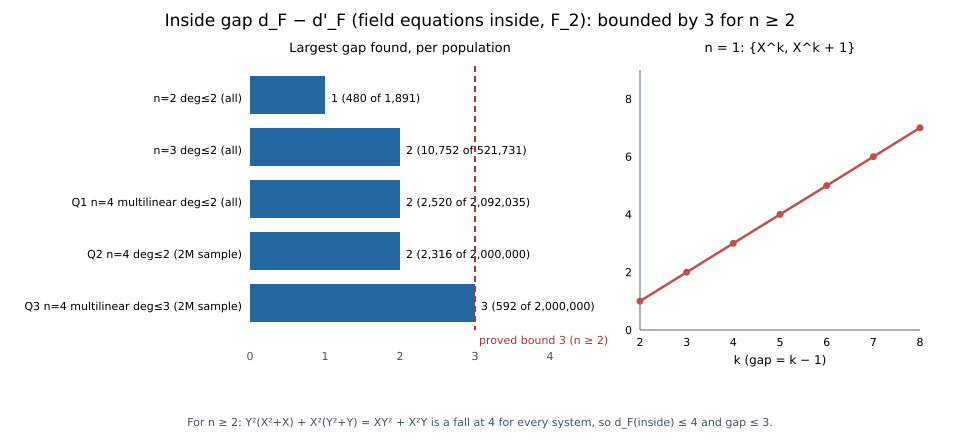

# The inside fake-to-true gap: bounded by 3 for n ≥ 2, unbounded for n = 1 (2026-11-02)

**Verdict.** The question `GAP-FAKE-GAP-INSIDE-BOUNDED` is settled.
- **n ≥ 2 variables:** with the field equations inside the generating set,
  `d_F − d'_F ≤ 3` for every system over `F_2`, and 3 is attained (n = 4).
- **One variable:** the gap is unbounded.

The bound comes from a fall built from the field equations alone, so it also shows that,
under the equality reading, inside-placement `d_F` never exceeds 4. All results are exact.
No cost claim.

Protocol: [`PROTOCOL.md`](PROTOCOL.md), frozen before computing, with Amendments 1–2.
Definitions: Nagao ePrint 2015/984 Definitions 5 and 6, equality reading, over `F_2`.



## The search

Instrument: `inside_gap_n4.rs`. Lines 1..384 are a byte-for-byte copy of the
`blindspots_19_checks.rs` fall computations. The driver adds threads, seeded sampling, and
the inside gap only. Control: the n = 3 witness embedded in n = 4 gives gap 2 (PASS).

| population | systems | max gap | systems at the max | undetermined |
|---|---:|---:|---:|---:|
| n = 2, all pairs deg ≤ 2 | 1,891 | 1 | 480 | 0 |
| n = 3, all pairs deg ≤ 2 | 521,731 | 2 | 10,752 | 0 |
| n = 4, all pairs multilinear deg ≤ 2 (Q1) | 2,092,035 | 2 | 2,520 | 0 |
| n = 4, pairs deg ≤ 2, seeded sample (Q2) | 2,000,000 | 2 | 2,316 | 0 |
| n = 4, pairs multilinear deg ≤ 3, seeded sample (Q3) | 2,000,000 | **3** | 592 | 0 |

The n = 3 row reproduces the earlier census of `research/lean_attacks_20261102` exactly.

**Gap-3 witness.** `{XYW + XY + W, XZW + XW + 1}` has `d_F(inside) = 4` and `d'_F = 1`. It
is confirmed by `independent_falls.py`, an exact linear-algebra implementation in Python
that shares no code with the Rust instrument.

## Why it stops at 3

The witnesses share a shape, `F(A, B, v) = {A v + 1, B v + B + 1}`:
- `(1 + v) f_1 + v f_2` reduces to `1`, so `d'_F = 1`;
- `v f_2 + B (v² + v) = v` is a true fall (inside) at `deg B + 2`.

That suggested a gap growing with `deg A, deg B`. Evaluating the family (Amendment 1)
refuted it: `d_F(inside)` follows `min(deg A, deg B) + 2` up to 4, then stays at 4 for every
larger `k`. Both implementations agree (`results/family_rust.txt`).

The independent implementation's degree-4 fall uses only the field equations:

    Y²(X² + X) + X²(Y² + Y) = XY² + X²Y

Both products have degree 4, and the sum has degree 3 and is nonzero.

**Theorem (n ≥ 2).** For every `F ⊆ F_2[X_1, …, X_n]` with `n ≥ 2`,
`d_F(F ∪ S_fe) ≤ 4`, and therefore `d_F(inside) − d'_F ≤ 3`.

*Proof.*
1. Put multiplier `X_2²` on `X_1² + X_1`, multiplier `X_1²` on `X_2² + X_2`, and 0 on every
   other generator.
2. The two products have degree 4 and the sum `X_1 X_2² + X_1² X_2` has degree 3 and is
   nonzero, so this is a fall at 4 and `d_F ≤ 4`.
3. `d'_F ≥ 1` always, since a fall needs a sum of lower degree than `d`. ∎

Checks: the field equations alone give `d_F = 4` for n = 2..8 (Rust) and n = 2..5
(Python).

**Tightness.** The gap-3 witness above.

**One variable.** With n = 1 there is no second field equation. `{X^k, X^k + 1}`:
- `X + (X + 1) = 1` is a fake fall at 1;
- `X^k + (X^k + 1) = 1` is a true fall at k;
- below k only `X² + X` is admissible, and one generator never falls.

So the gap is `k − 1`, unbounded; checked k = 2..8 by both implementations.

## What it means

- **Inside-placement `d_F` is degenerate.** Under the equality reading it is at most 4 for
  every system in two or more variables, because of falls among the field equations
  themselves. These are the "trivial degree falls" that Ding–Hodges and Petit–Quisquater
  exclude from their first fall degree; the definition encoded in
  `papers/ic-negative-results` does not exclude them.
- **Consequences for the inside placement:**
  - Nagao's Lemma 4 can fail there only when `d'_F < 4`.
  - No estimate can take its degree from inside-placement `d_F` without first removing
    trivial falls.
- **Outside the gap is unbounded** (`W_k`, previous round). Inside it is bounded, but only
  because the quantity itself is capped.

## Formal status

- `papers/ic-negative-results/lean/IcNegative/InsideGap.lean` states three things in core
  Lean with `decide +kernel`: the field-equation fall at 4 in two variables; no fall below
  4 from the field equations alone; and the same fall inside witness A's system. It is
  pending the repository proof gate.
- The step "zero multipliers on further generators leave the fall intact" is argued, not
  formalised.
- The four-variable witnesses are native only (two implementations), since the Lean
  encoding covers two variables.

## Reproduce

```sh
D=research/inside_gap_n4_20261102
rustc --edition 2021 -C opt-level=3 -o /tmp/ig4 $D/inside_gap_n4.rs
/tmp/ig4 control; /tmp/ig4 series; /tmp/ig4 q1; /tmp/ig4 q2 2000000; /tmp/ig4 q3 2000000   # ~7 s, ~70 s, ~81 s, ~108 s (4 threads)
rustc --edition 2021 -C opt-level=3 -o /tmp/fam8 $D/family_n8.rs && /tmp/fam8
python3 -I $D/independent_falls.py --selftest
python3 -I $D/independent_falls.py "XYW+XY+W; XZW+XW+1" 4 8
python3 -I $D/plot_inside_gap.py
```
