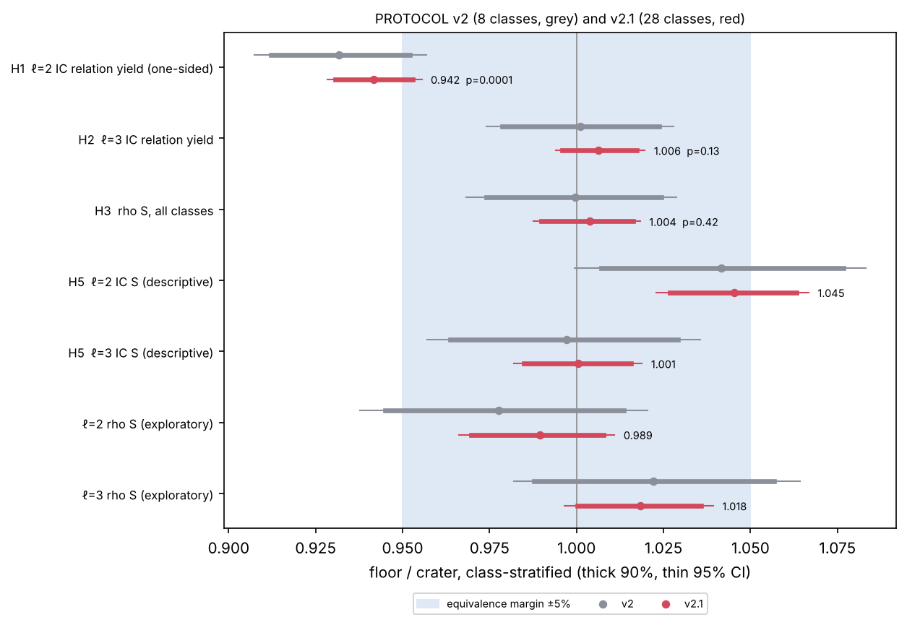
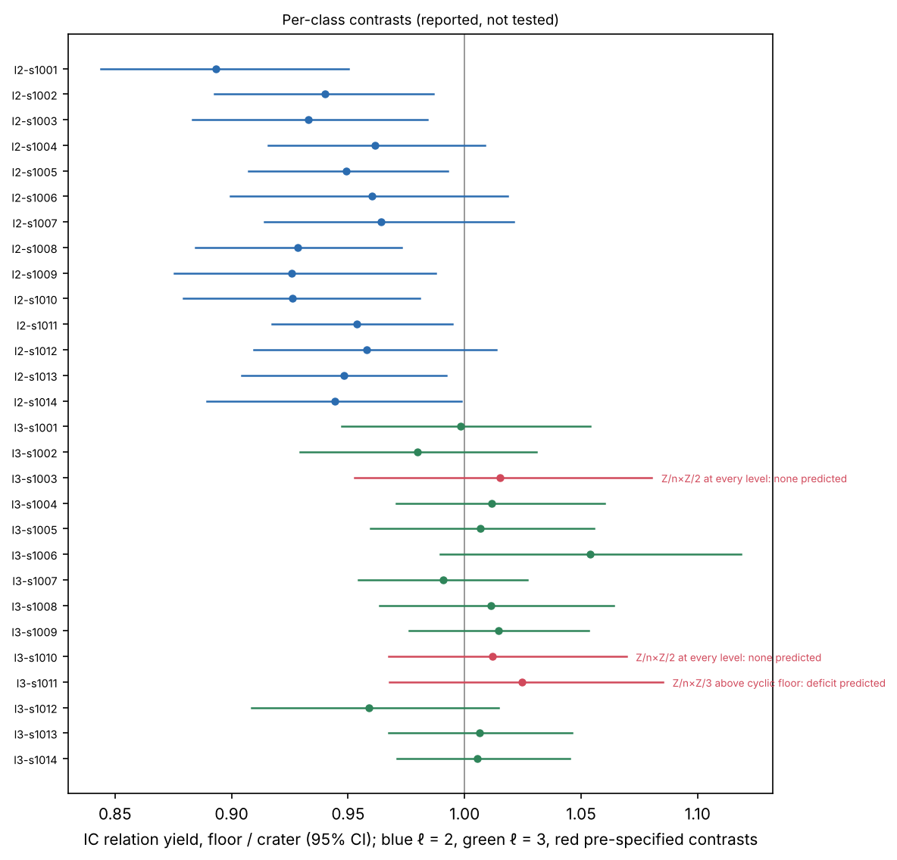
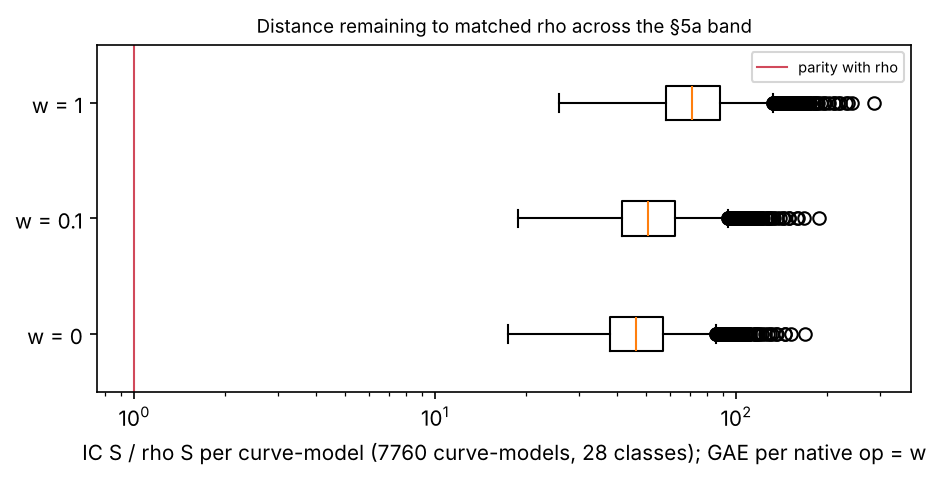
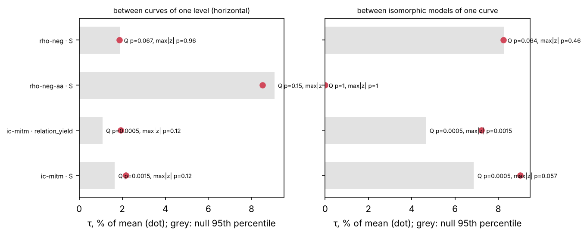
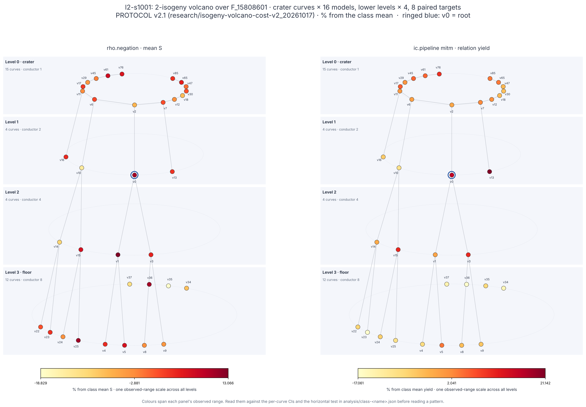
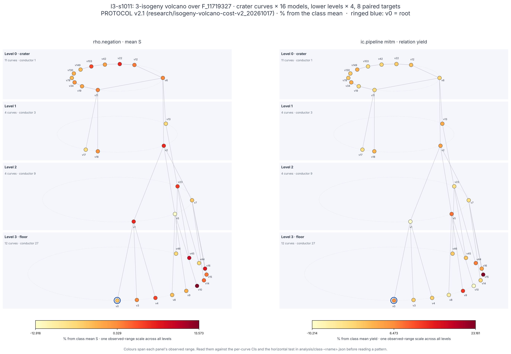

# Isogeny volcano cost, PROTOCOL v2 / v2.1: the ℓ = 2 IC-yield lead is confirmed

**Question.** v1 ([`../isogeny-volcano-cost_20261017`](../isogeny-volcano-cost_20261017/README.md))
left one exploratory lead: on ℓ = 2 volcanoes, floor curves gave about
6.5% fewer index-calculus relations per trial than crater curves, while
ℓ = 3 volcanoes showed nothing. Does this hold on fresh volcanoes with
many more crater curves? Are rho and IC yield equal across levels where
v1 could not say?

The protocol was frozen before any data ([`PROTOCOL.md`](PROTOCOL.md)):

- **v2:** 8 classes.
- **Amendment v2.1:** 20 more classes, added before any v2 record was
  analysed.

The headline is v2.1, with all 28 classes. The original 8 are reported
beside it.

## Answer

**Measured:**

- 28 classes (14 with ℓ = 2, 14 with ℓ = 3), 24-bit `p`, depth-3
  volcanoes with split craters.
- 7,760 curve-models: every crater curve in 16 isomorphic models, lower
  levels in 4.
- 154,160 measured runs (each after one warm-up), all verified.
- 113 sessions audited; 1,344 of 1,344 replays exact.

| hypothesis | v2.1 (28 classes): floor/crater, 90% CI [95% CI] | p | v2 (8 classes) | verdict |
|:--|:--|:--|:--|:--|
| **H1** (primary): ℓ = 2 IC relation yield is lower on the floor | **0.942** [0.931, 0.953] [0.928, 0.956] | 0.0001 (one-sided, 10,000 perms) | 0.932 [0.912, 0.952], p = 0.0001 | **confirmed**: ℓ = 2 floors give 5.8% [4.4, 7.2] fewer IC relations per trial than craters |
| **H2**: ℓ = 3 IC relation yield is equal across levels | 1.006 [0.996, 1.017] | 0.13 | 1.001 [0.979, 1.024] | **equal within ±5%** |
| **H3**: rho cost is equal across levels | 1.004 [0.990, 1.016] | 0.42 | 1.000 [0.974, 1.024] | **equal within ±5%** |
| **H4**: the v1 coordinate effect replicates (IC yield) | model τ 7.2% (null p95 4.7%), Q p = 0.0005; horizontal τ 1.9% | | model τ 7.2% > horizontal 2.3%, p = 0.0005 | **replicated** |
| H5 (descriptive): IC cost S, floor/crater | ℓ = 2: 1.045 [1.023, 1.067]; ℓ = 3: 1.001 [0.982, 1.019] | | ℓ = 2: 1.042; ℓ = 3: 0.997 | ℓ = 2 floors cost 4.5% more S |

Every curve-model's ratios are in `analysis/`. H1 is significant under
Holm over H1–H3: its p = 0.0001 is below the smallest threshold, 0.0167.
H2 and H3 are not significant differences, and each 90% CI lies inside
[0.95, 1.05]. v2 and v2.1 agree on every row.



### Positive controls (all required ones pass)

| control | required for | result |
|:--|:--|:--|
| Planted IC (factor base 33 against 32, yield matched by workload; predicted 1.063) | H1, H2 | ℓ = 2: 1.061 [1.058, 1.064]; ℓ = 3: 1.063 [1.060, 1.065]; all: 1.062 [1.060, 1.064] |
| BSGS exactness | all | 1 distinct cost per paired target on all 56 targets (28 classes × 2) |
| H1 power: `--plant-level 3:0.95` on the ℓ = 3 IC yield, one-sided | H1 | 0.956, p = 0.0001 < 0.0167 (v2: 0.951, p = 0.0001) |
| H3 power: `--plant-level 3:1.05` on rho, all classes | H3 | 1.054, p = 0.0001 < 0.0167 (v2: 1.050, p = 0.0001) |
| Single curve ×1.15 (`l2-s1001`, crater vertex 2), max\|z\| | reported only | IC yield: detected (max\|z\| p = 0.019). Rho: **not detected** (p = 0.42) |

The single-curve control is a limit on what the study can see. A
15% rho shift on one curve among about 30 is below what the max|z| test
detects at this N.

### Mechanism contrasts (pre-specified, reported, not tested)

The amendment predicted that if the ℓ = 2 deficit comes from the
ℓ-torsion structure changing between levels, then:

- `l3-s1011` (Z/n × Z/3 above a cyclic floor) would show a floor deficit;
- `l3-s1003` and `l3-s1010` (Z/n × Z/2 at every level) would show none.

| class | IC yield floor/crater [95% CI] | prediction |
|:--|:--|:--|
| `l3-s1011` | **1.025 [0.968, 1.085]** | deficit: **not seen** |
| `l3-s1003` | 1.015 [0.953, 1.080] | none: as predicted |
| `l3-s1010` | 1.012 [0.967, 1.069] | none: as predicted |
| every ℓ = 2 class (14) | 0.893 to 0.964: every estimate below 1, and every per-class permutation p < 0.05; 10 of 14 have a 95% CI wholly below 1 | deficit in every class |

The deficit is uniform across ℓ = 2 volcanoes. It does not appear in the
one ℓ = 3 volcano with the analogous structure change. So the
explanation "the ℓ-power torsion changes between levels" is not
supported, and the cause of the ℓ = 2 effect stays open. One class is
weak evidence (its CI reaches 0.968), so this is reported as a
contrast, not a rejection.



### Exploratory (not pre-registered)

- **Rho split by ℓ:**
  - ℓ = 2: 0.989 [0.970, 1.008] (90%).
  - ℓ = 3: 1.018 [1.000, 1.036] (90%), permutation p = 0.0054.

  Both are inside ±5%, and they cancel in H3. The ℓ = 3 sign is a lead
  at most.
- **Horizontal effect:** IC yield differs between same-level curves,
  τ = 1.9% (p = 0.0005). That is a quarter of the coordinate effect
  (7.2%). Rho shows no horizontal effect beyond the null (τ 1.9%, null
  p95 1.9%, p = 0.07).

## Gap to rho (CLAUDE.md success criterion; AGENTS.md §5a)

`ecbench band` on every class's main session, at weights 0, 0.1 and 1
GAE per native operation: **rho is below IC on all 7,760 curve-models at
every weight.**

| weight | IC S / rho S, min | median | max |
|--:|--:|--:|--:|
| 0 | 17.4 | 46.5 | 169.5 |
| 0.1 | 18.9 | 50.8 | 188.2 |
| 1 | 25.8 | 71.4 | 286.8 |



**Is anything here an improvement over the IC baseline?** H1 and H5
give a measured, pre-registered difference: on an ℓ = 2 floor curve, IC
costs 4.5% [2.3, 6.7] more S than on that volcano's crater curves. A
floor-curve target could therefore walk up the volcano (an isogeny walk
of depth 3) and run IC on a crater curve.

This is recorded as a **candidate, not a claimed improvement**:

- the isogeny walk's cost is not charged in these sessions;
- it is 24-bit only;
- its mechanism is unknown.

The gap to rho it would leave is still 17–170× at weight 0.

## Heterogeneity and the volcanoes



There is one heat map per class in `figures/volcano-<class>.png`, made
from that class's own analysis (`analysis/class-<class>.json`). Two
examples follow: the ℓ = 2 class with the largest deficit, and the
ℓ = 3 contrast class.





## Evidence and disclosures

- **Specs:** `classes/<class>/spec*.json`, `curves.jsonl`, and the
  export logs `classes/<class>.log`. The digests are in PROTOCOL.md: v2
  `0f7c6376…`, all 28 classes `ed9a7b88…`. They were computed from the
  repository root, with full paths. Re-run that way on this commit, the
  28-class digest reproduces `ed9a7b88…` exactly, so no spec changed
  after freezing:

  ```
  D=research/isogeny-volcano-cost-v2_20261017
  sha256sum $D/classes/*/spec*.json $D/classes/*/curves.jsonl | sha256sum
  ```
- **Sessions:** `sessions/<class>/<spec>/`, with `records.jsonl` and
  `plan.json` gzipped. `sessions/MANIFEST.sha256` holds the SHA-256 of
  every uncompressed file. The CI audit
  (`.github/scripts/ecbench-audit-sessions.sh`) verifies a decompressed
  copy.
- **Audits:** `audits/<class>__<spec>.json` from
  `ecbench verify --replay 12`. All 113 are `ok`, with 1,344/1,344
  replays reproduced.
  - The audits count 308,511 records: 154,160 measured runs, as many
    warm-ups, and the 191 runs of the interrupted session below.
- **Analysis:** [`analyse.sh`](analyse.sh) runs every `volcano-stats`
  and `ecbench band` call behind every number in this README:
  - stratified vertical statistic (v1.1);
  - bootstrap 2,000;
  - 10,000 permutations; 2,000 for the per-class runs;
  - seed 20261017.

  The figures come from [`plot.py`](plot.py), which only draws recorded
  values.
- **Interrupted session:** `l2-s1002/spec` was stopped at 191 runs,
  because a second stream claimed the same class. It is kept as
  evidence (audit `ok`, `--allow-interrupted`). Every run is claimed
  atomically, so no run was duplicated. The class was re-run whole as
  `spec-r2`, and the analysis uses `spec-r2`.
- **Parallel streams:** the sessions ran as up to four parallel streams,
  each with its own `--lock` (`/tmp/crypto-bench-g1..g4.lock`). This is
  not the global bench lock, so the streams shared the 4 vCPUs.
  - Only counted units (S, relations, trials) are cited; no wall time
    is.
  - The host is L0: a shared 4-vCPU VM (Intel Xeon @ 2.80 GHz).
- **Operations:** the disk filled once while sessions ran (a full git
  worktree). No session was affected: every audit is `ok`. The groups
  of 5 classes in the amendment were run as single-class jobs, to stay
  under the host's 2-hour background limit.
- **Scope:** 24-bit `p`, depth 3, split craters, ℓ ∈ {2, 3}, and the
  three methods at v1's parameters. No security statement is made, and
  no independent-host replay was run.

The report PDF is [`report.pdf`](report.pdf). The figures and PDF are
also in [`benchmarks/20261017-isogeny-volcano-cost-v2/`](../../benchmarks/20261017-isogeny-volcano-cost-v2/).
Its row in `benchmarks/README.md` is admitted under the validation gate
(AGENTS.md; `docs/VALIDATION_GATE.md`) by an independent validator's
`VALIDATION.json`. The validator:

- replayed 583 of 583 runs, drawn from a nonce of its own;
- re-checked every scalar with its own curve arithmetic;
- recomputed the headline numbers from the raw records with its own
  program (`validation/vrecompute.rs`).

The rho reference is `rho.negation` in the same sessions and binary.
