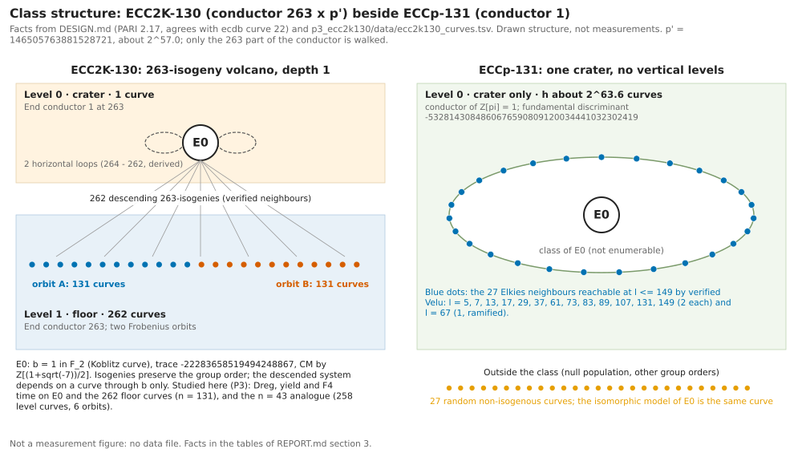
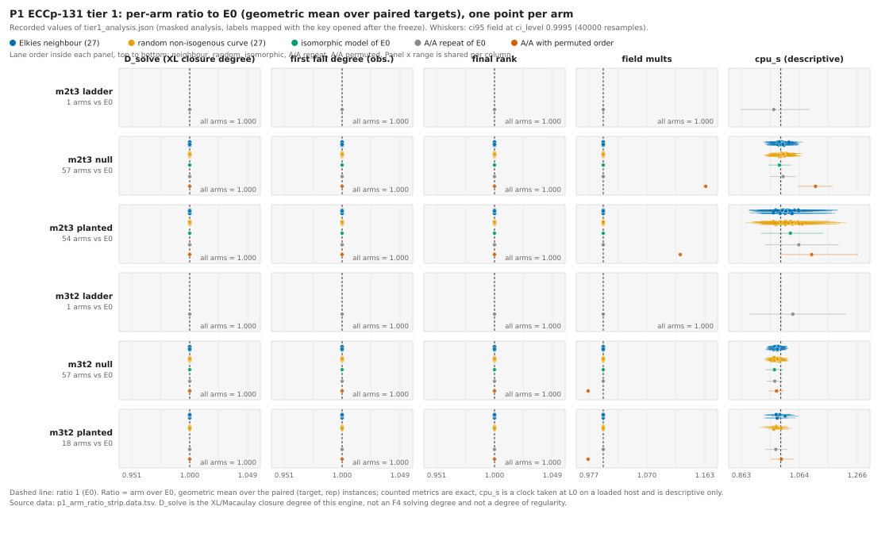
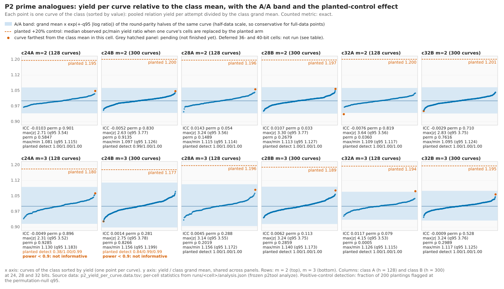
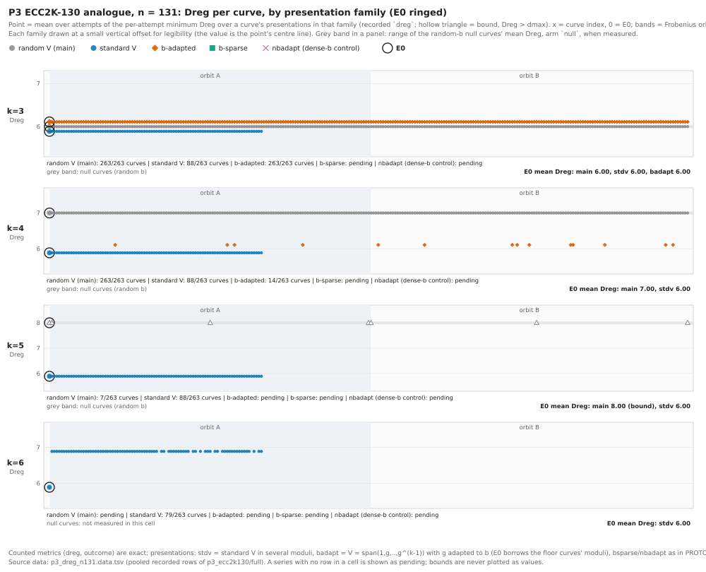
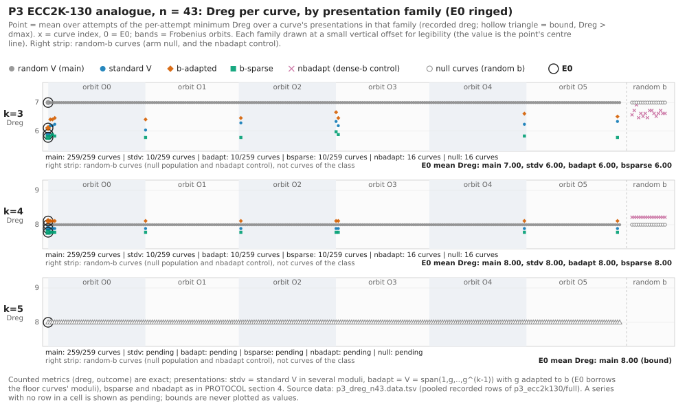

# Isogeny-class index-calculus yield: ECCp-131 and ECC2K-130

Characterization study report and visuals (branch claude/isogeny-class-ic-yield-20261102; generated by report/gen/gen_report.rs, interim until every cell has finished)

## 1. What this report is

Question (user, 2026-11-02): across the isogeny classes of ECC2K-130 and ECCp-131, do index-calculus relation yield, solve cost, resolving degree and related parameters differ between curves of one class? The study measures this with one instrument per part, the same on every curve, with an A/A noise floor, an isomorphic-model control, a negative-control population and, where the design has one, a planted positive control (DESIGN.md; PROTOCOL.md of each part).

- **Characterization study, not an improvement.** The preregistered expectation is a null. A null closes a lead. Nothing here is an improvement over the current index-calculus baseline, and the CLAUDE.md success criterion (every verified, measured improvement over that baseline) is not engaged: no baseline cost is changed, no phase is sped up.
- **No leaderboard row and no benchmarks row.** There is no cross-method claim and no matched rho reference, so the validation gate (replay certificate, validator report, matched rho with the 5a band) does not apply. `docs/ic-leaderboard.html`, `docs/ic/LEADERBOARD.md`, `docs/ic/leaderboard.json` and `benchmarks/README.md` are not touched. Per-row gaps to rho are not computed here, by design.
- **L0 isolation.** All three parts ran locally on a loaded host (P1 about 2 workers, P2 one ecbench cell at a time, P3 at most 2 workers, other agent sessions on the same 3 to 4 cores). Counted metrics (degrees, ranks, relation counts, field multiplications, row operations, solution counts) are exact and are the only ones that decide. Clocks (`cpu_s`, `wall_s`, `online_wall_ns_per_attempt`, `dreg_s`, `build_s`) are descriptive only and decide nothing.
- **Deferred, not dropped.** P1 tier 2 (`m2t4`), P2 at 36 and 40 bits (8 cells) and P3a-Y (n=43, k=13 yield line, claim C3) were not run under the amended protocols. They stay in the preregistration and are reported as "not run (deferred)", never filled.
- **Pending cells.** Cells still running at generation time show as "pending" in tables and graphs, never as nulls or zeros. Rerun `report/build.sh` when the runs finish.

## 2. Requirement to evidence

| Requirement | Status | Evidence |
|---|---|---|
| Report states: characterization, not an improvement over the IC baseline | verified complete | section 1, DESIGN.md, three PROTOCOL.md |
| No leaderboard or benchmarks row; no rho comparison | verified complete | section 1; P2 PROTOCOL section 9, P3 PROTOCOL section 1 |
| L0 isolation stated (counted exact, clock descriptive) | verified complete | section 1 and 3; P1 A1 section 14, P2 A1 and 10.1, P3 A1 |
| Deferred cells stated (P1 tier 2, P2 36/40-bit, P3a-Y) | verified complete | sections 1 and 8 |
| P1 ECCp-131 tier 1, arm-ratio strip plot | complete at tier-1 scope (tier 2 deferred) | section 5, figure 2, `p1_eccp131/runs/tier1_analysis.json` |
| P2 per-cell yield per curve, A/A band, planted control | partial: 12 of 12 run-scope cells finished | section 6, figure 3, `p2_prime_analogues/runs/<cell>/analysis.json` |
| P3 Dreg per curve and presentation family, E0 highlighted, standard V versus b-adapted | partial: 16 of 16 cards completed (receipt); more output present | section 7, figures 4 and 5, `p3_ecc2k130/full/` |
| Class-structure diagram (ECC2K-130 volcano levels beside ECCp-131 crater) | verified complete (structure from DESIGN.md) | section 3, figure 1 |
| Generator, REPORT.md, REPORT.typ, REPORT.pdf, SVGs | see section 9 | `report/` |

## 3. Class structure and measurement conditions

*Figure 1. Isogeny-class structure the instruments are applied to. Left: ECC2K-130 as a 263-isogeny volcano of depth 1 (E0 on the crater, 262 curves on the floor in two Frobenius orbits). Right: ECCp-131, a single crater of about 2^63.6 curves with 27 Elkies neighbours reachable at l <= 149, and the 27 random non-isogenous controls outside the class. Source: DESIGN.md, p3_ecc2k130/data/ecc2k130_curves.tsv.*

*Class facts (computed 2026-11-02, PARI 2.17 via cypari2; agrees with ecdb curve 22; copied from DESIGN.md).*

|  | ECC2K-130 | ECCp-131 |
|---|---|---|
| trace | -22283658519494248867 | 29529377007934231835 |
| fundamental discriminant | -7 | -5328143084860676590809120034441032302419 |
| conductor of Z[pi] | 263 x 146505763881528721 | 1 (crater only, h about 2^63.6) |
| computable neighbours | 262 at level 263 | Elkies l <= 150: 5,7,13,17,29,37,61,73,83,89,107,131,149 (2 each), 67 (1, ramified): 27 |
| scaled analogue measured | n = 43 (level 257/258 curves, 6 orbits), full width n = 131 for Dreg | P2: primes of 24 to 32 bits (36, 40 deferred), conductor 1, full class enumerated |

*Measurement conditions read from the recorded files. The protocols accept L0 (loaded host); the ecbench level on P2 rows is what ecbench graded and is reported as recorded. In every case the clock is descriptive only.*

| Part / cell | Host and isolation as recorded | Checks as recorded |
|---|---|---|
| P1 tier 1 | 2 workers, nproc 4, model name : Intel(R) Xeon(R) Processor @ 2.80GHz | rows 14016; binary sha256 c230a30013d85bd0; done 14016 jobs in 6883.4s |
| P2 c24A_m2 | ecbench isolation level recorded on rows: L1: 93, L2: 6435 | audit: OK, 8160 records, 12 replays; in-session A/A: counts identical 2176/2176 |
| P2 c24A_m3 | ecbench isolation level recorded on rows: L1: 352, L2: 12704 | audit: OK, 16320 records, 12 replays; in-session A/A: counts identical 4352/4352 |
| P2 c24B_m2 | ecbench isolation level recorded on rows: L1: 175, L2: 14609 | audit: OK, 18480 records, 12 replays; in-session A/A: counts identical 4928/4928 |
| P2 c24B_m3 | ecbench isolation level recorded on rows: L1: 1761, L2: 27807 | audit: OK, 36960 records, 12 replays; in-session A/A: counts identical 9856/9856 |
| P2 c28A_m2 | ecbench isolation level recorded on rows: L1: 1050, L2: 5478 | audit: OK, 8160 records, 12 replays; in-session A/A: counts identical 2176/2176 |
| P2 c28A_m3 | ecbench isolation level recorded on rows: L1: 316, L2: 6212 | audit: OK, 8160 records, 12 replays; in-session A/A: counts identical 2176/2176 |
| P2 c28B_m2 | ecbench isolation level recorded on rows: L1: 2518, L2: 12266 | audit: OK, 18480 records, 12 replays; in-session A/A: counts identical 4928/4928 |
| P2 c28B_m3 | ecbench isolation level recorded on rows: L1: 14784 | audit: OK, 18480 records, 12 replays; in-session A/A: counts identical 4928/4928 |
| P2 c32A_m2 | ecbench isolation level recorded on rows: L1: 4352 | audit: OK, 5440 records, 12 replays; in-session A/A: not run (dropped at 32 bits, PROTOCOL 4; round-parity A/A used) |
| P2 c32A_m3 | ecbench isolation level recorded on rows: L1: 1002, L2: 3350 | audit: OK, 5440 records, 12 replays; in-session A/A: not run (dropped at 32 bits, PROTOCOL 4; round-parity A/A used) |
| P2 c32B_m2 | ecbench isolation level recorded on rows: L1: 3401, L2: 6455 | audit: OK, 12320 records, 12 replays; in-session A/A: not run (dropped at 32 bits, PROTOCOL 4; round-parity A/A used) |
| P2 c32B_m3 | ecbench isolation level recorded on rows: L1: 3019, L2: 6837 | audit: OK, 12320 records, 12 replays; in-session A/A: not run (dropped at 32 bits, PROTOCOL 4; round-parity A/A used) |

## 4. Method in one paragraph per part

- **P1 (ECCp-131, full width, tier 1).** XL/Macaulay engine (`xl-incremental-sparse-echelon`) on the fixed bounded decomposition system, configs `m2t3` and `m3t2`, kinds null, planted and ladder. 58 arms: E0, an A/A repeat, an A/A permuted variable order-order arm, 1 isomorphic model, 27 Elkies neighbours, 27 random non-isogenous curves; 32 null targets, 8 planted targets, 3 reps, seed 20261102. Masked analysis frozen first, key opened after (A1 section 14).
- **P2 (prime analogues).** `ecbench` prime-abscissa mitm pipeline on every curve of an enumerated class (D = -84171, h = 128 for class A; D = -414651, h = 300 for class B), m = 2 and 3. Per curve pooled relation yield per attempt; ICC curve share of variance, max/min and max |z| against a 2000-permutation null; round-parity A/A halves; isomorphic-model control; planted +20% positive control (power must be at least 0.9 for a null to be informative).
- **P3 (ECC2K-130).** `p3h measure`: Weil-descended decomposition system over F_2, recorded `dreg` (resolving degree), exact `solutions`, rows and cols, for random V, standard V and b-adapted presentations, at n = 43 (all 258 level curves plus E0) and n = 131 (E0 plus 262 level-263 curves), k = 3 to 6.

## 5. P1: ECCp-131 at full width (tier 1)

`tier1_analysis.json` covers 14016 rows in 6 cells (config x kind), CI level 0.9995, 40000 bootstrap resamples. The analysis was produced with arm labels masked (`arm_labels_masked` = true); the key (sha256 b1463033d4d5bd5275e9b9b3202097fb34e72b9327e549f89413e0ec5766c96b) maps the masked labels to arms and is applied here only to name the points.

*Measured (derived from the recorded per-arm geometric-mean ratios vs E0): range over arms other than AA_perm, per cell. AA_perm is the A/A arm with permuted variable order (re-encoding floor) and is listed separately.*

| cell | arms vs E0 | D_solve ratio | final_rank ratio | field_mults ratio | cpu_s ratio (descriptive) | AA_perm field_mults ratio | min identical-profile fraction |
|---|---|---|---|---|---|---|---|
| m2t3 ladder | 1 (0 nb, 0 rnd) | 1.000 to 1.000 | 1.000 to 1.000 | 1.000 to 1.000 | 0.976 to 0.976 | n/a | 1.00 |
| m2t3 null | 57 (27 nb, 27 rnd) | 1.000 to 1.000 | 1.000 to 1.000 | 1.000 to 1.000 | 0.986 to 1.028 | 1.165 | 1.00 |
| m2t3 planted | 54 (25 nb, 26 rnd) | 1.000 to 1.000 | 1.000 to 1.000 | 1.000 to 1.000 | 0.974 to 1.074 | 1.124 | 1.00 |
| m3t2 ladder | 1 (0 nb, 0 rnd) | 1.000 to 1.000 | 1.000 to 1.000 | 1.000 to 1.000 | 1.042 to 1.042 | n/a | 1.00 |
| m3t2 null | 57 (27 nb, 27 rnd) | 1.000 to 1.000 | 1.000 to 1.000 | 1.000 to 1.000 | 0.968 to 0.995 | 0.976 | 1.00 |
| m3t2 planted | 18 (8 nb, 8 rnd) | 1.000 to 1.000 | 1.000 to 1.000 | 1.000 to 1.000 | 0.973 to 1.015 | 0.976 | 1.00 |

*Figure 2. P1 arm-ratio strip plot. One point per arm and metric: ratio to E0 (geometric mean over paired target and rep instances), whiskers the recorded confidence interval. Counted metrics (D_solve, first fall degree, final rank, field mults) are exact; cpu_s is descriptive (L0, loaded host). Run: tier1 card CARD-isogeny-ic-yield-p1-tier1-20261102-1, analysis tier1_analysis.json.*

*Recorded row status of tier1_rows.jsonl.gz (counted from the rows file).*

| config | kind | row status | rows |
|---|---|---|---|
| m2t3 | ladder | solved | 48 |
| m2t3 | null | solved | 5568 |
| m2t3 | planted | not formed | 72 |
| m2t3 | planted | solved | 1320 |
| m3t2 | ladder | solved | 48 |
| m3t2 | null | solved | 5568 |
| m3t2 | planted | not formed | 936 |
| m3t2 | planted | solved | 456 |

**Planted rows not formed: 1008.** Recorded reason: planted instance not formed: factor base on this curve has fewer abscissae than m. Rows by config and role:

*These rows are missing observations (the factor base of that curve held fewer abscissae than m), not values; they are excluded from every ratio above.*

| config | role | rows not formed |
|---|---|---|
| m2t3 | neighbour | 48 |
| m2t3 | random_curve_null_population | 24 |
| m3t2 | iso_control | 24 |
| m3t2 | neighbour | 456 |
| m3t2 | random_curve_null_population | 456 |

*Recorded `icc` block of the analysis: for the A/A, class (E0 plus neighbours) and random-curve groups, which counted metrics take one value on every curve and, where they vary, the curve share of variance.*

| cell | group | size | metrics with all values equal | metrics that vary (curve variance share) |
|---|---|---|---|---|
| m2t3 ladder | aa_E0_repeat_perm | 2 curves, 8 targets | D_solve, field_mults, final_cols, final_rank, final_rows, first_fall_degree_obs, n_standard_monomials_final | cpu_s (share 0.000) |
| m2t3 null | aa_E0_repeat_perm | 3 curves, 32 targets | D_solve, final_cols, final_rank, final_rows, first_fall_degree_obs, n_standard_monomials_final | cpu_s (share 0.583), field_mults (share 1.000) |
| m2t3 null | class_E0_plus_neighbours | 28 curves, 32 targets | D_solve, field_mults, final_cols, final_rank, final_rows, first_fall_degree_obs, n_standard_monomials_final | cpu_s (share 0.000) |
| m2t3 null | random_curves | 27 curves, 32 targets | D_solve, field_mults, final_cols, final_rank, final_rows, first_fall_degree_obs, n_standard_monomials_final | cpu_s (share 0.000) |
| m2t3 planted | aa_E0_repeat_perm | 3 curves, 8 targets | D_solve, final_cols, final_rank, final_rows, first_fall_degree_obs, n_standard_monomials_final | cpu_s (share 0.199), field_mults (share 1.000) |
| m2t3 planted | class_E0_plus_neighbours | 26 curves, 8 targets | D_solve, final_cols, final_rank, final_rows, first_fall_degree_obs, n_standard_monomials_final | cpu_s (share 0.000), field_mults (share 0.044) |
| m2t3 planted | random_curves | 26 curves, 8 targets | D_solve, final_cols, final_rank, final_rows, first_fall_degree_obs, n_standard_monomials_final | cpu_s (share 0.007), field_mults (share 0.017) |
| m3t2 ladder | aa_E0_repeat_perm | 2 curves, 8 targets | D_solve, field_mults, final_cols, final_rank, final_rows, first_fall_degree_obs, n_standard_monomials_final | cpu_s (share 0.000) |
| m3t2 null | aa_E0_repeat_perm | 3 curves, 32 targets | D_solve, final_cols, final_rank, final_rows, first_fall_degree_obs, n_standard_monomials_final | cpu_s (share 0.067), field_mults (share 1.000) |
| m3t2 null | class_E0_plus_neighbours | 28 curves, 32 targets | D_solve, field_mults, final_cols, final_rank, final_rows, first_fall_degree_obs, n_standard_monomials_final | cpu_s (share 0.000) |
| m3t2 null | random_curves | 27 curves, 32 targets | D_solve, field_mults, final_cols, final_rank, final_rows, first_fall_degree_obs, n_standard_monomials_final | cpu_s (share 0.005) |
| m3t2 planted | aa_E0_repeat_perm | 3 curves, 8 targets | D_solve, final_cols, final_rank, final_rows, first_fall_degree_obs, n_standard_monomials_final | cpu_s (share 0.000), field_mults (share 1.000) |
| m3t2 planted | class_E0_plus_neighbours | 9 curves, 8 targets | D_solve, field_mults, final_cols, final_rank, final_rows, first_fall_degree_obs, n_standard_monomials_final | cpu_s (share 0.000) |
| m3t2 planted | random_curves | 8 curves, 8 targets | D_solve, field_mults, final_cols, final_rank, final_rows, first_fall_degree_obs, n_standard_monomials_final | cpu_s (share 0.000) |

### 5.1 What it shows now

- **Measured.** In every cell, every arm other than AA_perm has ratio to E0 within 3.850e-5 of 1 on D_solve, first fall degree, final rank and field mults (the largest deviation over all cells and these four metrics is 3.850e-5; 0 means the recorded ratio is exactly 1). The arms present are the Elkies neighbours, the isomorphic model and the random non-isogenous curves (27 each, minus the planted instances that were not formed), for configs m2t3 and m3t2 and kinds null, planted and ladder.
- **Measured.** The arm that moves the operation count is AA_perm (field_mults ratio 0.976 to 1.165 over the cells in which it appears); its D_solve and final rank ratios deviate from 1 by at most 0. By construction (PROTOCOL section 3) this arm is the E0 instance with a seeded permutation of the variable order, the re-encoding noise floor: it sets how far the operation count moves under a re-encoding of the same curve, and it is not a curve effect.
- **Measured, descriptive.** `cpu_s` ratios of arms other than AA_perm lie within 0.074 of 1 (cells above); AA_perm cpu ratio 0.985 to 1.121. The clock was taken at L0 on a loaded host and decides nothing.
- **Measured.** 1008 planted rows were not formed (see table); they are missing, not zero.

**Reading (main session, 2026-11-02; interpretation, labelled as such).** At 131 bits the instrument's counted profile (XL closure degree, rank, field multiplications, per-degree profiles) is independent of the curve: it is the same on the 27 neighbours, on the isomorphic model and on the 27 random non-isogenous curves. Because random non-isogenous curves match as well, the null population is uninformative about isogeny specifically: this instrument at this system size does not distinguish any curve from any other, so it cannot see an isogeny-class effect even if one existed in a quantity it does not count. `D_solve` is the XL/Macaulay closure degree of this study's engine; on the 147 comparable mirror systems of `p1_eccp131/CROSSCHECK.md` it is strictly above F4's top step degree, so it is not F4's solving degree and not a degree of regularity, and no statement here calls it one. Full-width yield is predicted, not observed (exact-curve screens found zero relations).

## 6. P2: prime analogues of ECCp-131's class

Main-session reading (p2_prime_analogues/RESULTS.md): all 12 run-scope cells finished and audited. 9 cells support the null (planted 20% power >= 0.99; bootstrap upper bound on the curve share of yield variance <= 0.10 in every cell); 2 m = 3 cells at 24 bits are not informative at 20% (power 0.38, 0.84); the one flag (c32A m = 3, curve 80, max abs z p = 0.0005) was rerun on fresh seeds under the preregistered follow-up 1 (FOLLOWUP_c32A_m3.md) and did not replicate: curve 80 vs 15 comparators 1.0021 (95% 0.9815 to 1.0232), p = 0.84, positive control met (1.19), negative control informative.

*Cell inventory: 12 run-scope cells (24, 28, 32 bits, classes A and B, m = 2, 3) and 8 deferred cells (36 and 40 bits). Pending cells have no values; deferred cells were not run.*

| class | m = 2 | m = 3 | class facts (from a finished cell) |
|---|---|---|---|
| c24A | finished (128 curves) | finished (128 curves) | p 2^23.70, D -84171, h 128 |
| c24B | finished (300 curves) | finished (300 curves) | p 2^23.72, D -414651, h 300 |
| c28A | finished (128 curves) | finished (128 curves) | p 2^27.31, D -84171, h 128 |
| c28B | finished (300 curves) | finished (300 curves) | p 2^27.86, D -414651, h 300 |
| c32A | finished (128 curves) | finished (128 curves) | p 2^31.94, D -84171, h 128 |
| c32B | finished (300 curves) | finished (300 curves) | p 2^31.91, D -414651, h 300 |
| c36A | not run (deferred) | not run (deferred) | - |
| c36B | not run (deferred) | not run (deferred) | - |
| c40A | not run (deferred) | not run (deferred) | - |
| c40B | not run (deferred) | not run (deferred) | - |

*Figure 3. P2 yield per curve against the class mean with the A/A band and the planted-control effect, per finished cell (hatched panels are pending). Source: runs/<cell>/analysis.json (p2tool analyze, 2000 permutations, 2000 bootstrap resamples, seed 20261102).*

*Recorded statistics of the frozen analysis for the finished cells. The last column only lists which numeric triggers of PROTOCOL section 6 are met (Bonferroni alpha 0.0025 over 20 tests; positive-control power below 0.9 means a null is not informative at 20%); the verdict per cell is assigned by the main session, and a trigger starts a follow-up protocol, it is not a claim.*

| cell | yield mean / attempt | ICC raw / boot upper95 | ICC perm p | max abs z (null q95) p | max/min (null q95) | A/A sd / iso RMS (log ratio) | planted median pc/main / min power | rel_gae ICC p | PROTOCOL 6 triggers (mechanical) |
|---|---|---|---|---|---|---|---|---|---|
| c24A_m2 | 0.0199 | -0.0103 / 0.074 | 0.9005 | 2.71 (3.54) p 0.5847 | 1.081 (1.115) | 0.0322 / 0.0336 | 1.195 / 1.00 | 0.471 | none |
| c24A_m3 | 0.0330 | -0.0049 / 0.038 | 0.8961 | 2.31 (3.52) p 0.9285 | 1.130 (1.183) | 0.0484 / 0.0481 | 1.180 / 0.38 | 0.827 | power < 0.9 |
| c24B_m2 | 0.0198 | -0.0052 / 0.073 | 0.8296 | 2.63 (3.77) p 0.9135 | 1.097 (1.126) | 0.0316 / 0.0167 | 1.200 / 0.99 | 0.572 | none |
| c24B_m3 | 0.0340 | 0.0014 / 0.041 | 0.2814 | 2.75 (3.78) p 0.8266 | 1.156 (1.199) | 0.0528 / 0.0361 | 1.177 / 0.84 | 0.421 | power < 0.9 |
| c28A_m2 | 0.0199 | 0.0143 / 0.103 | 0.0540 | 3.24 (3.56) p 0.1489 | 1.115 (1.114) | 0.0347 / 0.0202 | 1.196 / 1.00 | 0.450 | none |
| c28A_m3 | 0.0329 | 0.0045 / 0.093 | 0.2884 | 3.14 (3.55) p 0.2019 | 1.156 (1.172) | 0.0525 / 0.0430 | 1.196 / 1.00 | 0.090 | none |
| c28B_m2 | 0.0171 | 0.0107 / 0.089 | 0.0330 | 3.30 (3.77) p 0.2679 | 1.113 (1.127) | 0.0337 / 0.0244 | 1.197 / 1.00 | 0.421 | none |
| c28B_m3 | 0.0330 | 0.0062 / 0.085 | 0.1134 | 3.24 (3.75) p 0.2859 | 1.140 (1.173) | 0.0446 / 0.0445 | 1.189 / 1.00 | 0.193 | none |
| c32A_m2 | 0.0010 | -0.0076 / 0.080 | 0.8186 | 3.64 (3.56) p 0.0360 | 1.109 (1.117) | 0.0326 / 0.0261 | 1.200 / 1.00 | 0.512 | none |
| c32A_m3 | 0.0330 | 0.0117 / 0.102 | 0.0795 | 4.15 (3.53) p 0.0005 | 1.126 (1.115) | 0.0370 / 0.0230 | 1.194 / 1.00 | 0.133 | max\|z\| p < 0.0025 |
| c32B_m2 | 0.0010 | -0.0029 / 0.075 | 0.7096 | 2.83 (3.75) p 0.7616 | 1.095 (1.124) | 0.0340 / 0.0220 | 1.201 / 1.00 | 0.676 | none |
| c32B_m3 | 0.0329 | -0.0009 / 0.078 | 0.5282 | 3.24 (3.76) p 0.2989 | 1.117 (1.125) | 0.0377 / 0.0278 | 1.195 / 1.00 | 0.449 | none |

**Observation to carry into the reading.** Cells whose last column lists a trigger are the ones the main session must read against the isomorphic-model control (presentation effect of the factor-base rule) before calling anything a curve effect. Cells that list `power < 0.9` are "not informative at 20%", never reported as nulls (PROTOCOL section 4).

## 7. P3: ECC2K-130 analogue and full width

*P3 card inventory. A file without a receipt may still be growing; its rows are included in the figures as present. P3a-Y (n=43, k=13 yield line, about 19.4 CPU-hours) is deferred, not run.*

| card | what | output files (rows present) | state |
|---|---|---|---|
| a-ctrl-k3 | P3a controls and C2 family, n=43, k=3 | p3a_ctrl_k3: 3659 rows | completed (receipt) |
| a-main-k3 | P3a main, n=43, k=3, 20 attempts | p3a_main_k3: 5180 rows | completed (receipt) |
| a-m2 | P3a m=2, n=43, k=3,4,5,8 | p3a_m2: 22000 rows | completed (receipt) |
| a-main-k5 | P3a main, n=43, k=5 (bound) | p3a_main_k5: 518 rows | completed (receipt) |
| a-ctrl-k4-s0 | P3a controls and C2 family, k=4, attempt 0 | p3a_ctrl_k4.s0: 183 rows | completed (receipt) |
| a-ctrl-k4-s1 | P3a controls and C2 family, k=4, attempt 1 | p3a_ctrl_k4.s1: 183 rows | completed (receipt) |
| a-main-k4-s0 | P3a main, k=4, attempt 0 | p3a_main_k4.s0: 259 rows | completed (receipt) |
| a-main-k4-s1 | P3a main, k=4, attempt 1 | p3a_main_k4.s1: 259 rows | completed (receipt) |
| b-badapt | P3b b-adapted presentations, n=131, k=3..6 | p3b_badapt: 2112 rows | completed (receipt) |
| b-bsparse | P3b b-sparse and nbadapt, n=131, k=5,6 | p3b_bsparse: 200 rows | completed (receipt) |
| b-main-k5-s0 | P3b random-V main, k=5, attempt 0 | p3b_main_k5.s0: 263 rows | completed (receipt) |
| b-main-k5-s1 | P3b random-V main, k=5, attempt 1 | p3b_main_k5.s1: 263 rows | completed (receipt) |
| b-ctrl | P3b controls, CTRL131, k=3,4,5 | p3b_ctrl: 216 rows | completed (receipt) |
| b-main-k34 | P3b random-V main, k=3,4 | p3b_main_k34: 1052 rows | completed (receipt) |
| b-stdv-s0 | P3b standard V, curves 0..131 (E0 and orbit A) | p3b_stdv.s0a: 528 rows; p3b_stdv.s0b: 528 rows; p3b_stdv.s0c: 528 rows | completed (receipt) |
| b-stdv-s1 | P3b standard V, curves 132..262 (orbit B) | p3b_stdv.s1a: 516 rows; p3b_stdv.s1b: 528 rows; p3b_stdv.s1c: 528 rows | completed (receipt) |

*PROTOCOL 6.1 instrument checks, recounted from the recorded rows (same (k, attempt, curve) key, same shard file). A cell with an identity below 100% is void by the protocol. Planted rows whose `outcome` is `atleast` are bounds and are not Dreg values.*

| cell | isomorphic-model rows identical to main (dreg, solutions, refuted) | A/A rows identical to main | planted rows: planted_ok = 1 / 0 / not applicable (-1) |
|---|---|---|---|
| n=43, k=3 | 200/200 | 200/200 | 199 / 0 / 0 |
| n=43, k=4 | 20/20 | 20/20 | 20 / 0 / 0 |
| n=131, k=3 | 14/14 | 14/14 | 14 / 0 / 0 |
| n=131, k=4 | 14/14 | 14/14 | 14 / 0 / 0 |
| n=131, k=5 | 14/14 | 14/14 | 14 / 0 / 0 |

*Figure 4. P3 at full width (n = 131): Dreg per curve for random V, standard V and b-adapted presentations, E0 ringed (curve 0), orbits A and B shaded. Pending series are named under each panel. Source: p3_dreg_n131.data.tsv from the recorded rows.*

*Figure 5. P3a analogue (n = 43, E0 plus 258 level curves, 6 orbits): Dreg per curve. The control and family arms were measured on a subset of curves (`--select`), the main arm on all curves. Hollow triangles are bounds (Dreg > dmax). Source: p3_dreg_n43.data.tsv.*

*Descriptive recorded-value summary, attempt 0 only; n = 43 family cells are k = 3 and 4 only (PROTOCOL A1) (the one attempt common to every family arm). Per curve: the minimum recorded Dreg over the presentations of the arms listed; per orbit: mean, range and count over curves, against E0 under the same procedure. This is not the frozen bootstrap analysis (`p3h analyze`, archived under report/data/p3_analysis/) and not PROTOCOL 6.3 outcome N or G: that reading needs the b-adapted and b-sparse arms to be complete, and cells marked incomplete must not be read as a family-minimum gap.*

| cell | orbit | standard V only: floor-curve mean of min Dreg against E0 | family minimum (arms present): floor-curve mean against E0 | family arms with rows | family status |
|---|---|---|---|---|---|
| n=131, k=3 | A | 6.000 (range 6 to 6; 131 curve(s)); E0 6; difference 0.000 | 6.000 (range 6 to 6; 131 curve(s)); E0 6; difference 0.000 | stdv, badapt | all three family arms have rows (curve coverage in figures 4 and 5) |
| n=131, k=3 | B | 6.000 (range 6 to 6; 131 curve(s)); E0 6; difference 0.000 | 6.000 (range 6 to 6; 131 curve(s)); E0 6; difference 0.000 | stdv, badapt | all three family arms have rows (curve coverage in figures 4 and 5) |
| n=131, k=4 | A | 6.000 (range 6 to 6; 131 curve(s)); E0 6; difference 0.000 | 6.000 (range 6 to 6; 131 curve(s)); E0 6; difference 0.000 | stdv, badapt | all three family arms have rows (curve coverage in figures 4 and 5) |
| n=131, k=4 | B | 6.000 (range 6 to 6; 131 curve(s)); E0 6; difference 0.000 | 6.000 (range 6 to 6; 131 curve(s)); E0 6; difference 0.000 | stdv, badapt | all three family arms have rows (curve coverage in figures 4 and 5) |
| n=131, k=5 | A | 6.000 (range 6 to 6; 131 curve(s)); E0 6; difference 0.000 | 6.000 (range 6 to 6; 131 curve(s)); E0 6; difference 0.000 | stdv, badapt, bsparse | all three family arms have rows (curve coverage in figures 4 and 5) |
| n=131, k=5 | B | 6.000 (range 6 to 6; 131 curve(s)); E0 6; difference 0.000 | 6.000 (range 6 to 6; 131 curve(s)); E0 6; difference 0.000 | stdv, badapt, bsparse | all three family arms have rows (curve coverage in figures 4 and 5) |
| n=131, k=6 | A | 7.000 (range 7 to 7; 131 curve(s)); E0 6; difference 1.000 | 6.000 (range 6 to 6; 131 curve(s)); E0 6; difference 0.000 | stdv, badapt, bsparse | all three family arms have rows (curve coverage in figures 4 and 5) |
| n=131, k=6 | B | 6.977 (range 6 to 7; 131 curve(s)); E0 6; difference 0.977 | 6.000 (range 6 to 6; 131 curve(s)); E0 6; difference 0.000 | stdv, badapt, bsparse | all three family arms have rows (curve coverage in figures 4 and 5) |
| n=43, k=3 | O0 | 6.333 (range 6 to 7; 3 curve(s)); E0 6; difference 0.333 | 6.000 (range 6 to 6; 3 curve(s)); E0 6; difference 0.000 | stdv, badapt, bsparse | all three family arms have rows (curve coverage in figures 4 and 5) |
| n=43, k=3 | O1 | 6.000 (range 6 to 6; 1 curve(s)); E0 6; difference 0.000 | 6.000 (range 6 to 6; 1 curve(s)); E0 6; difference 0.000 | stdv, badapt, bsparse | all three family arms have rows (curve coverage in figures 4 and 5) |
| n=43, k=3 | O2 | 6.000 (range 6 to 6; 1 curve(s)); E0 6; difference 0.000 | 6.000 (range 6 to 6; 1 curve(s)); E0 6; difference 0.000 | stdv, badapt, bsparse | all three family arms have rows (curve coverage in figures 4 and 5) |
| n=43, k=3 | O3 | 7.000 (range 7 to 7; 2 curve(s)); E0 6; difference 1.000 | 6.000 (range 6 to 6; 2 curve(s)); E0 6; difference 0.000 | stdv, badapt, bsparse | all three family arms have rows (curve coverage in figures 4 and 5) |
| n=43, k=3 | O4 | 6.000 (range 6 to 6; 1 curve(s)); E0 6; difference 0.000 | 6.000 (range 6 to 6; 1 curve(s)); E0 6; difference 0.000 | stdv, badapt, bsparse | all three family arms have rows (curve coverage in figures 4 and 5) |
| n=43, k=3 | O5 | 6.000 (range 6 to 6; 1 curve(s)); E0 6; difference 0.000 | 6.000 (range 6 to 6; 1 curve(s)); E0 6; difference 0.000 | stdv, badapt, bsparse | all three family arms have rows (curve coverage in figures 4 and 5) |
| n=43, k=4 | O0 | 8.000 (range 8 to 8; 3 curve(s)); E0 8; difference 0.000 | 8.000 (range 8 to 8; 3 curve(s)); E0 8; difference 0.000 | stdv, badapt, bsparse | all three family arms have rows (curve coverage in figures 4 and 5) |
| n=43, k=4 | O1 | 8.000 (range 8 to 8; 1 curve(s)); E0 8; difference 0.000 | 8.000 (range 8 to 8; 1 curve(s)); E0 8; difference 0.000 | stdv, badapt, bsparse | all three family arms have rows (curve coverage in figures 4 and 5) |
| n=43, k=4 | O2 | 8.000 (range 8 to 8; 1 curve(s)); E0 8; difference 0.000 | 8.000 (range 8 to 8; 1 curve(s)); E0 8; difference 0.000 | stdv, badapt, bsparse | all three family arms have rows (curve coverage in figures 4 and 5) |
| n=43, k=4 | O3 | 8.000 (range 8 to 8; 2 curve(s)); E0 8; difference 0.000 | 8.000 (range 8 to 8; 2 curve(s)); E0 8; difference 0.000 | stdv, badapt, bsparse | all three family arms have rows (curve coverage in figures 4 and 5) |
| n=43, k=4 | O4 | 8.000 (range 8 to 8; 1 curve(s)); E0 8; difference 0.000 | 8.000 (range 8 to 8; 1 curve(s)); E0 8; difference 0.000 | stdv, badapt, bsparse | all three family arms have rows (curve coverage in figures 4 and 5) |
| n=43, k=4 | O5 | 8.000 (range 8 to 8; 1 curve(s)); E0 8; difference 0.000 | 8.000 (range 8 to 8; 1 curve(s)); E0 8; difference 0.000 | stdv, badapt, bsparse | all three family arms have rows (curve coverage in figures 4 and 5) |

The preregistered reading is C2: after minimising over the declared presentation family F on both sides, E0 and the floor curves coincide, with the single-presentation (standard V) gap present as the positive control (standard V, n = 131, k = 6: E0 Dreg 6 against floor Dreg 7). Where the table shows the single-presentation gap and an incomplete family, only the positive control is visible so far. A surviving gap would be read only as a statement about b in F_2 (E0 alone has b = 1), not about the isogeny class, and is not a speedup (no end-to-end S, no rho gap).

Main-session reading of the frozen pooled analyses (masked first, unmasked after the freeze; p3_ecc2k130/RESULTS.md): outcome N. At n = 131, k = 5 and 6 the presentation-family minimum is Dreg 6 for E0 and for all 262 level-263 curves on both attempts; the b-adapted presentation alone gives 6 on every curve, and random-b controls match. Random V: Dreg and matrix shape identical to E0 on every class curve at n = 131 (k = 3, 4); at n = 43 Dreg is identical and one target of 20 shows b-dependent column counts with E0 in the modal shape.

## 8. Deferred and pending

- **Not run (deferred), P1 tier 2:** config `m2t4`, 39 arms, 8 plus 2 targets (about 6.3 CPU-hours). In the preregistered design, no data taken under protocol version 1 amendment A1. Needs a further amendment before running.
- **Not run (deferred), P2 at 36 and 40 bits:** c36A_m2, c36A_m3, c36B_m2, c36B_m3, c40A_m2, c40A_m3, c40B_m2, c40B_m3 (8 cells). In the population and the preregistration; no data taken under amendment A1.
- **Not run (deferred), P3a-Y:** n = 43, k = 13 yield line (about 19.4 CPU-hours); claim C3 (yield against the Poisson prediction) is not run, and the `solutions` column of the cells that did run is descriptive.
- **Pending at generation time, P2:** none.
- **Pending or partial at generation time, P3:** none.
- No cell is pending: every run-scope cell of P1, P2 and P3 has a completed receipt.

## 9. Reproduce, inputs and files

Rerun from the repository root: `research/isogeny_class_ic_yield_20261102/report/build.sh`. It compiles `report/gen/gen_report.rs` (Rust, std only, `rustc -O`), pools the P3 shards and archives the masked then unmasked `p3h analyze` outputs under `report/data/p3_analysis/` (needs the built `target/release/p3h`; skipped with a note if absent), runs the generator and renders `REPORT.pdf` from `REPORT.typ` with Typst. Typst is document rendering only; if it is not installed the script installs the `typst` wheel in a scratch virtualenv outside the repository, as the research-visuals skill prescribes. No Python computes any value in this report.

- `report/REPORT.md`, `report/REPORT.typ`, `report/REPORT.pdf`: this report in three forms (generated, do not edit by hand).
- `report/figures/*.svg` with `*.data.tsv` beside each: class_structure, p1_arm_ratio_strip, p2_yield_per_curve, p3_dreg_n131, p3_dreg_n43.
- `report/data/inputs.sha256.tsv`: sha256 of every input file read in this build.
- `report/data/p3_analysis/`: `p3h analyze` text output per pooled P3 file family (masked first, then unmasked).

*Inputs read by this build.*

| input file (relative to the study directory) | sha256 (first 16 hex; full in inputs.sha256.tsv) |
|---|---|
| `p1_eccp131/runs/tier1.log.gz` | `1990ce69b4a4e4b6` |
| `p1_eccp131/runs/tier1_analysis.json` | `253419f2d7d0fe97` |
| `p1_eccp131/runs/tier1_analysis.json.key.json` | `b1463033d4d5bd52` |
| `p1_eccp131/runs/tier1_rows.jsonl.gz` | `a756d194ceb5998a` |
| `p2_prime_analogues/runs/c24A_m2/analysis.json` | `b196d2f04d4877e3` |
| `p2_prime_analogues/runs/c24A_m2/audit.json` | `0950bc0c45a18367` |
| `p2_prime_analogues/runs/c24A_m3/analysis.json` | `c4b4d91b3910b4ae` |
| `p2_prime_analogues/runs/c24A_m3/audit.json` | `5fde2045b1ee7f20` |
| `p2_prime_analogues/runs/c24B_m2/analysis.json` | `bd9cae34ea36de6e` |
| `p2_prime_analogues/runs/c24B_m2/audit.json` | `b13fa242a0337a28` |
| `p2_prime_analogues/runs/c24B_m3/analysis.json` | `40a5e5944275d87c` |
| `p2_prime_analogues/runs/c24B_m3/audit.json` | `28c25dc4762f0aaa` |
| `p2_prime_analogues/runs/c28A_m2/analysis.json` | `01e919a90cfd2725` |
| `p2_prime_analogues/runs/c28A_m2/audit.json` | `b7b9447ece6d7693` |
| `p2_prime_analogues/runs/c28A_m3/analysis.json` | `017d0ca14e8795c9` |
| `p2_prime_analogues/runs/c28A_m3/audit.json` | `002d0164ac54045d` |
| `p2_prime_analogues/runs/c28B_m2/analysis.json` | `a0faeefba936a42c` |
| `p2_prime_analogues/runs/c28B_m2/audit.json` | `e4e4b112a63a998f` |
| `p2_prime_analogues/runs/c28B_m3/analysis.json` | `1765c53edc0276c3` |
| `p2_prime_analogues/runs/c28B_m3/audit.json` | `f27c9e54faf6b29b` |
| `p2_prime_analogues/runs/c32A_m2/analysis.json` | `dba868b529f5322f` |
| `p2_prime_analogues/runs/c32A_m2/audit.json` | `af60cc5c2c3c00c2` |
| `p2_prime_analogues/runs/c32A_m3/analysis.json` | `b4e907dd0328bc41` |
| `p2_prime_analogues/runs/c32A_m3/audit.json` | `9906464becf9e795` |
| `p2_prime_analogues/runs/c32B_m2/analysis.json` | `2d18ada46b05a867` |
| `p2_prime_analogues/runs/c32B_m2/audit.json` | `8c9455f0074f0eb2` |
| `p2_prime_analogues/runs/c32B_m3/analysis.json` | `2330be8d60844005` |
| `p2_prime_analogues/runs/c32B_m3/audit.json` | `3d394c5f8f2912ab` |
| `p3_ecc2k130/data/ecc2k130_curves.tsv` | `ee987b52191581be` |
| `p3_ecc2k130/full/p3a_ctrl_k3.jsonl` | `f136198871fd2e0f` |
| `p3_ecc2k130/full/p3a_ctrl_k4.s0.jsonl` | `38b5aa5f790b7d98` |
| `p3_ecc2k130/full/p3a_ctrl_k4.s1.jsonl` | `df920701d2ff3636` |
| `p3_ecc2k130/full/p3a_m2.jsonl` | `d4aba33321e915e2` |
| `p3_ecc2k130/full/p3a_main_k3.jsonl` | `5a74f7c788b3afb7` |
| `p3_ecc2k130/full/p3a_main_k4.s0.jsonl` | `ed54f2385dd64492` |
| `p3_ecc2k130/full/p3a_main_k4.s1.jsonl` | `483f319d6657d46e` |
| `p3_ecc2k130/full/p3a_main_k5.jsonl` | `e231989e04918260` |
| `p3_ecc2k130/full/p3b_badapt.jsonl` | `e4f3f7a44ab6293f` |
| `p3_ecc2k130/full/p3b_bsparse.jsonl` | `4529006fc66b534e` |
| `p3_ecc2k130/full/p3b_ctrl.jsonl` | `db555205a315ce34` |
| `p3_ecc2k130/full/p3b_main_k34.jsonl` | `027f656372a38aec` |
| `p3_ecc2k130/full/p3b_main_k5.s0.jsonl` | `0d349d7892f14204` |
| `p3_ecc2k130/full/p3b_main_k5.s1.jsonl` | `7d242d7bb016e554` |
| `p3_ecc2k130/full/p3b_stdv.s0a.jsonl` | `12726d01e4e2b785` |
| `p3_ecc2k130/full/p3b_stdv.s0b.jsonl` | `685559ff5d06aadc` |
| `p3_ecc2k130/full/p3b_stdv.s0c.jsonl` | `38501eaddf81c628` |
| `p3_ecc2k130/full/p3b_stdv.s1a.jsonl` | `51afd98ab060ba64` |
| `p3_ecc2k130/full/p3b_stdv.s1b.jsonl` | `48a22d0c68af26e4` |
| `p3_ecc2k130/full/p3b_stdv.s1c.jsonl` | `eb937a8bd2bcb6c2` |

