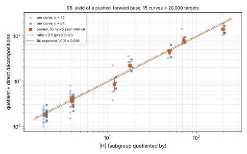
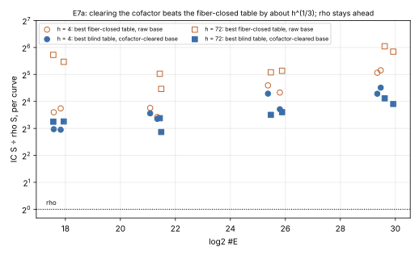

# Round 5: the cofactor penalty is self-inflicted

**Date.** 2026-10-12 (E6) and 2026-10-18 (E7).  **Status.**
- E6: 112 arm records on 15 curves, every decomposition lifted back and
  checked.
- E7: three audited `ecbench` sessions, 992 records, all verified, 12
  replays reproduced per audit.

**Result class.**
- E6 is a stage diagnostic: yield and F4 cost per system.
- E7 is whole-method cold cost against matched rho, one target per run,
  plus relation-phase engineering on binary curves.

No deployed-curve claim, no key recovery.  The protocol
([`PROTOCOL.md`](PROTOCOL.md)) froze E6 before it ran.  E7's section was
added after reading E6 and before E7 ran.  PDF: [`report.pdf`](report.pdf).

Earlier rounds:
- [1](../isogeny_conductor_gap_ic_20261010/README.md);
- [2](../isogeny_conductor_gap_round2_20261011/README.md);
- [3](../isogeny_conductor_gap_round3_20261011/README.md), whose finding 1
  this round corrects;
- [the scaling study](../fiber_ic_scaling_20261011/README.md).

## Findings

1. **Round 3 overstated its 2-torsion quotient gain, and the real lever is
   yield (E6).**
   - Round 3's direct system used an `H`-stable base whose orbits collapse
     to one column each after the `[h]` projection.  At matched columns the
     two systems are the same size.
   - What a quotient buys is yield.  An arbitrary base pushed forward to
     `E/H` can lose columns through image collisions; every image lies in
     an index-`|H|` subgroup with the target. Five of the 112 recorded arms
     have one fewer column than requested, as detailed below.
   - Decompositions per target grew as `|H|^{1.001 ± 0.036}` over
     `|H| = 2` to 200, with 0 lift failures in 112 arms on 15 curves.
   - F4 cost is unchanged on targets with no solution.  Targets with a
     solution cost 3–10× more to solve.
2. **Any base inside the targets' subgroup gets that yield, so rounds 1–2's
   fiber-closed tables were reclaiming a self-inflicted penalty (E7a).**
   - Pair tables over small abscissae spread their sums over all of
     `E(F_p)`.  Clearing the cofactor (`[h]P` for the same small-abscissa
     points) keeps every sum in `E[r]`.
   - On the 16 round-4 curves, the cheapest cleared-base arm costs 0.705×
     the cheapest fiber-closed arm at `h = 4` and 0.275× at `h = 72`.  The
     prediction was `h^{−1/3}` (0.63 and 0.24), within a factor of 1.5.
   - The study's best cell is now 7.3× rho (`h = 72`, 22 bits,
     `icv1-fp22-tm1504-967cbbde`).  The previous best was 8.4×.
3. **Rho stays ahead, and the gap still widens.**
   - The slope of `log₂(IC/rho)` on `log₂ #E` is 0.122 [0.081, 0.163] at
     `h = 4` and 0.068 [0.022, 0.114] at `h = 72`.  Both are above 0 and
     below the derived 1/6.
   - In this window fixed costs dominate small sizes (cofactor clearing,
     linear algebra, verification), and rho's own `S` falls toward its
     constant.
   - Relations per run grow with the base (about 0.55 `B`), so the
     relation phase is the `r^{2/3}` one the derivation uses.  No crossover
     is in sight.
4. **On binary curves the same lever is the trace-zero subspace, and it
   helps only where solving does not get dearer (E7b).**
   - A point of `y² + xy = x³ + ax² + b` is in `2E` iff `Tr(x) = Tr(a)`.
     With `Tr(a) = 0`, a subspace inside `ker Tr` puts every base point in
     `2E`.
   - This is known in the repository: `koblitz_factor_base_search` ranks
     trace-zero bases because they "yield twice for nothing", and
     `research/isogeny_fibers_20261010` found the quotient base dominated
     by the trace-zero base.  `ecbench`'s generic `binary-subspace` base
     did not use it until now.
   - On the a = 0 Koblitz curves:
     - over F_2^23, yield rose 1.94× [1.77, 2.14] and F4 work per relation
       fell 1.39×;
     - over F_2^19, yield rose only 1.48× [1.37, 1.60] and F4 work per
       relation rose 1.15× (ratio 0.87), because each trace-kernel system
       cost 1.7× more to solve.
   - The maximum solving degree stayed 3.

## E6. Pushed-forward base, yield at matched columns

The requested column counts are matched; the realized counts differ in
five of the 112 arm records. For the h = 72 floor, the E[h] quotient has
63 columns at c = 64. For the h = 50 crater, both the C2 and E[h]
quotients have 31 columns at c = 32 and 63 at c = 64. The direct arms
retain 32 or 64 columns. These image collisions mean the pooled yield
ratios and exponent below are not a strictly equal-column comparison in
every arm. The original counts, ratios, fit and lift checks are retained;
see the `columns` entries in [`TABLES.md`](TABLES.md) and the run report's
F4 discussion. No adjusted fit or new experiment is claimed here.



| subgroup | \|H\| | cases | quotient ÷ direct | 95 % interval |
|:--|--:|--:|--:|:--|
| C2 | 2 | 30 | 1.81 | 1.64 to 1.99 |
| C4 | 4 | 16 | 4.08 | 3.52 to 4.75 |
| E[2] | 4 | 6 | 3.57 | 2.76 to 4.60 |
| E[h] | 12 | 6 | 8.43 | 6.00 to 11.86 |
| E[h] | 18 | 6 | 21.87 | 17.70 to 27.01 |
| E[h] | 50 | 6 | 44.07 | 39.24 to 49.50 |
| E[h] | 72 | 6 | 79.57 | 67.54 to 93.73 |
| E[h] | 200 | 6 | 139.39 | 103.62 to 187.50 |

**P-E6.**
- As stated, "each interval contains `|H|`", it holds in 4 of 8 rows.  The
  ratios run from 70 to 121 percent of `|H|`.
- The exponent fit, 1.001 ± 0.036, confirms the mechanism.
- The scatter exceeds Poisson noise.  The bases are the smallest abscissae
  rather than random points, so their sums need not be equidistributed
  over cosets.
- Run report: [`run-20261012T0228Z`](reports/run-20261012T0228Z/README.md).

## E7a. Cofactor-cleared base against the fiber-closed table



The table gives per-curve best arms, as `S` and its ratio to rho, from
[`TABLES_E7.md`](TABLES_E7.md):

| h | bits | best closed ÷ rho | best cleared ÷ rho | cleared ÷ closed |
|--:|--:|:--|:--|:--|
| 4 | 18 | 12.1, 13.4 | **7.8, 7.7** | 0.65, 0.58 |
| 4 | 22 | 10.7, 13.5 | 10.2, 11.8 | 0.95, 0.87 |
| 4 | 26 | 24.2, 20.1 | 19.6, 13.1 | 0.81, 0.65 |
| 4 | 30 | 33.5, 35.6 | 19.5, 22.8 | 0.58, 0.64 |
| 72 | 18 | 44.3, 53.0 | 9.6, 9.5 | 0.22, 0.18 |
| 72 | 22 | 22.1, 32.6 | **7.3**, 10.4 | 0.33, 0.32 |
| 72 | 26 | 33.8, 35.2 | 11.3, 12.1 | 0.33, 0.35 |
| 72 | 30 | 57.6, 66.0 | 15.0, 17.3 | 0.26, 0.26 |

- **P-E7a, cleared ÷ closed ≈ `h^{−1/3}`: holds.**  The geometric means
  are 0.705 and 0.275, against 0.63 and 0.24.
- **P-E7a, slope 1/6: fails as stated.**  It measured 0.122 and 0.068,
  both above 0, so the ratio grows more slowly than predicted but still
  grows.
- The cleared base needs no fiber, no closure and no `h`-fold table.  It
  makes the cofactor irrelevant to cost, which is what rounds 1–2 worked
  for.  Those rounds' measurements stand, but their best configurations are
  now dominated.
- Run reports:
  [`run-20261018T1604Z`](reports/run-20261018T1604Z/README.md) (`h = 72`)
  and [`run-20261018T1605Z`](reports/run-20261018T1605Z/README.md)
  (`h = 4`).

## E7b. Trace-kernel subspace base

| curve | yield, trace-kernel ÷ default | F4 ops per relation, default ÷ trace-kernel | S, default ÷ trace-kernel | max degree |
|:--|:--|--:|--:|:--|
| `icv1-f2m19-t797-b6cf2467` | 1.48 [1.37, 1.60] | 0.87 | 1.01 | 3, 3 |
| `icv1-f2m23-t5197-69e76b73` | 1.94 [1.77, 2.14] | 1.39 | 1.41 | 3, 3 |

**P-E7b, results:**
- **Yield ×2, interval containing 2:** holds over F_2^23 and fails over
  F_2^19.
- **F4 work per relation down by 1.6 to 2.5:** fails on both, at 1.39 and
  0.87.
- **Degree unchanged:** holds.

The MITM arms on the same bases had the same yields, with `S` 1.07–1.22×
lower.  Run report: [`run-20261018T1606Z`](reports/run-20261018T1606Z/README.md).

**Unexplained and not tested:** why F_2^19 gains only 1.48×.  One
candidate is that the default base already leans toward `2E`.  Point
existence over `x` (`Tr(x + a + b/x²) = 0`) is not independent of `Tr(x)`.
The fraction of default base points in `2E` was not measured.

## §5a pricing band

Every E7 session was priced with `ecbench band --weights 0,0.1,1`
(unpriced native work at 0, 0.1 and 1 GAE per operation, rho included).
Outputs: `sessions/<name>.band.{json,md}`, and the per-curve E7a rows in
[`TABLES_E7.md`](TABLES_E7.md).

- **E7a.** The cleared base is cheaper than the best fiber-closed arm on
  every curve at every weight (cleared ÷ closed 0.18–0.97).  Cleared ÷ rho
  spans 7.1–27 across the band; the best cell is 7.06–7.29× rho on
  `icv1-fp22-tm1504-967cbbde`.  Rho is cheaper than every IC arm at every
  weight.
- **E7b.**
  - Trace-kernel MITM is cheaper than default MITM on both curves at every
    weight.
  - Trace-kernel F4 is cheaper than default F4 over F_2^23.  Over F_2^19 the
    pair is unresolved inside the band.
  - Once the solver's field operations are priced, every F4 arm is far
    behind rho (by a factor 10⁴–10⁶ at w = 0.1 and 1).  The F4 rows are a
    relation-phase stage measurement, not a competitive method.

## Leads, ranked by the evidence

1. **Solvable systems cost 3–10× more to solve than unsolvable ones.**
   - Evidence: round 3's planted rows, E6 (483k against 146k
     multiplications at degree 32), and E7b (1.4–1.7× per trial once yield
     rises).
   - Every yield lever moves work into the expensive case.
   - Measure where the extra work goes (basis completion after
     consistency, or solution extraction), and try deciding consistency
     first, extracting solutions only for consistent systems.  The
     recorded systems are enough to start.
   - Highest value: it multiplies with every yield lever above.
2. **Trace-kernel bases with `Tr(a) = 1` (the a = 1 Koblitz curves, h = 2)
   need an affine subspace `x₀ + ⟨v⟩`.**
   - The descent takes a linear basis.  An affine offset in
     `pq_descent_symbolic::descend` would extend E7b to the curves where it
     buys the whole cofactor.
3. **Map where the trace-kernel lever pays.**  Sweep `n` = 17–29 and the
   subspace dimension 8–10, and measure the default base's `2E` fraction to
   test the F_2^19 explanation.
4. **Close the prime-field pair-table line.**
   - With the cofactor cleared, what remains is a generic method at 7–17×
     rho, with a ratio that widens with size.
   - Its online phase sits on the non-adaptive preprocessing bound
     (`S·T ≈ N`; see `research/lit2026_w3_ggm_audit_20261011/`).
   - No lever measured in rounds 1–5 changes the exponent.
5. **Rounds 1–2 should read as dominated.**  Their fiber-closed and
   partial-fiber configurations are beaten by the cleared base (E7a).  A
   note to that effect is added to round 2's README in this change.

## Graphs checked

- **Scoreboard:** a round-5 panel and a progress point at 7.29× rho, the
  best cell.
- **Progress timeline:** the same point.
- **Lab browser:** regenerated; its session glob already covers this
  directory.
- **Leaderboard:** regenerated.
- **Round 4 figure:** unchanged.  Its question was the fiber-closed table's
  scaling, which this round does not alter.

## Reproduce

```bash
cargo build --release --bin ecbench --example isogeny_gap_pushforward_yield \
  --example isogeny_gap_round5_tables --example isogeny_gap_round5_e7_tables
./target/release/examples/isogeny_gap_pushforward_yield \
  --pairs research/isogeny_conductor_gap_ic_20261010/pairs/prime_pairs.json \
  --out research/isogeny_conductor_gap_round5_20261012/e6/records.jsonl
research/isogeny_conductor_gap_round5_20261012/run_sessions.sh
./target/release/examples/isogeny_gap_round5_tables --dir research/isogeny_conductor_gap_round5_20261012 \
  --out research/isogeny_conductor_gap_round5_20261012/TABLES.md --json research/isogeny_conductor_gap_round5_20261012/tables.json
./target/release/examples/isogeny_gap_round5_e7_tables --dir research/isogeny_conductor_gap_round5_20261012 \
  --out research/isogeny_conductor_gap_round5_20261012/TABLES_E7.md --json research/isogeny_conductor_gap_round5_20261012/tables_e7.json
```
