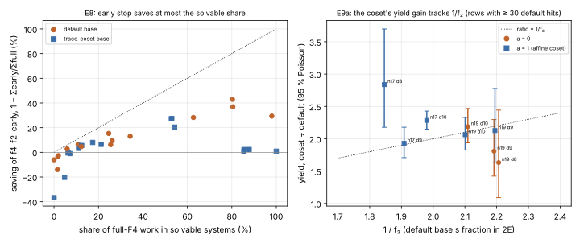

# Run report: E8 and E9a, per-system F4 profile (2026-10-18 17:42–18:15 UTC)

**What ran.** `examples/isogeny_gap_f4_phase_profile.rs` wrote 6,000 S₃
descent systems to `../../e8/records.jsonl`:
- 5 Koblitz curves (a = 1 over F_2^17, F_2^19, F_2^23; a = 0 over F_2^19,
  F_2^23);
- default and trace-coset bases, at d = 8, 9, 10;
- 200 shared targets each.

Every system was solved by full `f4-f2` and by `f4-f2-early` (free = 8).

**Code.** Commit `3360b300d` until 17:55 UTC; from then on the binary with
protocol amendment 1 (`../../e8/commit`).  The amendment's 30-minute
budget never triggered: the longest configuration took 935 s.  The d = 10
coset configuration on F_2^17 was restarted under the amended binary;
its partial first copy is superseded (the tables keep the last copy per
target).

**Host.** Managed Linux x86_64, 4 vCPU.  CI-follow-up builds shared the host
for part of the run.  The work counts are deterministic; only wall times
are affected.

**Read-outs.**  Tables: [`../../TABLES.md`](../../TABLES.md).
- **P-E8b, exactness: holds.** 0 solution-set mismatches in 6,000 systems.
- **P-E8a, solvable ≥ 3× unsolvable: fails.** The ratio is mostly 1.0–2.3,
  and ≥ 3 only on configurations with at most 7 solvable systems.
- **P-E8c, early ÷ full ≤ 0.5 on solvable systems: fails pooled.** Pooled
  0.94 [0.93, 0.95]; per configuration 0.24–0.99.
- **P-E8d, saving ≤ solvable share: holds on every configuration.**
  - Savings reach 29–43 % where most systems are solvable.
  - Savings are negative (down to −37 %) where almost none are: the
    2⁸-point enumeration costs more than letting F4 reach 1.
- **P-E9a, yield ratio ≈ 1/f₂: holds in 7 of 9 testable rows.**
- **P-E9a, the F_2^19 shortfall explanation: refuted.**  The default base's
  f₂ there is 0.45–0.46, below one half, not above 0.6.
- **P-E9b, a = 1 ratio interval contains 2 or 1/f₂: holds in 7 of 9
  rows.** It fails at F_2^17 d = 8 (2.84) and d = 10 (2.28 [2.15, 2.43]).
- **P-E9c, a = 1 coset F4 work ≥ 1.3× default: holds in 8 of 9 rows.**
  - It is 34–45× where the solving degree rises from 3 to 4: F_2^17 at
    d = 9 and 10, and F_2^19 at d = 10.
  - The rise also happens on the a = 0 curve at F_2^19, d = 10, where the
    coset is linear.  So it is not the affine constant.
