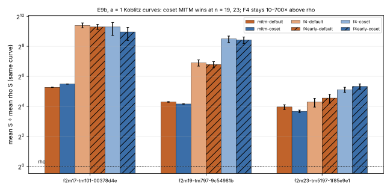

# Run report: E9b, a = 1 Koblitz curves, whole method (2026-10-18 18:15–18:20 UTC)

**Session.** `ECBS1hb4ef3b5d1409` (`../../sessions/e9b_a1`, spec
`../../specs/e9b_a1.json`).
- 168 records, 168 verified.
- Audit OK, 12 replays reproduced (`../../sessions/e9b_a1.audit.json`).
- Isolation earned: L2 on most rho and MITM runs, L1 on most F4 runs (per
  row in `e9b_a1.table.md`).
- **Curves.** a = 1 Koblitz over F_2^17, F_2^19, F_2^23 (h = 2).
- **Measurement.** 4 targets × 2 rounds.
- **Arms.** Rho, plus MITM and the S₃ descent (`f4-f2`, `f4-f2-early`),
  each over the default and the affine trace-coset bases at d = 8.

S in the figure is the record's `cost.s`: the solver is priced at its
pinned word-XOR ratio, and `f4-f2-early` is also charged its extraction.
The band (`e9b_a1.band.md`) prices the remaining native work at 0, 0.1
and 1 GAE per operation.

**P-E9d.**
- **MITM, coset below default across the band: holds at F_2^19 and
  F_2^23, fails at F_2^17.**
  - F_2^19: 28.4 vs 31.2.
  - F_2^23: 14.1 vs 17.3.
  - F_2^17: 71.6 vs 61.6.
- **`f4-f2-early` below `f4-f2` at w = 0.1 and 1: holds on 3 of 6
  (curve, base) pairs.**
  - Holds: coset at F_2^17 and F_2^19; default at F_2^19.
  - The rest are unresolved.
  - At F_2^23, where few systems are solvable, early is the more expensive
    on both bases (E8's negative savings).
- **Every IC arm above rho: holds.**
  - Distance remaining: the best cell is MITM on the coset base over
    F_2^23, at 12.7× rho (14.1 against 1.11).
  - The best F4 cell is the default base over F_2^23, at 19.4× rho.
