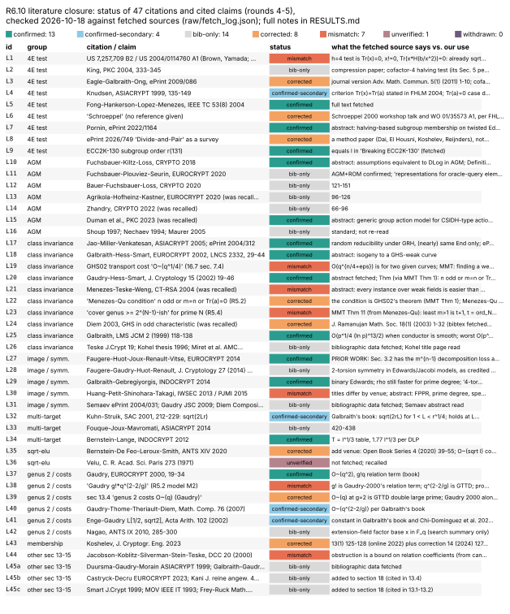

# R6.10: literature closure for rounds 4–5 (2026-10-18)

**Lead.** R6.10 (round 6, wave 1). **Design.** `round6/PROGRAM.md` §R6.10.
**Code.** None. This lead checks citations and writes no Rust. Python was used only to call
two bibliographic APIs (Crossref, Semantic Scholar) and to draw the status table.

## Question

Rounds 4–5 cite some results as "recalled", from "search snippets only", or with no check.
For each citation: is the bibliographic data right? Does the source say what we use it for?
Separately, does earlier work already contain the programme's main stated results?

## Method

* **Inputs.** Every citation in `RESEARCH_ISOGENY_FIBERS_ECDLP.md` §13–§18. The five
  round-4 `RESULTS.md` files that cite literature (16.2, 16.3, 16.5, 16.6, 16.7). R5.2
  (`origin/research/r5-ghs-class`) and R5.4 (`origin/research/r5-theory`), both marked
  "recalled". R5.1 cites nothing. The PROGRAM.md §R6.10 claim list.
* **Bibliographic data.** One Crossref query per reference. The queries are in
  `raw/crossref_queries.txt` and the records in `raw/crossref_hits.jsonl`. For 26 DOIs,
  Semantic Scholar abstracts are in `raw/semanticscholar_hits.jsonl`. Publishers elided many
  of these abstracts.
* **Content.** ePrint abstract pages, plus full texts wherever a PDF could be fetched
  (authors' pages, arXiv, publisher open access). `raw/fetch_log.json` lists every URL whose
  content was read, with what was read and which fetches failed. IACR PDF downloads and
  Springer pages were blocked (HTTP 403 or a login redirect). Downloaded PDFs are not
  committed.
* **Status words** (also used in `claims_status.json`):
  * **confirmed**: bibliographic data comes from a fetched record, and our use matches
    fetched primary text or a fetched abstract.
  * **confirmed (secondary)**: our use matches a fetched secondary source, but the primary
    text was not opened.
  * **bib-only**: the bibliographic data was fetched, but our use was not checked against
    the source. **Our use is unverified.**
  * **corrected**: the reference or its attribution was wrong.
  * **mismatch**: the source says something different from, or narrower than, what we use it
    for.
  * **unverified**: nothing was fetched.
  * **withdrawn**: the citation should be removed.
* A web-search result summary is not a fetched source. Where only such a summary exists, the
  entry says so and the statement is **unverified**.

Commands for the table: `$VENV/bin/python plot_claims_status.py` reads `claims_status.json`
and writes `claims_status.svg`. The report builds with `typst.compile('report.typ')`.

## Verdict

The table has 47 rows (some rows group several references). Bibliographic data was fetched for
46; only Vélu 1971 could not be fetched (unverified). By status: 13 confirmed, 4 confirmed
(secondary), 14 bib-only (our use unverified), 8 corrected, 7 mismatch, 1 unverified,
0 withdrawn. The 8 corrections are missing or wrong bibliographic data in 6 cases (EGO
journal version, Schroeppel, Divide-and-Pair, Diem 2003, the Îlu venue, the Koshelev
correction) and wrong attribution in 2 (the "Menezes–Qu condition", "Õ(q) (Gaudry)").

Four findings change claims we make:

1. **The 4E closed form's stated difference from prior art is wrong.** The patent's
   cofactor-4 test (US 7,257,709) already avoids the square root and does not use y. Our form
   does differ: it needs no inversion. That difference is derived from the two formulas, not
   stated in any source. (L1)
2. **The kernel-saturation penalty and its oracle dependence are anticipated.** Faugère–Huot–
   Joux–Renault–Vitse (EUROCRYPT 2014, §3.2) state the same accounting: a factor base
   invariant under translation by an m-torsion point lowers the decomposition probability by
   m^{n−1}, and needs m times fewer relations. The loss "is more than compensated by the
   improved resolution of the associated polynomial systems". §15.2 and the 16.4/R5.1 "oracle-
   dependent penalty" must cite them. (L27)
3. **The GHS cost exponents in R5.2 mix two sources.** The g! factor is the relation-search
   term of Gaudry 2000, while q^{2−2/g} is the double-large-prime exponent of Gaudry–Thomé–
   Thériault–Diem 2007. Their product, g!·q^{2−2/g}, is R5.2's own model, not a published
   cost. Likewise §13.4's "Õ(q) (Gaudry)" for genus 2 is the GTTD bound; Gaudry 2000 alone
   gives Õ(q²). The Enge–Gaudry constant √2 is confirmed, from two fetched secondary sources.
   (L36–L40)
4. **"Transport is an Õ(q^{1/4}) walk" overstates GHS02.** According to Maurer–Menezes–Teske
   2002, the Galbraith–Hess–Smart algorithm computes an isogeny between two *given* isogenous
   curves in O(q^{n/4+ε}). Finding *which* weak curve is isogenous to a target "may be
   difficult, as one has essentially to search through the entire set" of weak curves. 16.7
   §7.4's remark that "the oracle only removes the walk cost" needs that qualifier. (L19)

The search for earlier versions of our main results (§ "Prior work" below) found:

* **Oracle-dependent saturation penalty:** anticipated (FHJRV 2014).
* **Trace-pair coset label:** nothing found.
* **Isogeny-augmented generic group model:** nothing found that states it for isogenies.
  Related work exists for group actions and for generic models extended by other operations.
* **AGM with point-evaluation isogeny oracles:** nothing found.

## Entries

Each entry gives the status, then the corrected reference where one is needed, then the fetched
URL(s), then what the source says against what we use it for. "Crossref" means the record in
`raw/crossref_hits.jsonl`, fetched from `https://api.crossref.org/works?query.bibliographic=…`.

### A. 4E trace test and cofactor-4 validation (R4 16.2; note §14.3, §16.2, §17.2)

**L1. US 7,257,709 B2 / US 2004/0114760 A1: confirmed, with a mismatch.**
D. R. L. Brown and A. Yamada (Certicom), "Method and apparatus for performing validation of
elliptic curve public keys".
* Dates: priority 2002-09-03 (provisional 60/407,301); filed 2003-09-03; granted 2007-08-14.
  US 2004/0114760 A1 was published 2004-06-17. The listing marks the patent expired.
* URL: https://patents.google.com/patent/US7257709B2/en
* What the source says:
  * For h = 2, the test is Tr(x) = 1 (there Tr(a) = 1), as in claim 3.
  * For h = 4 (Tr(a) = 0), it checks (a) Tr(x) = 0, (b) x ≠ 0, and (c) Tr(x·Hf(b/x²)) = 0,
    which shows that Q has a quarter. Claim 5 covers this case.
  * Claim 17 covers h = 2^k by repeated halving.
* Our use: §17.2 says "This form only folds the half's trace into Tr(y) + Tr(xH(x)), avoiding
  the square root."
* **Mismatch.** The patent's h = 4 test already has no square root and no y. Both tests take
  one half-trace. Ours (1 M, three traces, one half-trace of x) differs because it uses y and
  needs no inversion. The patent's Hf(b/x²) needs 1/x² in affine coordinates. That comparison
  is *derived* from the two formulas and is not stated in either source. Proposed §17.2
  wording: "…appears in US 7,257,709 (priority 2002), whose h = 4 test is Tr(x) = 0, x ≠ 0,
  Tr(x·H(b/x²)) = 0. The form here uses y in place of b/x², which removes the inversion."

**L2. B. King, "A point compression method for elliptic curves defined over GF(2^n)", PKC 2004:
bib-only.**
* Crossref gives pp. 333–345, DOI 10.1007/978-3-540-24632-9_24. The S2 record says DBLP
  conf/pkc/King04. The LNCS volume number was not fetched.
* Fetches failed: the Springer page redirected to a login, the IACR bibtex returned 403, and
  S2 elided the abstract.
* A search-engine summary of the abstract (not fetched) describes a compression method for
  Tr(a₂) = 0. A search-engine snippet of EGO's PDF (not fetched) cites "Section 5 of King" for
  halving and checking Tr(x_Q) = Tr(a₂) when the cofactor is 4.
* **Unverified:** that King states a cofactor-4 validation test. Cite King as a compression
  paper that uses halving when Tr(a₂) = 0, with "§5 not read".

**L3. Eagle–Galbraith–Ong: corrected.** The published version is P. N. J. Eagle,
S. D. Galbraith, J. B. Ong, "Point compression for Koblitz elliptic curves", *Adv. Math.
Commun.* 5(1) (2011) 1–10, DOI 10.3934/amc.2011.5.1 (Crossref). The preprint is ePrint 2009/086.
* URLs: https://eprint.iacr.org/2009/086 (abstract fetched) and
  https://www.math.auckland.ac.nz/~sgal018/Phil-Eagle-Final.pdf (Eagle's PhD thesis, RHUL 2008,
  fetched). The PDF https://eprint.iacr.org/2009/086.pdf returned 403.
* The abstract covers compression in a normal basis and does not mention validation. The
  thesis, Lemma 4.1.15 (credited to Seroussi), says points of odd prime order satisfy
  Tr(x) = Tr(a).
* **Unverified:** the round-4 snippet "for #E = 4ℓ, halve P and check Tr(x_Q) = Tr(a²)". The
  paper text was not read. Tr(a²) = Tr(a), so the two forms agree if the snippet is accurate.

**L4. E. W. Knudsen, "Elliptic scalar multiplication using point halving", ASIACRYPT 1999:
confirmed (secondary).**
* Crossref gives pp. 135–149, DOI 10.1007/978-3-540-48000-6_12. The primary text was not
  opened.
* Fong et al. 2004 (L5, fetched) state "If (x, y) ∈ ⟨G⟩, then Tr(x) = Tr(a)". In their
  setting, halving solves λ̂² + λ̂ = u + a. They write that the Tr(a) = 0 case "is
  comparatively complicated… See [Knudsen], [Schroeppel patent]".
* Our curve y² + xy = x³ + 1 has a = 0, which is exactly that Tr(a) = 0 case.

**L5. K. Fong, D. Hankerson, J. López, A. Menezes, "Field inversion and point halving
revisited", IEEE Trans. Computers 53(8) (2004) 1047–1059: confirmed.**
* DOI 10.1109/TC.2004.43. URL: https://www.ece.uvic.ca/~fayez/research/gf3m/fong_j04.pdf
  (full text).

**L6. "Schroeppel": corrected.** The round-4 text gives no reference. The references in Fong
et al. (fetched) are:
* R. Schroeppel, "Elliptic curve point halving wins big", 2nd Midwest Arithmetical Geometry in
  Cryptography Workshop, Nov. 2000 (a talk).
* R. Schroeppel, "Elliptic curve point ambiguity resolution apparatus and method",
  PCT/US00/31014, WO 01/35573 A1 (2001).

Neither primary was read. A search result shows a US patent 7,200,225 with the same title.
Its link to the WO filing is **unverified**.

**L7. T. Pornin, "Point-halving and subgroup membership in twisted Edwards curves", ePrint
2022/1164: confirmed.** URL: https://eprint.iacr.org/2022/1164. The abstract describes halving
for prime-order-subgroup membership, about 2× faster than [ℓ]P on Curve25519.

**L8. ePrint 2026/749 "Divide-and-Pair": corrected.**
* Y. Dai, Y. El Housni, D. Koshelev, K. Reijnders, "Divide-and-Pair: Faster subgroup
  membership testing for elliptic curves". Received 2026-04-16, revised 2026-07-15.
* URL: https://eprint.iacr.org/2026/749
* It is **not a survey**. It is a method and implementation paper that combines Pornin-style
  division with Koshelev-style pairing tests, with implementations for Curve25519, Curve448,
  GC256A, FourQ and Jubjub. It does not name binary curves.

**L9. ECC2K-130 order: confirmed.** "Breaking ECC2K-130" (Bailey et al., 2009) gives
ℓ = 680564733841876926932320129493409985129. That equals r(131) in R4 16.2.
URL: https://www.cryptojedi.org/papers/breaking-20091106.pdf

Added, related, content unverified:
* Antipa, Brown, Menezes, Struik, Vanstone, "Validation of elliptic curve public keys",
  PKC 2003, pp. 211–223 (Crossref).
* T. Pornin, "Efficient and complete formulas for binary curves", ePrint 2022/1325 (abstract
  fetched). It builds prime-order group abstractions over binary curves. Its handling of
  cofactor 4 was not read.

### B. Algebraic group model and oracles (R4 16.7 §3, §10)

**L10. G. Fuchsbauer, E. Kiltz, J. Loss, "The algebraic group model and its applications",
CRYPTO 2018: confirmed.**
* pp. 33–62, DOI 10.1007/978-3-319-96881-0_2 (Crossref). ePrint 2017/620 (abstract fetched):
  https://eprint.iacr.org/2017/620
* The abstract shows CDH, SDH and LRSW equivalent to DLog in the AGM, and tight reductions to
  DLog. That supports "DLP hardness is the assumption reductions end in".
* **Unverified:** that 16.7's Definition 1 extends FKL's own definition. Their definition text
  was not read.

**L11. G. Fuchsbauer, A. Plouviez, Y. Seurin, "Blind Schnorr signatures and signed ElGamal
encryption in the algebraic group model", EUROCRYPT 2020: bib-only.**
* pp. 63–95 (Crossref). ePrint 2019/877 (fetched) confirms they work in "AGM+ROM".
* **Unverified:** that algebraic adversaries must give representations for elements they
  submit to the random oracle. The abstract does not say so.

**L12. B. Bauer, G. Fuchsbauer, J. Loss, "A classification of computational assumptions in
the algebraic group model", CRYPTO 2020, pp. 121–151: bib-only.**

**L13. T. Agrikola, D. Hofheinz, J. Kastner, "On instantiating the algebraic group model from
falsifiable assumptions", EUROCRYPT 2020, pp. 96–126: bib-only.** The bibliographic data is
confirmed, so it is no longer "recalled".

**L14. M. Zhandry, "To label, or not to label (in generic groups)", CRYPTO 2022, pp. 66–96:
bib-only.** Confirmed bibliographically, so no longer "recalled". The Shoup-versus-Maurer
reading is unverified.

**L15. J. Duman, D. Hartmann, E. Kiltz, S. Kunzweiler, J. Lehmann, D. Riepel, "Generic models
for group actions", PKC 2023, pp. 406–435: confirmed.**
* ePrint 2023/186 (abstract fetched).
* The abstract defines a Generic Group Action Model for actions "such as CSIDH" and a quantum
  algebraic variant. That matches 16.7's statement that it is related but about group actions.
* **Unverified:** whether any of its oracles evaluate isogenies on points. The abstract does
  not say.

**L16. Shoup, EUROCRYPT 1997, pp. 256–266; Nechaev, Math. Notes 55 (1994) 165–172; Maurer,
IMA Cryptography and Coding 2005, pp. 1–12: bib-only** (Crossref).

### C. Isogeny-class invariance and GHS (R4 16.7 §4, §7.4; note §15.4, §17.7; R5.2; R5.4)

**L17. D. Jao, S. D. Miller, R. Venkatesan, "Do all elliptic curves of the same order have
the same difficulty of discrete log?", ASIACRYPT 2005, pp. 21–40: confirmed.**
* DOI 10.1007/11593447_2 (Crossref).
* The ePrint 2004/312 title is different: "Ramanujan graphs and the random reducibility of
  discrete log on isogenous elliptic curves".
* The journal version is "Expander graphs based on GRH with an application to elliptic curve
  cryptography", J. Number Theory 129 (2009) 1491–1504 (Crossref).
* URL: https://eprint.iacr.org/2004/312. The abstract describes polynomial-time random
  reducibility of dlog among curves of the same order, under GRH. The proof "works only for
  curves with (nearly) the same endomorphism rings".
* This matches 16.7 Cor. 4's use ("random reducibility within a level, not to a given E_j").

**L18. S. D. Galbraith, F. Hess, N. P. Smart, "Extending the GHS Weil descent attack",
EUROCRYPT 2002, LNCS 2332, 29–44: confirmed.**
* DOI 10.1007/3-540-46035-7_3. The LNCS volume comes from MMT's reference list.
* URL: https://eprint.iacr.org/2001/054. The abstract says it uses "isogenies to find a new
  elliptic curve for which the GHS attack is effective", transforms the ECDLP to the isogenous
  curve, and improves Galbraith's isogeny algorithm.
* "Weak and non-weak curves coexist in one class" is implied by the abstract. MMT Remark 20
  (L19) states it explicitly: at N = 165, about 2^135 of 2^166 curves are isogenous to one of
  the ≈ 2^57 curves with magic number 5. That confirms "GHS applies to some members of an
  isogeny class and not others".

**L19. "In GHS02 the transport … at a cost they estimate as Õ(q^{1/4})" (16.7 §7.4): mismatch.**
* M. Maurer, A. Menezes, E. Teske, "Analysis of the GHS Weil descent attack on the ECDLP over
  characteristic two finite fields of composite degree", LMS J. Comput. Math. 5 (2002)
  127–174, DOI 10.1112/S1461157000000723. Full text fetched from Cambridge open access (URL in
  the fetch log).
* Remark 20 says GHS02 give "an algorithm with expected average running time of O(q^{n/4+ε})
  for explicitly computing an isogeny between two isogenous elliptic curve[s] over F_{q^n}".
  It then adds that "finding a curve with m = 5 isogenous to a given elliptic curve … may be
  difficult, as one has essentially to search through the entire set of 2^57 curves".
* So the Õ(q^{1/4}) (with q = |F_{q^n}|) is the cost between *given* endpoints. 16.7's
  "the oracle only removes the walk cost" holds only once the weak target is known.

**L20. P. Gaudry, F. Hess, N. P. Smart, "Constructive and destructive facets of Weil descent
on elliptic curves", J. Cryptology 15 (2002) 19–46: confirmed.**
* DOI 10.1007/s00145-001-0011-x. Abstract via S2.
* MMT Theorem 1 (fetched) states the GHS theorem: E: y² + xy = x³ + ax² + b over F_{q^n}, the
  magic number m(b), and the condition "n is odd, or m(b) = n, or Tr_{K/F₂}(a) = 0". It gives
  genus 2^{m−1} or 2^{m−1} − 1.
* This matches the formula in R5.2 §2 and R5.4's magic-number row.

**L21. A. Menezes, E. Teske, A. Weng, "Weak fields for ECC", CT-RSA 2004, pp. 366–386: no
longer "recalled", but a mismatch.**
* DOI 10.1007/978-3-540-24660-2_28 (Crossref). ePrint 2003/128 (abstract fetched).
* The abstract argues that for some fields (e.g. F_{2^210}) "any instance" of the ECDLP can be
  solved faster than rho on the hardest instances. The abstract names neither GHS nor
  isogeny classes.
* 16.7 §10 paraphrases it as "which composite-degree binary fields have many GHS-weak
  classes". That is not what the abstract says, and the method is **unverified**. Use the
  abstract's statement.

**L22. "Menezes–Qu condition: n odd, or m = n, or Tr(a) = 0" (R5.2 §2): corrected.** That
condition is in GHS02's theorem (MMT Theorem 1, credited to [GHS02]). MMT Lemma 6 weakens it to
"n odd, or j₀ = 2^e, or Tr(a) = 0".
* A. Menezes, M. Qu, "Analysis of the Weil descent attack of Gaudry, Hess and Smart",
  CT-RSA 2001, LNCS 2020, 308–318. The volume and pages come from MMT's references; the tech
  report CORR 2000-48 was fetched.
* Menezes–Qu analyse prime n and the magic-number structure (MMT Theorems 5 and 11 cite them).
  R5.2's "m = m′ + [f(1) ≠ 0] (MQ form)" is **unverified**.

**L23. "F_{2^N}, N prime: cover genus ≥ 2^{N−1}-ish" (R5.4 field table): mismatch.** MMT
Theorem 11, citing Menezes–Qu, states it for n an odd prime and t the order of 2 mod n. The
smallest admissible m(b) > 1 is t + 1, and the curves with that m are explicitly counted
(q^s(q^t − 1) values of b). So the least genus is about 2^t. That is governed by ord_n(2), not
by 2^{n−1}. Over F_{2^N} with q = 2, n = N, and ord_N(2) can be far below N − 1. R5.4's
conclusion ("GHS useless" for prime N at cryptographic sizes) is Menezes–Qu's. The genus bound
should be restated with t.

**L24. "Diem 2003 (GHS odd characteristic)": corrected.** C. Diem, "The GHS attack in odd
characteristic", J. Ramanujan Math. Soc. 18(1) (2003) 1–32. The bibtex was fetched from
https://cr.yp.to/bib/2003/diem-ghs.bibtex. Its content was not read, so R5.4's use is
**unverified**.

**L25. S. D. Galbraith, "Constructing isogenies between elliptic curves over finite fields",
LMS J. Comput. Math. 2 (1999) 118–138: confirmed.**
* URL: https://www.math.auckland.ac.nz/~sgal018/iso.pdf
* The paper covers ordinary curves over F_p. When the conductor is O(ln p)-smooth, the
  expected time is O(p^{1/4}(ln p)^{13/2}). The worst case is O(p^{3/2}). It is polynomial when
  the class number is small.
* 16.7 Cor. 4 (horizontal classes, Õ(q^{1/4})) matches for prime fields. For F_{q^n}, use
  GHS02's O(q^{n/4+ε}) (L19).

**L26. Bibliographic data fetched (bib-only):**
* E. Teske, "An elliptic curve trapdoor system", J. Cryptology 19 (2006) 115–133.
* D. Kohel, *Endomorphism rings of elliptic curves over finite fields*, PhD thesis,
  UC Berkeley, Fall 1996. Title page fetched from
  https://www.i2m.univ-amu.fr/perso/david.kohel/pub/thesis.pdf
* J. Miret, R. Moreno, D. Sadornil, J. Tena, M. Valls, Appl. Math. Comput. 176 (2006) 739–750.

### D. Images, pullbacks and symmetrised summation polynomials (note §14–§15; R5.4 §9)

**L27. J.-C. Faugère, L. Huot, A. Joux, G. Renault, V. Vitse, "Symmetrized summation
polynomials: using small order torsion points to speed up elliptic curve index calculus",
EUROCRYPT 2014, pp. 40–57: confirmed, and prior work for our results.**
* DOI 10.1007/978-3-642-55220-5_3. Full text:
  https://www-fourier.univ-grenoble-alpes.fr/~viva/research/articles/Semaev2torsion.pdf
* §3.2 ("Reducing the factor base") makes three statements:
  * the factor base {P : φ(P) ∈ P¹(F_q)} is invariant under translation by T of order m;
  * one needs only #F/m relations, and the linear algebra is m² faster;
  * "this decreases the probability that a random point R decomposes by a factor m^{n−1} …
    but this is more than compensated by the improved resolution of the associated polynomial
    systems".
* §3.1 says that if the induced homography does not have order m, then "ϕ can be factorized
  through an isogeny". That is the quotient-coordinate case.
* In their accounting, the relation-search cost of a T-saturated base changes by
  m^{n−1}/m = m^{n−2} at fixed oracle. That is *derived* here, and it is the |M|^{m−2} of our
  Prop. 15.2.
* Their compensation statement is the qualitative form of our "penalty is oracle-dependent"
  (16.4; R5.1).
* **Required:** §15.2, §17.4 and any statement of the saturation law must cite FHJRV §3.2. Our
  addition is the exact census and the measured class factors, not the law.

**L28 (added). J.-C. Faugère, P. Gaudry, L. Huot, G. Renault, "Using symmetries in the index
calculus for elliptic curves discrete logarithm", J. Cryptology 27 (2014) 595–635.**
* DOI 10.1007/s00145-013-9158-5 (Crossref). FHJRV (fetched) credits it with the 2-torsion
  symmetry for Edwards and Jacobi models.
* Status: bib-only (its text was not read).

**L29. S. D. Galbraith, S. W. Gebregiyorgis, "Summation polynomial algorithms for elliptic
curves in characteristic two", INDOCRYPT 2014, pp. 409–427; ePrint 2014/806: confirmed.**
* URL: https://eprint.iacr.org/2014/806. The abstract covers binary Edwards curves, variables
  invariant under a large group, and a symmetry-breaking factor base. It concludes that "Pollard
  rho is still much faster" for prime-degree extensions.
* R5.4 recalls "binary Edwards models and 4-torsion". Binary Edwards is confirmed; 4-torsion is
  **unverified**.

**L30. Y.-J. Huang, C. Petit, N. Shinohara, T. Takagi: mismatch in R5.4's recollection.**
* There are two versions:
  * IWSEC 2013, "Improvement of Faugère et al.'s method to solve ECDLP", pp. 115–132,
    DOI 10.1007/978-3-642-41383-4_8;
  * Pacific J. Math. Ind. 7 (2015), "Improvement of FPPR method to solve ECDLP",
    DOI 10.1186/s40736-015-0012-6.
* The abstract (fetched via S2) describes symmetrisation for prime-degree binary fields, by
  specialising the FPPR factor base. It says nothing about Edwards models or 4-torsion. R5.4
  attaches "binary Edwards and 4-torsion" to both papers; for HPST that is **unverified**.
* §18's entry is right, but should give the IWSEC title.

**L31. Bibliographic data fetched (bib-only):**
* I. Semaev, ePrint 2004/031 (abstract fetched).
* P. Gaudry, J. Symb. Comput. 44 (2009) 1690–1702. Galbraith's book (fetched) gives its
  double-large-prime cost as Õ(q^{2−2/n}).
* C. Diem, Compositio Math. 147 (2011) 75–104.
* E. Gorla, M. Massierer, Adv. Math. Commun. 9 (2015) 515–539.
* Added for context: Faugère–Perret–Petit–Renault (FPPR), EUROCRYPT 2012, pp. 27–44.

### E. Multi-target rho (R4 16.5; note §14.5, §17.5)

**L32. F. Kuhn, R. Struik, "Random walks revisited: extensions of Pollard's rho algorithm for
computing multiple discrete logarithms", SAC 2001, pp. 212–229: confirmed (secondary).**
* DOI 10.1007/3-540-45537-X_17 (Crossref). S2 mislabels the venue "ACM Symposium on Applied
  Computing"; it is Selected Areas in Cryptography.
* Galbraith, *Mathematics of Public Key Cryptography*, ch. 14, fetched from
  https://www.math.auckland.ac.nz/~sgal018/crypto-book/ch14.pdf, says:
  * "Kuhn and Struik propose and analyse a method to solve all L instances … in roughly
    √(2rL) group operations", for 1 < L < r^{1/4}, using the Silverman–Stapleton re-writing
    trick;
  * "the expected number of samples … until k > 1 collisions are found is approximately
    √(2kN)… Theorem 1 of [Kuhn–Struik]".
* R4 16.5's reference Σ_{i<L} C(2i,i)4^{−i}√(π/2) → √(2L) (in units of √r) is consistent with
  that. The condition L < r^{1/4} holds in every cell of 16.5: L ≤ 64 and r^{1/4} ≥ 2^{7.2}
  (derived).

**L33. P.-A. Fouque, A. Joux, C. Mavromati, "Multi-user collisions: applications to discrete
logarithm, Even-Mansour and PRINCE", ASIACRYPT 2014, pp. 420–438: bib-only.**

**L34. D. J. Bernstein, T. Lange, "Computing small discrete logarithms faster", INDOCRYPT
2012, pp. 317–338: confirmed.**
* URL: https://cr.yp.to/dlog/cuberoot-20120919.pdf
* In a group of order ℓ, a table of size ℓ^{1/3} costs 1.24·ℓ^{2/3} multiplications to build.
  After that, each DLP costs 1.77·ℓ^{1/3}.
* This supports §13.6's class-wide table, since the table amortises across the class once the
  targets are transported.

### F. √élu and Vélu (note §13.1, §17.3; R4 16.3, 16.7)

**L35. D. J. Bernstein, L. De Feo, A. Leroux, B. Smith, "Faster computation of isogenies of
large prime degree": corrected (venue detail added).**
* Proceedings of ANTS XIV, Open Book Series 4 (MSP, 2020) 39–55, DOI 10.2140/obs.2020.4.39
  (Crossref).
* The abstract (S2) gives Õ(√ℓ) F_q-operations for the codomain and for evaluation, versus
  Õ(ℓ) for Vélu. That matches the use.

**L36. J. Vélu, "Isogénies entre courbes elliptiques", C. R. Acad. Sci. Paris Sér. A 273
(1971): unverified.** Nothing was fetched. It is cited as recalled standard knowledge.

### G. Genus 2, Gaudry and GHS costs (R4 16.6; note §13.4; R5.2; R5.4 Prop. 4)

**L37. P. Gaudry, "An algorithm for solving the discrete log problem on hyperelliptic
curves", EUROCRYPT 2000, pp. 19–34: confirmed.**
* DOI 10.1007/3-540-45539-6_2. The abstract (S2) says it is faster than rho for genus greater
  than 4.
* Galbraith's book ch. 15 (fetched, §15.6.3) gives the smoothness probability 1/g!, a
  relation-generation term c₁g²g!q, linear algebra c₂g³q², and overall Õ(q²).

**L38. "Gaudry's g!·q^{2−2/g}" (R5.2 model M2): mismatch.**
* The g! factor belongs to Gaudry 2000's relation-generation term (g!·q).
* q^{2−2/g} is the double-large-prime exponent of Gaudry–Thomé–Thériault–Diem.
* The product g!·q^{2−2/g} is R5.2's own model and should be labelled as such. "Gaudry's" is
  the wrong attribution for it. R5.2's M1 (q^{2−2/g}, "Gaudry/GTTD") is correctly attributed
  to GTTD.

**L39. Note §13.4, "index calculus on genus 2 over F_q costs Õ(q) (Gaudry)": corrected.**
* Õ(q) at g = 2 is the GTTD bound q^{2−2/g}.
* Gaudry 2000 alone gives Õ(q²) for fixed g.
* Thériault's single-large-prime variant gives q^{2−2/(g+1/2)}. That is **recalled**, not
  fetched; the bibliographic data for Thériault, ASIACRYPT 2003, pp. 75–92, was fetched.

**L40. P. Gaudry, E. Thomé, N. Thériault, C. Diem, "A double large prime variation for small
genus hyperelliptic index calculus", Math. Comp. 76 (2007) 475–492: confirmed (secondary).**
* DOI 10.1090/S0025-5718-06-01900-4. The abstract was fetched.
* Õ(q^{2−2/g}) for fixed g is stated in Galbraith's book (§15.6.3). The abstract does not
  state the exponent.

**L41. A. Enge, P. Gaudry, "A general framework for subexponential discrete logarithm
algorithms", Acta Arith. 102 (2002) 83–103: confirmed (secondary).**
* The abstract (S2) has no constant.
* Two fetched sources state L_{q^g}[1/2, √2 + o(1)] for hyperelliptic curves of large genus:
  * Galbraith's book §15.9.2: "complexity L_{q^g}(1/2, √2 + o(1))";
  * Chi-Domínguez, Rodríguez-Henríquez, Smith, arXiv 2106.09967 (2021), which uses it as the
    GHS weakness criterion.
* R5.2's model P uses that constant. Its regime (g large relative to log q) is the sources'
  regime. Applying it at small g, as R5.2 does at N ≤ 16, is outside that regime. R5.2 §3 already
  flags its literal models M1 and A as degenerate at those sizes.
* Related: A. Enge, Math. Comp. 71 (2002) 729–742 (the provable version, bib-only).

**L42. K. Nagao, "Decomposition attack for the Jacobian of a hyperelliptic curve over an
extension field", ANTS IX (2010), pp. 285–300: bib-only.**
* DOI 10.1007/978-3-642-14518-6_23. The preprint is ePrint 2007/112, titled "Decomposed attack…".
* A search summary of the abstract (not fetched) describes a factor base of points with x ∈ F_q
  over F_{q^n}. 16.6's "Nagao-style, degree-1 base with x in an F_p-subspace of F_{p^n}" fits
  that, but the fit is **unverified**.

### H. Other citations in §13–§15

**L43. D. Koshelev, "Subgroup membership testing on elliptic curves via the Tate pairing":
corrected.**
* J. Cryptogr. Eng. 13(1) (2023) 125–128, published online 2022, DOI 10.1007/s13389-022-00296-9.
* Correction: J. Cryptogr. Eng. 14 (2024) 127–128, DOI 10.1007/s13389-023-00331-3.
* ePrint 2022/037 (abstract fetched): a Tate-pairing membership test that needs at most two
  power-residue symbols when the cofactor is small, and no pairing-friendliness.
* §15.3 reads it as "the connecting class δ(Q) is the Kummer map, computed by a reduced Tate
  pairing". That is our interpretation; it is consistent with the abstract but not stated
  there.

**L44. M. J. Jacobson, N. Koblitz, J. H. Silverman, A. Stein, E. Teske, "Analysis of the xedni
calculus attack", Des. Codes Cryptogr. 20 (2000) 41–64: mismatch (wording).**
* URL: https://pages.cpsc.ucalgary.ca/~jacobs/PDF/xedni.pdf
* The abstract says xedni fails asymptotically "because of an absolute bound on the size of
  the coefficients of a relation satisfied by the lifted points". The body derives that bound
  from canonical heights.
* §15.3 calls this "the height-growth obstruction". It should say "the canonical-height bound
  on dependency coefficients". The step "Isogenies cannot rescue lifting attacks" is our own
  inference, not theirs.

**L45. Bibliographic data fetched (bib-only), added to §18 because §13–§15 cite them:**
* Duursma–Gaudry–Morain, ASIACRYPT 1999, pp. 103–121.
* Galbraith–Gaudry, Des. Codes Cryptogr. 78 (2016) 51–72.
* Castryck–Decru, EUROCRYPT 2023, pp. 423–447.
* E. Kani, "The number of curves of genus two with elliptic differentials", J. reine angew.
  Math. 485 (1997) 93–122.
* Smart, J. Cryptology 12 (1999) 193–196.
* Menezes–Okamoto–Vanstone, IEEE Trans. Inf. Theory 39 (1993) 1639–1646.
* Frey–Rück, Math. Comp. 62 (1994) 865–874.

## Prior work for our main stated results

| Claim | Queries (web search, 2026-10-18) | Result |
|:--|:--|:--|
| Oracle-dependence of the kernel-saturation penalty (§15.2, 16.4, R5.1) | Fetched FHJRV full text; "summation polynomials factor base isogenous curve coordinates isogeny index calculus … translation torsion invariant factor base relation probability" | **Anticipated.** FHJRV EUROCRYPT 2014 §3.2 gives the m^{n−1} decomposition loss, the ÷m relations, and the compensation by easier systems (L27). FGHR J. Cryptology 2014 has the 2-torsion symmetry before that. Nothing found that states the exact μ^{m−2} census or the image-versus-fiber law as such. |
| Trace pair (Tr x, Tr(y + xH(x))) as an E/4E coset label (R6.3) | "binary elliptic curve point trace Tr(x) Tr(y) label cosets E/4E quarter halving Tr(y) cofactor 4 Koblitz"; "POINT COMPRESSION FOR KOBLITZ ELLIPTIC CURVES halve point order 4 trace Tr(a subgroup check"; "point halving binary elliptic curve Tr(x)=Tr(a) halvable Knudsen Schroeppel criterion" | **Nothing found.** The nearest is the x-only h = 4 test of US 7,257,709 (L1). The EGO and King texts were not read (L2, L3). |
| Isogeny-augmented generic group model (Thm 15.1) | "generic group model elliptic curve isogenies lower bound discrete logarithm isogenous Shoup multiple groups homomorphism oracle"; "Rupp Leander Bangerter Dent Sadeghi Sufficient conditions for intractability over black-box groups" | **Nothing found** for isogeny oracles. Related: Duman et al. PKC 2023 (group actions, L15). A. Rupp, G. Leander, E. Bangerter, A. W. Dent, A.-R. Sadeghi, "Sufficient conditions for intractability over black-box groups", ASIACRYPT 2008, pp. 489–505 (Crossref; ePrint 2007/360). It covers generic algorithms with extra operations expressible as polynomial functions; whether that covers scalar maps between groups is **unverified**. |
| AGM with point-evaluation isogeny oracles (16.7) | "algebraic group model isogeny oracle OR isogeny oracles elliptic curve discrete logarithm generic group model isogenous curves" | **Nothing found.** A search summary pointed to an "Algebraic Isogeny Model" in arXiv 2608.01675. The fetched abstract has no such model; it is a curve-model paper. |
| Class-wide multi-target rho through isogeny transport (§14.5, 16.5) | "multi-user discrete logarithm different elliptic curves same isogeny class transport isogeny batch Pollard rho per-user curves security" | **Nothing found** that states it. The ingredients are standard: Kuhn–Struik (L32) and Galbraith's isogeny construction (L25). §13.6 already calls it folklore-level. |

"Nothing found" means these queries returned nothing relevant. It is not a proof that no such
work exists.

## Limits

* No IACR PDF and no Springer page could be fetched. For King (L2), EGO (L3), Knudsen (L4),
  Kuhn–Struik (L32), Nagao (L42) and Menezes–Qu (L22), statements rest on abstracts or on
  secondary sources, as each entry says.
* Crossref matches were accepted only when title and authors agreed. LNCS volume numbers are
  given only where a fetched page printed them: King's 2947 is unverified and is omitted from
  `references_proposed.md`.
* The bibliographic data of the "confident" lists in R4 16.7 §10 and R5.4 was checked only for
  references that §13–§18 also cite.
* No statement about any deployed curve's security is made or checked here.

## Next step

* Apply `references_proposed.md` to §18, and apply the wording fixes:
  * L1 (§17.2 "avoiding the square root" → "avoiding the inversion");
  * L19 (16.7 §7.4 walk cost);
  * L27 (cite FHJRV §3.2 wherever the saturation law or its oracle dependence is stated);
  * L38/L39 (GHS and genus-2 cost attributions);
  * L21–L23 (MTW paraphrase, GHS condition, prime-N genus).
* If anyone wants a primary check of King §5 and EGO's cofactor-4 test, fetch the PDFs from a
  network that IACR and Springer do not block.
