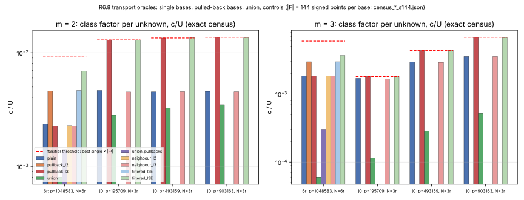
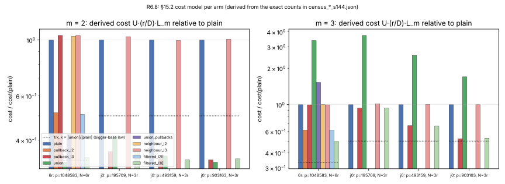

# R6.8 Transport oracles on factor-base points (Proposition 5′)

Round-6 lead R6.8 (PROGRAM.md §R6.8), closing Proposition 5 of round-4 lead
16.7. Toy instances only (p ≈ 2^18–2^20); no sub-rho claim; no statement about
any deployed curve.

## 1. Question, hypothesis, falsifier

*Question.* Does an oracle T_ψ that evaluates an isogeny ψ (and ψ̂) on
arbitrary points, factor-base points in particular, help an index-calculus
attacker beyond the CJ-DLP reduction of Theorem 1 (16.7)?

*Hypothesis (theory).* A transport oracle is worth exactly the union of
pulled-back bases F ∪ ⋃_ψ ψ̂(F′_ψ); by Prop. 3.2 and Thm. 4.2 pullbacks only
grow, so the effect is the image/pullback law of §14 with |F| replaced by at
most (1 + |Ψ|)|F|: a constant, no exponent moves.

*Falsifier (measurement).* On toy classes with 2- and 3-isogeny oracles, a
union-of-pullbacks base whose class factor per unknown exceeds that of the best
single base by more than |Ψ| (exact census, m = 2, 3).

**Outcome in one line.** Proposition 5′ is proved below (exact simulation;
the class-factor bound (5.2) is heuristic as in §14–§15). The falsifier does
**not** fire on any of 16 (curve, size, m) cells: the union's class factor per
unknown is 0.02–0.27 of the best single base (threshold: > |Ψ| = 1 or 2).
Verdict: **confirmed** (hypothesis survives; constant-only effect).

## Part I. Theory: Proposition 5′

### 2. Setting and notation

As in round-4 lead 16.7 §2. F_q is a finite field; E₁, …, E_k are ordinary
curves in one F_q-isogeny class, N = #E_j(F_q) = h·r, r prime, r ∤ h;
G_j = E_j(F_q)[r] with generator P_j; Ψ is a finite set of F_q-rational
isogenies between the E_j, closed under duals, fixed before the instance,
and **r ∤ deg ψ for every ψ ∈ Ψ** (so every λ_ψ is a unit mod r, Lemma 1
of 16.7). J is the set of curves Ψ touches, together with E₁. A spanning
tree 𝒯 of J rooted at E₁ is fixed; γ_j is the tree path E₁ → E_j,
ρ_j := γ̂_j its dual, d_j := deg γ_j = deg ρ_j (prime to r), and the
generators are normalised, P_j := γ_j(P₁), so λ_{γ_j} = 1, λ_{ρ_j} = d_j
(Lemma 2(d) of 16.7). M_j := ker ρ_j ∩ E_j(F_q) is the rational kernel of
the pullback path; |M_j| ≤ d_j and M_j ⊆ E_j(F_q)[h]. e_G := s·h mod N with
s·h ≡ 1 mod r is the idempotent onto G (Lemma 3 of 16.7). For a finite set
S ⊆ E_j(F_q) write mS for the m-fold sumset, D_m^{G_j}(S) := |mS ∩ G_j|
(distinct m-sums landing in G_j), U(S) := #{±[h]Z : Z ∈ S} \ {O} (the
projected columns), and, for the mitm pipeline of §14.1,
C_m(S) := U(S)·(r / D_m^{G_j}(S))·L_m(S) with L_2 = 1, L_3 = |S|. The
class factor is c_m(S) := D_m^{G_j}(S)·m!/|S|^m.

*Transport is computable* if every ψ ∈ Ψ is given with its kernel, so that
ψ(Z) can be evaluated at cost C_eval(deg ψ) field operations (Vélu, O(ℓ);
√élu, Õ(√ℓ); Cor. 3 of 16.7).

### 3. The model

**Definition 3 (AGM-Iso(Ψ) with transport oracles).** The game of
Definition 1 of 16.7, plus, for every ψ ∈ Ψ, a *transport oracle*
T_ψ that on any Z ∈ E_{s(ψ)}(F_q), with no representation, returns ψ(Z).
Q is the number of transport queries. (This is COM(Ψ) of 16.7 Def. 2; the
new name stresses what Prop. 5(a) proved: on G the oracle is the transport
τ, and off G it is a table.)

**Definition 4 (index-calculus-style attacker).** An attacker A in this
model is *index-calculus-style* (IC) if

* (IC1, bases) before receiving the challenge, as a function of the public
  curve data, Ψ and its own coins, A fixes finite *factor bases*
  F_j ⊆ E_j(F_q) for j ∈ J (some may be empty). Base points are given by
  their coordinates; they have no representation.
* (IC2, formed points) every point A holds is *formed*: a received point
  (P_j, X_j := xP_j, oracle answers), a base point, a sum or negative of
  formed points, a Z/r-multiple of a formed point, or T_ψ of a formed point.
* (IC3, relation finding) A obtains relations only through a
  *decomposition oracle* Dec_m(S, R), where S is a finite set of formed
  points on one curve E_k and R a formed point on E_k; it returns the set
  of all m-multisets of S with sum R (possibly empty). A is charged for
  Dec_m in a cost unit that is non-decreasing in |S| and U(S) and
  non-increasing in D_m^{G_k}(S); C_m(S) above is the instance used in the
  measurements (§15.2 model).
* (IC4, output) x is computed by linear algebra over Z/r from the
  coefficient vectors of the relations after cofactor projection.

Rho, BSGS, kangaroo and the oracle-algebraic adversaries of Theorem 1 are
*not* IC attackers in this sense (they are already handled by Thm 15.1 and
Theorem 1); IC attackers are the index-calculus and summation-polynomial
family of §14–§15, now allowed to carry base points across the class.

A *star* attacker is one whose non-empty bases sit on E₁ and on the
Ψ-neighbours of E₁, and whose transport queries are on base points or
sums of base points of a single base (the case Prop. 5(c) singled out).
Write B := max_j |F_j| and let |Ψ| count the pairs {ψ, ψ̂} out of E₁.

### 4. Two lemmas

**Lemma 4 (canonical form of formed points).** Every formed point Z on
E_k has a representation, maintained by the simulator at O(1) bookkeeping
per operation,

  Z = Σ_{(P, γ)} n_{P,γ}·γ(P) + u·P_k + v·X_k,          (4.1)

where P runs over base points, γ over compositions of elements of Ψ
forming a path from the curve of P to E_k (the empty path included),
n_{P,γ} ∈ Z and u, v ∈ Z/r. Transport acts on (4.1) by
T_ψ(Z) = Σ n_{P,γ}·(ψ∘γ)(P) + λ_ψ·(u·P_{k′} + v·X_{k′}).

*Proof.* Induction over IC2. Received points: (u, v) = (1, 0) or (0, 1), no
base terms. Base points: n_{P,∅} = 1. Sums, negatives, multiples: add the
representations (coefficients of the algebraic part mod r, Lemma 1 of
16.7). Transport: ψ is a homomorphism, so it distributes over the sum; on
the base terms it composes the path; on the algebraic part
ψ(uP_k + vX_k) = λ_ψ(uP_{k′} + vX_{k′}) by Lemma 1 and the normalisation,
exactly the bookkeeping step of Theorem 1. ∎

Write β(Z) := Σ n_{P,γ}·γ(P) for the *base part* of Z. It depends only on
the curve data and A's coins up to the point where A formed it, and A can
form it only through the base points and the oracles; the simulator knows
the pair list but, without transport, can compute β(Z) only if it can
evaluate the paths γ on base points.

**Lemma 5 (relations transport to E₁ with known coefficients, and
pullbacks only grow).** Let S ⊆ E_k(F_q) be a finite set of formed points,
R ∈ E_k(F_q) formed, and S* := ρ_k(S) \ {O} ⊆ E₁(F_q), R* := ρ_k(R).
(a) *Columns.* ρ_k is injective on G_k, and [h]ρ_k(Z) = ρ_k([h]Z); hence
    U(S*) = U(S), and Z, Z′ ∈ S with ρ_k(Z) = ρ_k(Z′) have the same column
    ([e_G]Z = [e_G]Z′). For every base point P ∈ F_j, the unknown
    ℓ_P := log_{P_j}([e_G]P) satisfies, for any path γ: E_j → E_k,
    [e_G]γ(P) = λ_γ·ℓ_P·P_k with λ_γ a known unit mod r (Lemma 2 of 16.7).
    So a decomposition Σ_i Z_i = R over formed points is, after
    projection by e_G, the linear relation
    Σ_i Σ_{(P,γ)} n^{(i)}_{P,γ} λ_γ ℓ_P ≡ u_R + v_R·x (mod r)
    among the unknowns {ℓ_P : P ∈ ⋃_j F_j} and x, with every coefficient
    known from the canonical forms.
(b) *Pushforward.* If Σ_i Z_i = R then Σ_i ρ_k(Z_i) = R*. Hence
    ρ_k(mS ∩ G_k) ⊆ mS* ∩ G₁ and
    D_m^{G₁}(S*) ≥ D_m^{G_k}(S).                                  (4.2)
(c) *Exact pullback.* Conversely Σ_i ρ_k(Z_i) = R* iff Σ_i Z_i ∈ R + M_k.
    Hence mS* ∩ G₁ = ρ_k((mS + M_k) ∩ ... ) and, exactly,
    D_m^{G₁}(S*) = #{ρ_k(W) : W ∈ mS, ρ_k(W) ≠ O} restricted to G₁
                 = #(ρ_k(mS) ∩ G₁ \ {O});
    in words, the pulled-back set S* decomposes every point of G₁ whose
    ρ_k-fibre (a coset of M_k inside E_k(F_q) = G_k ⊕ E_k(F_q)[h]) meets mS
    anywhere, not only in G_k. The extra decompositions are those with
    Σ Z_i ∈ R + t, t ∈ M_k \ {0}: the twisted factors of Theorem 4.2, and
    each of them is a valid relation in G₁ because [h] kills M_k
    (Prop. 4.1).
(d) *Sizes.* |S|/|M_k| ≤ |S*| ≤ |S|.

*Proof.* (a) ρ_k is F_q-rational of degree prime to r, so ρ_k|_{G_k} is
λ_{ρ_k}·τ_{k1} with λ_{ρ_k} = d_k ≠ 0 (Lemma 1): a bijection G_k → G₁.
Isogenies commute with [h]. If ρ_k(Z) = ρ_k(Z′) then Z − Z′ ∈ M_k ⊆
E_k(F_q)[h], so [e_G] kills the difference. The formula for [e_G]γ(P) is
Lemma 1 applied to [e_G]P ∈ G_j together with the normalisation; the
coefficient λ_γ is the product of the λ_ψ along γ (Lemma 2(a)), each a
unit because r ∤ deg ψ. Summing the canonical forms of the Z_i and
applying [e_G] gives the displayed relation; the right side is
[e_G](u_R P_k + v_R X_k) = (u_R + v_R x)·P_k. (b) ρ_k is a homomorphism.
(c) ρ_k(Σ Z_i − R) = O iff Σ Z_i − R ∈ ker ρ_k ∩ E_k(F_q) = M_k. The
fibre of ρ_k over a point of E₁(F_q) is a coset of M_k; since
M_k ∩ G_k = {O} (r ∤ |M_k|) each coset contains exactly one point of G_k,
so a point of G₁ is decomposable over S* iff some point of its fibre is
an m-sum of S. The twisted sums R + t are the zero set of the
twisted summation polynomials S_m^{E_k, ±t} of Theorem 4.2; for a relation
in G₁ only [h](Σ Z_i) = [h]R matters, and [h]t = O. (d) The fibres of
ρ_k on E_k(F_q) have |M_k| points. ∎

Lemma 5(c) is the counting form of Theorem 4.2 and Theorem 6 of 16.7,
written for the dual direction: *a base pulled back along ρ_k sees every
relation the far base sees, plus the twisted ones, never fewer*. This is
the one place where Theorem 4.2 ("pullbacks only grow") enters; the
degree enters through |M_k| ≤ d_k.

### 5. Proposition 5′

**Proposition 5′ (transport oracles on factor-base points are worth the
pulled-back bases).** Let A be an IC attacker in AGM-Iso(Ψ) with transport
oracles, making Q transport queries, with bases (F_j)_{j∈J}, running in
time T with success probability ε, and suppose transport is computable.
Let Γ be the set of pairs (P, γ) that occur in the canonical forms of A's
formed points with γ non-empty, and

  F* := ⋃_{j∈J} ρ_j(F_j) ∪ {ρ_k(γ(P)) : (P, γ) ∈ Γ, γ ends on E_k} \ {O}
      ⊆ E₁(F_q).

Then there is an IC attacker B **on E₁ alone, with no transport oracle
and no oracle other than Dec_m**, with factor base F*, that solves DLP on
E₁ with probability exactly ε, makes exactly one Dec_m call on E₁ for each
Dec_m call of A, each on a set S* with |S*| ≤ |S|, U(S*) = U(S) and
D_m^{G₁}(S*) ≥ D_m^{G_k}(S) (so each call costs B no more than it costs A
in any cost unit of IC3), and whose additive overhead is

  (|J| − 1 + |Γ|)·max_ψ C_eval(deg ψ) + O(Q·(ℓ + log r))

group and field operations, where ℓ bounds the length of the canonical
forms. The set F* does not depend on the instance (it is a function of the
curves, Ψ and A's coins), and

  |F*| ≤ Σ_j |F_j| + |Γ|.

For a star attacker, Γ ⊆ {(P, ψ) : P ∈ F_{t(ψ)}, ψ ∈ Ψ} ∪ {(P, ψ̂) : P ∈ F₁},
the second kind contributes ρ_{t(ψ)}(ψ̂(P)) = ψ̂ψ(P) = [deg ψ]P, which has
the column of P, and

  F* = F₁ ∪ ⋃_{ψ} ψ̂(F_{t(ψ)}) ∪ (multiples of points of F₁),
  |F*| ≤ (1 + |Ψ|)·B + (number of points of F₁ that A transported).

Dropping the multiples (which add no column and no new relation class)
leaves F* = F₁ ∪ ⋃_ψ ψ̂(F_ψ′) of size at most (1 + |Ψ|)·B: the union of
the pulled-back bases.

*Proof.* B receives (P₁, X₁) and runs A on the curve data, computing the
other generators P_j = γ_j(P₁) and challenges X_j = γ_j(X₁) by |J| − 1
tree evaluations (Cor. 3), and maintaining for every formed point its
canonical form (Lemma 4).

*Transport queries.* On T_ψ(Z) with Z on E_k, B answers
Σ n_{P,γ}(ψ∘γ)(P) + λ_ψ(uP_{k′} + vX_{k′}). The algebraic part costs two
scalar multiplications (Theorem 1). For the base part B needs the points
(ψ∘γ)(P): it evaluates ψ on each γ(P) it has not seen before, one
evaluation per new element of Γ, and keeps a table; afterwards the sum
costs O(ℓ) group operations. The answer equals the real oracle's answer
because ψ is a homomorphism. Every evaluation is of a point that depends
only on the curve data and A's coins, never on x.

*Decomposition queries.* On Dec_m(S, R) on E_k, B forms S* = ρ_k(S) \ {O}
and R* = ρ_k(R) from the canonical forms (ρ_k applied to (4.1) is again a
sum of table entries ρ_k(γ(P)) plus d_k(uP₁ + vX₁); the ρ_k(γ(P)) are
evaluated once each and added to the table and to F*), and calls its own
Dec_m(S*, R*) on E₁. It receives every m-multiset of S* with sum R*. For
each, it lifts every element to a preimage in S (any choice; B holds all
of A's points and the map S → S*), and keeps the lifts whose sum on E_k is
exactly R, computed with the coordinates B holds. By Lemma 5(b) every
genuine decomposition of R over S appears among the lifts, and by (c) the
discarded lifts are exactly the twisted ones. So B returns to A exactly the
set the real Dec_m(S, R) would return; A's view is identical to the real
game, and its output distribution, hence ε, is unchanged. The cost
properties of the call are Lemma 5(a), (b), (d). (B may keep the twisted
decompositions as additional relations in G₁ over F*, by Lemma 5(a) and
Prop. 4.1; this only helps B and does not change A's view.)

*Output.* A outputs x* and B outputs it. A's relations are linear
relations among {ℓ_P} ∪ {x} with known coefficients (Lemma 5(a)); the
unknowns ℓ_{ρ_j(P)} of B's base are d_j·ℓ_P, with d_j a unit mod r, so
B's linear algebra and A's are the same system up to a known diagonal
change of variables.

*Sizes and instance independence.* F* consists of ρ_j(F_j) and ρ_k(γ(P))
for (P, γ) ∈ Γ; the pairs in Γ are determined by A's coins and the public
data (IC1, IC2: x enters formed points only through the algebraic part,
which is not transported as a base term). For a star attacker the paths
are single edges: ψ out of E₁ gives ρ_{t(ψ)}(ψ(P)) = ψ̂ψ(P) = [deg ψ]P for
P ∈ F₁, and ψ̂ into E₁ gives ρ₁ = id, hence ψ̂(P) for P ∈ F_{t(ψ)}. ∎

**Remarks.**

1. *Non-computable transport.* If the kernels of Ψ are not known (a
   conductor gap with a large prime factor, Prop. 3.3), B cannot evaluate
   ρ_k and ψ. The proof still goes through if B is given the finite table
   {γ(P) : P ∈ ⋃F_j, γ a path of length ≤ t} as advice, where t bounds the
   depth of A's transports; the advice has size ≤ |J|·|Ψ|^t·B, depends
   only on the curves and Ψ, and is instance-independent in the sense of
   R5.4's exponent α*. B then solves CJ-DLP_J, as Theorem 1 does, with
   overhead O(Q(ℓ + log r)). Proposition 5′ therefore closes Prop. 5(c) for
   IC attackers in both regimes: *relative to the pulled-back bases*, the
   transport oracle is worth nothing; the pulled-back bases are
   instance-independent data of bounded size.
2. *Where Prop. 3.2 enters.* The simulation replaces a Dec_m call on E_k
   over S by one on E₁ over ρ_k(S). For an enumeration (mitm, pair-table)
   oracle the cost unit depends on |S|, U(S), D_m only, and Lemma 5 makes
   B's call no dearer. For an *algebraic* oracle (Semaev system plus a
   solver) the cost depends on the shape of the system in the base's
   x-coordinates. ρ_k(S) is not an x-interval base on E₁, and by
   Theorem 4.2 the system in E₁'s x-coordinates for the pulled-back
   problem has degree d_k·2^{m−2} per variable instead of 2^{m−2}: the
   pullback of the system is larger, never smaller. So an attacker with an
   algebraic oracle gains nothing by pulling bases back; its best course is
   to run the algebraic oracle on E_k with the native base F_k and the
   transported target X_k, which is the CJ-DLP side (Theorem 1), and
   Prop. 3.2 says that system has the same degree, variable count and
   monomial support (ab ≠ 0) on every member of the class, so its cost per
   call is the same as on E₁ up to the |F_k|/|F₁| yield term. Prop. 3.2 is
   thus what prevents the *choice of curve* from lowering the algebraic
   oracle's cost, and Theorem 4.2 what prevents the *pullback* from doing
   so.
3. *Where the degree enters.* (i) r ∤ deg ψ makes every λ a unit, so the
   pulled-back relations have known non-zero coefficients (Lemma 5(a)).
   (ii) |M_k| ≤ d_k bounds the fibre merging, |S|/d_k ≤ |S*| ≤ |S|
   (Lemma 5(d)). (iii) The image index of a pulled-back base is
   i_ψ̂ := [E₁(F_q) : ψ̂(E_{t(ψ)}(F_q))] = |ker ψ̂ ∩ E_{t(ψ)}(F_q)| ≤
   min(deg ψ, h) (Prop. 2.3(4)); this is the only place where the pulled
   back base can be *better* than a plain one (Corollary 5′.1), and it is
   bounded by the degree and by h. (iv) The simulation overhead is
   (|J| − 1 + |Γ|)·C_eval(deg ψ): the "Q × degree" loss of Prop. 5(b),
   now shown to be attached to instance-independent points, i.e.
   preprocessing in the non-uniform sense.

**Corollary 5′.1 (cost: the affine law with |F| replaced by
(1 + |Ψ|)|F|; heuristic in the class-factor part).** Let A be a star
attacker with bases of size B on E₁ and on each of its |Ψ| neighbours,
transporting each neighbour base back to E₁ (|Γ| ≤ |Ψ|·B), and let B₀ be
the plain attacker on E₁ with base F₁ alone. In the mitm cost model
C_m(S) = U·(r/D_m)·L_m, with F* = F₁ ∪ ⋃_ψ ψ̂(F_ψ′), k := |F*|/|F₁| ≤
1 + |Ψ|:

  C_m(F*) / C_m(F₁) = (U(F*)/U(F₁)) · (c_m(F₁)/c_m(F*)) · k^{−2}.   (5.1)

(5.1) is exact arithmetic (L_3 = |F| contributes k^{m−2}, D_m contributes
k^{−m}). Under the class-factor uniformity heuristic of §14.1 (each
sub-base spread uniformly over the cofactor classes of the image subgroup
it lies in), c_m(F*) is a convex combination of the terms
i_T/|A| over the mixed tuples T of sub-bases, where i_T is the index of
the sum of the image subgroups involved, so

  c_m(F₁) ≤ c_m(F*) ≤ max(c_m(F₁), max_ψ c_m(ψ̂(F_ψ′))) ≤ max_ψ i_ψ̂ / h · h = max_ψ i_ψ̂·c_plain,   (5.2)

and with U(F*) ≈ k·U(F₁) (no column coincidences),

  C_m(F*)/C_m(F₁) ≈ (1/k)·(c_m(F₁)/c_m(F*)) ∈ [1/(k·max_ψ i_ψ̂), 1/k].   (5.3)

So the transport oracle buys at most a factor k·max_ψ i_ψ̂ ≤ (1 + |Ψ|)·h,
of which the factor k is exactly what a k-fold larger plain base on E₁
buys in this model (C_m ∝ 1/k at fixed m, no oracle needed: k·B small-x
points cost k·B square roots), and the factor i_ψ̂ is the image law of
Prop. 14.1(a), available without any oracle by filtering (Prop. 8 of
16.7) at i_ψ̂ candidates per accepted point. Nothing in (5.1)–(5.3)
depends on r: **no exponent moves**; the ratio is a constant bounded by
(1 + |Ψ|)·min(h, max deg ψ).

*Class factor per unknown.* The falsifier of the programme compares
c_m/U across arms. By (5.2) and U(F*) ≥ max_j U(F_j),
(c_m(F*)/U(F*)) / max_single (c_m/U) ≤ 1 under the heuristic, so a
measured value above |Ψ| would contradict (5.2) by a factor |Ψ| or more.

### 6. What Proposition 5′ does not cover

* **Oracles on points that are not formed from base points.** IC2 lets A
  transport only base points, their sums and algebraic points. A point
  chosen from coordinates on the fly (a random point of unknown logarithm,
  a hashed point, a point of a rho walk that is *not* algebraic) is not
  formed, and T_ψ on it is a genuine evaluation that B cannot reproduce
  from the table. Such points cannot serve as relation targets (their
  logarithm is unknown), so the only use is a *double decomposition*: R
  over F_k on E_k and ψ̂(R) over F₁ on E₁ gives a relation among the
  unknowns with no x. Under the uniformity heuristic the probability of a
  double hit is the product of two hit rates, no better than two ordinary
  targets, and the point must still be evaluated; this is the
  isogenous-neighbour portfolio of §14.4, not covered here and expected
  neutral at best.
* **Non-IC attackers.** Anything that is not relation collection over a
  fixed base through Dec_m: generic algorithms (Thm 15.1, Theorem 1),
  attacks that use the transported *coordinates* of a point in a way
  other than as a base element or a target (none is known to this report).
* **The CJ-DLP side.** Transport of the *challenge* is Theorem 1; whether
  DLP on some member of the class is cheaper is Proposition 9 and
  Conjecture 10 / 10′ (R5.4), not this proposition. Proposition 5′ says
  that, on top of the choice of curve, base transport adds nothing beyond
  a (1 + |Ψ|)-fold base.
* **Algebraic oracles over pulled-back bases.** Not an omission but a
  limit of the attacker: by Theorem 4.2 and the linearity barrier of §14.2
  the pulled-back base has no usable x-structure on E₁ (Remark 2).
* **The class-factor bound (5.2) is heuristic**, as every class-factor
  statement of §14–§15 is; it is tested exactly below, on two toy
  families. The exact parts are Lemma 5, Proposition 5′ and (5.1).

## Part II. Measurement

### 7. Commands

```sh
export CARGO_TARGET_DIR=<target> CARGO_BUILD_JOBS=1
cargo +1.98 build --release --example r6_8_transport_oracle
sh research/isogeny_fibers_20261010/round6/r6_8_transport_oracle/run.sh
/path/to/venv/bin/python research/isogeny_fibers_20261010/round6/r6_8_transport_oracle/plot.py
```

(`run.sh` honours `EX_BIN=<built binary>`; the recorded run used the built
binary directly, same arguments, seed 7.) Each census run takes about 1 s
(contended wall time). All counts are exact enumerations; only the 2000
targets of the relation-transport simulation are sampled.

### 8. Instances (measured, recorded in `curve_E` / `neighbours`)

| family | slug | p | N | h | r | isogenies |
|---|---|---|---|---|---|---|
| j0 (§15.2) | icv1-fp18-t857-6ed1b1af | 195709 | 194853 | 3 | 64951 | ℓ = 3, kernel x = 0 |
| j0 | icv1-fp19-tm169-e87dee41 | 493159 | 493329 | 3 | 164443 | ℓ = 3 |
| j0 | icv1-fp20-t1847-1a56b6c7 | 903163 | 901317 | 3 | 300439 | ℓ = 3 |
| 6r | icv1-fp21-t1842-89bf7f00 | 1048583 | 1046742 | 6 | 174457 | ℓ = 2 and ℓ = 3 |

Every isogeny and dual from `isogeny_eval::small_degree` passed 500/500
on-curve, homomorphism, ψ̂ψ = [ℓ] and ψψ̂ = [ℓ] checks (`dual_certified`).
The relation-transport simulation (Proposition 5′ proof, B covering A's
decompositions) held on every sampled target: `B_covers_A` =
`A_hits_on_E'` and `pulled_back_relation_holds` equal on all runs, and the
Theorem 1 simulated answers agreed 2000/2000.

### 9. Falsifier table (measured, exact; c/U = class factor per unknown)

| file | m | |Ψ| | best single | best c/U | union c/U | union/best | union cost / plain cost | fires |
|---|---|---|---|---|---|---|---|---|
| census_j0_p18_s72 | 2 | 1 | pullback_l3 | 0.02737 | 0.0057 | 0.208 | 0.436 | false |
| census_j0_p18_s72 | 3 | 1 | pullback_l3 | 0.0181 | 0.0017 | 0.094 | 1.139 | false |
| census_j0_p19_s72 | 2 | 1 | pullback_l3 | 0.02752 | 0.00739 | 0.268 | 0.316 | false |
| census_j0_p19_s72 | 3 | 1 | pullback_l3 | 0.023 | 0.00339 | 0.147 | 0.642 | false |
| census_j0_p20_s72 | 2 | 1 | pullback_l3 | 0.02761 | 0.00726 | 0.263 | 0.314 | false |
| census_j0_p20_s72 | 3 | 1 | pullback_l3 | 0.02489 | 0.00432 | 0.173 | 0.516 | false |
| census_6r_p20_s72 | 2 | 2 | pullback_l2 | 0.00915 | 0.00172 | 0.188 | 0.305 | false |
| census_6r_p20_s72 | 3 | 2 | pullback_l2 | 0.0087 | 0.00078 | 0.09 | 0.636 | false |
| census_j0_p18_s144 | 2 | 1 | pullback_l3 | 0.01295 | 0.0028 | 0.217 | 0.416 | false |
| census_j0_p18_s144 | 3 | 1 | pullback_l3 | 0.00181 | 0.00011 | 0.063 | 3.733 | false |
| census_j0_p19_s144 | 2 | 1 | pullback_l3 | 0.01347 | 0.00327 | 0.243 | 0.346 | false |
| census_j0_p19_s144 | 3 | 1 | pullback_l3 | 0.00436 | 0.00029 | 0.066 | 2.555 | false |
| census_j0_p20_s144 | 2 | 1 | pullback_l3 | 0.01368 | 0.0035 | 0.256 | 0.327 | false |
| census_j0_p20_s144 | 3 | 1 | pullback_l3 | 0.00679 | 0.00052 | 0.077 | 1.7 | false |
| census_6r_p20_s144 | 2 | 2 | pullback_l2 | 0.00459 | 0.0008 | 0.175 | 0.327 | false |
| census_6r_p20_s144 | 3 | 2 | pullback_l2 | 0.00298 | 6e-05 | 0.02 | 3.39 | false |

### 10. Per-arm census, |F| = 144 (measured counts; c, c/U, cost derived from them)

U = unknowns, D = distinct m-sums in G (exact), rel/target = D/r,
cost = U·(r/D)·L_m (§15.2 model, L_2 = 1, L_3 = |F|).

**census_j0_p20_s144**

| arm | m | |F| | U | D | rel/target | c | c/U | cost |
|---|---|---|---|---|---|---|---|---|
| plain | 2 | 144 | 72 | 3416 | 0.0114 | 0.329 | 0.00458 | 6332 |
| plain | 3 | 144 | 72 | 127266 | 0.4236 | 0.256 | 0.00355 | 24476 |
| neighbour_l3 | 2 | 144 | 72 | 3388 | 0.0113 | 0.327 | 0.00454 | 6385 |
| neighbour_l3 | 3 | 144 | 72 | 127224 | 0.4235 | 0.256 | 0.00355 | 24484 |
| pullback_l3 | 2 | 144 | 72 | 10212 | 0.034 | 0.985 | 0.01368 | 2118 |
| pullback_l3 | 3 | 144 | 72 | 243450 | 0.8103 | 0.489 | 0.00679 | 12795 |
| filtered_l3E | 2 | 144 | 72 | 10118 | 0.0337 | 0.976 | 0.01355 | 2138 |
| filtered_l3E | 3 | 144 | 72 | 240464 | 0.8004 | 0.483 | 0.00671 | 12954 |
| union | 2 | 288 | 144 | 20884 | 0.0695 | 0.504 | 0.0035 | 2072 |
| union | 3 | 288 | 144 | 299418 | 0.9966 | 0.075 | 0.00052 | 41613 |

**census_6r_p20_s144**

| arm | m | |F| | U | D | rel/target | c | c/U | cost |
|---|---|---|---|---|---|---|---|---|
| plain | 2 | 144 | 72 | 1760 | 0.0101 | 0.17 | 0.00236 | 7137 |
| plain | 3 | 144 | 72 | 65710 | 0.3767 | 0.132 | 0.00183 | 27527 |
| neighbour_l2 | 2 | 144 | 72 | 1702 | 0.0098 | 0.164 | 0.00228 | 7380 |
| neighbour_l2 | 3 | 144 | 72 | 65630 | 0.3762 | 0.132 | 0.00183 | 27560 |
| pullback_l2 | 2 | 144 | 72 | 3424 | 0.0196 | 0.33 | 0.00459 | 3668 |
| pullback_l2 | 3 | 144 | 72 | 106776 | 0.612 | 0.215 | 0.00298 | 16940 |
| filtered_l2E | 2 | 144 | 72 | 3478 | 0.0199 | 0.335 | 0.00466 | 3612 |
| filtered_l2E | 3 | 144 | 72 | 106720 | 0.6117 | 0.214 | 0.00298 | 16949 |
| neighbour_l3 | 2 | 144 | 72 | 1688 | 0.0097 | 0.163 | 0.00226 | 7441 |
| neighbour_l3 | 3 | 144 | 72 | 65880 | 0.3776 | 0.132 | 0.00184 | 27456 |
| pullback_l3 | 2 | 144 | 72 | 1688 | 0.0097 | 0.163 | 0.00226 | 7441 |
| pullback_l3 | 3 | 144 | 72 | 65880 | 0.3776 | 0.132 | 0.00184 | 27456 |
| filtered_l3E | 2 | 144 | 72 | 5162 | 0.0296 | 0.498 | 0.00691 | 2433 |
| filtered_l3E | 3 | 144 | 72 | 132134 | 0.7574 | 0.266 | 0.00369 | 13689 |
| union | 2 | 432 | 216 | 16162 | 0.0926 | 0.173 | 0.0008 | 2332 |
| union | 3 | 432 | 216 | 174456 | 1 | 0.013 | 6e-05 | 93313 |
| union_pullbacks | 2 | 288 | 144 | 8354 | 0.0479 | 0.201 | 0.0014 | 3007 |
| union_pullbacks | 3 | 288 | 144 | 171970 | 0.9857 | 0.043 | 0.0003 | 42072 |

The other six files have the same arms; see the JSON.





### 11. Reading

* *Pullbacks grow (Thm 4.2 / Lemma 5(b)), measured.* Every
  `transport_identities` row has D_G(ψ̂(F′)) ≥ D_G′(F′); the growth ratio is
  ≈ 3.0 for ℓ = 3 on j0 and ≈ 2.0 for ℓ = 2 on the 6r curve at m = 2, which
  is the image index i_ψ̂ (Corollary 5′.1(iii)). The 3-isogeny on the 6r
  curve has image index i_ψ̂ = 1 (recorded `dual_image_index_predicted`): its pullback equals
  the plain base statistically (c/U 0.00226 vs 0.00236).
* *The pullback gain is the image law, available without the oracle.* The
  no-oracle control `filtered_lE` (small-x points on E filtered into ℓE(F_p))
  matches `pullback_l` within 2% on j0 (e.g. p20: 0.01355 vs 0.01368 at
  m = 2), and beats it for ℓ = 3 on the 6r curve (0.00691 vs 0.00226),
  where filtering reaches index 3 and the pullback does not.
* *Union.* c/U of the union is below the best single base in every cell
  (ratio 0.02–0.27), so the falsifier does not fire. At m = 2 the union's
  cost is 0.31–0.44 of plain, inside the (5.3) interval [1/(k·i), 1/k]
  (k = 2, i = 3 on j0: [0.167, 0.5]; k = 3, i ≤ 3 on 6r: [0.111, 0.333]).
* *m = 3 saturates.* At |F| = 144, D approaches r for the union
  (e.g. 299418 of r = 300439 on p20), so the class factor collapses and
  the derived cost rises above plain (1.7–3.7×). This is a toy-size effect
  of a base too large for r, not a transport effect; at |F| = 72 the
  saturation is weaker (0.52–1.24×).
* The Lemma 5(c) identity "D_G(pullback) = #non-zero dual images of all
  m-sums" holds exactly on j0 (dual image ⊆ G after cofactor 3) and is
  recorded `false` on the 6r curve, as expected: there the dual images of
  off-G sums need not lie in G (h = 6, i_ψ̂ = 2), and the counter does not
  restrict to G; the restricted identity of Lemma 5(c) is not separately
  counted (limit).

## 12. Verdict

**Confirmed.** Proposition 5′ is proved: an IC attacker with transport
oracles is simulated exactly by a no-oracle IC attacker on E₁ whose base is
the pulled-back union, of size ≤ (1 + |Ψ|)|F|, instance-independent, with
additive overhead linear in deg ψ; no exponent moves. The measurement does not
fire the falsifier (0/16 cells; maximum union/best ratio 0.268 against a
threshold of |Ψ| ≥ 1). The only gains measured are the bigger-base factor k
and the image index i ≤ min(deg ψ, h), both available without any oracle.
No §15.4 row moves.

## 13. Limits

* Toy fields (p ≤ 2^20.1), four curves, one seed, base sizes 72 and 144.
* The class-factor bound (5.2) is heuristic; the census tests it on two
  families only.
* m = 3 at |F| = 144 is near saturation (D ≈ r) and its costs are not
  representative of the asymptotic regime.
* Non-IC attackers, transport of non-formed points, and the CJ-DLP side are
  out of scope (§6).

## 14. Next step

Fold Proposition 5′ into the note's §15.4 discussion of Prop. 5(c) as
closed for IC attackers; the remaining open question is the double-
decomposition use of transport on non-formed points (§6, first bullet),
which is the isogenous-neighbour portfolio of §14.4.

## Files

`examples/r6_8_transport_oracle.rs`, `run.sh`, `census_*.json` (8 raw
records), `plot.py`, `class_factor_per_unknown.svg`, `cost_ratio.svg`,
`report.typ`, `report.pdf`.
